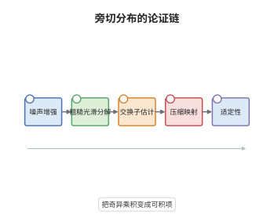

# 遍及理论与受控粗糙路径

> **一句话大白话**：既然解里有一段天生粗糙、无法直接相乘的部分，就把它单独拎出来当作已知的"粗糙项"，剩下的部分更光滑，用交换子估计控制两者耦合，方程就能照常做不动点。
>
> **小例子**：三维 $\Phi^4_3$ 方程的解满足 $u\in C^{-1/2-}$，减去线性解后 $u-u_{\mathrm{lin}}\in C^{1/2-}$；正是这一阶正则性的提升让三次项可以被 Young 型估计吸收。

## 介绍

在奇异随机偏微分方程里，噪声决定了解的最低正则性，线性解往往只是负指标的分布，非线性项因此无法按经典方式相乘。Gubinelli 的受控粗糙路径与 Gubinelli-Imkeller-Perkowski 的旁切分布（paracontrolled distributions）提供了一套统一处理：把解分解为"由噪声线性决定的粗糙项"与"更光滑的修正项"，再用 Bony 的仿积分解和交换子估计把二者的共振部分单独控制。它不依赖树展开，因而比正则性结构更轻，也把"解为什么能被唯一确定"归结为一个可检验的不动点论证。

## 几何直观

图意在说明：噪声先被增强成固定的奇异数据，解被拆成粗糙项与光滑修正。交换子估计把共振耦合变成可积项，最后压缩映射给出唯一解。

## 分析

**前置依赖**：粗糙路径、Littlewood-Paley 分解；补充：Bony 仿积分解、仿微分算子、Hölder-Besov 空间。

**数学内涵**：
- 分解式 $u=u_{\mathrm{lin}}+u^\sharp$ 中，$u_{\mathrm{lin}}=(\partial_t-\Delta)^{-1}\xi$ 承担全部奇异部分，$u^\sharp$ 比 $u$ 高一阶正则性（$\Phi^4_3$ 中 $u\in C^{-1/2-}$、$u^\sharp\in C^{1/2-}$）。
- Bony 分解 $\pi(a,b)=\pi_{<}(a,b)+\pi_{>}(a,b)+R(a,b)$ 把乘积拆成低频乘高频、高频乘低频与共振余项；共振项 $\pi(u,u)$ 只有在增强数据给定时才有定义。
- 交换子估计形如 $\|\pi_{<}(a,f)-\pi_{<}(af,\cdot)\|\lesssim\|\nabla f\|\,\|a\|$，把"粗糙函数乘光滑函数后再求导"的误差压成可积项，这是压缩映射能成立的核心。
- 常见误区：以为只要 $u^\sharp$ 光滑就能直接做乘法。共振项涉及 $u_{\mathrm{lin}}$ 与 $u^\sharp$ 的乘积，不先固定增强噪声就无法定义，必须保留旁切结构。

**结构**：
1. 取线性解作为粗糙项，固定噪声的增强数据。
2. 把方程化为关于 $u^\sharp$ 的方程，展开非线性项并按奇异性分层。
3. 用仿积分解与交换子估计把奇异项变成可积的低阶项。
4. 在 Hölder-Besov 空间中做压缩映射，得到局部唯一解。

## 思考过程

Lyons 的粗糙路径理论解决了"被粗糙信号驱动的微分方程"，但随机偏微分方程里粗糙的不是驱动信号而是解本身，直接套用会卡在乘积上。Gubinelli 在 2004 年前后提出受控粗糙路径：只要把解按参照信号的"导数值"展开，就能定义积分。2015 年 Gubinelli、Imkeller 与 Perkowski 把这套想法搬到抛物 SPDE，用 Littlewood-Paley 分解代替树展开，成功处理了三维 $\Phi^4_3$ 与一维 KPZ。它与 Hairer 的正则性结构在结论上重合，但语言更接近调和分析，适合做"增益估计"这种逐项可查的论证。

## 证明过程

**定理**：考虑三维环面上重正化后的随机量化方程 $\partial_tu=\Delta u-u^3+\xi$。对每个初值 $u_0\in C^{-1/2-}$ 与每个增强噪声实现，存在 $T>0$ 与唯一的 $u\in C([0,T];C^{-1/2-})$，满足 $u-u_{\mathrm{lin}}\in C([0,T];C^{1/2-})$ 且方程在旁切意义下成立；解连续依赖于初值与增强噪声。

**证明**：

### 1. 粗糙项与增强数据

令 $u_{\mathrm{lin}}(t)=\int_0^te^{(t-s)\Delta}\,\mathrm dW(s)$。由热核估计，$\mathbb E\|u_{\mathrm{lin}}\|_{C^{-1/2-}}^p<\infty$，故 $u_{\mathrm{lin}}$ 是负指标分布。把它与它的奇异乘积一起固定为增强噪声，作为后续论证的已知数据，不再参与随机性讨论。

### 2. 化为光滑修正的方程

令 $v=u-u_{\mathrm{lin}}$，则 $v$ 满足

$$
(\partial_t-\Delta)v=-\big(u_{\mathrm{lin}}+v\big)^3=-u_{\mathrm{lin}}^3-3u_{\mathrm{lin}}^2v-3u_{\mathrm{lin}}v^2-v^3 .
$$

右端第一项经重正化后是良定义的分布，第二项包含 $u_{\mathrm{lin}}^2v$ 这一共振耦合：$u_{\mathrm{lin}}^2$ 的期望发散，必须减去反项后才有意义。

### 3. 交换子估计与增益

对 $u_{\mathrm{lin}}^2v$ 作 Bony 分解，

$$
\pi(u_{\mathrm{lin}}^2,v)=\pi_{<}(u_{\mathrm{lin}}^2,v)+\pi_{>}(u_{\mathrm{lin}}^2,v)+R(u_{\mathrm{lin}}^2,v),
$$

其中低频乘高频项用交换子恒等式改写：

$$
\pi_{<}(u_{\mathrm{lin}}^2,v)=\pi_{<}\big(v,u_{\mathrm{lin}}^2\big)+\mathcal C(u_{\mathrm{lin}}^2,v),
$$

其中 $\mathcal C$ 记交换子修正。交换子项满足 $\big\|\mathcal C(u_{\mathrm{lin}}^2,v)\big\|_{C^{-1/2-}}\lesssim\|v\|_{C^{1/2-}}\|u_{\mathrm{lin}}^2\|_{C^{-1-}}$，右端只含已知的增强数据与 $v$ 的范数。于是整个右端落在 $C^{-3/2-}$，比 $v$ 的方程低两阶。

### 4. 不动点

热半群把正则性提高两阶：若 $(\partial_t-\Delta)v=f\in C^{-3/2-}$，则 $v\in C^{1/2-}$ 且 $\|v\|_{C^{1/2-}}\lesssim\|f\|_{C^{-3/2-}}$。因此在球 $\{\|v\|_{C_T^{1/2-}}\le R\}$ 上，右端的立方项满足

$$
\|v^3-w^3\|_{C^{-3/2-}}\le C R^2\|v-w\|_{C^{1/2-}},
$$

取 $T$ 充分小使 $CR^2T^\kappa<1$，映射为压缩，得到唯一不动点。$\square$

## 课堂问答

**老师**：为什么要把解拆成"粗糙项加光滑修正"，而不能直接对整个解做估计？

**学生**：因为解的最低正则性完全由噪声决定，$u$ 与 $u_{\mathrm{lin}}$ 的奇异部分相同，直接估计 $u$ 会把这个已知的奇异结构当成未知量。减去 $u_{\mathrm{lin}}$ 后剩下的 $v$ 高一阶，方程右端也因此落在可积的正则性类里，估计才封闭。

**老师（追问）**：交换子估计到底解决了什么问题？把公式写出来说明。

**学生**：它解决"粗糙乘光滑再求导"时导数落错位置的问题，即 $\pi_{<}(a,f)-\pi_{<}(af,\cdot)$ 的误差。典型估计是 $\big\|\mathcal C(a,f)\big\|_{C^{\alpha}}\lesssim\|\nabla f\|_{L^\infty}\|a\|_{C^{\alpha}}$：导数落在光滑的 $f$ 上，粗糙的 $a$ 只以其所在的正则性类出现。这样共振项就被压成"已知增强数据乘 $v$ 的范数"，可以并入压缩常数。

**老师（拓展）**：这套方法与正则性结构相比，优劣在哪里？

**学生**：旁切分布不需要建立完整的模型空间与重整化群，证明更短、更接近调和分析，适合处理次临界方程如三维 $\Phi^4_3$ 与一维 KPZ。代价是它对每个方程都要手工设计分解与交换子估计，缺乏正则性结构那种"任意次临界方程统一处理"的自动化；对超临界或需要复杂树结构的方程，正则性结构仍更系统。
