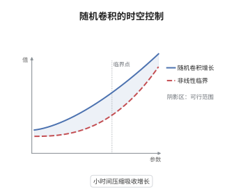

# 随机波动方程与 Strichartz 估计

> **一句话大白话**：波动方程没有平滑效应，靠的是色散把波包摊开；把确定性的 Strichartz 估计搬到随机卷积上，就能像处理确定性方程一样用不动点解出随机波动方程。
>
> **小例子**：取 $d=3$、加性噪声强度 $\epsilon$，随机卷积 $Z(t)=\int_0^t\frac{\sin((t-s)|\nabla|)}{|\nabla|}\,\mathrm dW_s$ 满足 $\mathbb E\|Z\|_{L^4(0,T;L^4)}^2\le C\epsilon^2T$，正是 $L^4_tL^4_x$ 这条容许对给出的控制。

## 介绍

随机波动方程 $\partial_t^2u-\Delta u+u=f(u)+\sigma(u)\xi$ 是双曲型随机偏微分方程的代表。与热方程不同，它没有瞬时平滑，解的正则性完全靠初值与色散估计维持。Strichartz 估计把色散效应量化为时空可积性，允许在不损失导数的前提下控制非线性项；随机版本则要求对随机卷积也给出同样的时空估计。本节说明随机 Strichartz 估计如何得到、Duhamel 公式怎样组装成不动点、以及为什么三维时非线性增长必须低于能量临界指数。

## 几何直观

图意在说明：随机卷积的 Strichartz 范数只随时间多项式增长。非线性项一旦达到临界指数，同样的增长就压不住了，小时间压缩随之失效。

## 分析

**前置依赖**：波动方程、随机卷积；补充：Strichartz 估计、Burkholder-Davis-Gundy 不等式、能量方法。

**数学内涵**：
- Duhamel 公式为 $u(t)=\cos(t|\nabla|)u_0+\frac{\sin(t|\nabla|)}{|\nabla|}u_1+\int_0^t\frac{\sin((t-s)|\nabla|)}{|\nabla|}f(u)\,\mathrm ds+Z(t)$，最后一项是噪声的随机卷积。
- 容许对 $(q,r)$ 满足 $\frac1q+\frac dr=\frac d2-s$ 与 $\frac1q\le\frac{d-1}2\big(\frac12-\frac1r\big)$，Strichartz 估计断言 $\|u\|_{L^qL^r}\lesssim\|u_0\|_{H^s}+\|u_1\|_{H^{s-1}}+\|F\|_{L^{q'}L^{r'}}$。
- 随机卷积的估计由 BDG 不等式加 Minkowski 不等式得到：$\mathbb E\|Z\|_{L^qL^r}^p\le C(T)\|\sigma\|_{L_2}^p$，只按 $T$ 的多项式增长。
- 常见误区：以为噪声能提升正则性。加性噪声的随机卷积与线性解同阶，不能弥补超临界非线性造成的导数损失；这也是三维 $p\ge5$ 时无法用同一框架得到全局解的原因。

**结构**：
1. 对随机卷积建立 Strichartz 型矩估计。
2. 把 Duhamel 公式写成算子方程的固定点形式。
3. 在时空混合范数空间的小球上验证压缩。
4. 用能量估计延拓时间并提升正则性。

## 思考过程

确定性波动方程的 Strichartz 理论在 1970 年代由 Strichartz、Ginibre-Velo 等人建立，核心是色散估计与 $TT^*$ 论证。把噪声放进来后，第一个问题是随机卷积是否满足同样的时空估计：答案是可以，只要在 Itô 等距之外再用 BDG 不等式把上确界换成矩，然后用 Minkowski 不等式把时间积分搬到期望外面。第二个问题是压缩常数：非线性项的 Strichartz 范数按 $\|u\|_{L^qL^r}^p$ 增长，只有在小球上才能压住，因此时间区间要依赖初值范数。三维的临界指数 $p=5$ 恰好使缩放不变，超出后估计失效。

## 证明过程

**定理**：设 $d=2,3$，$\sigma$ 取值于 Hilbert-Schmidt 算子空间且 $\|\sigma\|_{L_2}<\infty$，$f$ 局部 Lipschitz 且 $|f(u)|\le C(1+|u|^p)$，其中 $p$ 在 Strichartz 意义下次临界（$d=3$ 时 $p<5$）。取容许对 $(q,r)$ 与 $s$ 满足 $\frac1q+\frac dr=\frac d2-s$ 与 $\frac1q\le\frac{d-1}2\big(\frac12-\frac1r\big)$。则对任意 $(u_0,u_1)\in H^s\times H^{s-1}$，存在 $T=T(\|u_0\|_{H^s},\|u_1\|_{H^{s-1}},\|\sigma\|_{L_2})>0$ 与唯一解

$$
u\in C([0,T];H^s)\cap L^q(0,T;L^r).
$$

**证明**：

### 1. 随机卷积的 Strichartz 估计

记 $Z(t)=\int_0^tK(t-s)\sigma\,\mathrm dW(s)$，$K(t)=\sin(t|\nabla|)/|\nabla|$。由 BDG 不等式，对 $p\ge2$，

$$
\mathbb E\sup_{t\le T}\|Z(t)\|_{H^s}^p\le C_p\,\mathbb E\Big(\int_0^T\|K(t-s)\sigma\|_{L_2}^2\,\mathrm ds\Big)^{p/2}\le C_p'T^{p/2}\|\sigma\|_{L_2}^p .
$$

再用 Minkowski 不等式把 $L^q_tL^r_x$ 范数移到期望内，并利用 $K$ 的色散估计 $\|K(t)g\|_{L^r}\lesssim t^{-\frac{d-1}2(1-2/r)}\|g\|_{L^{r'}}$（允许有限阶导数损失），得

$$
\mathbb E\|Z\|_{L^q(0,T;L^r)}^p\le C_{p,q,r,T}\|\sigma\|_{L_2}^p .
$$

### 2. Duhamel 公式与固定点

把解写成

$$
u=\cos(t|\nabla|)u_0+K(t)u_1+\int_0^tK(t-s)f(u(s))\,\mathrm ds+Z .
$$

在空间 $X_T=\{u:\ \|u\|_{X_T}<\infty\}$ 上定义范数 $\|u\|_{X_T}=\|u\|_{L^\infty H^s}+\|u\|_{L^qL^r}$，并令 $\Phi$ 为右端映射。确定性 Strichartz 估计给出

$$
\|\Phi(u)\|_{X_T}\le C\big(\|u_0\|_{H^s}+\|u_1\|_{H^{s-1}}+\|f(u)\|_{L^{q'}L^{r'}}+\|Z\|_{X_T}\big).
$$

### 3. 小球上的压缩

取球 $B_R=\{u:\|u\|_{X_T}\le R\}$，$R=2C(\|u_0\|_{H^s}+\|u_1\|_{H^{s-1}}+\|Z\|_{X_T})$。由 $f$ 的增长假设与 Hölder 不等式，

$$
\|f(u)-f(v)\|_{L^{q'}L^{r'}}\le C R^{p-1}T^\kappa\|u-v\|_{X_T},
$$

其中 $\kappa>0$ 来自时空积分的长度。取 $T$ 充分小使 $CR^{p-1}T^\kappa\le1/2$，则 $\Phi$ 是 $B_R$ 上的压缩，得到唯一局部解。

### 4. 正则性与延拓

对能量 $E(t)=\frac12\int(|\partial_tu|^2+|\nabla u|^2+u^2)$ 用 Itô 公式，噪声项由 Hilbert-Schmidt 性给出可积修正。若 $f$ 是聚焦型且能量次临界，$E(t)$ 被初值与噪声强度一致控制，于是解可按 $T$ 分段延拓为全局解；一般情形只断言局部适定性与爆破准则 $\|u\|_{X_T}\to\infty$。$\square$

## 课堂问答

**老师**：波动方程没有热核平滑，Strichartz 估计凭什么能替代平滑性？

**学生**：靠色散。自由波的频率分量以不同速度传播，波包在空间上摊开，$L^r$ 范数随时间以 $t^{-\frac{d-1}2(1-2/r)}$ 衰减；把这条衰减对时间积分就得到时空可积性。它不提升解的正则性，但把"导数"换成"时空范数"，足以让非线性项进入压缩映射。

**老师（追问）**：随机卷积为什么也满足 Strichartz 估计？哪一步用到 Hilbert-Schmidt？

**学生**：先用 BDG 不等式把 $\sup_t\|Z(t)\|_{H^s}$ 的矩换成 $\big(\int\|K(t-s)\sigma\|_{L_2}^2\,\mathrm ds\big)^{p/2}$，这一步需要 $\sigma$ 是 Hilbert-Schmidt，否则被积的 Hilbert-Schmidt 范数发散；然后用 Minkowski 不等式把 $L^q_tL^r_x$ 的积分移到期望外，逐点套用确定性色散估计，就得到与 $T$ 多项式增长的界。

**老师（拓展）**：为什么三维时要求 $p<5$？超过会怎样？

**学生**：$p=5$ 是三维波动方程的能量临界指数，此时非线性项与能量在同一尺度上不变，Strichartz 估计给出的压缩常数不再随 $T$ 变小而变小，小球论证失效。超过临界时方程可能在小时间就爆破，只能得到更弱的结论（如局部解存在但时间依赖解的正则性、或仅对特殊初值可解），不能指望同一套不动点框架给出全局适定性。
