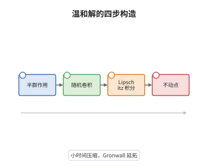

# 随机热方程的存在唯一性

> **一句话大白话**：只要非线性项是 Lipschitz 的、噪声在状态空间里"平方可积"，随机热方程在温和解意义下就存在唯一的轨道，而且可以逐段延拓到任意长时间。
>
> **小例子**：在圆周上取 $\mathrm dX=(\Delta X-X)\,\mathrm dt+\mathrm dW$、$X(0)=x$，温和解为 $X(t)=e^{t(\Delta-1)}x+\int_0^t e^{(t-s)(\Delta-1)}\,\mathrm dW(s)$，其中随机卷积的方差是 $\int_0^t\|e^{r(\Delta-1)}\|_{L_2}^2\,\mathrm dr<\infty$。

## 介绍

随机热方程是无穷维随机分析的样板方程：$\mathrm dX=(AX+f(X))\,\mathrm dt+B\,\mathrm dW$。把它当经典微分方程写没有意义，因为 $W$ 的轨道处处不可微、协方差只在迹类条件下才给出 $H$ 值过程。Da Prato 与 Zabczyk 的办法是把方程改写成积分方程，把噪声项吸收进一个 Gaussian 过程（随机卷积），再对剩下的确定性积分做 Banach 不动点。这样"解"被定义为满足积分等式的轨道，称为温和解。本节说明这个定义为什么自然、随机卷积为什么有连续版本、以及 Lipschitz 条件与小时间压缩怎样拼成全局唯一性。

## 几何直观

图意在说明：初值经半群衰减，噪声经随机卷积变成连续轨道，非线性项被 Lipschitz 常数控制。三者相加后成为压缩映射的不动点，局部唯一性由此得到。

## 分析

**前置依赖**：算子半群、Itô 积分；补充：Hilbert-Schmidt 算子、随机卷积、Banach 不动点定理。

**数学内涵**：
- 温和解的定义是积分等式 $X(t)=S(t)x+\int_0^tS(t-s)f(X(s))\,\mathrm ds+\int_0^tS(t-s)B\,\mathrm dW(s)$，右端三项分别在 $H$ 中有意义，不要求 $X$ 可微。
- 随机卷积 $W_A(t)=\int_0^tS(t-s)B\,\mathrm dW(s)$ 是中心 Gauss 过程，协方差为 $\int_0^tS(r)BB^*S^*(r)\,\mathrm dr$；当 $B$ 为 Hilbert-Schmidt 且 $S$ 解析时它有 $H$ 值连续版本。
- 压缩性来自 Lipschitz 常数：$\|\Phi(X)-\Phi(Y)\|_\infty\le LT\|X-Y\|_\infty$，取 $T<1/L$ 即为压缩，再用 Gronwall 估计逐段延拓。
- 常见误区：把温和解当成弱解的同义词。对解析半群且右端足够正则时两者一致，但温和解的定义不依赖对偶配对，因此在分布值噪声下仍然成立。

**结构**：
1. 用因子化方法证明随机卷积有连续版本并给出矩估计。
2. 在 $C([0,T];H)$ 上验证 Picard 映射是压缩，得到局部解。
3. 用能量型 Gronwall 估计延拓到任意有限时间，并证明唯一性。

## 思考过程

把噪声直接看作 $H$ 值函数会遇到不可微的障碍，Da Prato 与 Zabczyk 在二十世纪八十年代的选择是"只积分、不微分"：把 $A$ 生成半群这一事实榨干，把所有项都写成半群对某个密度的积分。剩下的唯一技术难点是随机卷积的连续性——Itô 等距只给平方可积，连续轨道要靠因子化恒等式把时间奇性转移到辅助过程上。另一个关键观察是压缩只在小时间成立，而全局性不需要新的概率估计，只需要确定性的 Gronwall 不等式。这套框架后来被原样搬到 Navier-Stokes、波动方程与 SPDE 的几乎每个分支。

## 证明过程

**定理**：设 $A$ 是 $H$ 上解析半群 $S(t)$ 的生成元，$B\in L_2(U,H)$，$W$ 是 $U$ 上的 $Q$-Wiener 过程，$f:H\to H$ 满足 $\|f(x)-f(y)\|\le L\|x-y\|$。则对每个 $x\in H$ 与 $T>0$，存在唯一的适应过程 $X\in C([0,T];H)$ 几乎必然满足上述温和解积分等式。

**证明**：

### 1. 随机卷积的连续版本

取 $\alpha\in(0,1/2)$，由因子化恒等式可把随机卷积写成

$$
W_A(t)=\frac{\sin\pi\alpha}{\pi}\int_0^t(t-s)^{\alpha-1}S(t-s)Y(s)\,\mathrm ds,
$$

其中 $Y(s)=\int_0^s(s-r)^{-\alpha}S(s-r)B\,\mathrm dW(r)$。由 Itô 等距与 $\|S(r)B\|_{L_2}\le M\|B\|_{L_2}$，

$$
\mathbb E\|Y(s)\|^2\le M^2\|B\|_{L_2}^2\int_0^sr^{-2\alpha}\,\mathrm dr=\frac{M^2\|B\|_{L_2}^2}{1-2\alpha}s^{1-2\alpha},
$$

故 $\sup_{s\le T}\mathbb E\|Y(s)\|^2<\infty$。解析性给出 $S(t-s)$ 在 $s\to t$ 时的 Hölder 衰减，代回积分即得 $W_A\in C^\alpha([0,T];H)$ 且各阶矩有限。

### 2. Picard 映射是压缩

在 $C([0,T];H)$ 上定义

$$
\Phi(X)(t)=S(t)x+\int_0^tS(t-s)f(X(s))\,\mathrm ds+W_A(t).
$$

由半群的一致有界性与 Lipschitz 条件，

$$
\|\Phi(X)-\Phi(Y)\|_\infty\le L\int_0^T\|S(t-s)\|\,\mathrm ds\,\|X-Y\|_\infty\le LT\|X-Y\|_\infty .
$$

取 $T\le1/(2L)$，压缩常数为 $1/2$。Banach 不动点定理给出唯一的 $X\in C([0,T];H)$，适应性与可测性由 Picard 迭代逐次继承。

### 3. 延拓到任意时间

设 $X$ 在 $[0,T]$ 上已解出，对 $\|X(t)\|^2$ 用 Gronwall 型估计：由 $f$ 的 Lipschitz 性，

$$
\sup_{t\le T}\|X(t)\|^2\le C\Big(\|x\|^2+\sup_{t\le T}\|W_A(t)\|^2\Big)e^{2LT}.
$$

右端只依赖 $x,T$ 与噪声的矩，不依赖具体轨道。于是可把区间按长度 $1/(2L)$ 切开逐段求解，得到 $[0,T]$ 上的解；两解之差满足同样的不等式且初值为零，故唯一。$\square$

## 课堂问答

**老师**：为什么不直接要求 $X$ 可微、把方程当经典方程解？

**学生**：因为 $W$ 的轨道几乎必然处处不可微，$\mathrm dW/\mathrm dt$ 根本不存在；即使噪声光滑，$B$ 也未必使 $BW$ 落在 $A$ 的定义域里。温和解把方程积分一次，用半群 $S(t-s)$ 吸收 $A$，只要求积分等式成立，因而在分布值噪声下也有意义。

**老师（追问）**：随机卷积的连续性用到了哪些条件？少一个会怎样？

**学生**：用到 $B$ 是 Hilbert-Schmidt 与 $S$ 解析。前者保证 Itô 等距中的 $\|S(r)B\|_{L_2}$ 有限，后者保证时间奇性可积并给出 Hölder 模。若 $B$ 只是有界算子（如恒等），$\|S(r)B\|_{L_2}=\infty$，随机卷积的方差发散；这时必须把噪声看作柱过程并换更大的状态空间。

**老师（拓展）**：如果 $f$ 只是局部 Lipschitz，结论变成什么？

**学生**：只能得到局部温和解，存在最大存在时间 $\tau$，且当 $\tau<\infty$ 时 $\limsup_{t\to\tau}\|X(t)\|=\infty$。要得到全局解需要额外的先验估计，例如二维 Navier-Stokes 靠涡量估计、随机波动方程靠能量守恒；仅靠局部 Lipschitz 无法排除有限时刻爆破。
