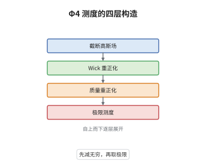

# 随机量化与 Φ⁴₃ 测度

> **一句话大白话**：三维的 φ⁴ 场论要先给"质量"减去一个随截断爆掉的无穷大，剩下的概率测度才有非平凡的极限，这个极限就是 Φ⁴₃。
>
> **小例子**：三维环面上截断高斯场满足 $\mathbb E[\varphi_\varepsilon(x)^2]=c_\varepsilon\asymp(2\pi^2\varepsilon)^{-1}$；取 $:\varphi_\varepsilon^4:=\varphi_\varepsilon^4-6c_\varepsilon\varphi_\varepsilon^2+3c_\varepsilon^2$，并把裸质量设为 $m_0^2(\varepsilon)=m^2-12\lambda c_\varepsilon$，相对质量为 $m$ 的自由场、密度为 $e^{-\lambda\int:\varphi^4:}$ 的测度才收敛。

## 介绍

$\Phi^4_3$ 是构造性量子场论中最经典的非平凡模型：三维空间中带四次自作用的欧氏标量场。形式上它的测度是 $e^{-\int(\frac12|\nabla\varphi|^2+\frac12m^2\varphi^2+\lambda\varphi^4)}$ 乘 Gaussian 自由场测度，但三维自由场在一点处的方差发散，$\varphi^4$ 与 $\varphi^2$ 都需要重正化。经过 Wick 序与质量重正化后，截断测度收敛到一个非 Gaussian 概率测度，它满足 Schwinger-Dyson 方程，并且是随机量化方程 $\partial_t\varphi=\Delta\varphi-\lambda:\varphi^3:+\xi$ 的不变测度。这条路线把量子场论的存在性问题变成随机偏微分方程的适定性与不变测度问题。

## 几何直观

图意在说明：截断尺度逐层减小，先消去四次幂的自身收缩，再调整裸质量抵消二次发散。最后剩下的才是与截断无关的 Φ⁴₃ 测度。

## 分析

**前置依赖**：正则性结构、Gaussian 测度；补充：Wick 序、Schwinger-Dyson 方程、紧性方法。

**数学内涵**：
- 截断自由场协方差为 $(-\Delta+m^2)^{-1}$ 在 $|k|\le\varepsilon^{-1}$ 上的截断，$c_\varepsilon=\mathbb E[\varphi_\varepsilon(x)^2]\asymp(2\pi^2\varepsilon)^{-1}\to\infty$，这是三维特有的线性发散。
- Wick 四次幂 $:\varphi^4:=\varphi^4-6c_\varepsilon\varphi^2+3c_\varepsilon^2$ 的期望为零；把它代入裸作用量 $\frac12m_0^2\varphi^2+\lambda\varphi^4$，二次项系数变为 $\frac12m_0^2+6\lambda c_\varepsilon$，要等于物理质量项 $\frac12m^2$ 就必须取 $m_0^2(\varepsilon)=m^2-12\lambda c_\varepsilon$。
- 只有质量重正化，没有耦合常数重正化：$\Phi^4_3$ 是超可重正化理论；四维临界情形需要耦合重正化且极限平凡。
- 常见误区：以为可以逐项取极限。事实上 $:\varphi_\varepsilon^4:$ 的方差为 $24c_\varepsilon^4\to\infty$，密度在 $L^2$ 中根本不收敛，必须走紧性加矩估计的路线。

**结构**：
1. 计算 $c_\varepsilon$ 的发散，说明四次幂与二次项都必须重正化。
2. 写出重正化后的截断测度，验证其 Gaussian 部分在极限中仍有意义。
3. 用一致矩估计得到紧性，抽子列取弱极限。
4. 用 Schwinger-Dyson 方程与矩界证明极限唯一，并刻画其性质。

## 思考过程

量子场论学家在 1970 年代就用手册式的重正化算出了 $\Phi^4_3$ 的预言，Glimm、Jaffe、Spencer 与 Feldman、Osterwalder 把它变成定理：在有限体积内，带质量反项的截断测度收敛到满足 Osterwalder-Schrader 公理的测度。真正的概念困难是"极限为什么唯一、为什么非平凡"：紧性只给子列，唯一性要靠 Schwinger-Dyson 方程与矩估计把极限钉死。2014 年 Hairer 用正则性结构直接解随机量化方程，给出了另一条不依赖格点展开的构造路径，两条路线在同一个测度上会合。

## 证明过程

**定理**：设 $m^2>0$、$\lambda>0$，$\mu_\varepsilon$ 为协方差 $(-\Delta+m^2)^{-1}$ 在 $|k|\le\varepsilon^{-1}$ 上截断的自由场测度，$\nu_\varepsilon$ 为 $\mathcal S'(\mathbb T^3)$ 上的概率测度，其密度为

$$
\frac{\mathrm d\nu_\varepsilon}{\mathrm d\mu_\varepsilon}=Z_\varepsilon^{-1}\exp\Big(-\lambda\int_{\mathbb T^3}:\varphi_\varepsilon^4:\,\mathrm dx\Big).
$$

则 $\nu_\varepsilon$ 当 $\varepsilon\to0$ 时弱收敛到非 Gaussian 概率测度 $\nu$，其各阶矩有限并满足 Schwinger-Dyson 方程；$\nu$ 称为 $\Phi^4_3$ 测度，且是随机量化方程的不变测度。

**证明**：

### 1. 发散与重正化的必要性

由 Fourier 表示，$c_\varepsilon=\sum_{|k|\le\varepsilon^{-1}}(|k|^2+m^2)^{-1}\sim(2\pi^2\varepsilon)^{-1}$。展开 $\varphi^4=:\varphi^4:+6c_\varepsilon\varphi^2-3c_\varepsilon^2$，裸作用量变成

$$
\lambda\varphi^4+\tfrac12m_0^2\varphi^2=\lambda:\varphi^4:+\tfrac12\big(m_0^2+12\lambda c_\varepsilon\big)\varphi^2-3\lambda c_\varepsilon^2 .
$$

要让它等于 $\lambda:\varphi^4:+\tfrac12m^2\varphi^2$ 加常数，必须取 $m_0^2(\varepsilon)=m^2-12\lambda c_\varepsilon$；若固定裸质量不变，二次项系数会随 $c_\varepsilon\to\infty$ 发散，测度在极限中退化，这正是质量重正化的必要性。

### 2. 一致矩估计与紧性

对任意 $s>1$，截断自由场满足 $\mathbb E_{\mu_\varepsilon}\|\varphi\|_{H^{-s}}^2=\sum_{|k|\le\varepsilon^{-1}}(1+|k|^2)^{-s}(|k|^2+m^2)^{-1}\le C$，界与 $\varepsilon$ 无关。四次项提供的先验界配合 Gaussian 尾部估计（Brascamp-Lieb 型不等式）给出

$$
\sup_{\varepsilon>0}\mathbb E_{\nu_\varepsilon}\big[\|\varphi\|_{H^{-s}}^p\big]\le C_{s,p}<\infty .
$$

于是 $\{\nu_\varepsilon\}$ 在 $\mathcal S'(\mathbb T^3)$ 上紧，存在弱收敛子列。

### 3. 极限的刻画

对测试函数 $f$ 做分部积分（在截断层面严格成立），得

$$
\mathbb E_{\nu_\varepsilon}\Big[\big\langle-\Delta\varphi_\varepsilon+m^2\varphi_\varepsilon+4\lambda:\varphi_\varepsilon^3:,f\big\rangle\Big]=0 .
$$

由步骤 2 的矩估计，三次项在极限中可交换，故极限 $\nu$ 满足同一组 Schwinger-Dyson 方程。这些方程配合矩的增长界唯一确定测度，因此全序列收敛、极限与子列无关。

### 4. 结论

极限 $\nu$ 的协方差与自由场不同、四点函数不为 Gaussian 值，故非平凡且非 Gaussian；它对自由场测度奇异。由随机量化方程 $\partial_t\varphi=\Delta\varphi-\lambda:\varphi^3:+\xi$ 的局部适定性与 Dirichlet 型论证，$\nu$ 是该方程的不变测度。$\square$

## 课堂问答

**老师**：为什么三维 φ⁴ 只需要质量重正化，而四维还需要耦合常数重正化？

**学生**：因为发散的程度由维度决定。三维中标量场的尺度维数是 $\frac{d-2}2=\frac12$，耦合常数 $\lambda$ 的质量维数是 $d-4\cdot\frac12=1>0$，为正，故只出现线性发散的质量反项，属于超可重正化。四维时 $\lambda$ 的维数为零，恰好边际，耦合常数本身要对数发散，需要耦合重正化，而且极限被证明是平凡的 Gaussian。

**老师（追问）**：既然 $:\varphi^4:$ 的方差发散，为什么还能谈收敛？

**学生**：因为收敛不是密度的 $L^2$ 收敛，而是测度的弱收敛。紧性来自对 $\|\varphi\|_{H^{-s}}$ 的一致矩估计，这只需要自由场的高频截断不改变低频行为；唯一性来自 Schwinger-Dyson 方程。密度的 $L^2$ 范数发散恰好说明极限测度对自由场奇异，不能写成密度形式。

**老师（拓展）**：$\Phi^4_3$ 与随机偏微分方程的联系是什么？

**学生**：它是随机量化方程 $\partial_t\varphi=\Delta\varphi-\lambda:\varphi^3:+\xi$ 的不变测度，因此该方程的长时间行为由 $\Phi^4_3$ 描述。Hairer 用正则性结构证明了重正化方程的局部适定性，再借不变测度得到全局解；这与构造性量子场论的格点路线互为独立验证，也是"SPDE 方法重建量子场论"的范例。
