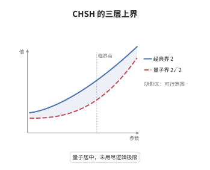

# Bell 不等式与 CHSH

> **一句话大白话**：如果世界的随机只是"我们没看到那份隐藏说明书"，四个关联量的特定组合就超不过 $2$；实验测到 $2\sqrt2$，所以世界不是那样运作的。
>
> **小例子**：取 $A_1=Z$、$A_2=X$、$B_1=(Z+X)/\sqrt2$、$B_2=(Z-X)/\sqrt2$ 作用在 Bell 态 $|\Phi^+\rangle$ 上，得 $S=\tfrac{4}{\sqrt2}=2\sqrt2$。

## 介绍

Bell 在 1964 年把 EPR 悖论从哲学争论变成不等式：任何局域隐变量模型都必须服从某个关联上界，而量子力学预言违反它。CHSH 形式（Clauser、Horne、Shimony、Holt，1969）把它整理成最便于实验检验的形状：两方各选两种测量，四种关联的特定组合 $S=A_1B_1+A_1B_2+A_2B_1-A_2B_2$ 满足 $|S|\le2$。量子力学允许 $S$ 达到 $2\sqrt2$，即 Tsirelson 界，它来自算符代数而非具体模型。CHSH 因此同时是基础物理的判决性实验、量子信息里"纠缠可验证"的度量，也是设备无关量子密码的安全依据。

## 几何直观

图意在说明：最矮的柱子是局域隐变量允许的最大值 $2$，中间是量子力学允许的 Tsirelson 界 $2\sqrt2$，最高的柱子是无信号原理允许的代数极限 $4$。量子力学落在中间，说明它比经典关联强，却仍未用尽逻辑上可能的全部关联。

## 分析

**前置依赖**：密度矩阵、张量积、测量；补充：算子不等式、Cauchy-Schwarz 不等式、Tsirelson 界。

**数学内涵**：
- 局域隐变量模型给联合分布 $p(a,b|x,y)=\sum_\lambda p_\lambda\,p(a|x,\lambda)p(b|y,\lambda)$，其极值点是确定性赋值 $a,b\in\{\pm1\}$；在赋值上把 $S$ 重排为 $a_1(b_1+b_2)+a_2(b_1-b_2)$ 即见 $|S|\le2$。
- 量子情形把 $A_i,B_j$ 换成算符：$A_i^2=B_j^2=I$，不同因子的算符对易，此时 $|S|\le2\sqrt2$，等号在最大纠缠态与共轭基测量下取得。
- 常见误区：以为违反 CHSH 能超光速传信。实际不然，Alice 的边际分布 $\mathrm{tr}(\rho\,A_i\otimes I)$ 与 Bob 选哪个测量无关，这正是无信号条件。
- 另一个误区：以为有纠缠就够。纠缠配上固定的测量基并不违反 CHSH，必须让双方在两套基之间自由选择，关联才会显形。

**结构**：
1. 把局域隐变量模型约化为确定性赋值，得到 $|S|\le2$。
2. 构造具体测量与 Bell 态，算出 $S=2\sqrt2$。
3. 用 $C=A_1+A_2$、$D=A_1-A_2$ 满足 $C^2+D^2=4I$ 加 Cauchy-Schwarz 给出普适上界。

## 思考过程

Einstein、Podolsky、Rosen 在 1935 年指出纠缠意味着描述不完整，这个结论依赖一个未言明的假设：局域性。Bell 的贡献是把假设写成可检验的不等式，而不是继续争论隐变量是否存在。他 1964 年的原始不等式针对自旋单态，形式不对称；CHSH 在 1969 年把它改成对称、每种测量只有两个结果的版本，使实验门槛大幅降低。真正的技术障碍在上界：为什么量子力学不能更过分地违反？Tsirelson 在 1980 年用算符代数回答：把 $A_1\pm A_2$ 看成两个算符，平方和是 $4I$，再用 Cauchy-Schwarz 就把 $S$ 卡在 $2\sqrt2$。这个证明与维数、与具体态都无关，只用了 $\pm1$ 取值的代数关系。此后 Popescu 与 Rohrlich 构造出达到 $4$ 的超量子关联，说明 $2\sqrt2$ 是量子力学的特性而非逻辑必然。

## 证明过程

**定理**：设 $A_1,A_2$ 是 $\mathcal H_A$ 上的自伴酉算子（$A_i^2=I$），$B_1,B_2$ 是 $\mathcal H_B$ 上的自伴酉算子（$B_j^2=I$），不同因子的算符对易。记 $S=A_1B_1+A_1B_2+A_2B_1-A_2B_2$，则对任意态 $|\Psi\rangle$ 有 $|\langle S\rangle|\le2\sqrt2$；若关联来自局域隐变量模型，则 $|S|\le2$。

**证明**：

### 1. 局域隐变量给出二

在确定性赋值下 $a_i,b_j\in\{\pm1\}$，把四项重排为

$$
S=a_1(b_1+b_2)+a_2(b_1-b_2).
$$

因 $b_1+b_2$ 与 $b_1-b_2$ 必有一个为 $0$、另一个为 $\pm2$，故 $|S|\le2$。一般隐变量模型是确定性赋值的凸组合，$S$ 对概率线性，故 $|S|\le2$ 保持。

### 2. 量子实现取到二倍根号二

取 $A_1=Z\otimes I$、$A_2=X\otimes I$、$B_1=I\otimes\tfrac{Z+X}{\sqrt2}$、$B_2=I\otimes\tfrac{Z-X}{\sqrt2}$，态取 $|\Phi^+\rangle$。由 $\langle ZZ\rangle=\langle XX\rangle=1$、$\langle ZX\rangle=\langle XZ\rangle=0$，四项期望依次为 $1/\sqrt2$、$1/\sqrt2$、$1/\sqrt2$、$-1/\sqrt2$，相加得

$$
\langle S\rangle=\frac{4}{\sqrt2}=2\sqrt2 .
$$

### 3. Tsirelson 上界

记 $C=A_1+A_2$、$D=A_1-A_2$。展开平方时交叉项 $A_1A_2+A_2A_1$ 自动抵消，

$$
C^{2}+D^{2}=2\big(A_1^{2}+A_2^{2}\big)=4I .
$$

把 $S$ 按 $A$ 的符号重排得 $S=CB_1+DB_2$。令 $|u\rangle=C|\Psi\rangle$、$|v\rangle=D|\Psi\rangle$，则

$$
\langle u|u\rangle+\langle v|v\rangle=\langle\Psi|(C^2+D^2)|\Psi\rangle=4 .
$$

由 $C$ 与 $B_1$ 对易且 $C$ 自伴，有 $\langle\Psi|CB_1|\Psi\rangle=\langle u|(I\otimes B_1)|\Psi\rangle$；又 $B_1^2=I$ 给出 $\|(I\otimes B_1)|\Psi\rangle\|=1$，对 $B_2$ 同理。于是由 Cauchy-Schwarz 与 $\|u\|+\|v\|\le\sqrt2\sqrt{\|u\|^2+\|v\|^2}$，

$$
|\langle S\rangle|\le\|u\|\cdot1+\|v\|\cdot1\le 2\sqrt2 .
$$

$\square$

## 课堂问答

**老师**：$|S|\le2$ 的推导里，"确定性赋值就够了"凭什么？

**学生**：因为隐变量模型 $p(a,b|x,y)=\sum_\lambda p_\lambda p(a|x,\lambda)p(b|y,\lambda)$ 中，每个 $\lambda$ 下的响应是概率分布，而任何概率分布都是确定性响应的凸组合。$S$ 对概率线性，上界必在极点上取得，极点就是 $a,b\in\{\pm1\}$ 的赋值，所以只需验证确定性情形。

**老师（追问）**：Tsirelson 证明中 $C^2+D^2=4I$ 用到了 $A_1,A_2$ 的什么性质？需要它们反对易吗？

**学生**：只用到 $A_i^2=I$，不需要反对易，也不需要 $A_1A_2=0$。展开 $C^2+D^2=2(A_1^2+A_2^2)+(A_1A_2+A_2A_1)-(A_1A_2+A_2A_1)=4I$，交叉项无条件抵消。这也解释了为什么 $2\sqrt2$ 与维数、与具体态无关，只要可观测量取值 $\pm1$ 就成立。

**老师（拓展）**：$2\sqrt2$ 是不是逻辑上最强的违反？有没有更强的关联？

**学生**：不是。Popescu-Rohrlich 在 1994 年构造的 PR 盒满足无信号条件却给出 $S=4$，这是代数上的绝对上界，因为 $S$ 只是四个 $\pm1$ 量之和。量子力学达不到 $4$，只能到 $2\sqrt2$，这个差距说明无信号比量子更宽松：量子关联集合严格介于局域多面体与无信号多面体之间，区分这两层催生了信息因果性、宏观定域性等更强的原理。
