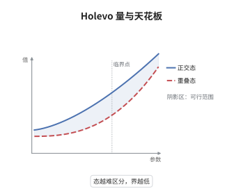

# Holevo 界与量子信道容量

> **一句话大白话**：用 $n$ 个量子比特传经典消息，无论怎么编码、怎么测量，能读出的信息都有天花板，天花板由"平均态的熵减去各态熵的平均"决定。
>
> **小例子**：等概率发送 $|0\rangle$ 与 $|+\rangle$，平均态的特征值为 $(1\pm1/\sqrt2)/2$，故 $\chi=h\big((1+1/\sqrt2)/2\big)\approx0.6$ 比特，明显低于正交情形的 $1$ 比特。

## 介绍

Holevo 在 1973 年证明：若发送方以概率 $p_i$ 制备量子态 $\rho_i$，接收方做任意测量得到经典结果 $Y$，则互信息满足 $I(X:Y)\le\chi$，其中 $\chi$ 是平均态的熵减去各态熵的加权平均，称为 Holevo 量。它把"量子信道能传多少经典信息"这一工程问题变成一个熵的优化问题。HSW 定理（Schumacher 与 Westmoreland 1997、Holevo 1998）进一步证明 $\chi$ 在产物态编码下可达，于是对 $\chi$ 取最大值得到产物态经典容量。需要强调 $\chi$ 不是完整的经典容量：若允许编码端使用跨符号的纠缠输入，容量可能更大，因此完整容量需要正则化。

## 几何直观

图意在说明：横轴是二元系综中第一个态的先验概率，纵轴是 Holevo 量。两条曲线分别对应正交的两个态与内积较大的两个态，水平虚线是 $\log2$ 的天花板。态越难区分，曲线越低，这正是量子态不能完美区分的定量表现。

## 分析

**前置依赖**：von Neumann 熵、量子信道；补充：量子相对熵的数据处理不等式、POVM、联合凸性。

**数学内涵**：
- 等价写法 $\chi=\sum_ip_iD(\rho_i\|\bar\rho)$，其中 $\bar\rho=\sum_ip_i\rho_i$，因此 $\chi\ge0$ 直接来自 Klein 不等式。
- 上界 $\chi\le S(\bar\rho)\le\log d$：第一个不等号因为 $S(\rho_i)\ge0$，第二个因为 $d$ 维系统的熵不超过 $\log d$。
- 当所有 $\rho_i$ 两两对易时，取公共特征基上的投影测量可使 $I(X:Y)=\chi$，界被取到；这是经典与量子的分水岭。
- 常见误区：把 $\chi$ 当成信道容量的最终答案。$\chi$ 只对产物态编码可达；一般经典容量是 $\lim_n\chi(\Phi^{\otimes n})/n$，而 Hastings 在 2009 年证明 $\chi$ 对张量积不可加，故容量可以严格大于 $\chi(\Phi)$。

**结构**：
1. 把编码写成经典-量子态 $\rho_{XB}=\sum_ip_i|i\rangle\langle i|\otimes\rho_i$。
2. 把 $\chi$ 识别为相对熵 $D(\rho_{XB}\|\rho_X\otimes\rho_B)$。
3. 用数据处理不等式把测量这一步"抹掉"，得到 $I(X:Y)\le\chi$。

## 思考过程

经典信道的容量由 Shannon 的互信息最大化给出，故事在 1948 年就结束了。量子情形卡在一个朴素的问题上：接收方不知道发送方选了哪个态，而量子态一般不可区分，"最多能读出多少比特"因此没有现成答案。Holevo 的洞察是把问题写成发送、信道、接收三方的互信息，并注意到测量本身是一个 CPTP 映射。一旦这么看，数据处理不等式自动给出上界，完全不需要计算具体测量。真正的困难是可达性：Holevo 只给了上界，二十五年后 Schumacher 与 Westmoreland、Holevo 各自用典型序列与 pretty good measurement 证明产物态编码能达到 $\chi$。故事看似圆满，Hastings 却在 2009 年证明 $\chi$ 对信道张量积不可加，说明"最优输入是产物态"这个前提本身就是限制。

## 证明过程

**定理**：设发送方以概率 $p_i$ 制备 $\rho_i$，$\bar\rho=\sum_ip_i\rho_i$。接收方对 $\bar\rho$ 做任意 POVM $\{E_y\}$ 得经典结果 $Y$。则

$$
I(X:Y)\le\chi=S(\bar\rho)-\sum_ip_iS(\rho_i).
$$

**证明**：

### 1. 编码为经典-量子态

把标签系统记作 $X$，其正交基为 $|i\rangle$。编码后的联合态为

$$
\rho_{XB}=\sum_ip_i\,|i\rangle\langle i|\otimes\rho_i ,
$$

其 $B$ 边际是 $\rho_B=\bar\rho$，条件熵是 $S(B|X)=\sum_ip_iS(\rho_i)$。于是

$$
\chi=S(\rho_B)-S(B|X)=D\big(\rho_{XB}\big\|\rho_X\otimes\rho_B\big),
$$

最后一步是相对熵在经典-量子态上的标准分解。

### 2. 测量是 CPTP 映射

POVM 加读数是作用在 $B$ 上的 CPTP 映射，记作 $\mathcal M$：它把 $\rho_i$ 送到以 $p(y|i)=\mathrm{tr}(E_y\rho_i)$ 为对角的经典态。$\mathcal M$ 作用在 $\rho_{XB}$ 上得到经典-经典态 $\rho_{XY}$，作用在 $\rho_X\otimes\rho_B$ 上得到 $\rho_X\otimes\rho_Y$。

### 3. 数据处理不等式与结论

由数据处理不等式，

$$
D\big(\rho_{XB}\big\|\rho_X\otimes\rho_B\big)\ \ge\ D\big(\rho_{XY}\big\|\rho_X\otimes\rho_Y\big)=I(X:Y),
$$

右端的等号是经典互信息的相对熵定义。合并步骤 1 即得 $I(X:Y)\le\chi$。

### 4. 等号可取到的情形

若所有 $\rho_i$ 两两对易，取公共特征基上的投影测量。此时测量不改变 $\rho_{XB}$ 的条件熵，数据处理不等式的每一步都取等，故 $I(X:Y)=\chi$。特别地，若 $\rho_i$ 是相互正交的纯态，$\chi=\log d$，用 $d$ 元投影测量即可完全区分，达到系统的熵上限。$\square$

## 课堂问答

**老师**：Holevo 界为什么不可能靠"更聪明的测量"突破？

**学生**：因为证明只用到测量是 CPTP 映射这一件事，没有对测量做任何假设。数据处理不等式说相对熵在 CPTP 下不增，而编码端的 $\chi$ 恰好就是测量之前的那个相对熵，所以任何测量都只能让它下降。要突破只能改编码方式，例如让多个符号的态互相纠缠，那就进入了正则化容量的范围。

**老师（追问）**：$\chi$ 与 $\log d$ 是什么关系？什么时候能取到 $\log d$？

**学生**：总有 $\chi\le S(\bar\rho)\le\log d$，第一个不等号因为各 $S(\rho_i)\ge0$，第二个因为 $d$ 维系统的最大熵是 $\log d$。取到 $\log d$ 需要同时满足 $\bar\rho=I/d$ 与所有 $\rho_i$ 为纯态。例如等概率发送 $d$ 个正交纯态，此时 $\chi=\log d$，用 $d$ 元投影测量可完全区分。

**老师（拓展）**：既然 HSW 定理说 $\chi$ 可达，为什么经典容量还要正则化？

**学生**：因为 HSW 只证明产物态编码 $\rho_{i_1}\otimes\cdots\otimes\rho_{i_n}$ 能达到 $\chi(\Phi)$ 的 $n$ 倍速率，而一般编码允许 $n$ 个符号的态互相纠缠。经典容量定义为 $\chi(\Phi^{\otimes n})/n$ 的上极限，Hastings 在 2009 年证明 $\chi$ 对张量积可以严格超可加，所以 $\chi(\Phi)$ 不是最终答案，"量子信道的经典容量"至今没有单一公式。
