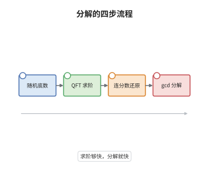

# Shor 算法与量子 Fourier 变换

> **一句话大白话**：大整数分解可以改写成"求某个数幂的周期"，而周期能用量子 Fourier 变换一次性读出来，于是分解从指数时间掉到多项式时间。
>
> **小例子**：取 $N=15$、$a=7$，$7$ 的幂模 $15$ 是 $7,4,13,1,\dots$，周期 $r=4$；又 $7^{2}\equiv4\pmod{15}$，于是 $\gcd(3,15)=3$、$\gcd(5,15)=5$，分解完成。

## 介绍

Shor 在 1994 年给出多项式时间的整数分解与离散对数算法，直接威胁 RSA 与 Diffie-Hellman。算法骨架是两步归约：先用数论把"分解 $N$"归约为"求 $a$ 模 $N$ 的阶 $r$"，再用量子相位估计与量子 Fourier 变换在 $O((\log N)^3)$ 个门内求出 $r$。前一步是经典的概率归约，失败只需换底数重试；后一步是真正的量子加速来源，因为 $n$ 个量子比特的 QFT 只需 $O(n^2)$ 个门，而经典快速 Fourier 变换需要处理 $2^n$ 个数据点。两步拼起来，分解的复杂度从亚指数变成多项式，这是量子计算第一次展示出对经典算法的指数优势。

## 几何直观

图意在说明：左端从数论出发选一个与 $N$ 互素的底数，中段用 QFT 相位估计读出 $\log N$ 位精度的相位，右端用连分数把该相位还原成有理数从而得到周期，最后一步用两个最大公约数把 $N$ 拆开。

## 分析

**前置依赖**：量子线路、模算术、量子 Fourier 变换；补充：量子相位估计、连分数、中国剩余定理。

**数学内涵**：
- QFT 定义为 $|x\rangle\mapsto\frac1{\sqrt M}\sum_{y=0}^{M-1}e^{2\pi ixy/M}|y\rangle$，$M=2^n$；它分解为 $n$ 个 Hadamard 门与 $O(n^2)$ 个受控相位门，逆变换同理。
- 求阶的量子部分是对模乘酉算子 $U_a|y\rangle=|ay\bmod N\rangle$ 做相位估计。它的本征态是 $|u_s\rangle=\frac1{\sqrt r}\sum_{k=0}^{r-1}e^{-2\pi isk/r}|a^k\bmod N\rangle$，本征值为 $e^{2\pi is/r}$。
- 数论归约：若 $r$ 为偶数且 $a^{r/2}\not\equiv-1\pmod N$，则 $\gcd(a^{r/2}\pm1,N)$ 都是非平凡因子；对随机底数成功率至少 $1/2$。
- 常见误区：以为 QFT 就是"量子的快速 Fourier 变换"，能一次读出全部频谱。单次测量只给一个样本，加速来自周期信息被压进相位，而不是并行算出所有值。

**结构**：
1. 数论归约：把分解化为求阶，并估计成功概率。
2. 量子求阶：构造本征态、做相位估计，证明读数集中在 $s/r$ 附近。
3. 连分数还原周期并清点门数，得到 $O((\log N)^3)$ 的总代价。

## 思考过程

Shor 之前，分解问题最好的算法是二次筛与数域筛，复杂度亚指数，人们普遍相信它难到足以支撑 RSA。Shor 的出发点不是"用量子并行试除"，而是数论里一个古老事实：知道 $a$ 模 $N$ 的周期就能分解 $N$。这把问题变成周期查找，而周期查找正是 Fourier 变换的专长，经典 FFT 已经做得很高效，问题只是数据量太大。量子的贡献在于把 $2^n$ 个振幅的变换压进 $n$ 个比特的演化，代价是只能采样一次。这一次采样够不够？相位估计的答案是够，因为周期 $r$ 被编码在相位 $s/r$ 的分母上，而 $s/r$ 只有 $r$ 种可能，$O(\log N)$ 位精度足以用连分数唯一确定它。整个算法最精巧的地方，是每一步的误差都被控制在"连分数仍能唯一还原"的窗口内。

## 证明过程

**定理**：设 $N$ 为奇的合数且不是素数幂。随机取 $1<a<N$ 且 $\gcd(a,N)=1$，令 $r=\mathrm{ord}_N(a)$。若 $r$ 为偶数且 $a^{r/2}\not\equiv-1\pmod N$，则 $\gcd(a^{r/2}-1,N)$ 与 $\gcd(a^{r/2}+1,N)$ 都是 $N$ 的非平凡因子，且该条件成立的概率不小于 $1/2$。又若 $2^n\ge N^2$，对 $U_a|y\rangle=|ay\bmod N\rangle$ 做相位估计并用连分数还原，即可在多项式时间内得到 $r$。

**证明**：

### 1. 数论归约

由 $r$ 的定义 $a^{r}\equiv1\pmod N$，故 $N\mid(a^{r/2}-1)(a^{r/2}+1)$。若 $N$ 整除 $a^{r/2}-1$，则 $a^{r/2}\equiv1$，与 $r$ 的最小性矛盾；若 $N$ 整除 $a^{r/2}+1$，则与假设矛盾。因此 $N$ 不整除任一因子，两个最大公约数都真介于 $1$ 与 $N$ 之间。

### 2. 失败概率不超过一半

设 $N=\prod_{i=1}^{k}p_i^{e_i}$，$k\ge2$。由中国剩余定理，$a$ 对应各分量的 $a_i$，$r=\mathrm{lcm}(r_1,\dots,r_k)$，其中 $r_i=\mathrm{ord}_{p_i^{e_i}}(a_i)$。记 $2^{d_i}$ 是整除 $r_i$ 的 $2$ 的最高幂。则 $a^{r/2}\equiv-1$ 当且仅当 $r_i$ 不整除 $r/2$ 对每个 $i$ 都成立，即所有 $d_i$ 相等。于是"$r$ 为奇数或 $a^{r/2}\equiv-1$"恰好是事件"所有 $d_i$ 相等"。对随机 $a$，$d_i=t$ 的概率不超过 $1/2$，故

$$
\Pr[\text{失败}]=\sum_{t\ge0}\prod_{i=1}^{k}\Pr[d_i=t]\le\max_t\Pr[d_1=t]\cdot\sum_t\Pr[d_2=t]\le\frac12 .
$$

### 3. 相位估计给出 s 除以 r

对 $|u_s\rangle$ 做相位估计，第一寄存器测量值为 $k$，它逼近 $2^n\cdot s/r$，误差不超过 $1/2^{n+1}$。若 $2^n\ge N^2$，则由于 $r\le N$，

$$
\Big|\frac{k}{2^n}-\frac{s}{r}\Big|\le\frac{1}{2^{n+1}}\le\frac{1}{2r^{2}} ,
$$

由连分数定理，$s/r$ 必是 $k/2^n$ 的收敛子，其约化分母即给出 $r$。实际输入取 $|1\rangle$，它是全部 $|u_s\rangle$ 的等权叠加，测量给出随机的 $s$；只要 $\gcd(s,r)=1$ 即可由分母直接读出 $r$，对 $s$ 取几次结果的最小公倍数便能成功。

### 4. 门数计数

$M=2^n$ 上的 QFT 分解为 $n$ 个 Hadamard 与 $n(n-1)/2$ 个受控相位门，再加 $O(n)$ 个逆序交换，共 $O(n^2)$ 个门。模幂 $a^{2^j}$ 用重复平方，共 $O(n)$ 次模乘，每次用可逆线路实现代价 $O(n^2)$，合计 $O(n^3)$。取 $n=\lceil2\log_2N\rceil$ 得 $O((\log N)^3)$ 个门，加上常数次重试，成功概率趋于 $1$。$\square$

## 课堂问答

**老师**：Shor 算法里到底哪一步是量子的？如果全用经典计算，会慢在哪里？

**学生**：只有求阶的相位估计是量子的，前后两端求最大公约数与连分数还原都是经典多项式时间。经典慢在找周期需要访问上千甚至指数多个数据点，而量子把周期编码进 $U_a$ 的相位，再用 QFT 把相位信息集中到少数几个可测比特上，只需一次采样加多项式次重试。

**老师（追问）**：为什么测量值 $k/2^n$ 能唯一确定 $s/r$？

**学生**：因为分母不超过 $r\le N$，而相位估计的误差不超过 $1/2^{n+1}$。当 $2^n\ge N^2$ 时误差小于 $1/(2r^2)$，由连分数定理，任何满足这个误差界的有理数必是 $k/2^n$ 的收敛子，而收敛子由 $k/2^n$ 唯一决定。精度必须与分母的平方同阶，这正是第一寄存器要取约 $2\log_2N$ 个比特的原因。

**老师（拓展）**：如果 $r$ 是奇数或者 $a^{r/2}\equiv-1$，能靠改进量子部分补救吗？

**学生**：不能，这是数论层面的失败，不是精度问题：此时 $a^{r/2}\pm1$ 与 $N$ 的公约数只有 $1$ 和 $N$。补救办法是换底数重试，失败等价于所有 $d_i$ 相等，概率不超过 $1/2$，重试 $m$ 次后失败率降到 $2^{-m}$。若 $N$ 是素数幂，则任何底数都会失败，必须先把它识别出来并单独降为素数情形，这也是算法流程里需要独立处理的一步。
