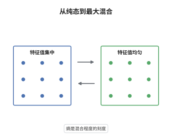

# von Neumann 熵与量子相对熵

> **一句话大白话**：熵量的是一个量子态"有多混合"，相对熵量的是两个态"有多难分辨"，后者永远非负，而且任何物理过程都不会让它变大。
>
> **小例子**：在二维空间取 $\rho=\tfrac12 I$ 与 $\sigma=|0\rangle\langle0|$，则 $S(\rho)=\log2$ 而 $D(\rho\|\sigma)=\log2$；换作 $\rho=\sigma$ 时相对熵为 $0$。

## 介绍

von Neumann 熵 $S(\rho)=-\mathrm{tr}\rho\log\rho$ 是 Shannon 熵在非交换情形的推广：把 $\rho$ 对角化之后，它就是特征值分布的 Shannon 熵。量子相对熵 $D(\rho\|\sigma)=\mathrm{tr}\rho(\log\rho-\log\sigma)$ 度量两个态的可区分程度，它恒非负（Klein 不等式），并在任意 CPTP 映射下不增（数据处理不等式）。这两条性质使它成为量子信息的中心势函数：信道容量、纠缠度量、量子假设检验、量子热力学都以它为语言。与经典情形不同，$\rho$ 与 $\sigma$ 一般不对易，$\log$ 的算子凹性取代了逐项比较，成为证明的核心工具。

## 几何直观

图意在说明：左栏的特征值集中在一个分量上，熵接近 $0$；右栏的特征值在 $d$ 个分量上均匀铺开，熵达到最大值 $\log d$。中间的箭头是从"确定"到"完全不确定"的连续刻度，熵正是这条刻度上的读数。

## 分析

**前置依赖**：密度矩阵、算子不等式；补充：谱分解、算子凹性、Lieb 三矩阵定理、Stinespring 扩张。

**数学内涵**：
- $S(\rho)=-\sum_i\lambda_i\log\lambda_i$，约定 $0\log0=0$；有 $0\le S(\rho)\le\log d$，左端等号当且仅当 $\rho$ 是纯态，右端当且仅当 $\rho=I/d$。
- $D(\rho\|\sigma)\ge0$，等号当且仅当 $\rho=\sigma$；它不对称、不是度量，但控制着迹距离：量子 Pinsker 不等式给出 $D(\rho\|\sigma)\ge\tfrac12\|\rho-\sigma\|_1^2$。
- 数据处理不等式：对任意 CPTP 映射 $\Phi$ 有 $D(\Phi\rho\|\Phi\sigma)\le D(\rho\|\sigma)$。特例是偏迹，即"丢掉一部分系统只会减少可区分性"。
- 常见误区：以为 $S(\rho_{AB})$ 等于 $S(\rho_A)+S(\rho_B)$。恰恰相反，$S(\rho_{AB})\le S(\rho_A)+S(\rho_B)$，而纯纠缠态满足 $S(\rho_{AB})=0$ 与 $S(\rho_A)=S(\rho_B)>0$，这是次可加性的非经典之处。

**结构**：
1. 在 $\rho$ 的特征基上把 $D$ 化成"经典 KL 散度加一项修正"。
2. 用 $\log$ 的算子凹性证明修正非负，得到 Klein 不等式。
3. 通过 Stinespring 扩张与 Lieb 定理，把不等式提升到任意 CPTP 映射。

## 思考过程

Shannon 在 1948 年用 $-\sum p\log p$ 刻画经典信源的不确定性；von Neumann 更早在 1927 年就为量子统计力学写下 $-\mathrm{tr}\rho\log\rho$，但两者的联系要到把 $\rho$ 对角化后才看得清。相对熵的量子版本由 Umegaki 在 1962 年给出，难点立刻暴露：$\rho$ 与 $\sigma$ 不对易时没有共同的基，经典证明里逐项比较的手法全部失效。突破在于把 $\log$ 当成算子函数，用它的凹性代替初等不等式；Lindblad 与 Uhlmann 在 1975 至 1977 年用这个方法证明了单调性。更深的工具是 Lieb 在 1973 年证明的三矩阵定理，它给出 $p\mapsto\mathrm{tr}\,\rho^p\sigma^{1-p}$ 的对数凹性，单调性只是对 $p$ 求导的副产品。这条路线后来成为"证明任何单调性"的标准套路。

## 证明过程

**定理**：设 $\rho,\sigma$ 是 $\mathcal H$ 上的密度矩阵，$\sigma$ 满秩。则 (i) $D(\rho\|\sigma)\ge0$，等号当且仅当 $\rho=\sigma$；(ii) 对任意 CPTP 映射 $\Phi$，有 $D(\Phi\rho\|\Phi\sigma)\le D(\rho\|\sigma)$。

**证明**：

### 1. 在特征基上展开

设 $\rho=\sum_i\lambda_i|i\rangle\langle i|$，$\lambda_i>0$、$\sum_i\lambda_i=1$，并令 $q_i=\langle i|\sigma|i\rangle>0$。则

$$
D(\rho\|\sigma)=\sum_i\lambda_i\log\lambda_i-\mathrm{tr}(\rho\log\sigma).
$$

### 2. 算子凹性给出第一层下界

$\log$ 在正数上算子凹，故对概率权 $\lambda_i$ 有 $\sum_i\lambda_i\langle i|\log\sigma|i\rangle\le\sum_i\lambda_i\log\langle i|\sigma|i\rangle$，即

$$
-\mathrm{tr}(\rho\log\sigma)=-\sum_i\lambda_i\langle i|\log\sigma|i\rangle\ \ge\ -\sum_i\lambda_i\log q_i .
$$

代回步骤 1，并注意 $\{q_i\}$ 也是概率分布（$\sum_iq_i=\mathrm{tr}\sigma=1$），

$$
D(\rho\|\sigma)\ \ge\ \sum_i\lambda_i\log\frac{\lambda_i}{q_i}\ =\ D(\lambda\|q)\ \ge\ 0 ,
$$

最后一个不等号是经典 Gibbs 不等式。等号要求 $\rho$ 的特征基下 $\sigma$ 对角（$\log$ 取等）且 $\lambda=q$，合起来即 $\rho=\sigma$。

### 3. 数据处理不等式

任一 CPTP 映射有 Stinespring 扩张 $\Phi(\rho)=\mathrm{tr}_E\,U(\rho\otimes|0\rangle\langle0|)U^\dagger$。酉共轭不改变 $D$，故只需证明偏迹不增 $D$。记 $f(p)=\log\mathrm{tr}\,\rho^{p}\sigma^{1-p}$，由 Lieb 三矩阵定理，$p\mapsto\mathrm{tr}\,\rho^{p}\sigma^{1-p}$ 在 $[0,1]$ 上对数凹，$f$ 亦然；偏迹情形是同一凹性的推论，具体地有

$$
\mathrm{tr}\big(\mathrm{tr}_B\rho\big)^{p}\big(\mathrm{tr}_B\sigma\big)^{1-p}\ \ge\ \mathrm{tr}\,\rho^{p}\sigma^{1-p},\qquad 0\le p\le1 .
$$

记对应的 $f_\Phi(p)=\log\mathrm{tr}(\Phi\rho)^p(\Phi\sigma)^{1-p}$，则 $f_\Phi\ge f$，且 $f(0)=f(1)=0$、$f_\Phi(0)=f_\Phi(1)=0$。在 $p=1$ 处求导得 $f'(1)=-\mathrm{tr}\,\rho(\log\rho-\log\sigma)=-D(\rho\|\sigma)$，同理 $f_\Phi'(1)=-D(\Phi\rho\|\Phi\sigma)$。由 $f_\Phi-f\ge0$ 且两者在 $p=1$ 同为零，得 $f_\Phi'(1)\ge f'(1)$，于是

$$
D(\Phi\rho\|\Phi\sigma)=-f_\Phi'(1)\le -f'(1)=D(\rho\|\sigma).
$$

$\square$

## 课堂问答

**老师**：为什么不能把相对熵写成逐个分量比较的求和？

**学生**：因为 $\rho$ 与 $\sigma$ 一般不对易，没有共同的基使两者同时对角化。在 $\rho$ 的特征基下，$\sigma$ 只是一个普通半正定矩阵，$\mathrm{tr}(\rho\log\sigma)$ 不等于 $\sum_i\lambda_i\log q_i$。证明里用的是算子凹性给出的单向不等式 $\langle i|\log\sigma|i\rangle\le\log\langle i|\sigma|i\rangle$，方向恰好够用。

**老师（追问）**：等号条件为什么要求 $\rho=\sigma$，而不只是"支持集相同"？

**学生**：等号要同时在两处成立：$\log$ 的凹性取等要求 $\sigma$ 在 $\rho$ 的特征基下对角，经典 Gibbs 不等式取等要求 $\lambda=q$。两者合起来正是 $\rho=\sigma$。只要求支持集相同是不够的，例如 $\rho=|0\rangle\langle0|$ 与 $\sigma=\tfrac12I$ 的支持集相容，相对熵却是 $\log2>0$。

**老师（拓展）**：数据处理不等式的反向什么时候成立？

**学生**：只有存在恢复映射时才成立，这就是 Petz 恢复映射定理：$D(\rho\|\sigma)=D(\Phi\rho\|\Phi\sigma)$ 当且仅当存在 CPTP 映射 $\mathcal R$ 使 $\mathcal R(\Phi\rho)=\rho$ 且 $\mathcal R(\Phi\sigma)=\sigma$，并可取 Petz 形式。等号条件刻画了"哪些信息在信道下没有丢失"，是量子纠错、马尔可夫性与近似恢复的分界线。
