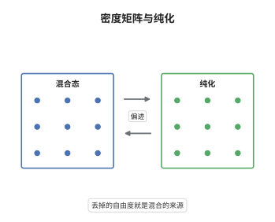

# 密度矩阵与纯化

> **一句话大白话**：混合态看起来"脏"，其实它只是更大系统上一个纯态留下的影子；把影子的主人请回来，状态就又变干净了。
>
> **小例子**：$\rho=\tfrac12|0\rangle\langle0|+\tfrac12|1\rangle\langle1|$ 由 $|\Phi^+\rangle=\tfrac1{\sqrt2}(|00\rangle+|11\rangle)$ 对第二比特取偏迹得到，$\mathrm{tr}_B|\Phi^+\rangle\langle\Phi^+|=\tfrac12 I=\rho$。

## 介绍

量子力学最初用态矢量 $|\psi\rangle$ 描述系统，但态矢量描述不了两种常见情形：系统与环境纠缠后环境被丢弃，以及制备过程本身带有随机性。密度矩阵把这两种情形统一成一个对象：$\rho\ge0$、$\mathrm{tr}\rho=1$ 的算符。它不是新的物理定律，而是把"我们对系统知道多少"编码进算符。纯化定理进一步指出这只是记账方式：任何混合态都能写成某个纯态在子系统上的偏迹，于是"混合"与"纠缠"在数学上是同一件事的两面。这条定理把开放系统的问题改写成封闭系统的问题，是量子信息里一切"把环境拉进来一起算"的做法的合法性来源。

## 几何直观

图意在说明：左栏的混合态落在状态集合的内部，右栏的纯态落在边界上；中间的双向箭头表示偏迹与纯化这一对方向相反的操作。加上辅助系统，内部的点被抬到边界；丢掉辅助系统，边界上的点又落回内部。

## 分析

**前置依赖**：线性代数、Hilbert 空间；补充：Schmidt 分解、偏迹、凸集。

**数学内涵**：
- 密度矩阵是 Hermitian、半正定、迹为一的算符，谱分解 $\rho=\sum_i\lambda_i|i\rangle\langle i|$ 给出一个概率分布，这正是"以概率 $\lambda_i$ 处于 $|i\rangle$"的量化说法。
- 纯态由 $\mathrm{tr}\rho^2=1$ 刻画，等价于 $\rho^2=\rho$，等价于谱里只有一个 $1$；混合程度可用 $\mathrm{tr}\rho^2<1$ 度量。
- 纯化不唯一：在同一个辅助空间上，所有极小纯化只差辅助系统上的一个酉变换；但把 $\rho$ 拆成纯态系综的方式却有无穷多种，说明系综不是客观的，只有 $\rho$ 是。
- 常见误区：把混合态理解成"其实处于某个纯态，只是我们不知道"。这种经典无知解释不了纠缠导致的混合，例如 Bell 态的任何一边约化都是最大混合态，而整体却是纯态。

**结构**：
1. 对 $\rho$ 做谱分解，把特征值当概率、特征向量当基底。
2. 用一个与 $\rho$ 同秩的辅助系统逐项配上正交基，写出 $|\Psi\rangle$。
3. 计算偏迹验证还原，再用 Gram 矩阵证明所有极小纯化只差一个等距，可延拓为酉算子。

## 思考过程

von Neumann 在 1927 年为了处理统计力学中的系综引入密度矩阵，但在很长时间里它被当作权宜之计。转折来自对纠缠的认识：复合系统的纯态，其子系统必然是混合的，这时混合不是无知而是结构。Schrödinger 以及后来的 Hughston、Jozsa、Wootters 把这句话反过来用：既然混合来自纠缠，那么任何混合态都可以"假装"来自某个纠缠纯态。这个反用之所以重要，是因为纯态上的线性代数（内积、Schmidt 分解、酉演化）远比混合态上的凸分析好用，纯化等于给每个凸问题配一个线性化模型。技术上唯一的障碍是辅助系统的维数：它必须至少等于 $\rho$ 的秩，否则配不出足够多的相互正交的伴侣向量。

## 证明过程

**定理**：设 $\rho$ 是 $\mathcal H_A$ 上的密度矩阵，$r=\mathrm{rank}\,\rho$。则存在维数为 $r$ 的辅助空间 $\mathcal H_B$ 与单位向量 $|\Psi\rangle\in\mathcal H_A\otimes\mathcal H_B$，使 $\mathrm{tr}_B|\Psi\rangle\langle\Psi|=\rho$。若 $|\Phi\rangle\in\mathcal H_A\otimes\mathcal H_B$ 是同一 $\rho$ 的另一个纯化，则存在 $\mathcal H_B$ 上的酉算子 $U$ 使 $|\Phi\rangle=(I_A\otimes U)|\Psi\rangle$。

**证明**：

### 1. 谱分解给出候选纯化

写 $\rho=\sum_{i=1}^{r}\lambda_i|i\rangle\langle i|$，其中 $\lambda_i>0$、$\sum_i\lambda_i=1$。取 $\mathcal H_B$ 的一组正交基 $|i_B\rangle$（$i=1,\dots,r$），令

$$
|\Psi\rangle=\sum_{i=1}^{r}\sqrt{\lambda_i}\,|i_A\rangle\otimes|i_B\rangle .
$$

### 2. 偏迹还原

按偏迹的定义，

$$
\mathrm{tr}_B\big(|\Psi\rangle\langle\Psi|\big)=\sum_{i,j}\sqrt{\lambda_i\lambda_j}\,|i_A\rangle\langle j_A|\,\langle i_B|j_B\rangle .
$$

由 $\{|i_B\rangle\}$ 的正交性，只有 $i=j$ 的项存活，故

$$
\mathrm{tr}_B|\Psi\rangle\langle\Psi|=\sum_i\lambda_i|i_A\rangle\langle i_A|=\rho .
$$

右端与整体相位无关，说明纯化至少差一个相位不唯一。

### 3. 任意纯化的 Gram 矩阵

设 $|\Phi\rangle=\sum_i|i_A\rangle\otimes|w_i\rangle$ 是任一纯化，$|i_A\rangle$ 仍取 $\rho$ 的特征基。由

$$
\rho=\mathrm{tr}_B|\Phi\rangle\langle\Phi|=\sum_{i,j}|i_A\rangle\langle j_A|\,\langle w_j|w_i\rangle
$$

与 $\rho$ 的对角形式比较，得 $\langle w_j|w_i\rangle=\lambda_i\delta_{ij}$。于是 $|w_i\rangle=\sqrt{\lambda_i}|e_i\rangle$，其中 $\{|e_i\rangle\}$ 两两正交，在 $r$ 维的 $\mathcal H_B$ 中构成一组基。

### 4. 唯一性

两个纯化分别给出 $|w_i\rangle=\sqrt{\lambda_i}|e_i\rangle$ 与 $|w_i'\rangle=\sqrt{\lambda_i}|e_i'\rangle$。定义 $U|e_i\rangle=|e_i'\rangle$ 并线性延拓，$U$ 把一组正交基送到正交基，因而是酉算子，且

$$
(I_A\otimes U)|\Psi\rangle=\sum_i\sqrt{\lambda_i}\,|i_A\rangle|e_i'\rangle=|\Phi\rangle .
$$

$\square$

## 课堂问答

**老师**：纯化是不是等于说"混合只是无知的假象，其实系统处于某个纯态"？

**学生**：不是。纯化只说明数学上可以把 $\rho$ 写成更大系统的偏迹，那个大系统的纯态是真实存在的物理描述，但 $\rho$ 本身仍然是混合的，它对 $\mathcal H_A$ 上任何测量给出的统计都与纯态不同。混合的根源是纠缠而不是无知：Bell 态的边约化是最大混合态，而整个系统确定是纯的。

**老师（追问）**：辅助系统的维数为什么不能小于 $\mathrm{rank}\,\rho$？

**学生**：因为 $\mathrm{tr}_B|\Psi\rangle\langle\Psi|$ 的秩不超过 $\dim\mathcal H_B$，这来自 Schmidt 秩不超过任一因子的维数。若 $\dim\mathcal H_B<r$，纯化的约化秩必然小于 $r$，不可能等于 $\rho$。取 $\dim\mathcal H_B=r$ 时，Schmidt 分解恰好用满 $\rho$ 的全部 $r$ 个非零特征值，这正是"极小纯化"的含义。

**老师（拓展）**：纯化不唯一，那把一个混合态拆成纯态系综的方式是否也不唯一？

**学生**：不唯一，而且差别可以很大。$\tfrac12I$ 既可以看成 $|0\rangle$ 与 $|1\rangle$ 各半，也可以看成 $|+\rangle$ 与 $|-\rangle$ 各半。Hughston-Jozsa-Wootters 定理说两个系综给出同一个 $\rho$ 当且仅当它们由一个保范矩阵相联系。所以"系统以某个概率处于某个纯态"没有客观意义，只有 $\rho$ 与测量统计是客观的；纯化把这种不唯一性集中表现为辅助系统上的酉自由度。
