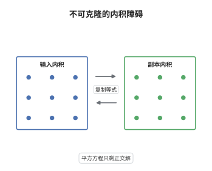

# 量子不可克隆定理

> **一句话大白话**：你没法给一个未知的量子态做一份一模一样的拷贝；要么不动它，要么就会毁掉原型。
>
> **小例子**：$|0\rangle$ 与 $|+\rangle$ 的内积是 $1/\sqrt2$，若两者都能被完美复制，两份副本的内积应当是 $1/2$，与"酉演化保内积"直接矛盾。

## 介绍

不可克隆定理说：不存在物理过程把任意未知的 $|\psi\rangle$ 变成 $|\psi\rangle|\psi\rangle$。它由 Wootters 与 Zurek、Dieks 在 1982 年独立提出，是量子密码（尤其 BB84）安全性的基石，也是"量子比特不能像经典比特那样随便读取复制"的定量表达。定理的证明只用两件事：量子演化的线性，以及内积的保持。它把"未知"这个认识论词汇变成一个可计算的代数障碍：两个非正交的态不可能同时被克隆。值得注意的是它并不禁止正交态的复制，也不禁止近似克隆，因此定理的边界正好划出了量子复制的最优折中。

## 几何直观

图意在说明：左栏是两个候选输入态的内积，右栏是复制后两份输出的内积。复制要求输出内积等于输入内积，可右栏算出的是输入内积的平方。方程只在输入内积为 $0$ 或 $1$ 时有解，非正交态因此被排除。

## 分析

**前置依赖**：量子信道、线性性；补充：内积与保真度、Schmidt 分解、正交测量。

**数学内涵**：
- 若存在酉 $U$ 使 $U(|\psi\rangle|0\rangle)=|\psi\rangle|\psi\rangle$ 对所有 $|\psi\rangle$ 成立，则对任意两态取内积得 $\langle\psi|\phi\rangle=\langle\psi|\phi\rangle^2$，故 $|\langle\psi|\phi\rangle|\in\{0,1\}$。
- 对一般 CPTP 映射结论不变：由 $\Phi$ 的线性，在 $|0\rangle$、$|1\rangle$、$|+\rangle$ 三个态上同时要求复制会得到互相矛盾的矩阵元。
- 正交族可以"克隆"：此时 $x=0$ 满足方程，受控非门就是这样的酉。量子纠错码能把一个逻辑比特编码到多个物理比特上并不违反定理，那是等距嵌入，只作用于码子空间。
- 常见误区：以为定理禁止一切复制。Buzek-Hillery 普适克隆机对任意输入都给出保真度 $5/6$ 的两份副本；定理只排除"完美且普适"的复制。

**结构**：
1. 先证酉版本：用内积保持把条件化成 $x=x^2$。
2. 再证 CPTP 版本：用线性性在三个非正交态上导出矛盾。
3. 指出正交与非正交的分界，说明近似克隆为何不受限制。

## 思考过程

1982 年之前，"能不能复制一个未知量子态"似乎只是技术问题，Wootters、Zurek 与 Dieks 同时意识到它是原理性的。他们的出发点很朴素：量子态不是一串可以读取的数字，测量会扰动它，所以"先读再写"在第一关就失败。剩下的可能只有"不读而直接变换"，而这样的变换必须是酉的或 CPTP 的。一旦写成变换，内积就成了不可回避的标尺：酉变换保内积，复制却把内积平方，这个平方就是全部障碍。Dieks 从激光放大的角度、Wootters 与 Zurek 从通信的角度分别到达同一结论，说明这不是某个模型的缺陷而是公理的推论。后来的工作沿着定理留出的缝隙走：正交态可克隆、近似克隆有最优保真度、概率克隆能以一定概率成功，三者共同勾出了量子复制的完整边界。

## 证明过程

**定理**：不存在 CPTP 映射 $\Phi$ 与固定的空白态 $|0\rangle$，使对一切 $|\psi\rangle\in\mathcal H$ 有 $\Phi(|\psi\rangle\langle\psi|)=|\psi\rangle\langle\psi|\otimes|\psi\rangle\langle\psi|$。

**证明**：

### 1. 酉情形：内积保持

设存在酉 $U$ 使 $U(|\psi\rangle|0\rangle)=|\psi\rangle|\psi\rangle$ 对所有 $|\psi\rangle$ 成立。对任意两态取内积：左端由 $U$ 保内积为 $\langle\psi|\phi\rangle\langle0|0\rangle=\langle\psi|\phi\rangle$，右端为 $\langle\psi|\phi\rangle\langle\psi|\phi\rangle$。于是

$$
\langle\psi|\phi\rangle=\langle\psi|\phi\rangle^{2}.
$$

令 $x=\langle\psi|\phi\rangle$，得 $x(1-x)=0$，故 $x\in\{0,1\}$。

### 2. 非正交态立即矛盾

取 $|\psi\rangle=|0\rangle$ 与 $|\phi\rangle=|+\rangle=\tfrac1{\sqrt2}(|0\rangle+|1\rangle)$，则 $x=1/\sqrt2$，既非 $0$ 也非 $1$。故不存在这样的 $U$，$|0\rangle$ 与 $|+\rangle$ 不能被同一台机器完美克隆。

### 3. 一般 CPTP 用三态线性矛盾

设 $\Phi$ 对所有纯态满足复制条件，取正交的 $|0\rangle,|1\rangle$，则

$$
\Phi(|0\rangle\langle0|)=|00\rangle\langle00|,\qquad \Phi(|1\rangle\langle1|)=|11\rangle\langle11| .
$$

由 $\Phi$ 的线性与 $|+\rangle\langle+|=\tfrac12\big(|0\rangle\langle0|+|0\rangle\langle1|+|1\rangle\langle0|+|1\rangle\langle1|\big)$，

$$
\Phi(|+\rangle\langle+|)=\tfrac12\big(|00\rangle\langle00|+|11\rangle\langle11|\big)+\tfrac12\big(M+M^\dagger\big),
$$

其中 $M=\Phi(|0\rangle\langle1|)$。但复制条件要求 $\Phi(|+\rangle\langle+|)=|++\rangle\langle++|$，而 $|++\rangle=\tfrac12(|00\rangle+|01\rangle+|10\rangle+|11\rangle)$，其展开式中 $|00\rangle\langle00|$ 的系数是 $1/4$，与上式左端的 $1/2$ 矛盾。故这样的 $\Phi$ 不存在。$\square$

## 课堂问答

**老师**：内积证明里"$U$ 保内积"这一步用到了量子力学的全部结构吗？换成非线性演化会怎样？

**学生**：只用到酉演化保内积这一个事实。若允许非线性演化，方程 $x=x^2$ 就不再是约束，因为非线性映射不保内积；但非线性量子力学与超光速通信、热力学第二定律冲突，物理上被排除。定理的真正前提是"演化线性且保内积"，其余都是推论。

**老师（追问）**：为什么正交态可以克隆，这不违反定理吗？

**学生**：不违反。$|0\rangle$ 与 $|1\rangle$ 的内积是 $0$，方程有解 $x=0$，对应的酉就是受控非门：$|0\rangle|0\rangle\mapsto|00\rangle$、$|1\rangle|0\rangle\mapsto|11\rangle$。定理排除的是"对所有态同时复制"，而正交族只占 Hilbert 空间的一个离散子集，线性延拓到叠加态时自动失败，受控非门把 $|+\rangle|0\rangle$ 送到纠缠态而不是 $|+\rangle|+\rangle$。

**老师（拓展）**：如果允许近似，最好的普适克隆能做到多好？

**学生**：Buzek-Hillery 普适克隆机对任意输入给出两份副本，每份保真度 $5/6$，这也是对称普适克隆的最优值，代价是把"完美"换成"普适且对称"。更一般地，$1$ 到 $N$ 的普适克隆保真度为 $(2N+1)/(3N)$，当 $N\to\infty$ 时趋近 $2/3$，说明复制的份数越多，每一份越不可靠。
