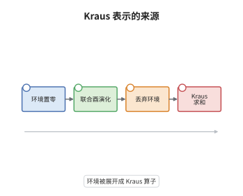

# 量子信道与 Kraus 表示

> **一句话大白话**：任何合法的量子演化都能写成"用几个算子分别夹住密度矩阵再相加"，而概率守恒只要求这些算子满足一个求和条件。
>
> **小例子**：振幅阻尼信道的算子 $K_0=|0\rangle\langle0|+\sqrt{1-\gamma}|1\rangle\langle1|$ 与 $K_1=\sqrt{\gamma}|0\rangle\langle1|$ 满足 $K_0^\dagger K_0+K_1^\dagger K_1=I$，它把 $|1\rangle\langle1|$ 以概率 $\gamma$ 变成 $|0\rangle\langle0|$。

## 介绍

量子信道是量子信息里的"函数"：输入密度矩阵，输出密度矩阵。物理上它必须来自某个封闭系统上的酉演化再加上丢弃环境，数学上这等价于完全正（completely positive）且迹保持（trace preserving）的线性映射，简称 CPTP。Kraus 表示定理说这类映射总能写成 $\Phi(\rho)=\sum_iK_i\rho K_i^\dagger$，而迹保持归结为 $\sum_iK_i^\dagger K_i=I$。这条定理把"物理可实现"翻译成一组算子的代数条件，于是判断一个线性映射是不是信道，只需检查一个半正定条件和一次求和。它是量子纠错、信道容量、开放系统动力学的共同出发点。

## 几何直观

图意在说明：左端把环境置成确定的 $|0\rangle$，中段让系统与环境一起做酉演化，右端对环境自由度取偏迹。把这条流程按环境的一组正交基展开，每一项就给出一个 Kraus 算子 $K_i=\langle i|U|0\rangle$，求和正是偏迹的展开式。

## 分析

**前置依赖**：密度矩阵、完全正性；补充：Choi 矩阵、Stinespring 扩张、偏迹。

**数学内涵**：
- 完全正性是对每个 $n$ 要求 $\Phi\otimes\mathrm{id}_n$ 保正，不能减弱为 $\Phi$ 保正：转置映射 $\Theta(\rho)=\rho^{T}$ 保正却不完全正，$(\Theta\otimes\mathrm{id})(|\Omega\rangle\langle\Omega|)$ 有特征值 $-1/2$，其中 $|\Omega\rangle=\tfrac1{\sqrt2}\sum_i|ii\rangle$。
- 迹保持等价于 $\sum_iK_i^\dagger K_i=I$：由 $\mathrm{tr}\,\Phi(\rho)=\mathrm{tr}(\rho\sum_iK_i^\dagger K_i)$，要对一切 $\rho$ 等于 $\mathrm{tr}\,\rho$ 只能如此。
- Kraus 算子个数可取 $d_Ad_B$，最小个数等于 Choi 矩阵的秩；表示不唯一，$K_i\mapsto\sum_jU_{ij}K_j$（$U$ 酉）给出同一信道。
- 常见误区：把"保正"当成"物理"，把 Kraus 表示当成唯一。另一处边界是无环境时的酉演化，它只是单个 Kraus 算子的特例，此时求和退化为一项。

**结构**：
1. 用 Choi 矩阵把完全正性变成一个半正定条件。
2. 对 Choi 矩阵做谱分解，读出 Kraus 算子。
3. 由迹保持推出求和条件，并验证 Kraus 形式确实是 CPTP。

## 思考过程

开放系统的演化一般不是酉的：系统与环境纠缠，环境的自由度被丢弃，剩下的动力学必然非酉。人们最初只会写主方程，但主方程是近似的、连续的描述。Kraus 在 1971 年、Choi 在 1975 年、Stinespring 早在 1955 年从三个方向到达同一件事：任何这样的演化都能用一组算子夹住再加起来表示。关键的技术发现是"正"不够，必须是"完全正"，因为信道总要和别处的纠缠态一起作用，只对自身保正的映射会在纠缠输入上产生负概率。这个教训很贵：转置映射看起来无害，却在纠缠态上失败。Choi 矩阵把完全正性变成一个可以计算的半正定检验，从此信道分类变成了矩阵分解问题。

## 证明过程

**定理**：设 $\Phi:\mathcal B(\mathcal H_A)\to\mathcal B(\mathcal H_B)$ 线性。则 $\Phi$ 完全正且迹保持，当且仅当存在算子 $K_i:\mathcal H_A\to\mathcal H_B$ 使

$$
\Phi(\rho)=\sum_iK_i\rho K_i^\dagger,\qquad \sum_iK_i^\dagger K_i=I .
$$

**证明**：

### 1. 充分性直接验证

若 $\Phi$ 有上述形式，则对任意 $n$ 与任意 $X\ge0$，

$$
(\Phi\otimes\mathrm{id}_n)(X)=\sum_i(K_i\otimes I)\,X\,(K_i\otimes I)^\dagger\ge0 ,
$$

每项都是半正定算子的共轭，故完全正。又 $\mathrm{tr}\,\Phi(\rho)=\mathrm{tr}\big(\rho\sum_iK_i^\dagger K_i\big)=\mathrm{tr}\,\rho$，迹保持。

### 2. Choi 矩阵

取 $\mathcal H_A$ 的正交基 $\{|i\rangle\}$，定义

$$
J=\sum_{i,j}|i\rangle\langle j|\otimes\Phi\big(|i\rangle\langle j|\big)\in\mathcal B(\mathcal H_A\otimes\mathcal H_B).
$$

令 $|\Omega\rangle=\sum_i|i\rangle|i\rangle$，直接计算得 $J=(\mathrm{id}\otimes\Phi)(|\Omega\rangle\langle\Omega|)$，故 $J\ge0$ 与 $\Phi$ 完全正等价，$J$ 称为 Choi 矩阵。

### 3. 谱分解读出 Kraus 算子

由 $J\ge0$ 写 $J=\sum_k|v_k\rangle\langle v_k|$，把 $|v_k\rangle$ 按第一个因子展开为 $\sum_i|i\rangle\otimes|u_{k,i}\rangle$。则对任意 $|y\rangle,|z\rangle$，

$$
\langle y|\Phi(|i\rangle\langle j|)|z\rangle=\langle i|\langle y|J|j\rangle|z\rangle=\sum_k\langle y|u_{k,i}\rangle\langle u_{k,j}|z\rangle .
$$

定义 $K_k|i\rangle=|u_{k,i}\rangle$ 并线性延拓，得 $\Phi(|i\rangle\langle j|)=\sum_kK_k|i\rangle\langle j|K_k^\dagger$；由线性性，同一等式对一切 $\rho$ 成立。

### 4. 迹保持给出求和条件

把上式代回迹的表达式，得 $\mathrm{tr}\,\Phi(\rho)=\mathrm{tr}\big(\rho\sum_kK_k^\dagger K_k\big)$。它对一切 $\rho$ 等于 $\mathrm{tr}\,\rho$，而 $\mathcal B(\mathcal H_A)$ 上的线性泛函由 $\rho$ 唯一确定，故 $\sum_kK_k^\dagger K_k=I$。$\square$

## 课堂问答

**老师**：为什么不能只要求 $\Phi$ 保正，非要完全正？

**学生**：因为信道从不孤立作用。只要输入与参考系统存在纠缠，实际演化就是 $\Phi\otimes\mathrm{id}_n$，它必须把纠缠态映成密度矩阵。转置映射给出反例：$\Theta$ 保正，但 $(\Theta\otimes\mathrm{id})(|\Omega\rangle\langle\Omega|)$ 在反对称向量上取特征值 $-1/2$，对应负概率。

**老师（追问）**：Kraus 算子的最小个数由什么决定？为什么可以不止一组？

**学生**：最小个数等于 Choi 矩阵 $J$ 的秩，因为 $J=\sum_k|v_k\rangle\langle v_k|$ 的谱分解只需秩那么多项。表示不唯一来自谱分解不唯一：对 $\{|v_k\rangle\}$ 做酉混合 $\sum_jU_{kj}|v_j\rangle$ 给出同一个 $J$，对应 $K_k\mapsto\sum_jU_{kj}K_j$，信道不变。

**老师（拓展）**：如果放宽迹保持，只要求"不增迹"，会得到什么？

**学生**：得到次归一化信道，$\sum_iK_i^\dagger K_i\le I$，物理上对应"以某概率被环境吸收、结果被丢弃"的过程，例如光子丢失。任何次归一化信道都可以补一个 Kraus 算子升格为 CPTP；量子测量的仪器描述就是把每个读数配一个这样的次归一化信道，全部读数求和才回到 CPTP。
