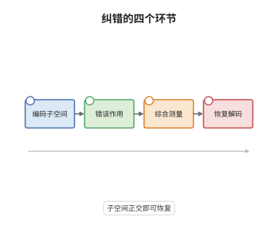

# 量子纠错码与 Knill-Laflamme 条件

> **一句话大白话**：一组错误能不能被纠正，只看一件事——这些错误作用在码字上之后，是不是只把码字整体缩放，而不把不同码字搅在一起。
>
> **小例子**：三量子比特重复码的码字 $|000\rangle$ 与 $|111\rangle$ 对单比特翻转 $X_1,X_2,X_3$ 满足 $PE_a^\dagger E_bP=\delta_{ab}P$，故任意单比特翻转都能被纠正。

## 介绍

量子纠错把"错误"看作一个信道，把"纠正"看作另一个信道，要求复合起来在码子空间上等于恒等。Knill 与 Laflamme 在 1997 年给出充要条件：码子空间 $\mathcal C$（投影 $P$）能纠正错误集 $\{E_a\}$，当且仅当存在 Hermitian 矩阵 $C$ 使 $PE_a^\dagger E_bP=C_{ab}P$。直观含义是：不同的错误把码子空间送到互相正交的子空间，而同一个错误在所有码字上的缩放因子相同。它把纠错码的设计从"构造恢复电路"变成"验证一组矩阵等式"，是 stabilizer 码、拓扑码、量子 LDPC 码共同的分析起点。

## 几何直观

图意在说明：左端的码子空间被不同错误送到互不相交的子空间，中段的综合测量判断落在哪个子空间，右端的恢复把该子空间整体搬回码子空间。子空间互不相交正是 $PE_a^\dagger E_bP=C_{ab}P$ 的几何内容，而简并码允许若干错误共用同一个子空间。

## 分析

**前置依赖**：量子信道、编码理论；补充：极分解、Choi 矩阵、POVM、量子 Singleton 界。

**数学内涵**：
- 条件等价于：对码的一组正交基 $\{|i\rangle\}$ 有 $\langle i|E_a^\dagger E_b|j\rangle=C_{ab}\delta_{ij}$，即不同错误在码字间的重叠必须是同一标量乘正交关系。
- $C$ 必定半正定且 Hermitian。$C$ 对角时称错误正交，可用投影测量直接分辨；$C$ 有非对角项时称简并码，不同错误落在同一子空间，需要更精细的恢复。
- 抗 $t$ 个错误的检验办法：只需对重量不超过 $2t$ 的错误算子验证条件，因为 $E_a^\dagger E_b$ 的重量不超过两者之和。
- 常见误区：以为必须逐个识别并纠正每个错误。Knill-Laflamme 允许简并，多个错误可由同一次恢复处理；也不必还原出错误本身，只需还原出码字。

**结构**：
1. 必要性：把恢复映射写成 Kraus 形式，证明每个 $R_bE_a$ 在码上等于标量乘恒等。
2. 用迹保持把标量矩阵 $C$ 读出来。
3. 充分性：用极分解构造恢复算子并验证迹保持。

## 思考过程

1995 年 Shor 与 Steane 各自给出第一个纠错码时，人们还不清楚"什么样的错误集可以被纠正"的一般判据，当时的构造都是分别针对比特翻转与相位翻转设计再拼接。Knill 与 Laflamme 把问题提得很准：不要问"怎么纠错"，而要问"存在恢复映射的代数后果是什么"。一旦把恢复写成 CPTP 映射并用极分解，条件就自动浮现。关键观察是错误不必正交：只要它们的作用在码上只差一个标量，恢复就可以先把它们搬到正交子空间再统一搬回。这个简并自由度后来成了拓扑码与表面码的核心资源，它们正是靠大量简并换取高的编码率。Bennett、DiVincenzo、Smolin 与 Wootters 同期的量子 Singleton 界则从计数角度补充了另一面。

## 证明过程

**定理**：设 $\mathcal C\subseteq\mathcal H$ 是码子空间，$P$ 为其正交投影，$\{E_a\}$ 是错误算子且 $\sum_aE_a^\dagger E_a=I$。则存在 CPTP 映射 $\mathcal R$ 使 $\mathcal R\big(\sum_aE_a\rho E_a^\dagger\big)=\rho$ 对所有支撑在 $\mathcal C$ 上的 $\rho$ 成立，当且仅当存在 Hermitian 矩阵 $C=(C_{ab})$ 使

$$
PE_a^\dagger E_bP=C_{ab}P\qquad\text{对所有 }a,b .
$$

**证明**：

### 1. 必要性：恢复算子的乘积是标量

设 $\mathcal R$ 的 Kraus 算子是 $\{R_b\}$，记 $M_{ba}=R_bE_a$。由 $\mathcal R\circ\mathcal E=\mathrm{id}$ 在 $\mathcal B(\mathcal C)$ 上成立，

$$
\sum_{b,a}M_{ba}XM_{ba}^\dagger=X\qquad\text{对一切 }X\in\mathcal B(\mathcal C).
$$

同一个信道的两组 Kraus 算子只差一个等距混合（Kraus 表示的唯一性），与单算子表示 $X\mapsto IXI^\dagger$ 比较，得 $M_{ba}=u_{ba}I$ 在 $\mathcal B(\mathcal C)$ 上成立，其中 $\sum_{ba}|u_{ba}|^2=1$。

### 2. 用迹保持读出 C

取 $|\psi\rangle,|\phi\rangle\in\mathcal C$ 与 $Y=E_a|\psi\rangle\langle\phi|E_b^\dagger$。由步骤 1，

$$
\mathcal R(Y)=\sum_b(R_bE_a)|\psi\rangle\langle\phi|(E_b^\dagger R_b^\dagger)=\Big(\sum_bu_{ba}\overline{u_{bb}}\Big)|\psi\rangle\langle\phi| .
$$

$\mathcal R$ 迹保持，故 $\mathrm{tr}\,\mathcal R(Y)=\mathrm{tr}\,Y$；右式的迹是 $c_{ab}\langle\phi|\psi\rangle$，左式的迹是 $\langle\phi|E_b^\dagger E_a|\psi\rangle$，于是

$$
\langle\phi|E_b^\dagger E_a|\psi\rangle=c_{ab}\langle\phi|\psi\rangle ,
$$

即 $PE_b^\dagger E_aP=c_{ab}P$。交换指标并利用左端的 Hermitian 性，得 $PE_a^\dagger E_bP=C_{ab}P$，$C$ 自动 Hermitian。

### 3. 充分性：极分解构造恢复

设 $PE_a^\dagger E_bP=C_{ab}P$，$C$ 半正定。在错误指标空间对角化 $C=\sum_k\lambda_k|k\rangle\langle k|$，置 $F_k=\sum_a\langle k|a\rangle E_a$，则

$$
PF_k^\dagger F_lP=\sum_{a,b}\overline{\langle k|a\rangle}\langle l|b\rangle C_{ab}P=\lambda_k\delta_{kl}P .
$$

丢掉 $\lambda_k=0$ 的项，对 $F_kP$ 作极分解 $F_kP=\sqrt{\lambda_k}\,U_k$，其中 $U_k$ 是部分等距且 $U_k^\dagger U_k=P$。上式等价于 $U_k^\dagger U_l=\delta_{kl}P$，故像空间 $\{U_k\mathcal C\}$ 两两正交。取恢复算子 $R_k=U_k^\dagger$ 并补上 $R_0=I-\sum_kU_kU_k^\dagger$，则 $\sum_kR_k^\dagger R_k=I$，$\mathcal R$ 是 CPTP 的。

### 4. 验证恢复

由 $\sum_lF_l\rho F_l^\dagger=\sum_aE_a\rho E_a^\dagger$ 及 $R_kF_l=\sqrt{\lambda_l}\delta_{kl}P$，

$$
\mathcal R\Big(\sum_aE_a\rho E_a^\dagger\Big)=\sum_{k,l}\sqrt{\lambda_k\lambda_l}\,\delta_{kl}\,P\rho P=\Big(\sum_k\lambda_k\Big)\rho=\rho ,
$$

最后一步用了 $\sum_k\lambda_k=\mathrm{tr}\,C=\mathrm{tr}(P\sum_aE_a^\dagger E_aP)=1$，这正是错误集构成 CPTP 信道的条件。$\square$

## 课堂问答

**老师**：条件里为什么允许 $C$ 有非对角项，而直觉上"不同错误应该被彻底区分"？

**学生**：因为纠错不要求识别错误，只要求恢复码字。$C$ 的非对角项意味着两个错误在码上的作用"只差一个标量"，它们把码子空间送到同一个子空间，此时仍然存在一个统一的恢复把该子空间搬回。这就是简并码，它反而更省资源。

**老师（追问）**：必要性证明里哪一步用到了"$\mathcal R$ 迹保持"？

**学生**：在步骤 2 比较迹的时候。步骤 1 只给出 $R_bE_a=u_{ba}I$，据此只能说明恢复后的算符是标量乘 $|\psi\rangle\langle\phi|$；要把它和错误本身的矩阵元 $\langle\phi|E_b^\dagger E_a|\psi\rangle$ 对上，必须用 $\mathrm{tr}\,\mathcal R(Y)=\mathrm{tr}\,Y$。少了迹保持，$C$ 的条目会依赖具体的 $\psi,\phi$，条件就不成立。

**老师（拓展）**：Knill-Laflamme 条件与量子 Singleton 界是什么关系？

**学生**：Knill-Laflamme 是"可纠性"的判据，Singleton 界是可纠维数的计数上界：编码 $k$ 个逻辑比特、纠正 $t$ 个错误、物理比特数 $n$ 满足 $n\ge2t+k$。两者的分工是，Singleton 界告诉你码不可能太小，Knill-Laflamme 检验一个具体子空间是否真的合格。五比特码恰好取到 $n=5$、$t=1$、$k=1$ 的等号，是满足该界的最短完美码。
