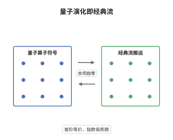

# Egorov 定理

> **一句话大白话**：把一个量子可观测量随演化"倒着搬回去"，得到的新算子就是一个沿经典 Hamilton 流搬过去的符号，只差一个比 $\hbar$ 还小的误差；也就是说，量子演化在首阶上就是经典力学的流动。
>
> **小例子**：自由粒子 $H=-\hbar^2\partial_x^2/2$，取 $a(x)=x$，经典流为 $\phi_t(x,\xi)=(x+t\xi,\xi)$。此时 $U(-t)\,x\,U(t)=x+t\hbar D_x$ 精确成立，而 $x+t\hbar D_x$ 的 Weyl 符号恰是 $x+t\xi$，即 $a\circ\phi_t$，余项为零。

## 介绍

Egorov 在 1969 年证明：用一个拟微分算子的符号去追踪量子演化，等价于让该符号沿经典 Hamilton 流运动。这条定理把"量子动力学"与"经典动力学"在首阶上焊接起来，误差是 $O(\hbar)$ 的算子。它是半经典分析的枢纽：量子遍历性、半经典测度、Bohr 对应原理、以及用经典流的信息推断谱与特征函数的行为，都以它为出发点。技术上，它把算子方程 $\frac{d}{dt}A=[H,A]/(i\hbar)$ 化为一阶输运方程，从而可以用特征线法求解。

## 几何直观

图意在说明：左栏的圆斑代表一个被 $\hbar$ 局部化的量子可观测量，它的符号集中在相空间的一小块。右栏是这块区域沿 Hamilton 流推进后的位置，形状被流拉伸或压缩。中间的对应说明：与其追踪量子算子的演化，不如追踪这块相空间区域，两者的差别只有一个 $O(\hbar)$ 的算子；但流的拉伸会使这个差别随时间指数放大，这正是半经典近似有"保质期"的几何原因。

## 分析

**前置依赖**：拟微分算子与象征演算、Weyl 量子化、Hamilton 流与辛结构、算子范数估计与 Gronwall 不等式。

**数学内涵**：
- 取 Weyl 量子化，使 $\mathrm{Op}_\hbar(\xi)=\hbar D_x$，$H=\mathrm{Op}_\hbar(h)$ 自伴，$h$ 实值，$U(t)=e^{-itH/\hbar}$。定理断言对 $a\in C_c^\infty(T^*M)$ 与任意 $T>0$，
$$
U(t)^{-1}\mathrm{Op}_\hbar(a)U(t)=\mathrm{Op}_\hbar(a\circ\phi_t)+O(\hbar),\qquad |t|\le T .
$$
- 余项含义：$O(\hbar)$ 指存在与 $\hbar$ 无关的常数 $C_T$，使该算子作为 $L^2$ 有界算子的范数不超过 $C_T\hbar$；余项本身是低一阶的拟微分算子（符号属于 $S^{m-1}$），故在 $\hbar\to0$ 时被压掉，但系数 $C_T$ 含 $e^{C|t|}$，只对有限时间窗一致。
- 精细形式：$a_t=a\circ\phi_t+\hbar a_1+O(\hbar^2)$，其中 $a_1$ 由输运方程的一阶修正与次主象征决定；逐阶展开可得到任意阶的 Egorov 定理（需对 $h$ 加更多光滑性）。
- 常见误区：把余项当成"一致地小"。它只在 $|t|\le T$ 且 $T$ 固定时一致；超过 Ehrenfest 时间 $T_E\sim C^{-1}\log(1/\hbar)$ 后，流的拉伸使误差与主项同阶，半经典图像失效。

**结构**：
1. 对时间求导，把算子演化写成换位子。
2. 用象征演算把换位子化为 Poisson 括号加高阶余项。
3. 比较首项得到输运方程，用特征线法写出 $a\circ\phi_t$。
4. 对余项作 Gronwall 估计，得到 $O(\hbar)$ 的一致界。

## 思考过程

量子演化由算子方程 $\frac{d}{dt}A=\frac{1}{i\hbar}[H,A]$ 控制，经典演化由 Hamilton 方程控制，两者形式上一模一样，只是前者作用于算子、后者作用于函数。障碍在于交换子含有两个算子的乘积，不能直接读出"作用在哪个函数上"。关键想法是把交换子按 $\hbar$ 展开：首项恰好是 Poisson 括号，而 Poisson 括号乘以 $\hbar$ 之后正好与量子方程中的 $1/\hbar$ 相消，剩下的就是经典输运方程。于是量子问题在首阶上变成一个可以用特征线法求解的一阶偏微分方程。这个"消去 $\hbar$"的技巧之所以可行，是因为 Weyl 量子化把括号结构精确地保了下来；也正因为展开只到首阶，余项才只能是 $O(\hbar)$，而误差随时间的增长只能靠 Gronwall 控制。

## 证明过程

**定理**：设 $H=\mathrm{Op}_\hbar(h)$ 在 $L^2$ 上自伴，$h$ 实值且属于适当的符号类，$\phi_t$ 为 $h$ 的 Hamilton 流。则对 $a\in C_c^\infty(T^*M)$ 与每个 $T>0$，存在常数 $C_T$ 使

$$
\big\|U(t)^{-1}\mathrm{Op}_\hbar(a)U(t)-\mathrm{Op}_\hbar(a\circ\phi_t)\big\|_{L^2\to L^2}\le C_T\,\hbar,\qquad |t|\le T .
$$

**证明**：

### 1. 对时间求导

由 $U(-t)=e^{itH/\hbar}$ 得 $\frac{d}{dt}U(-t)=\frac{i}{\hbar}H\,U(-t)$，于是

$$
\frac{d}{dt}\Big(U(-t)\mathrm{Op}_\hbar(a)U(t)\Big)=\frac{i}{\hbar}\,U(-t)\,[H,\mathrm{Op}_\hbar(a)]\,U(t).
$$

### 2. 换位子的首项

Weyl 演算给出 $[H,\mathrm{Op}_\hbar(a)]=\frac{\hbar}{i}\,\mathrm{Op}_\hbar(\{h,a\})+O(\hbar^3)$，其中括号为 $\{h,a\}=\sum_j(\partial_{\xi_j}h\,\partial_{x_j}a-\partial_{x_j}h\,\partial_{\xi_j}a)$。代回第 1 步，$i/\hbar$ 与 $\hbar/i$ 相消，得

$$
\frac{d}{dt}\Big(U(-t)\mathrm{Op}_\hbar(a)U(t)\Big)=U(-t)\,\mathrm{Op}_\hbar(\{h,a\})\,U(t)+O(\hbar).
$$

### 3. 输运方程与特征线

设 $A(t)=U(-t)\mathrm{Op}_\hbar(a)U(t)$，并尝试写成 $A(t)=\mathrm{Op}_\hbar(a_t)+R(t)$，其中 $R$ 是待定的误差。首项应当满足

$$
\partial_t a_t=\{h,a_t\},\qquad a_t|_{t=0}=a .
$$

沿 Hamilton 流求导即得 $\frac{d}{dt}a(\phi_t z)=\{h,a\}(\phi_t z)$，故 $a_t=a\circ\phi_t$ 是这个输运方程的唯一解（特征线唯一，初值唯一）。

### 4. 余项的 Gronwall 估计

把 $A(t)-\mathrm{Op}_\hbar(a\circ\phi_t)$ 记为 $R(t)$。由第 2、3 步，$\frac{d}{dt}R(t)=U(-t)\,\mathrm{Op}_\hbar(r_t)\,U(t)$，其中 $r_t$ 是 $\hbar$ 阶的余项，满足 $\sup_{|t|\le T}\|\mathrm{Op}_\hbar(r_t)\|_{L^2\to L^2}\le C\hbar$。于是

$$
\|R(t)\|\le\int_0^{|t|}\big\|\mathrm{Op}_\hbar(r_s)\big\|\,\mathrm ds\le C\int_0^{|t|}\big(1+\|R(s)\|\big)\,\mathrm ds .
$$

由 Gronwall 不等式得 $\|R(t)\|\le C\hbar\,(e^{C|t|}-1)$，在 $|t|\le T$ 上被 $C_T\hbar$ 控制。

### 5. 结论与余项的意义

合并第 3、4 步即得所述估计。余项不是一致小量而只是"有限时间窗内一致"：指数因子 $e^{C|t|}$ 反映经典流的拉伸率，当 $|t|$ 达到 $C^{-1}\log(1/\hbar)$ 时误差与主项同阶，此后半经典描述失效。若要突破这一限制，必须保留 $\hbar$ 的一次项 $a_1$ 甚至更高阶项，或者改用 Fourier 积分算子直接构造传播子。$\square$

## 课堂问答

**老师**：定理里为什么必须限制在有限时间窗 $|t|\le T$？直接把 $T$ 取到无穷行不行？

**学生**：不行。余项满足的 Gronwall 估计给出 $e^{C|t|}$ 的增长，常数 $C$ 由 $h$ 的二阶导数与 $a$ 的导数控制，与 $\hbar$ 无关。因此当 $|t|\sim\log(1/\hbar)$ 时 $e^{C|t|}\hbar$ 已经不小了。这不只是估计粗糙：在混沌系统中，相空间体积确实会被指数拉伸，轨道之间的分离是指数的，$O(\hbar)$ 的不确定性会被放大到宏观尺度，这是真实的物理效应，不是技术缺陷。

**老师（追问）**：为什么换位子的首项恰好是 Poisson 括号，而不出现别的项？

**学生**：这是 Weyl 量子化的定义性质。量子化把经典乘积提升为 Moyal 乘积 $a\star b=ab+\frac{i\hbar}{2}\{b,a\}+O(\hbar^2)$，其展开的反对称部分严格等于 $\hbar$ 乘 Poisson 括号，在本文的括号约定下正是 $\frac{\hbar}{i}\{a,b\}$；除此之外没有零阶或一阶的对称项，所以换位子的首项只能来自括号。若改用 Kohn–Nirenberg 量子化，首项仍是括号，但低阶修正不同；把量子化换掉而不调整 $U$ 的定义，公式里的 $a\circ\phi_t$ 就会变成 $a\circ\phi_{-t}$，这是最常见的符号错误来源。

**老师（拓展）**：Egorov 定理怎样推出量子遍历性？

**学生**：设 $a$ 为能量面上的光滑函数，$A=\mathrm{Op}_\hbar(a)$。Egorov 说 $U(-t)AU(t)=\mathrm{Op}_\hbar(a\circ\phi_t)$ 模 $O(\hbar)$，故若 $\psi$ 是 $H$ 的特征函数，
$$
\langle A(t)\psi,\psi\rangle=\langle \mathrm{Op}_\hbar(a\circ\phi_t)\psi,\psi\rangle+O(\hbar).
$$
左边其实与 $t$ 无关（特征函数是定态），于是量子观测量在时间平均下等于经典时间平均 $\lim_T\frac1T\int_0^T a\circ\phi_t\,\mathrm dt$。若经典流在能量面上遍历，该平均几乎处处等于 $\int a\,\mathrm d\mu_L$，这就把矩阵元的极限锁定为 Liouville 测度，正是 Šnirelman 定理的骨架。
