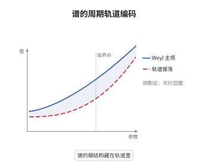

# Gutzwiller 迹公式

> **一句话大白话**：量子能谱的振荡部分可以写成一堆经典周期轨道的求和——每条闭合轨道交出一个相位（由它的作用量决定）和一个振幅（由它有多不稳定决定）。
>
> **小例子**：长度 $L$ 的一维箱中粒子，能级 $E_n=n^2\pi^2\hbar^2/(2mL^2)$，能级密度的振荡部分正是由唯一那条来回一次的周期轨道（周期 $2L$、作用量 $S=2Lp$）给出的 $\cos(2Lp/\hbar)$ 型项。

## 介绍

Weyl 定律只给出能级计数的光滑主项，而能级的实际位置由围绕主项的振荡决定。Gutzwiller 在 1971 年提出：这些振荡可以用经典周期轨道来编码，每条轨道贡献一个振幅与一个相位，相位是作用量除以 $\hbar$。这条公式把"谱"与"周期轨道"这两个看似无关的对象连接起来：谱的精细结构反映了经典系统有哪些闭合轨道、它们有多不稳定。它不是定理而是半经典近似，成立条件是所有相关周期轨道孤立且非退化，因此主要用于混沌系统；对完全可积系统，正确的版本是 Berry–Tabor 求和。尽管如此，它是量子混沌、介观物理与谱几何中最有生命力的启发式工具之一。

## 几何直观

图意在说明：平滑的底色是 Weyl 主项，即相空间体积除以 $(2\pi\hbar)^n$；叠加其上的振荡由周期轨道逐条相加而成，每条轨道贡献一个 $\cos(S_\gamma/\hbar)$ 型的波纹。轨道的周期越长、越不稳定，波纹的振幅越小，但相位变化越快；当许多轨道同时贡献时，它们的干涉就重塑了谱的细结构。

## 分析

**前置依赖**：半经典分析与 Weyl 定律、驻相法与稳定相位、传播子的 Fourier 积分算子表示、周期轨道与 Poincaré 映射、Maslov 指标。

**数学内涵**：
- 公式写作
$$
\mathrm{tr}\,e^{-itH/\hbar}\ \approx\ (2\pi\hbar)^{-n}\!\!\int_{T^*M}\!\! e^{-it|\xi|^2/\hbar}\,\mathrm dx\,\mathrm d\xi\ +\ \sum_{\gamma}\frac{T_\gamma}{i\,\hbar^{1/2}\big|\det(I-P_\gamma)\big|^{1/2}}\,e^{\,iS_\gamma/\hbar-i\frac{\pi}{2}\mu_\gamma},
$$
其中 $\gamma$ 取遍所有周期轨道（含重复），$T_\gamma$ 为其周期，$S_\gamma=\oint_\gamma\xi\,\mathrm dx$ 为作用量，$P_\gamma$ 为线性化 Poincaré 映射，$\mu_\gamma$ 为 Maslov 指标。
- 第一项是 Weyl 主项：它是相空间上 $e^{-it|\xi|^2/\hbar}$ 的积分，正是"相空间体积除以 $(2\pi\hbar)^n$"的半经典计数。
- 求和项来自驻相法：传播子核的相位在"起点等于终点"处驻定，驻相点就是闭合轨道；二阶变分的 Hessian 给出 $\det(I-P_\gamma)$，其行列式开方进入振幅分母，故轨道越不稳定贡献越小。
- 常见误区：把 $\approx$ 当成等号。该式只对孤立、非退化的周期轨道成立；若轨道成族（如圆盘台球的所有直径），$\det(I-P_\gamma)$ 退化、振幅发散，必须改用带连续对称性的版本。式中 $\hbar^{-1/2}$ 是按二维台球的归一化写的，一般维数下幂次随维数改变，但振幅来自稳定行列式开方这一结构不变。

**结构**：
1. 写出传播子核的 WKB 型振荡积分表示，相位是经典作用量。
2. 取迹，把积分限制在对角线 $y=x$ 上。
3. 对 $x$ 作驻相分析，把驻相点识别为闭合轨道并算出 Hessian。
4. 逐条轨道累加振幅与相位，再与主项合并。

## 思考过程

Gutzwiller 研究的是"能否从经典轨道读出量子谱"这一问题。困难在于：传播子的核在长时由无数条路径叠加，直接求和毫无希望。他的想法是先在半经典精度下用一个振荡积分表示核，再取迹——取迹把两端点粘在一起，恰好把"路径"变成"闭合回路"。于是对端点位置作驻相时，驻相条件就是回路闭合，而作用量对端点的导数正是动量之差，这个条件自动把轨道挑出来。第二个障碍是振幅：单条轨道的贡献必须由二阶变分决定，而闭合轨道的二阶变分含有一个零模（沿轨道的平移），必须把这一方向分离出去，剩下的横向量就给出 $\det(I-P_\gamma)$。第三是相位：每次经过焦散要加 $-\pi/2$，累计成 Maslov 指标。三块拼起来就是迹公式。也正因每一步都是渐近展开，"求和"在混沌系统中会因轨道数指数增长而发散，公式只能按分布意义或经平滑后理解。

## 证明过程

**定理（半经典近似）**：设 $H=-\hbar^2\Delta/2+V$ 的经典流在能量面上只有孤立、非退化的周期轨道。则在 $\hbar\to0$ 的意义下，按分布理解，

$$
\mathrm{tr}\,e^{-itH/\hbar}\ \approx\ \underbrace{(2\pi\hbar)^{-n}\!\!\int_{T^*M}\!\! e^{-it|\xi|^2/\hbar}\mathrm dx\,\mathrm d\xi}_{\text{Weyl 主项}}\ +\ \sum_{\gamma}\frac{T_\gamma}{i\,\hbar^{1/2}\big|\det(I-P_\gamma)\big|^{1/2}}e^{\,iS_\gamma/\hbar-i\frac{\pi}{2}\mu_\gamma}.
$$

此式是启发式近似：右端求和一般不收敛，等式只在平滑后或 Borel 求和意义下成立。

**证明**：

### 1. 传播子的振荡积分表示

短时间（或对时间作分解后）传播子的核可写成

$$
U(t,x,y)=(2\pi\hbar)^{-n}\int e^{\,i\big(S(t,x,y)-\frac{\pi}{2}\nu\big)/\hbar}\,a(t,x,y)\,\mathrm d\xi ,
$$

其中 $S(t,x,y)$ 是连接 $y$ 到 $x$ 在时间 $t$ 内的经典作用量，$a$ 是运输方程给出的振幅，$\nu$ 记录沿途焦散。对一般的 $t$，把 $[0,t]$ 切成许多小段再作组合，相位仍是作用量之和，即整体作用量。

### 2. 取迹

$$
\mathrm{tr}\,U(t)=\int U(t,x,x)\,\mathrm dx=(2\pi\hbar)^{-n}\iint e^{\,iS(t,x,x)/\hbar}\,a(t,x,x)\,\mathrm dx\,\mathrm d\xi .
$$

取迹把两端点粘合，积分变量成为闭合回路的起点 $(x,\xi)$。

### 3. 驻相分析

对 $(x,\xi)$ 作驻相。作用量对终点的导数等于终点动量，对起点的导数等于起点动量的负值，故

$$
\partial_x S(t,x,x)=0\iff \xi_{\text{终}}=\xi_{\text{起}},\qquad \partial_\xi S(t,x,x)=0\iff x_{\text{终}}=x_{\text{起}} .
$$

合起来恰是"经过时间 $t$ 后回到出发点与初动量"，即一条周期为 $t$ 的闭合轨道。于是驻相点与周期轨道一一对应。

### 4. Hessian 与振幅

在驻相点展开到二阶，二次型的行列式由作用量对端点与动量的二阶导数组成；分离沿轨道的零模后，横向量化的二次型正是 $I-P_\gamma$，其中 $P_\gamma$ 是线性化 Poincaré 映射。标准驻相公式给出振幅

$$
\frac{T_\gamma}{i\,\hbar^{1/2}\big|\det(I-P_\gamma)\big|^{1/2}},
$$

分子 $T_\gamma$ 来自零模方向的积分（长度为周期），分母来自横向的稳定行列式。若 $P_\gamma$ 有单位特征值，$\det(I-P_\gamma)=0$，驻相退化，公式失效。

### 5. 求和、相位与主项

每条轨道贡献相位 $e^{iS_\gamma/\hbar}$，焦散贡献再乘 $e^{-i\pi\mu_\gamma/2}$。把所有驻相点相加即得求和项；而 $t\to0$ 时驻相点退化为"零长轨道"，其贡献连续化为相空间积分，即第一项 Weyl 主项。

由于混沌系统中周期轨道数按 $e^{h_{\mathrm{top}}|t|}$ 增长，而每条振幅只按不稳定性的指数衰减，右端通常不绝对收敛，只能作为分布或在平滑能级密度后成立——这正是"半经典近似"而非恒等式的含义。$\square$

## 课堂问答

**老师**：为什么主项是相空间积分，而不是各条轨道贡献的某种平均？

**学生**：因为主项来自"零长轨道"这一退化驻相点。当 $t$ 固定而 $\hbar\to0$ 时，驻相点附近仍有大量非退化贡献；但把时间与能量作平滑后，短轨道的贡献连续化为相空间上的积分，其系数正是 Weyl 计数 $(2\pi\hbar)^{-n}$。换句话说，主项是"所有极短轨道"的集体效应，而求和项是"有限长轨道"的个体效应，两者尺度不同。

**老师（追问）**：分母里的 $\det(I-P_\gamma)$ 为什么会出现，它对轨道有什么要求？

**学生**：它来自二阶变分。闭合轨道的二阶变分有一个零特征方向（沿轨道的平移），分离后横向的二次型由 Poincaré 映射 $P_\gamma$ 描述，其行列式 $\det(I-P_\gamma)$ 度量轨道在横向上被拉伸或压缩的程度。轨道越不稳定，$|\det(I-P_\gamma)|$ 越大，振幅越小。要求 $P_\gamma$ 没有特征值 $1$，否则行列式为零、驻相退化，公式失效——圆盘台球的所有直径轨道正是这种情形。

**老师（拓展）**：如果系统完全可积，或者轨道成族，公式该怎么修正？

**学生**：可积系统中轨道不来孤立地出现，而是铺满不变环面，Gutzwiller 求和失效，正确的版本是 Berry–Tabor 迹公式：把对周期轨道的求和换成对环面上有理频率的求和，振幅由环面的几何给出。若轨道族由对称性造成（如圆盘、球），可以用带群作用的版本，或先用微扰破坏对称性、再取极限，让 $\det(I-P_\gamma)\to0$ 的发散与轨道数的增长相互抵消。
