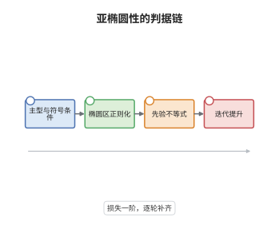

# Hörmander 亚椭圆性定理

> **一句话大白话**：有些算子虽然不是椭圆，却仍能把"输出的光滑"倒推成"输入的光滑"；能不能这样倒推，只看主象征的两件事：特征集上梯度不为零，以及虚部沿经典轨道不会从"阻尼"一侧翻到"放大"一侧。
>
> **小例子**：热算子 $P=\partial_t-\partial_x^2$ 的主象征是 $i\tau+\xi^2$，特征集只有 $\xi=\tau=0$，且 $\mathrm{Im}\,p=\tau$ 沿 $\mathrm{Re}\,p=\xi^2$ 的流为常数，故 $P$ 亚椭圆：$(\partial_t-\partial_x^2)u$ 光滑就推出 $u$ 光滑。

## 介绍

椭圆算子的正则性理论要求主象征在除零截面外处处可逆，这个条件对热算子、Kolmogorov 算子、$\bar\partial$ 型算子都太强。Hörmander 在 1963 年给出一个只依赖主象征的判据：若主象征是主型的（特征集光滑、Hamilton 场不为零），且虚部沿实部的 Hamilton 流不改变符号，则算子具有亚椭圆性（hypoellipticity）——方程右端光滑就迫使解光滑。定量版本更强：正则性只损失一阶导数。它把"椭圆性"这一过于苛刻的假设松成一组在相空间上可检验的几何条件，从此亚椭圆性成为偏微分方程正则性理论的主线之一。

## 几何直观

图意在说明：先在特征集上检验主型与虚部的符号条件，这一步把相空间分成椭圆区与特征区。椭圆区靠拟逆直接正则化，特征区则用虚部提供的阻尼换得一个损失一阶的先验不等式，最后靠迭代把这"一阶"逐轮补齐。整条链上，奇性从未被搬走，而是被阻尼压掉，这与双曲算子把奇性沿轨道搬运形成鲜明对照。

## 分析

**前置依赖**：波前集与奇性传播定理、主象征与象征演算、Gårding 不等式、Sobolev 空间与拟微分算子有界性。

**数学内涵**：
- 主型条件：$p_m(x,\xi)=0$ 且 $\xi\ne0$ 时 $\mathrm d_\xi p_m(x,\xi)\ne0$。它保证 $\mathrm{Char}(P)$ 是余切丛中的光滑流形，且 Hamilton 场 $H_{p_m}=(\partial_\xi p_m,-\partial_x p_m)$ 在特征集上不为零，双特征线才有定义。
- 符号条件：$\mathrm{Im}\,p_m$ 沿 $\mathrm{Re}\,p_m$ 的双特征线不变号，特别是不允许由负变正。直观上，$\mathrm{Im}\,p_m$ 起阻尼或放大的作用，一旦由阻尼翻成放大，某个法向对偶变量就能被吸收进实部，估计随之失效。
- 结论：$Pu\in H^s_{\mathrm{loc}}\Rightarrow u\in H^{s+m-1}_{\mathrm{loc}}$，只损失一阶；取 $s=\infty$ 得 $Pu\in C^\infty\Rightarrow u\in C^\infty$。
- 常见误区：把亚椭圆性混同于椭圆性。热算子的特征集非空，并不椭圆，却亚椭圆；反之实主象征的主型算子（如波动算子）虚部恒为零，条件退化为"不变号"的临界情形，此时奇性不被压掉而是沿双特征线传播，算子不亚椭圆。

**结构**：
1. 用拟逆处理椭圆点，把问题微局部化到特征集附近。
2. 借主型条件选取椭圆共轭，把主象征规范化，使虚部在特征点附近非正。
3. 用 Gårding 不等式得到损失一阶的先验估计。
4. 迭代该估计，把正则性逐阶补齐，并读出 $C^\infty$ 结论。

## 思考过程

椭圆性要求主象征处处可逆，可热方程的特征集是一整片超曲面，这个要求根本无法满足。Hörmander 的观察是：亚椭圆性本质上是"单向"的正则性，只需要一个方向上的估计，而不需要在每个方向上都可逆。障碍于是变成：在特征方向上没有椭圆性可用，拿什么换正则性？答案是主象征的虚部——它像一个阻尼项，在特征集上提供一个定号的二次型。关键的技术难点是符号条件必须沿 Hamilton 流陈述，而不能只在一个点上陈述，因为首阶修正项正是沿流传播的；只在单点定号，迭代时符号会在轨道上翻转，估计就闭合不了。把条件写成"沿流不变号"之后，损失的一阶导数可以在每一轮迭代中被补回来，这正是"损失一阶"而非"损失无穷阶"的原因。

## 证明过程

**定理**：设 $P\in\Psi^m$ 为适当支集算子，主象征 $p_m$ 满足：(i) $p_m$ 在 $\mathrm{Char}(P)$ 上主型；(ii) $\mathrm{Im}\,p_m$ 沿 $\mathrm{Re}\,p_m$ 的双特征线不变号。则对任意实数 $s$，

$$
u\in\mathcal D'(X),\quad Pu\in H^{s}_{\mathrm{loc}}(X)\ \Longrightarrow\ u\in H^{s+m-1}_{\mathrm{loc}}(X).
$$

特别地，$Pu\in C^\infty(X)$ 蕴含 $u\in C^\infty(X)$，即 $P$ 亚椭圆。

**证明**：

### 1. 椭圆点与特征集的分解

在 $p_m(x_0,\xi_0)\ne0$ 的点，$P$ 椭圆，存在拟逆 $Q$ 使 $QP=I+R$，$R$ 光滑化，于是 $u=QPu-Ru$ 直接继承右端的全部正则性，无须损失。故只需在 $\mathrm{Char}(P)$ 的一个小锥邻域内证明估计，再用单位分解与椭圆区拼接。

### 2. 主象征的规范化

由主型条件，$\mathrm d_\xi p_m\ne0$，可在特征集附近把 $p_m$ 写成 $p_m=e\,(\xi_n+i q)$，其中 $e$ 为该点附近不为零的椭圆因子，$q$ 实值且沿 $q=0$ 有 $\mathrm dq\ne0$。用椭圆因子消去 $e$、再用椭圆算子作共轭 $E^{-1}PE$（这既不改变亚椭圆性，也不改变正则性指标），即可设

$$
\mathrm{Re}\,p_m=\xi_n,\qquad \mathrm{Im}\,p_m\le 0
$$

于特征点的小邻域内。符号条件正是保证第二步可行的关键：若 $\mathrm{Im}\,p_m$ 沿流会由负变正，则它在 $\xi_n$ 方向上的变化率无法被吸收，规范化后必然出现正号区域。

### 3. 损失一阶的先验估计

对支集落在该邻域内的 $u$，把 $P$ 拆成自伴部分与反自伴部分，对 $\mathrm{Re}\,p_m=\xi_n$ 用分部积分，对 $\mathrm{Im}\,p_m\le0$ 用 Gårding 不等式，得

$$
\|u\|^2_{m-1}\le C\big(\|Pu\|_0\,\|u\|_0+\|u\|^2_{m-2}\big).
$$

右端第一项用 Cauchy–Schwarz 与 $\varepsilon$ 吸收，得到

$$
\|u\|_{m-1}\le C\big(\|Pu\|_0+\|u\|_{m-2}\big).
$$

把 $u$ 换成 $\Lambda^{s}u$（$\Lambda$ 为一阶椭圆算子）并注意它与 $P$ 的换位子低一阶，即得一般形式

$$
\|u\|_{s+m-1}\le C\big(\|Pu\|_s+\|u\|_{s+m-2}\big),
$$

只要 $u$ 的支集仍在同一邻域内。

### 4. 迭代提升正则性

设 $Pu\in H^s$ 且已知 $u\in H^{t}$。若 $t<s+m-1$，上式右端有限，给出 $u\in H^{t+1}$。于是每轮把指标提高一，重复至 $t=s+m-1$ 终止。用单位分解把局部估计拼成整体，得 $u\in H^{s+m-1}_{\mathrm{loc}}$。

### 5. 取 $s=\infty$

若 $Pu\in C^\infty$，则 $Pu\in H^s_{\mathrm{loc}}$ 对一切 $s$ 成立，第 4 步给出 $u\in H^{s+m-1}_{\mathrm{loc}}$ 对一切 $s$ 成立，由 Sobolev 嵌入得 $u\in C^\infty$。这就是亚椭圆性。$\square$

## 课堂问答

**老师**：为什么条件 (ii) 必须沿 Hamilton 流陈述，而不能只要求在特征集上 $\mathrm{Im}\,p_m\le0$？

**学生**：因为估计在迭代时要沿着轨道一路使用。主象征的实部生成流，虚部在这一路上的取值决定了每一步能换来多少正则性；若只在一点非正、沿流却翻成正，那么迭代到翻转处估计就中断，只能得到有限阶的结果。写成"沿流不变号"才能保证整条轨道上定号，从而支持逐阶迭代。

**老师（追问）**：结论里"损失一阶"这个一阶是从哪来的？能不能损失零阶，即像椭圆算子那样全额正则？

**学生**：一阶来自特征方向上缺少可逆性：在 $\mathrm{Char}(P)$ 上 $\mathrm{Re}\,p_m$ 退化，只剩虚部提供的二次型，它只能补偿 $m-1$ 阶而非 $m$ 阶。要零损失就必须主象征处处可逆，也就是椭圆，这恰是热算子做不到的。热算子确实是损失一阶的典型：它对 $x$ 方向二阶、$t$ 方向一阶，正则性在 $t$ 上只提升一阶。

**老师（拓展）**：如果主型条件失效，会有什么反例？

**学生**：此时特征集可能带奇点，双特征线不再唯一，虚部的符号也无从沿单条轨道检验，定理的论证整体失效。经典的处理是改用 Oleinik 型条件或次椭圆估计：例如 $\partial_x^2+x^2\partial_y^2$ 这类算子，主象征 $\xi^2+x^2\eta^2$ 在 $\xi=x=0$ 处梯度为零，必须逐点分析退化方向，而不能直接套用本定理。反过来，若主型成立但虚部恒为零，则奇性沿双特征线传播，算子不亚椭圆，波动算子就是这样的例子。
