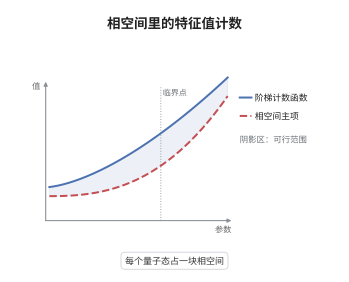

# 半经典 Weyl 定律

> **一句话大白话**：数一数不超过 $\lambda$ 的特征值有多少个，答案约等于相空间里"动能不超过 $\lambda$"那块区域的体积除以 $(2\pi)^n$：每个量子态平均占据 $(2\pi)^n$ 的相空间体积，特征值把相空间铺得越来越均匀。
>
> **小例子**：区间 $(0,L)$ 上 Dirichlet 拉普拉斯的特征值是 $\lambda_j=(j\pi/L)^2$，故 $N(\lambda)\approx L\sqrt\lambda/\pi$；而 $(2\pi)^{-1}\cdot\mathrm{vol}\{(x,\xi):x\in(0,L),\ |\xi|\le\sqrt\lambda\}=L\cdot2\sqrt\lambda/(2\pi)$，两者完全相同。

## 介绍

Weyl 在 1911 年由黑体辐射的模密度猜出这条定律：区域 $\Omega\subset\mathbb R^n$ 上拉普拉斯算子的特征值计数函数 $N(\lambda)$，当 $\lambda\to\infty$ 时按 $\lambda^{n/2}$ 增长，系数只依赖区域的体积，与形状无关。它把一个纯谱论的问题——数特征值——化归为一个几何问题——算相空间体积。此后它成为谱几何的起点：人们追问次项是否反映边界的面积、反映边界的周期轨道，从而引出热核渐近、Gutzwiller 迹公式与量子遍历性。在半经典语言下，它同时是"每个量子态占据相空间体积 $(2\pi\hbar)^n$"这一相空间计数原理的严格版本。

## 几何直观

图意在说明：阶梯是真实的特征值计数，每跨过一个特征值就跳一格；光滑曲线是相空间体积除以 $(2\pi)^n$ 给出的主项。两者的差在 $\lambda$ 增大时相对于主项趋于零，于是"数特征值"与"量相空间体积"在渐近意义下是同一件事。曲线以下的面积也提示：任何平滑化（如热核或 Abelian 求和）都会自动抹掉阶梯，只留下主项。

## 分析

**前置依赖**：谱理论与紧自伴算子、Dirichlet 与 Neumann 变分刻画、相空间体积、热核渐近。

**数学内涵**：
- 定义 $N(\lambda)=\#\{j:\lambda_j\le\lambda\}$，其中 $0<\lambda_1\le\lambda_2\le\cdots\to\infty$ 是 $-\Delta$ 在 $\Omega$ 上带 Dirichlet 边条件的特征值。
- 主项为
$$
N(\lambda)\sim\frac{\mathrm{vol}(\Omega)\,\omega_n}{(2\pi)^n}\,\lambda^{n/2},\qquad \omega_n=\mathrm{vol}\{|\xi|\le1\}=\frac{\pi^{n/2}}{\Gamma(n/2+1)} .
$$
- 等价地，$N(\lambda)\sim(2\pi)^{-n}\,\mathrm{vol}\{(x,\xi)\in T^*\Omega:|\xi|^2\le\lambda\}$：分母 $(2\pi)^n$ 来自 Fourier 变换的归一化，含义是每个量子态对应相空间体积 $(2\pi)^n$。若把 $\omega_n\lambda^{n/2}$ 简记为 $\lambda^{n/2}$，公式就写成 $N(\lambda)\sim(2\pi)^{-n}\mathrm{vol}(\Omega)\lambda^{n/2}$。
- 常见误区：主项与边界无关，边界只影响次项；$N(\lambda)$ 本身是阶梯函数，逐点比较必须用包夹而不是等号。光滑边界时预期有次项 $\mp\frac14(2\pi)^{-(n-1)}\mathrm{vol}_{n-1}(\partial\Omega)\lambda^{(n-1)/2}$，但对一般区域这一项是否真的存在仍是未决问题。

**结构**：
1. 在方体上用显式特征值把问题化为格点计数。
2. 用 Dirichlet 与 Neumann 的区域单调性把一般区域夹在两组方体之间。
3. 让方体边长趋于零，使方体体积和收敛到区域体积。
4. 用热核渐近给出另一条独立路径，并读出相空间解释。

## 思考过程

Weyl 的问题来自物理：一个空腔里能容纳多少个电磁模式？他意识到模式密度应当只与腔体体积成正比，因为高频模式的波长远小于腔体尺寸，局部看来空间是平的、边界几乎不可见。障碍是数学上没有任何显式公式可用：一般区域的特征值无法求解。关键想法是"先算最简单的形状"：方体上特征值是格点长度的平方，数特征值就是数球内格点，主项立刻由球体积给出。再把一般区域用大量小方体填满与包住，靠 Dirichlet 与 Neumann 的单调性夹住——这一步之所以可行，是因为两个边条件给出了上下两侧的变分刻画。Courant 与 Hilbert 之后，Carleman、Levitan 用热核与 Tauberian 定理给出另一条更解析的证明。Weyl 定律真正告诉人的是：谱的宏观分布是普适的，几何的个性只藏在次项与更细的涨落里。

## 证明过程

**定理**：设 $\Omega\subset\mathbb R^n$ 是有界开集，$N(\lambda)$ 为 $-\Delta$ 在 $H^1_0(\Omega)$ 上（Dirichlet）的特征值计数函数。则

$$
\lim_{\lambda\to\infty}\frac{N(\lambda)}{\lambda^{n/2}}=\frac{\mathrm{vol}(\Omega)\,\omega_n}{(2\pi)^n}.
$$

**证明**：

### 1. 方体上的显式谱与格点计数

设 $Q$ 是边长 $\ell$ 的方体。分离变量得特征值 $(\pi k/\ell)^2$，$k\in\mathbb N^n$，故

$$
N_Q(\lambda)=\#\{k\in\mathbb N^n:\ |k|\le \ell\lambda^{1/2}/\pi\}.
$$

半开方体 $\tilde Q$ 上改用周期或 Neumann 条件，则 $k\in\mathbb Z^n$，计数化为整格点数。把 $\mathbb Z^n$ 中的点与以它们为心、边长 $1$ 的小方体配对，得

$$
\#\{k\in\mathbb Z^n:|k|\le R\}=\omega_n R^n+O(R^{n-1}),
$$

于是 $N_Q(\lambda)=\omega_n(\ell\lambda^{1/2}/\pi)^n+O(\lambda^{(n-1)/2})=\frac{\mathrm{vol}(Q)\omega_n}{(2\pi)^n}\lambda^{n/2}+O(\lambda^{(n-1)/2})$。

### 2. 区域单调性

Dirichlet 特征值随区域增大而减小，Neumann 特征值亦然。因此若 $A\subset\Omega\subset B$，则

$$
N_A^{D}(\lambda)\le N_\Omega^{D}(\lambda)\le N_\Omega^{N}(\lambda)\le N_B^{N}(\lambda),
$$

其中最后一个不等号用到同一区域上 Dirichlet 谱不低于 Neumann 谱。

### 3. 用方体夹逼一般区域

取边长 $1/m$ 的网格，令 $A_m$ 为完全落在 $\Omega$ 内的所有小方体之并，$B_m$ 为与 $\Omega$ 相交的所有小方体之并。则 $A_m\subset\Omega\subset B_m$，且当 $m\to\infty$ 时 $\mathrm{vol}(A_m),\mathrm{vol}(B_m)\to\mathrm{vol}(\Omega)$。由第 1、2 步，

$$
\frac{\mathrm{vol}(A_m)\omega_n}{(2\pi)^n}\le\liminf_{\lambda\to\infty}\frac{N_\Omega(\lambda)}{\lambda^{n/2}}\le\limsup_{\lambda\to\infty}\frac{N_\Omega(\lambda)}{\lambda^{n/2}}\le\frac{\mathrm{vol}(B_m)\omega_n}{(2\pi)^n}.
$$

先令 $\lambda\to\infty$，再令 $m\to\infty$，两端同时收敛到 $\mathrm{vol}(\Omega)\omega_n/(2\pi)^n$，定理得证。

### 4. 热核路径与相空间解读

另一条路线是看热核迹：由局部参数化与 Laplace 方法，$\mathrm{tr}\,e^{t\Delta}\sim(4\pi t)^{-n/2}\mathrm{vol}(\Omega)$（$t\downarrow0$）。而 $\mathrm{tr}\,e^{t\Delta}=\int_0^\infty e^{-t\lambda}\,\mathrm dN(\lambda)$ 是 $N$ 的 Laplace–Stieltjes 变换，Karamata 型 Tauberian 定理把它翻译回 $N(\lambda)\sim(4\pi)^{-n/2}\Gamma(n/2+1)^{-1}\mathrm{vol}(\Omega)\lambda^{n/2}$，与第 3 步一致。

半经典形式更直白：取 $H=-\hbar^2\Delta$，记其特征值为 $\mu_1\le\mu_2\le\cdots$，则

$$
\#\{\mu_j\le1\}\sim(2\pi\hbar)^{-n}\,\mathrm{vol}\{(x,\xi)\in T^*\Omega:\ |\xi|^2\le1\},
$$

即"相空间体积除以 $(2\pi\hbar)^n$"。令 $\hbar=\lambda^{-1/2}$ 即回到原式。$\square$

## 课堂问答

**老师**：主项系数里为什么没有边界的面积？边界难道不占用空间吗？

**学生**：主项是高频极限，波长 $\sim\lambda^{-1/2}$ 远小于区域尺度时，模式在局部看起来就像在无穷空间中，只有体积起作用。边界的影响是低一阶的：它贡献 $\lambda^{(n-1)/2}$ 量级的次项，且符号依赖于边界条件。所以面积不出现在首项系数里，只出现在次项，这也正是"听音辨形"问题的困难所在。

**老师（追问）**：夹逼论证里，为什么可以先把 $\lambda\to\infty$、再让 $m\to\infty$？

**学生**：因为对每个固定的 $m$，$A_m$ 与 $B_m$ 都是有限个方体之并，第 1 步已给出它们计数函数的精确主项与可控余项，所以对固定的 $m$ 取 $\lambda\to\infty$ 是合法的。得到的上下界只差一个随 $m$ 趋于零的体积误差，最后让 $m\to\infty$ 即可。若反过来先让 $m\to\infty$，方体数目将随 $\lambda$ 增长，余项就不再可控。

**老师（拓展）**：这条定律在流形上与在半经典框架里分别长什么样？

**学生**：在 $n$ 维闭黎曼流形上，$N(\lambda)\sim\omega_n\mathrm{vol}(M)\lambda^{n/2}/(2\pi)^n$ 依然成立，证明改用局部欧氏化加 Dirichlet–Neumann 夹逼或热核；这说明主项是纯局部的、与曲率无关。在半经典框架里它等价于 $\mathrm{tr}\,f(H/\hbar)\sim(2\pi\hbar)^{-n}\int_{T^*M}f(|\xi|^2)\,\mathrm dx\,\mathrm d\xi$，即 Weyl 型拟经典迹公式；把 $f$ 换成振荡函数就得到 Gutzwiller 迹公式，主项正是这里的相空间积分。
