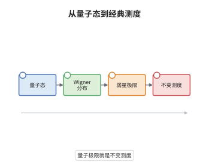

# 半经典测度与量子极限

> **一句话大白话**：一族量子态在 $\hbar\to0$ 时会在相空间上留下一个概率分布，这个分布的每个极限点都必须被经典流"原地不动"地保持；若经典流还遍历，极限就只能是均匀的 Liouville 测度。
>
> **小例子**：一维谐振子的第 $n$ 个特征函数，其 $|\psi_n|^2$ 在相空间集中到椭圆 $x^2+\xi^2=2n\hbar+O(\hbar)$ 附近；对时间平均后得到该椭圆上的均匀测度 $\mathrm d\theta/2\pi$，它显然被旋转流保持。

## 介绍

量子力学说状态由波函数描述，经典力学说状态由相空间上的点描述，两者如何衔接？半经典测度（semiclassical measure，也称 Wigner 测度）给出了一条严格通道：把量子态映为相空间上的概率测度，再取 $\hbar\to0$ 的弱极限。极限测度必须被经典 Hamilton 流保持不变，这是 Egorov 定理的直接推论。进一步，若经典流在能量面上遍历，则几乎所有特征函数的极限都是 Liouville 测度——这就是量子遍历性（Šnirelman 定理）。这套语言把"量子极限"从模糊的物理直觉变成测度论命题，是量子混沌的核心框架。

## 几何直观

图意在说明：量子态先被摊成相空间上的一个"模糊团块"，其宽度约为 $\hbar$，总质量为一。$\hbar\to0$ 时团块的宽度趋于零，若它集中到某条能量面上就得到一个概率测度。这个测度不能任意，它必须沿 Hamilton 流的轨道保持不变，因此只能由不变集上的不变测度拼成；若流遍历，拼法只有一种，即均匀分布。

## 分析

**前置依赖**：Egorov 定理、Weyl 量子化与 Wigner 分布、遍历理论与不变测度、紧性（Banach–Alaoglu）与 sharp Gårding 不等式。

**数学内涵**：
- 定义：对 Weyl 量子化，令 $\int_{T^*M}a\,\mathrm d\mu_\hbar=\langle\mathrm{Op}_\hbar(a)\psi_\hbar,\psi_\hbar\rangle$，$a\in C_c^\infty(T^*M)$，$\|\psi_\hbar\|=1$。由 sharp Gårding 不等式，$\mu_\hbar$ 是"几乎正"的，其弱极限仍是概率测度。
- 紧性：$\mu_\hbar(T^*M)=1$ 且质量不逃逸（可用相空间紧支集截断），故存在弱星 收敛子列，极限记为 $\mu$。
- 不变性：由 Egorov 定理与特征函数是定态，得
$$
\int a\circ\phi_t\,\mathrm d\mu=\int a\,\mathrm d\mu,\qquad \forall a\in C_c^\infty(T^*M),
$$
即 $\mu$ 是经典流的不变测度。
- 支撑：由 $\langle(H-E)^2\psi_\hbar,\psi_\hbar\rangle=0$ 与 $(H-E)=\mathrm{Op}_\hbar(h-E)+O(\hbar)$，得 $\int(h-E)^2\,\mathrm d\mu=0$，故 $\mathrm{supp}\,\mu\subset\Sigma_E=\{h=E\}$。
- 常见误区：半经典测度不一定是 Liouville 测度。可积系统中不同子列可以有完全不同的极限，甚至可以是环面上的 $\delta$ 型测度；只有遍历性才能排除这种多样性，而"所有子列都收敛"（量子唯一遍历性）仍是未决猜想。

**结构**：
1. 用 Wigner 测度把量子态映为相空间测度，并证明其紧性。
2. 用能量守恒把极限测度的支撑压到能量面上。
3. 用 Egorov 定理证明极限测度对 Hamilton 流不变。
4. 在遍历假设下作遍历分解，并用方差的迹估计证明几乎处处均匀。

## 思考过程

Wigner 在 1932 年就提出用相空间上的拟概率分布来表示量子态，但它的定义依赖量子化方案，且在 $\hbar\to0$ 时行为并不显然。真正的障碍是：如何说明"量子态趋于某个经典对象"这件事有意义？Hörmander 与 Egorov 的工作提供了钥匙——只要把量子态与算子的矩阵元配对，再把算子换成符号，就得到一个测度；而 Egorov 定理恰好说明这个测度在时间演化下几乎不变，误差只有 $O(\hbar)$。于是"量子极限"被翻译成"不变测度的紧集"，剩下的问题纯属遍历理论。Šnirelman 的关键一步是方差计算：他证明矩阵元偏离 Liouville 平均的平方和在特征值上求和后是 $o(N)$，于是偏离只能发生在密度零的子列上。这也解释了为什么量子遍历性只能给出"几乎处处"的结论，而不能逐条特征函数地断言——后者正是 Rudnick 与 Sarnak 提出的量子唯一遍历性猜想。

## 证明过程

**定理**：设 $H=-\hbar^2\Delta+V$ 具光滑实位势，$\psi_\hbar$ 是单位特征函数，对应特征值 $E_\hbar\to E$，$\mu_\hbar$ 为相应的半经典测度。则任一弱星 聚点 $\mu$ 满足：(i) $\mu$ 是支撑在 $\Sigma_E$ 上的概率测度；(ii) $\mu$ 对 Hamilton 流不变；(iii) 若流在 $\Sigma_E$ 上遍历，则在密度为 $1$ 的特征函数子列上 $\mu$ 等于 $\Sigma_E$ 上的归一化 Liouville 测度。

**证明**：

### 1. 紧性

取 $\chi\in C_c^\infty(T^*M)$ 使 $\chi=1$ 于相空间的一个大紧集上。$\langle\mathrm{Op}_\hbar(\chi)\psi_\hbar,\psi_\hbar\rangle\le1$，故质量不逃向无穷。由 sharp Gårding 不等式，对 $a\ge0$ 有 $\langle\mathrm{Op}_\hbar(a)\psi_\hbar,\psi_\hbar\rangle\ge-C\hbar\|\nabla^2a\|_\infty$，故弱极限仍是正测度；取 $a=1$ 得总质量 $1$。由 Banach–Alaoglu 定理，存在弱星 收敛子列。

### 2. 支撑落在能量面上

特征函数满足 $(H-E_\hbar)\psi_\hbar=0$，而 $H-E_\hbar=\mathrm{Op}_\hbar(h-E_\hbar)+O(\hbar)$。对 $(h-E)^2$ 用 sharp Gårding 不等式，

$$
\int_{T^*M}(h-E)^2\,\mathrm d\mu_\hbar\le C\hbar+O(|E_\hbar-E|)\to0,
$$

故极限测度支撑在 $\{h=E\}$ 上，即能量面 $\Sigma_E$。

### 3. 不变性来自 Egorov

设 $\psi_\hbar$ 是特征函数，则 $U(t)\psi_\hbar=e^{-iE_\hbar t/\hbar}\psi_\hbar$，于是

$$
\langle\mathrm{Op}_\hbar(a\circ\phi_t)\psi_\hbar,\psi_\hbar\rangle=\langle U(-t)\mathrm{Op}_\hbar(a)U(t)\psi_\hbar,\psi_\hbar\rangle+O(\hbar)=\langle\mathrm{Op}_\hbar(a)\psi_\hbar,\psi_\hbar\rangle+O(\hbar).
$$

令 $\hbar\to0$ 沿收敛子列，得 $\int a\circ\phi_t\,\mathrm d\mu=\int a\,\mathrm d\mu$ 对一切 $a$ 成立，即 $\mu$ 不变。

### 4. 遍历性与均匀性

把 $\mu$ 作遍历分解 $\mu=\int\mu_\omega\,\mathrm d\nu(\omega)$，每个 $\mu_\omega$ 是遍历不变测度。对固定的 $a$，由 Birkhoff 遍历定理，时间平均 $\frac1T\int_0^T a\circ\phi_t\,\mathrm dt$ 收敛到某个 $\bar a$，且 $\int\bar a\,\mathrm d\mu_\omega=\int a\,\mathrm d\mu_\omega$。

另一方面，对特征函数用 Egorov 并积分可得矩阵元与时间无关，故 $\langle\mathrm{Op}_\hbar(a)\psi_\hbar,\psi_\hbar\rangle=\int\bar a\,\mathrm d\mu+O(\hbar)$。若流在 $\Sigma_E$ 上遍历，则唯一的遍历不变概率测度是归一化 Liouville 测度，于是 $\mu$ 只能是它。至于"几乎处处"而非"逐条"：对矩阵元偏离的平方在 $\lambda_j\le E$ 上求和，用 $\mathrm{tr}\,\mathrm{Op}_\hbar(a)^*U(-t)\mathrm{Op}_\hbar(a)U(t)$ 的迹估计可得该和为 $o(N(E,\hbar))$，故偏离只可能发生在密度为零的子列上。

### 5. 结论

(i)(ii) 已由第 2、3 步得到；(iii) 由第 4 步的遍历分解与方差估计得到。注意可积系统中遍历分解非平凡，不同子列可收敛到不同的遍历分量，故不能去掉遍历性假设。$\square$

## 课堂问答

**老师**：半经典测度的"极限"是对什么取极限？为什么不是逐点收敛？

**学生**：极限是 $\hbar\to0$ 时测度序列的弱星 极限，即只要求对每个光滑试验函数 $a$ 的积分收敛，而不要求测度本身逐点或按全变差收敛。这是必然的选择：Wigner 测度一般不是正测度（在某些区域可以取负值），逐点收敛没有意义；而测试函数积分恰好对应量子可观测量的期望，物理上最有意义。取弱星 拓扑还带来紧性，保证极限一定存在。

**老师（追问）**：不变性那一步，特征函数是定态这件事用在哪里？

**学生**：用在把 $U(t)\psi_\hbar$ 换成一个纯相位 $e^{-iE_\hbar t/\hbar}\psi_\hbar$。这样 Egorov 公式右端的 $\langle\mathrm{Op}_\hbar(a)\psi_\hbar,\psi_\hbar\rangle$ 就与 $t$ 无关，而左端是 $\int a\circ\phi_t\,\mathrm d\mu_\hbar$，于是对每个 $t$ 极限都相同，得到不变性。若 $\psi_\hbar$ 不是特征函数而是任意态，就只能得到"极限测度沿流演化"的结论，得不出不变性。

**老师（拓展）**：量子唯一遍历性猜想说了什么？它与本定理差在哪里？

**学生**：猜想（Rudnick–Sarnak）断言对负曲率曲面，整列特征函数（而不只是密度为 $1$ 的子列）的半经典测度都收敛到 Liouville 测度，即不存在"例外子列"。本定理只给出几乎处处收敛，因为证明依赖平方和的估计，只能排除密度零的例外集。这一差别是实质性的：算术曲面上已发现存在例外子列（Lindenstrauss 与 Soundararajan 的算术量子唯一遍历性结果给出部分反例），说明"几乎处处"在一般情况下是最优的。
