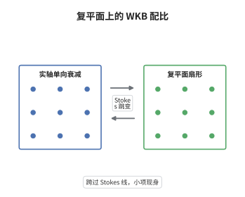

# 复 WKB 与 Stokes 现象

> **一句话大白话**：在复平面上做 WKB 近似时，解在两个指数项之间的"配比"不是固定的；跨过某些特定曲线（Stokes 线）时，本来小到看不见的那一项会突然被点亮，而这件事在实轴上完全看不到。
>
> **小例子**：Airy 方程 $w''=zw$ 在正实轴上只有衰减解 $z^{-1/4}e^{-\frac23z^{3/2}}$；绕过转向点 $z=0$ 之后，同一解析解的渐近式里却多出一个 $i\,z^{-1/4}e^{+\frac23z^{3/2}}$，多出的系数就是 Stokes 常数。

## 介绍

WKB 近似把二阶线性常微分方程的解写成 $Q^{-1/4}\exp(\pm\frac1\hbar\int\sqrt Q)$ 的形式。在实轴上这通常够用，但在复平面上，$\int\sqrt Q$ 是多值的，转向点成为支点，两个指数项的相对大小随辐角变化。Stokes 在 19 世纪中叶发现：沿某些从转向点出发的曲线（Stokes 线）行进时，指数小的那一项会以正比于指数大项的幅度突然出现，系数发生跳变。这一现象无法被任何阶的幂级数渐近展开捕捉，因为它是指数小的。复 WKB 与 Stokes 现象因此成为连接渐近分析、精确 WKB（exact WKB）、Borel 求和与复原（resurgence）的枢纽，也是量子隧穿与能级分裂的标准语言。

## 几何直观

图意在说明：左栏是实轴视角，看起来只有一个衰减指数项，配比恒定。右栏把平面割成扇形，从转向点射出几条 Stokes 线；每跨过一条，衰减项与增长项的配比就换一次，于是同一条解析解在不同扇形里写成不同的线性组合。连线表示两侧描述的是同一个解，只是基底选择变了。

## 分析

**前置依赖**：渐近分析与 WKB 近似、二阶线性常微分方程的转向点理论、最速下降法与 Airy 函数、解析延拓与多值函数。

**数学内涵**：
- 方程取 $\hbar^2w''(z)=Q(z)w(z)$。形式代入 $w=\exp\big(\frac1\hbar\int^z S\big)$ 得 $S^2+\hbar S'=Q$，展开 $S=S_0+\hbar S_1+\cdots$ 给出 $S_0=\pm\sqrt Q$、$S_1=-S_0'/(2S_0)$，故
$$
w_\pm(z)=Q(z)^{-1/4}\exp\Big(\pm\frac1\hbar\int_{z_0}^{z}\sqrt{Q(s)}\,\mathrm ds\Big)\big(1+O(\hbar)\big).
$$
- 转向点即 $Q(z_0)=0$ 的点。此处 $Q^{-1/4}$ 发散、$\int\sqrt Q$ 有支点，WKB 基失效，必须在转向点附近用 Airy 型函数作内解再与两侧匹配。
- Stokes 线：从转向点出发、满足 $\mathrm{Im}\frac1\hbar\int\sqrt Q=0$ 的曲线（两指数同相，一主一次）。穿越它时次支配项的系数按 $c_+\mapsto c_++T\,c_-$ 跳变，$T$ 称为 Stokes 常数。另一类曲线 $\mathrm{Re}\frac1\hbar\int\sqrt Q=0$ 上两指数模长相等，称为反 Stokes 线，那里两基互换角色但系数连续。
- 常见误区：以为 Stokes 跳变是"近似失效"造成的假象。恰恰相反，它是精确的性质：跳变量 $\sim e^{-c/\hbar}$，比任何 $\hbar^N$ 都小，所以渐近级数对它完全"盲"；要看到它必须控制最优截断之后的尾项。

**结构**：
1. 作 WKB 形式展开，得到领头振幅 $Q^{-1/4}$ 与相位。
2. 分析系数的递推增长，说明级数发散、最优截断给出指数小误差。
3. 在复平面上割开扇形，讨论两个指数的相对权重如何随辐角变化。
4. 在转向点用 Airy 方程近似并匹配，读出 Stokes 常数。

## 思考过程

19 世纪的渐近分析面临一个悖论：形式级数对每个 $\hbar$ 都发散，却在数值上极其准确。Poincaré 用"最优截断"解释了这个悖论——截到 $N\sim1/\hbar$ 项时误差最小，约为 $e^{-c/\hbar}$。但这也意味着级数丢掉了指数小的信息，而物理上最要紧的效应（隧穿、能级分裂）恰恰是指数小的。Stokes 的洞察是：这些信息没有消失，它藏在解的解析延拓里。同一条解析解绕转向点一圈后，两个指数项的相对系数必然改变，因为 $\int\sqrt Q$ 多值、$\sqrt Q$ 换号；改变的幅度由绕行所积累的指数因子决定，于是"小项"以正比于"大项"的方式出现。要在数学上兑现这一点，就必须在复平面上工作，并且必须放弃"级数求和"的想法，改用 Borel 求和或精确 WKB 的框架。这也是为什么复 WKB 在 20 世纪后期随复原理论复兴，成为处理非微扰效应的标准工具。

## 证明过程

**定理**：设 $Q$ 在区域 $\Omega$ 内全纯且只有单零点，$w$ 是 $\hbar^2w''=Qw$ 在 $\Omega$ 内的解。则在每个不含转向点的扇形 $S_j$ 上存在常数 $c_\pm^{(j)}$ 使

$$
w(z)=c_+^{(j)}w_+(z)+c_-^{(j)}w_-(z),\qquad w_\pm=Q^{-1/4}\exp\Big(\pm\frac1\hbar\int^z\sqrt Q\Big)\big(1+O(\hbar)\big),
$$

且当扇形由一条 Stokes 线分隔时，相邻两组系数满足 $c_+^{(j+1)}=c_+^{(j)}+T\,c_-^{(j)}$（或对称地作用于另一侧），$T$ 为仅依赖局部模型的 Stokes 常数。

**证明**：

### 1. WKB 展开与领头项

令 $w=\exp\big(\frac1\hbar\int^z S\big)$，则 $w'=\frac{S}{\hbar}w$，$w''=\big(\frac{S^2}{\hbar^2}+\frac{S'}{\hbar}\big)w$。代入方程并乘以 $\hbar^2$ 得

$$
S^2+\hbar S'=Q .
$$

按 $\hbar$ 展开 $S=S_0+\hbar S_1+\hbar^2S_2+\cdots$ 得 $S_0^2=Q$、$2S_0S_1+S_0'=0$，故 $S_1=-\frac{S_0'}{2S_0}$，而

$$
\exp\Big(\int^z S_1\Big)=S_0^{-1/2}=Q^{-1/4}.
$$

这就是 WKB 振幅的来源：它恰好是使"通量" $w^2\sqrt Q$ 守恒的因子。

### 2. 级数发散与最优截断

$S_n$ 由递推 $2S_0S_{n+1}=-\sum_{j=1}^{n}S_jS_{n-j}-S_n'$ 给出。由归纳可见 $S_n$ 含 $Q$ 的至多 $n$ 阶导数，其量级为 $n!$ 型增长，故 $\sum\hbar^nS_n$ 对每个固定的 $\hbar$ 都发散。截断到 $N$ 项时误差约为 $N!\,\hbar^N$，在 $N\approx1/\hbar$ 处取极小，量级为 $e^{-c/\hbar}$。这说明渐近展开丢掉的正是指数小的部分。

### 3. 扇形划分与基的选择

在不含转向点的单连通扇形内，可取定 $\sqrt Q$ 的单值分支，于是 $w_\pm$ 良定、线性无关，任何解都可唯一地写成它们的组合。绕转向点一周时 $\sqrt Q$ 变号，$\int\sqrt Q$ 改变一个周期，$w_+$ 与 $w_-$ 互换角色并各乘一个指数因子。因此在复平面上必须把区域割成若干扇形，每个扇形内用一组系数描述；扇形之间的分界就是两指数相对量级发生重排的曲线。

### 4. Stokes 线与系数跳变

在 $\mathrm{Im}\frac1\hbar\int\sqrt Q=0$ 的曲线上，两指数同相，衰减项的贡献与增长项处于"可比较"的位置。设从左侧扇形进入右侧扇形，左侧解为 $c_-w_-$（纯衰减）。把两侧的渐近式都解析延拓到同一点比较，左侧表达式在右侧扇形中的延拓会额外产生一个正比于 $c_-$ 的增长项，比例常数 $T$ 只依赖转向点的局部模型，与整体几何无关。于是

$$
c_+^{(j+1)}=c_+^{(j)}+T\,c_-^{(j)},\qquad c_-^{(j+1)}=c_-^{(j)} .
$$

这就是 Stokes 现象：系数不是连续变化的函数，而是在一条曲线上跳变。跳变量正比于主导项系数，故其绝对大小是指数小的。

### 5. 局部模型与 Stokes 常数

在单零点 $z_0$ 附近，$Q(z)\approx Q'(z_0)(z-z_0)$，方程近似为 Airy 方程。Airy 函数在三个扇形中的渐近式给出连接公式；把两侧扇形中的 WKB 表达式与 Airy 渐近式逐项比较，可定出 $T$。对 Airy 方程，在此归一化下 $T=i$。多个转向点的情形由这些局部跳变沿路径复合而成，路径的同伦类决定最终的系数。

### 6. 结论

于是"复 WKB + Stokes 跳变"给出一个精确的框架：在每个扇形内用发散级数作最优截断，在扇形边界按 $T$ 修正系数，最终得到指数精度正确的整体解。这正是精确 WKB 与 Borel 求和能够复原非微扰效应的原因。$\square$

## 课堂问答

**老师**：Stokes 跳变明明是指数小的，为什么还会影响结果？物理上它重要在哪里？

**学生**：因为很多效应本身就是指数小的。量子隧穿的透射系数、双势阱的能级分裂、共振的宽度，量级都是 $e^{-c/\hbar}$；如果只用幂级数渐近展开，这些量会被算成零。Stokes 跳变恰好把这些"超越所有阶"的项从一个扇形搬到另一个扇形，所以它尽管小，却是这些现象的唯一来源。

**老师（追问）**：为什么不能在实轴上直接看到这个跳变，而非要绕到复平面？

**学生**：实轴上两个指数项的模长严格分开，衰减项永远被压住，没有任何机制让它"长出来"。只有在复平面上，$\int\sqrt Q$ 的虚部变化才会让两项同相；而解析延拓是唯一的，所以绕转向点一圈后系数必须改变，否则解就不是同一个。Stokes 线正是标记"必须换基"的位置，它们从转向点射出，把平面分成若干扇形。

**老师（拓展）**：这套复 WKB 与精确 WKB、复原理论是什么关系？

**学生**：Vorós 的精确 WKB 把 $\hbar$ 当作复参数，用 Borel 求和把发散级数变成真正的解，并证明 Stokes 常数可以从级数的 Borel 奇点算出；跳变因此不再是"附加规则"，而是求和路径变形时必然产生的留数。进一步的复原理论（resurgence）指出，不同阶的瞬子贡献由同一组 Stokes 常数联系，从而把微扰级数与瞬子级数编织成一个整体。能量量子化条件也随之修正为 $\oint\sqrt Q\,\mathrm dz=2\pi\hbar(k+\frac12)$ 加上瞬子修正，这正是 EBK 量子化在复域中的精确版本。
