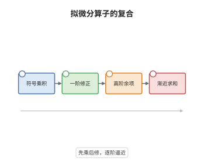

# 拟微分算子的象征演算

> **一句话大白话**：两个带符号的算子相乘，不等于把两个符号直接相乘，而要按导数阶数一层层加修正；每求一次关于频率的导数，就要配一次关于位置的导数，并带上系数 $-i$。
>
> **小例子**：取 $p=\xi$（对应算子 $D_x=-i\partial_x$）与 $q=x$，则 $\xi\#x=\xi x-i$，即 $D_x\circ x=xD_x-i$，也就是正则交换关系 $[D_x,x]=-i$。那个 $-i$ 正是 $\partial_\xi$ 与 $\partial_x$ 配对后留下的修正。

## 介绍

拟微分算子是"把微分算子里的 $\partial_x$ 换成频率变量 $\xi$"之后得到的对象，在局部上可以用振荡积分写出。单个算子的符号好写，但两个算子相乘时符号并不相乘：交换顺序会留下低一阶的修正。象征演算（symbol calculus）就是逐项计算这些修正的完整规则，其核心是一个按多重指标 $\alpha$ 求和、系数为 $(-i)^{|\alpha|}/\alpha!$ 的渐近展开。它把算子代数翻译成符号代数，使复合、伴随、求逆都变成可以逐项计算的形式运算，成为椭圆正则性、微局部分析与半经典极限的共同地基。

## 几何直观

图意在说明：两个符号各自在相空间的区域上取值，复合就是把它们放在重叠的小区域里做一次振荡积分。驻相点给出频率方向的对齐 $\eta=0$ 与位置方向的对齐 $y=0$，展开后零阶项是普通乘积 $pq$，一阶项来自 $\partial_\xi p\,\partial_x q$，再往后的项被 $\langle\xi\rangle$ 的负幂压住，所以展开只能是渐近的而不是收敛的。

## 分析

**前置依赖**：Fourier 分析、象征类 $S^m_{1,0}$ 与振荡积分、驻相法、分布的微局部刻画。

**数学内涵**：
- 定义 $\mathrm{Op}(p)u(x)=(2\pi)^{-n}\iint e^{i(x-y)\cdot\xi}p(x,\xi)u(y)\,\mathrm dy\,\mathrm d\xi$，其中 $p\in S^m_{1,0}$ 意即 $|\partial_\xi^\alpha\partial_x^\beta p(x,\xi)|\le C_{\alpha\beta}\langle\xi\rangle^{m-|\alpha|}$。
- 复合符号为 $p\#q\sim\sum_{\alpha}\frac{(-i)^{|\alpha|}}{\alpha!}\,\partial_\xi^\alpha p\,\partial_x^\alpha q$，$\alpha$ 取遍 $\mathbb N^n$ 中一切多重指标，$|\alpha|=\alpha_1+\cdots+\alpha_n$，$\alpha!=\alpha_1!\cdots\alpha_n!$；零阶项即 $pq$。
- 一阶修正的反对称部分给出 Poisson 括号：$p\#q-q\#p=-i\{p,q\}+O(S^{m_1+m_2-2})$，故符号代数在首项上不交换，量子化的痕迹就藏在低一阶的项里。
- 常见误区：把 $\#$ 当成普通乘法会丢掉一阶项，而椭圆拟逆、亚椭圆性与 Egorov 定理恰恰依赖这一项；另外展开式只是渐近的，对固定 $\xi$ 的级数一般发散。

**结构**：
1. 把两个算子都写成振荡积分，把复合核化为一个双相位积分。
2. 对中间变量作替换与分部积分，把复合写成 $p(x,\xi+\eta)$ 与 $q(x+y,\xi)$ 的卷积形式。
3. 对两个因子分别作 Taylor 展开，用 $\delta$ 函数的矩恒等式定出系数。
4. 用切割函数与分部积分估计尾项，得到 $S^{m_1+m_2-N}$ 的余项，再作渐近求和。

## 思考过程

Kohn 与 Nirenberg 在 1965 年为处理变系数椭圆方程引入这类算子，Hörmander 随后给出系统的象征类与演算。障碍很具体：变系数算子不能被 Fourier 变换对角化，复合后的核不再是卷积核，符号无从直接读出。关键想法是把算子写成振荡积分，把复合看成对中间变量的一次积分，再把相位在驻相点展开——驻相点正好是"频率守恒"的位置。展开中每一次 $\partial_\xi$ 都配一次 $\partial_x$，因为 $x-y$ 与 $\xi$ 在相位 $e^{i(x-y)\xi}$ 中共轭；求导落下的因子 $i$ 累积成 $(-i)^{|\alpha|}$。之所以只能用渐近展开，是因为 $\partial_x^\alpha q$ 只按 $\langle\xi\rangle^{-|\alpha|}$ 衰减，级数对固定 $\xi$ 发散，但任意截断都留下可控的负幂余项，这已足够做拟逆。

## 证明过程

**定理**：设 $p\in S^{m_1}_{1,0}$、$q\in S^{m_2}_{1,0}$，且其中至少一个是适当支集的。则 $\mathrm{Op}(p)\mathrm{Op}(q)=\mathrm{Op}(p\#q)$，$p\#q\in S^{m_1+m_2}_{1,0}$，且对每个 $N\ge1$，

$$
p\#q-\sum_{|\alpha|<N}\frac{(-i)^{|\alpha|}}{\alpha!}\,\partial_\xi^\alpha p\,\partial_x^\alpha q\in S^{m_1+m_2-N}_{1,0}.
$$

**证明**：

### 1. 把复合写成双相位积分

把两个算子依次作用，得到

$$
\big(\mathrm{Op}(p)\mathrm{Op}(q)u\big)(x)=(2\pi)^{-2n}\iiint e^{i(x-y)\cdot\xi}p(x,\xi)\,e^{i(y-z)\cdot\eta}q(y,\eta)\,u(z)\,\mathrm dz\,\mathrm dy\,\mathrm d\eta\,\mathrm d\xi .
$$

先对 $z$ 积分，得到 $u$ 的 Fourier 变换；再对 $y$ 分部积分，可把二重积分收缩到 $y=x$ 附近，从而写成单一振荡积分 $\int e^{i(x-z)\cdot\xi}r(x,z,\xi)u(z)\,\mathrm dz\,\mathrm d\xi$，函数 $r$ 在 $z=x$ 处光滑。

### 2. 化到标准形式

利用平移与 Fourier 反演，上述核可以整理为

$$
p\#q(x,\xi)=(2\pi)^{-n}\iint e^{-iy\cdot\eta}\,p(x,\xi+\eta)\,q(x+y,\xi)\,\mathrm dy\,\mathrm d\eta .
$$

直觉是：复合等于先让 $q$ 在 $y$ 方向偏移一点、在频率上偏移 $\eta$，再用 $e^{-iy\cdot\eta}$ 把两处偏移"配对"起来；对 $\eta$ 积分给出 $\delta(y)$，于是偏离被强制变小。

### 3. Taylor 展开与矩恒等式

在 $y=0$、$\eta=0$ 处展开两个因子：

$$
p(x,\xi+\eta)=\sum_{\alpha}\frac{\eta^\alpha}{\alpha!}\,\partial_\xi^\alpha p(x,\xi),\qquad q(x+y,\xi)=\sum_{\beta}\frac{y^\beta}{\beta!}\,\partial_x^\beta q(x,\xi).
$$

逐项计算基本积分

$$
(2\pi)^{-n}\iint e^{-iy\cdot\eta}\,\eta^\alpha y^\beta\,\mathrm dy\,\mathrm d\eta=(-i)^{|\alpha|}\,\alpha!\,\delta_{\alpha\beta},
$$

其中 $\delta_{\alpha\beta}$ 表示两个多重指标逐分量相等。于是只有 $\alpha=\beta$ 的项存活，系数恰为 $(-i)^{|\alpha|}/\alpha!$，这正是所断言的展开。

### 4. 余项估计与渐近求和

把 $p$ 的展开截断到 $|\alpha|<N$，余项含 $\eta$ 的 $N$ 次齐次因子。取切割函数把 $|y|+|\eta|\le1$ 与外部拆开：紧区域上用符号估计，外部对 $y$ 分部积分 $N$ 次，每次换来 $\langle\eta\rangle^{-1}$ 的衰减。两部分合起来属于 $S^{m_1+m_2-N}_{1,0}$，故截断误差随 $N$ 单调变光滑。

### 5. 拟逆与交换子

若 $p$ 椭圆，即 $|p(x,\xi)|\ge c\langle\xi\rangle^{m}$ 于 $|\xi|\ge R$，取 $q_0=p^{-1}\chi$ 使 $p\#q_0=1+r_{-1}$，再用 $q=q_0-q_0\#r_{-1}+\cdots$ 逐阶修正并由 Borel 引理求和，得 $p\#q=1$ 模光滑化算子，即拟逆存在。另一方面，把展开式中 $\alpha$ 与 $\beta$ 的角色对调再相减，一次项留下

$$
p\#q-q\#p=-i\{p,q\}+O(S^{m_1+m_2-2}),\qquad \{p,q\}=\sum_{j}\big(\partial_{\xi_j}p\,\partial_{x_j}q-\partial_{x_j}p\,\partial_{\xi_j}q\big),
$$

所以交换子 $[\mathrm{Op}(p),\mathrm{Op}(q)]$ 的首项是 $-i\{p,q\}$，经典 Poisson 括号由此进入量子侧。$\square$

## 课堂问答

**老师**：展开式里的系数为什么是 $(-i)^{|\alpha|}$ 而不是 $i^{|\alpha|}$？

**学生**：因为矩恒等式 $(2\pi)^{-n}\iint e^{-iy\cdot\eta}\,\eta^\alpha y^\beta\,\mathrm dy\,\mathrm d\eta=(-i)^{|\alpha|}\alpha!\,\delta_{\alpha\beta}$ 中的 $-i$ 来自相位的两次求导：对 $\eta$ 求导落下 $-iy$，对 $y$ 求导落下 $-i\eta$，配对后剩下的因子正是 $(-i)^{|\alpha|}$。若把相位约定整体换成 $e^{+i(x-y)\cdot\xi}$，指数会一致地翻转，所以系数必须跟随约定。

**老师（追问）**：既然级数一般发散，为什么还称它为"演算"？

**学生**：需要的是任意阶截断后的余项可控，而不是级数收敛。余项落在 $S^{m_1+m_2-N}$，$N$ 任意大，于是可以逐阶求解、逐阶改进；用 Borel 引理还能构造一个真正满足 $p\#q$ 的符号，其渐近展开正是该级数。这正是渐近展开替代收敛级数的标准用法。

**老师（拓展）**：$p\#q\ne q\#p$ 会带来什么后果？

**学生**：一阶项给出 $[\mathrm{Op}(p),\mathrm{Op}(q)]=-i\,\mathrm{Op}(\{p,q\})$ 模低两阶，这是"Poisson 括号量子化为交换子"的精确版本。它既解释了为何不能同时对角化两个算子，也是 Egorov 定理中量子演化近似经典流的全部来源；椭圆性与亚椭圆性则依赖高阶修正项来闭合正则性估计。
