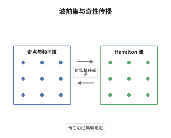

# 波前集与奇性传播定理

> **一句话大白话**：一个分布在哪里不光滑、朝哪个频率方向不光滑，可以画成一张"奇性地图"；椭圆算子不改变这张图，双曲型算子只是把图上的点沿经典轨道整体搬走。
>
> **小例子**：$\delta(x_1)\otimes1$ 在 $\mathbb R^2$ 上的奇点集是直线 $x_1=0$，但只有法方向 $(\xi_1,0)$（$\xi_1\ne0$）属于波前集；沿 $\xi_2$ 方向它其实是光滑的。

## 介绍

经典的正则性理论只回答"函数在哪里不光滑"，用奇点集 $\mathrm{singsupp}\,u$ 就够了。但当奇性有方向时，这个信息太粗：一条直线上的 $\delta$ 分布只沿法向奇异，沿切向完全光滑。Hörmander 在 1970 年引入波前集 $\mathrm{WF}(u)$，把奇性同时定位在位置 $x$ 与频率方向 $\xi$ 上，即定位在余切丛的球丛里。从此"奇性"成为一个相空间对象：椭圆算子不搬动它，而实主象征的 Hamilton 流决定它如何移动。奇性传播定理（propagation of singularities）正是这一图景的定量表述，也是双曲方程、散射理论、成像与反问题的基本工具。

## 几何直观

图意在说明：左栏的锥表示该点的奇性只沿锥内的频率方向存在，锥外的频率分量已经光滑。右栏的曲线是主象征给出的 Hamilton 流，奇性沿着它整体平移，锥的形状与开角被流保持；若某条轨道上没有奇性，则整条轨道上都没有——这就是"传播"的含义。

## 分析

**前置依赖**：分布与 Fourier 变换、拟微分算子与象征演算、Hamilton 流、椭圆性与拟逆。

**数学内涵**：
- 定义：称 $(x_0,\xi_0)\notin\mathrm{WF}(u)$，若存在 $\varphi\in C_c^\infty(X)$ 使 $\varphi(x_0)\ne0$，并存在 $\xi_0$ 的锥邻域 $\Gamma$，使得对每个 $N$ 都有 $|\widehat{\varphi u}(\xi)|\le C_N\langle\xi\rangle^{-N}$ 对一切 $\xi\in\Gamma$ 成立；否则称 $(x_0,\xi_0)\in\mathrm{WF}(u)$。简言之，存在微局部截断使 Fourier 变换在该方向上快速衰减。
- 等价刻画：存在零阶拟微分算子 $A$，在 $(x_0,\xi_0)$ 处椭圆，使 $Au\in C^\infty$。这把"频率局部化"翻译成"算子局部化"，便于做演算。
- 基本性质：$\pi(\mathrm{WF}(u))=\mathrm{singsupp}\,u$（投影到 $x$ 空间）；$\mathrm{WF}(Pu)\subset\mathrm{WF}(u)$；$P$ 椭圆时 $\mathrm{WF}(Pu)=\mathrm{WF}(u)$；一般地 $\mathrm{WF}(u)\subset\mathrm{WF}(Pu)\cup\mathrm{Char}(P)$。
- 传播：若 $p_m=\sigma_m(P)$ 实值且主型（$p_m=0\Rightarrow\mathrm dp_m\ne0$），$Pu\in C^\infty$，则 $\mathrm{WF}(u)\setminus\mathrm{WF}(Pu)$ 是 $\mathrm{Char}(P)$ 内一些双特征线的并。
- 常见误区：$\mathrm{WF}(u)$ 关于 $\xi$ 是锥集，只记方向不记模长，故常在 $\xi$ 的球面上画它；此外它刻画的是 $C^\infty$ 奇性，无法区分 $H^s$ 层次，要分层次须换成 $H^s$-波前集。

**结构**：
1. 验证定义与截断函数的选取无关，使之成为分布的固有属性。
2. 用拟逆把椭圆算子两侧的正则性互推，得 $\mathrm{WF}(Pu)=\mathrm{WF}(u)$。
3. 用"微局部作用不制造新方向奇性"得一般包含关系，并把差别限制在特征集上。
4. 沿 Hamilton 流解输运方程，配合损失一阶的先验估计做正则性提升。

## 思考过程

在 Hörmander 之前，Sato 用"奇性谱"研究超函数，Lax 与 Nirenberg 也在双曲方程的奇性传播上做了工作，但都缺少一个统一而可计算的载体。障碍在于：位置信息与方向信息必须同时被局部化，而通常的截断只能局部位移、不能局部频率。关键想法是用锥形邻域代替球邻域，因为"方向"天然是锥形的量；再把这个锥形截断实现为拟微分算子，于是"在某点某方向光滑"就等价于"某个椭圆算子作用后光滑"，一切都落回象征演算。至于为什么奇性沿 Hamilton 流走：换位子的首项是 $-i\{p_m,a\}$，只要截断象征 $a$ 沿流为常数，首项就消失，正则性便能逐阶提升，流的轨道因此成为奇性的"传送带"。

## 证明过程

**定理**：设 $P\in\Psi^m$ 适当支集，主象征 $p_m$ 实值且为 $\mathrm{Char}(P)$ 上的主型，$u\in\mathcal D'(X)$。若 $Pu\in C^\infty(X)$，则 $\mathrm{WF}(u)\subset\mathrm{Char}(P)$，且 $\mathrm{WF}(u)$ 在 $\mathrm{Char}(P)$ 内对 $p_m$ 的 Hamilton 流不变：若 $(x_0,\xi_0)\in\mathrm{WF}(u)$ 且 $p_m(x_0,\xi_0)=0$，则整条双特征线 $\gamma=\{\phi_t(x_0,\xi_0)\}$ 都含于 $\mathrm{WF}(u)$。

**证明**：

### 1. 定义与截断无关

设条件对某个 $\varphi$ 成立，$\psi\in C_c^\infty$ 的支集落在 $\{\varphi\ne0\}$ 内。则 $\psi u=(\psi/\varphi)\cdot\varphi u$ 是光滑函数与 $\varphi u$ 的乘积，其 Fourier 变换是 $\widehat{\varphi u}$ 与一个 Schwartz 函数的卷积。卷积不破坏锥内的快速衰减，只要把锥稍微缩小即可，故条件对 $\psi$ 也成立。反过来用单位分解把任意截断拆成支集足够小的有限和，可见定义只依赖 $u$ 与点 $(x_0,\xi_0)$。

### 2. 椭圆算子不改变波前集

设 $P$ 在 $(x_0,\xi_0)$ 处椭圆，则存在 $Q\in\Psi^{-m}$ 使 $QP=I+R$，$R$ 为光滑化算子。于是 $u=QPu-Ru$。$Q$ 是 proper 的，$Pu\in C^\infty$ 蕴含 $QPu\in C^\infty$；$Ru$ 也光滑。故 $u$ 在该点微局部光滑，即 $\mathrm{WF}(u)\subset\mathrm{WF}(Pu)$。另一方向见下一步，两者合起来给出 $\mathrm{WF}(u)=\mathrm{WF}(Pu)$。

### 3. 一般包含关系

若 $u$ 在 $(x_0,\xi_0)$ 微局部光滑，取 $A$ 在该点椭圆、且象征在 $\xi_0$ 的某个小锥内恒等于 $1$，则 $Au\in C^\infty$，而 $(1-A)u$ 的波前集避开该方向。写 $Pu=PAu+P(1-A)u$：第一项因 $Au$ 光滑而光滑；第二项的波前集含于 $\mathrm{WF}\big((1-A)u\big)$，仍避开 $(x_0,\xi_0)$。故 $Pu$ 在该点光滑，即 $\mathrm{WF}(Pu)\subset\mathrm{WF}(u)$。于是未被 $Pu$ 继承的奇性只能落在 $P$ 非椭圆的方向上，即 $\mathrm{WF}(u)\subset\mathrm{WF}(Pu)\cup\mathrm{Char}(P)$。

### 4. 沿双特征线提升正则性

设 $(x_0,\xi_0)\in\mathrm{WF}(u)\cap\mathrm{Char}(P)$，$\gamma(t)=\phi_t(x_0,\xi_0)$。反设某点 $\gamma(t_0)$ 不属于 $\mathrm{WF}(u)$，取 $A\in\Psi^0$ 在 $\gamma(t_0)$ 处椭圆且 $Au\in C^\infty$。令 $a_s=a\circ\phi_{-s}$ 为沿流拉回的象征，$A_s=\mathrm{Op}(a_s)$；则 $\{p_m,a_s\}=0$，故

$$
[P,A_s]\in\Psi^{m-2}
$$

因为交换子的主象征是 $-i\{p_m,a_s\}$，而 $a_s$ 沿流为常数使该括号恒为零，阶数于是自动降一。

由主型条件，在特征点附近可得损失一阶的先验估计：若 $A_su\in H^{t}$ 且 $PA_su\in H^{t-m+2}$，则 $A_su\in H^{t+1}$。这里 Sobolev 指标均指 $\gamma$ 的管状邻域内的局部指标；必要时先乘紧支截断，截断函数与 $P$ 的换位子只贡献低阶项，不影响结论。而

$$
PA_su=A_sPu+[P,A_s]u,
$$

右端两项分别属于 $C^\infty$ 与 $H^{t-m+2}$。令 $S$ 为使 $A_su\in C^\infty$ 的 $s$ 的集合：$0\in S$；而只要 $s_0\in S$，上述估计对 $s_0$ 附近的 $s$ 给出 $A_su\in H^{t+1}$，$t$ 任意，故 $s_0$ 有邻域含于 $S$。因此 $S$ 既开又闭且非空，等于整个 $\mathbb R$，即 $u$ 在 $\gamma(t_0+s)$ 附近光滑对一切 $s$ 成立。这与 $(x_0,\xi_0)\in\mathrm{WF}(u)$ 矛盾。

### 5. 结论

于是 $\mathrm{WF}(u)\cap\mathrm{Char}(P)$ 是流的饱和集：它在每条双特征线上要么全含、要么全不含。结合第 3 步在椭圆点处的正则性，得到 $\mathrm{WF}(u)\subset\mathrm{Char}(P)$ 且由双特征线拼成。$\square$

## 课堂问答

**老师**：为什么定义里要用"锥邻域"，改成 $\xi_0$ 的一个小球邻域不行吗？

**学生**：不行。波前集关于 $\xi$ 是锥形的：若 $(\xi_0)$ 方向上的 Fourier 变换快速衰减，则 $2\xi_0$、$3\xi_0$ 方向上同样衰减，所以信息只与方向有关。用球邻域会把模长也当成变量，定义就不再与伸缩相容。用锥邻域还使得"频率足够大时衰减"这一渐近性质可以被干净地说清楚。

**老师（追问）**：椭圆算子那一步为什么能反过来推 $u$ 的正则性？

**学生**：靠拟逆 $Q$ 与 $QP=I+R$。$u=QPu-Ru$，右端第一项继承 $Pu$ 的正则性，第二项因为 $R$ 光滑化而自动光滑；再配合 $A$ 的椭圆性，就把"$Pu$ 在 $(x_0,\xi_0)$ 光滑"等价为"$u$ 在该点光滑"。这一步用到的正是 $P$ 在该点椭圆这个条件，非椭圆方向没有拟逆，结论自然要打折扣。

**老师（拓展）**：如果 $p_m$ 不是实值，或特征集上有多个分歧方向，会发生什么？

**学生**：若 $\mathrm{Im}\,p_m$ 在特征集上不为零，则主象征的虚部提供额外的正则性增益，奇性反而不传播，这正是亚椭圆性的来源；只有 $\mathrm{Im}\,p_m$ 沿流不变号时才有部分传播。若 $\mathrm dp_m$ 在特征点退化，双特征线不再是唯一轨道，奇性可以沿整个特征叶状结构扩散，此时需要亚主象征与更高阶的 Hamilton 不变量来刻画。
