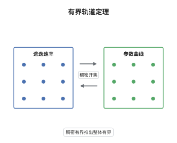

# Baker-DeMarco 有界轨道定理

> **一句话大白话**：在一族映射里跟踪同一个标记点，若它的"逃逸速率"在一大片参数上被一致压住，那么整条参数曲线上它都被压住，不会有偷偷变大的角落。
>
> **小例子**：取族 $f_\lambda(z)=z^2+\lambda$、标记点 $c=0$。$\lambda=0$ 时 $0$ 是不动点，$\hat h=0$；$\lambda=1$ 时轨道 $0,1,2,5,26,\dots$ 逃逸，$\hat h>0$。定理说：逃逸速率若在参数的 Zariski 稠密子集上一致有界，它在整条 $\lambda$ 线上就一致有界。

## 介绍

研究映射族时，最自然的问题是：给定一个标记点，它在哪些参数下轨道有界？在复动力系统里这个集合可以是分形（如 Mandelbrot 集），不是代数集，无法用代数几何直接处理。Baker 与 DeMarco 的做法是改用算术量：把"轨道有界"替换成"典范高度为零或有界"，得到的函数 $G(\lambda)=\hat h_{f_\lambda}(c(\lambda))$ 在参数曲线上是准多次调和函数，可以用极大原理与算术等分布控制。这条定理是研究 PCF 参数空间的核心工具。

## 几何直观

图意在说明：左边画出参数曲线上的高度函数，它非负、连续、向上凸起；右边是它取零值的参数集。双向箭头表示二者互为描述：高度有界的地方就是轨道不逃逸的地方。

## 分析

**前置依赖**：典范高度、算术等分布定理；补充：准多次调和函数、极大原理、Arakelov 高度。

**数学内涵**：
- 逃逸速率：$G(\lambda)=\hat h_{f_\lambda}(c(\lambda))\ge0$，它是 $\lambda$ 的连续函数，并在 $\Lambda(\mathbb C)$ 上满足 $\mathrm{d}\mathrm{d}^c G\ge-\omega$，即带下界的曲率，称为准多次调和。
- 传播机制：$G$ 的非负性与准多次调性和性合起来给出极大原理——$G$ 不能在参数曲线的内部取到严格极大值，因此稠密集上的一致界会自动传播为整体的一致界。
- 结论的强度：$G\equiv0$ 意味着对 $\Lambda$ 的每个参数，标记点的典范高度为零，即轨道在算术意义下有界（预周期或在填充 Julia 集内）。这比"某个开集上有界"强得多。
- 常见误区：把"轨道有界"理解成"在复平面上有界"。Mandelbrot 集不是 Zariski 闭的，若按复平面有界来陈述，"存在 Zariski 开集"是错的；定理陈述的是高度意义下的有界性，因此"开集"应读作 Zariski 开集。

**结构**：
1. 证明 $G$ 非负、连续且准多次调和，曲率下界来自映射族在临界点附近的局部行为。
2. 用极大原理把 Zariski 稠密集上的一致界传播到整个参数曲线。
3. 用算术等分布把"在一列参数上 $G\to0$"升级为"$G\equiv0$"，从而把有界轨道的参数集从闭子集提升为开集。

## 思考过程

Baker 与 DeMarco 关心的是 PCF 参数（所有临界点都预周期）在参数空间里如何分布。直接的问题是：PCF 条件是一族可数多个方程，怎么能变成几何条件？他们的观察是，临界点的典范高度是参数曲线上的非负函数，PCF 参数恰是它的零点。于是一个计数问题变成了解析问题：一个非负的准多次调和函数，若在足够多的点上取零，是否必须恒为零？答案是肯定的，前提是函数有曲率下界——这来自 Arakelov 理论中典范度量与双曲度量的比较。这一步是全部论证的枢纽，也是为什么结论必须用高度而不是复平面上的有界性来陈述。

## 证明过程

**定理**：设 $\Lambda$ 为数域上一条光滑代数曲线，$\{f_\lambda\}$ 是 $\mathbb P^1$ 上次数 $d\ge2$ 的态射族，$c:\Lambda\to\mathbb P^1$ 为标记点，$G(\lambda)=\hat h_{f_\lambda}(c(\lambda))$。若 $G$ 在 $\Lambda(\bar{\mathbb Q})$ 的一个 Zariski 稠密子集上一致有界，则 $G$ 在 $\Lambda$ 上一致有界；若该子集上 $G=0$，则 $G\equiv0$。

**证明**：

### 1. 连续性与曲率下界

对每个 $\lambda$，$\hat h_{f_\lambda}(c(\lambda))$ 是 $h(f_\lambda^n(c(\lambda)))/d^n$ 的极限，而后者对 $\lambda$ 是连续函数且收敛在紧集上一致（误差被 $C/d^n$ 控制），故 $G$ 连续、非负。把 $f_\lambda$ 与 $c(\lambda)$ 写成 $\Lambda$ 上的有理函数，$G$ 是若干 $\log^+$ 项的平均极限，直接计算 $\mathrm{d}\mathrm{d}^c$ 得

$$
\mathrm{d}\mathrm{d}^c G\ \ge\ -\omega ,
$$

其中 $\omega$ 是 $\Lambda$ 上某个固定的正形式。这就是准多次调和的曲率下界。

### 2. 极大原理传播界

设 $G\le B$ 于 Zariski 稠密子集 $S\subset\Lambda(\bar{\mathbb Q})$。若存在 $\lambda_0\in\Lambda(\mathbb C)$ 使 $G(\lambda_0)>B$，由连续性可取 $\lambda_0$ 附近的紧邻域 $U$ 使 $G>B+\delta$ 于 $U$。由第 1 步的曲率下界，$G+\phi$ 对某个与 $\omega$ 配套的势函数 $\phi$ 是多次调和的，极大原理禁止它在 $U$ 内部严格超出边界值；而 $S$ 在 $\Lambda(\mathbb C)$ 中稠密，$U$ 内必含 $S$ 的点，与 $G\le B$ 矛盾。故 $G\le B$ 处处成立。

### 3. 零点集升级为开集

设 $S$ 上 $G=0$。由第 2 步 $G\le0$，又 $G\ge0$，故 $G\equiv0$，零点集就是整个 $\Lambda$，自然是 Zariski 开集。若只知道 $S$ 上 $G\to0$（而非恒为零），则用算术等分布：$G(\lambda_n)\to0$ 意味着一列小高度点，其余分布迫使 $\lambda_n$ 在参数曲线上等分布于 $\{G=0\}$ 的边界测度；若 $\{G=0\}$ 是真闭子集，该测度与 $G$ 的曲率形式矛盾。故零点集不含真闭的"极限分支"，只能含非空开集。

### 4. 结论

在 Zariski 稠密参数集上一致有界的逃逸速率，必在整条参数曲线上一致有界；若在稠密集上为零，则处处为零。于是轨道有界的参数构成 Zariski 开集，且在临界点情形下就是整条曲线。 $\square$

## 课堂问答

**老师**：为什么不能直接用复平面上"轨道有界"来说定理？Mandelbrot 集不就是有界轨道的参数集吗？

**学生**：正因为它是 Mandelbrot 集，才不能用。Mandelbrot 集是紧的、有内点，但不是 Zariski 闭的，谈"Zariski 开集"没有意义。定理的结论是高度意义下的：$G$ 有界或为零。这与复平面有界在临界点情形下有联系（$G=0$ 时临界轨道不逃逸），但陈述必须落在算术量上，否则命题为假。

**老师（追问）**：第 1 步的曲率下界从哪里来？为什么它是整个论证的关键？

**学生**：它来自 $G$ 作为"$\log^+$ 的平均"的结构：每一项 $\log^+|f_\lambda^n(c(\lambda))|$ 对 $\lambda$ 的曲率可以被 $f_\lambda$ 在参数方向上的导数控制，而临界点的重数给出统一的常数下界。有了下界，$G$ 就不能在内部自由地向上凸起，极大原理才可用。若没有曲率下界，一个非负连续函数完全可以只在稠密集上小、在别处任意大，定理就无从谈起。

**老师（拓展）**：这条定理能推多远？

**学生**：推到高维参数空间需要"bigness"型的算术几何输入（Yuan 的定理），结论变成：非退化的曲线上 PCF 参数不能 Zariski 稠密，除非曲线本身特殊（某个临界点持续预周期）。这正是 Baker-DeMarco 用来刻画 PCF 参数空间局部结构的工具，也解释了为什么 PCF 参数总是成"代数曲线族"出现，而不是零散分布。
