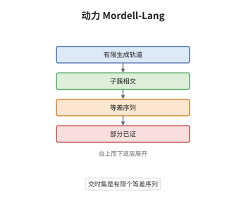

# 动力系统 Mordell-Lang 猜想

> **一句话大白话**：猜想说，一个点沿映射不断往前走，它撞进某个固定子簇的那些时刻，必然是若干个等差数列拼起来的，不会有"越来越怪"的时间集。
>
> **小例子**：取 $X=\mathbb G_m$、$f(x)=x^2$、$V=\{1\}$，起点取本原 $2^k$ 次单位根 $\zeta$。则 $f^n(\zeta)=1$ 当且仅当 $2^n\ge 2^k$，时刻集是 $\{n:n\ge k\}$，正是一个等差数列。

## 介绍

Ghioca、Tucker 与 Zhang 在 2008 年提出动力系统 Mordell-Lang 猜想：特征零的拟射影簇 $X$ 上给定态射 $f$、起点 $x$ 与闭子簇 $V$，则集合 $\{n\ge0:f^n(x)\in V\}$ 是有限个等差数列之并。它是古典 Mordell-Lang 定理的动力学版本：后者处理"子群与子簇的交"，前者处理"单个轨道与子簇的交"。猜想在一般情形仍开放，只在半阿贝尔簇、单项映射等有群结构的场合被证明；正特征下已有反例，说明特征零假设不可省。

## 几何直观

图意在说明：第一层把轨道收进一个有限生成群，第二层用 Mordell-Lang 把交分解成陪集，第三层在陪集上得到等差数列，第四层注明这只在半阿贝尔等特殊情形成立。

## 分析

**前置依赖**：Mordell-Lang 定理、典范高度；补充：线性递推与 Skolem-Mahler-Lech 定理、有限生成交换群上的整矩阵作用。

**数学内涵**：
- 猜想（Ghioca-Tucker-Zhang）：$k$ 特征零，$X$ 拟射影，$f:X\to X$ 态射，$x\in X(k)$，$V\subset X$ 闭子簇，则 $\{n\ge0:f^n(x)\in V\}$ 是有限个等差数列 $a+b\mathbb N$ 的并。
- 已证情形：$X$ 为半阿贝尔簇、$f$ 为群自同态、$x$ 属于有限生成子群 $\Gamma$。此时轨道整个落在 $\Gamma$ 内，古典 Mordell-Lang 给出 $V\cap\Gamma$ 的陪集分解，再用线性递推定出返回时刻。
- 已证情形：$\mathbb G_m^N$ 上的单项映射（monomial map）。这类映射在坐标上写成 $x_i\mapsto\prod_j x_j^{a_{ij}}$，取对数后变成整矩阵作用，仍可归约为线性递推。
- 常见误区：以为"轨道与 $V$ 相交无穷多次"就已经是结论。猜想说的是时刻集的**结构**（有限个等差数列之并），比无穷性严格得多；例如时刻集 $\{p^k\}$ 虽然无穷，却不是有限个等差数列之并。
- 已知反例：Benedetto-Ghioca-Kurlberg-Tucker-Zhang 在正特征构造了 $\mathbb F_p(t)$ 上 $\mathbb A^2$ 的自映射，其轨道与一条直线的交时集恰为 $\{p^k\}$，猜想因此不成立；这说明特征零假设是本质的。

**结构**：
1. 把轨道塞进有限生成群：这一步只在有群结构的 $X$ 与保群的 $f$ 下可行。
2. 用古典 Mordell-Lang 把 $V\cap\Gamma$ 分解成有限个陪集。
3. 对每个陪集，把返回条件化成有限生成交换群上的线性递推，用 Skolem-Mahler-Lech 型论证读出等差数列。

## 思考过程

古典 Mordell-Lang 的证明骨架是"高度 + 子群结构"：子簇与有限生成群的交只能是有限个陪集，因为陪集是群论上唯一能无限延伸的对象。Ghioca、Tucker 与 Zhang 问：如果只有一条轨道，能不能得到同样干净的结论？直觉是轨道在群情形下也是一条"线性递推"，应当保持等差结构。障碍在于一般态射没有群结构，轨道可以极其复杂，没有任何代数约束。他们的想法是先把猜想当成一个统一的框架，再逐个攻破有群结构的特例；正特征反例则提醒人们，超度量与 Frobenius 会把"等差"打乱成"几何级数"，因此证明里必须用到特征零的某条性质（通常是有理数域上的高度与分母估计）。

## 证明过程

**定理**（已证情形）：设 $A$ 是特征零代数闭域上的半阿贝尔簇，$\Gamma\subset A$ 为有限生成子群，$\varphi:A\to A$ 为群自同态，$x\in\Gamma$，$V\subset A$ 为闭子簇。则 $\{n\ge0:\varphi^n(x)\in V\}$ 是有限个等差数列之并。

**证明**：

### 1. 轨道落在有限生成群内

因 $\varphi$ 是群自同态，$\varphi(\Gamma)\subset\Gamma$，故 $\varphi^n(x)\in\Gamma$ 对一切 $n$ 成立。于是问题变成：这条落在 $\Gamma$ 内的轨道何时撞进 $V$。

### 2. 古典 Mordell-Lang 给出陪集分解

对有限生成子群 $\Gamma$ 与闭子簇 $V$，Mordell-Lang 定理断言

$$
V\cap\Gamma=\bigcup_{i=1}^{r}\big(\gamma_i+\Gamma_i\big),
$$

其中 $\Gamma_i\subset\Gamma$ 是子群。于是只需对每个陪集求出返回时刻集，再取并。

### 3. 陪集上的线性递推

固定 $i$。把 $\Gamma$ 张成 $\mathbb Q$ 向量空间，$\varphi$ 在其上诱导一个整矩阵 $M$，$\varphi^n(x)$ 的坐标是 $M^n$ 作用的结果，每个坐标都是 $n$ 的线性递推序列。条件 $\varphi^n(x)\in\gamma_i+\Gamma_i$ 等价于若干个线性递推式同时为零。由 Skolem-Mahler-Lech 定理，单个非零线性递推的零点集是有限集与有限个等差数列之并；有限多个条件取交，仍是有限个等差数列之并。

### 4. 结论与边界

合并 $i=1,\dots,r$ 的答案，即得 $\{n:\varphi^n(x)\in V\}$ 是有限个等差数列之并。注意第 1 步用到了"$x$ 属于有限生成群且 $\varphi$ 保群"，第 3 步用到了"特征零"（Skolem-Mahler-Lech 型论证在此成立）；一般态射两条都不满足，猜想因此仍开放。 $\square$

## 课堂问答

**老师**：猜想为什么要求特征零？正特征到底哪里坏了？

**学生**：坏在递推结构。特征零时轨道坐标是线性递推序列，零点集受 Skolem-Mahler-Lech 控制，必然由有限集与等差数列组成。正特征下 Frobenius 让 $n\mapsto p^n$ 这类"几何级数"也成为可能，而 $\{p^k\}$ 不是有限个等差数列之并。Benedetto-Ghioca-Kurlberg-Tucker-Zhang 正是构造了轨道与直线的交时集恰为 $\{p^k\}$ 的例子，直接否定了正特征的猜想。

**老师（追问）**：第 3 步为什么要"取交"？单个条件不够吗？

**学生**：不够。$\varphi^n(x)\in\gamma_i+\Gamma_i$ 是一个陪集条件，在商群 $\Gamma/\Gamma_i$ 上它是"落在某个元素上"，而 $\Gamma/\Gamma_i$ 可能是高秩的，需要多个坐标同时满足。每个坐标给出一个线性递推的零点条件，各自是有限集加等差序列，但交集必须逐项处理，最后仍归结为有限个等差数列的并，因为有限多个"有限集加等差序列"的交仍只有有限多个等差成分。

**老师（拓展）**：一般情形有哪些进展？猜想的难点在哪？

**学生**：已证的还有 $\mathbb G_m^N$ 上的单项映射，因为取对数后仍是整矩阵作用，本质仍是线性递推。此外在曲面上的 étale 映射、以及"$V$ 是单点"的轨道相交问题上有部分结果。难点在于一般态射没有群结构，轨道既不受子群约束也没有递推结构，只能借助高度：若轨道与 $V$ 相交无穷多次，典范高度在交点上有上界，由 Northcott 型论证能挤出有限性，但挤不出"等差"这种精细结构，这正是猜想至今无法一般证明的原因。
