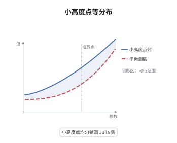

# 算术等分布定理

> **一句话大白话**：一列"算术上越来越小"的代数点，它们的共轭点会均匀地铺满映射的 Julia 集，且铺法由唯一的一条平衡测度决定。
>
> **小例子**：取 $f(z)=z^2$，则 Julia 集是单位圆周，平衡测度是圆周上的均匀测度。取 $\zeta_n$ 为本原 $n$ 次单位根，$h(\zeta_n)=0=\hat h_f(\zeta_n)$，其共轭点正是全部本原 $n$ 次单位根，$n\to\infty$ 时它们均匀铺满圆周。

## 介绍

Bilu 在 1997 年证明：$\mathbb G_m^n$ 上高度趋于零的代数点，其 Galois 轨道按 Haar 测度等分布。把 $\mathbb G_m$ 换成 $\mathbb P^1$、把 Weil 高度换成典范高度 $\hat h_f$，得到的正是算术动力系统的等分布定理：$\hat h_f\to0$ 的点列，其 Galois 轨道弱收敛到 $f$ 的平衡测度 $\mu_f$。它把"点的算术小"翻译成"点的分布规则"，是算术动力系统中唯一能把高度信息与几何分布联系起来的桥梁，也是 Morton-Silverman 型一致有界性、Baker-DeMarco 有界轨道定理的技术基础。

## 几何直观

图意在说明：竖轴是高度，横轴是 Julia 集上的位置；高度越低，共轭点在同一区域堆积得越均匀。极限分布不再依赖具体点列，只由映射决定，那就是平衡测度。

## 分析

**前置依赖**：典范高度、势论、平衡测度；补充：Green 函数、Frostman 极大原理、弱收敛。

**数学内涵**：
- 对 $\alpha$ 的 Galois 轨道定义概率测度 $\mu_\alpha=\frac{1}{D}\sum_{i=1}^{D}\delta_{\alpha^{(i)}}$，其中 $D=[\mathbb Q(\alpha):\mathbb Q]$。定理断言 $\hat h_f(\alpha_n)\to0$ 且 $D_n\to\infty$ 时 $\mu_{\alpha_n}\rightharpoonup\mu_f$。
- 平衡测度是 $\mu_f=\frac{1}{2\pi}\Delta g_f$，其中 Green 函数 $g_f(z)=\lim_{n}d^{-n}\log^+|f^n(z)|$ 满足 $g_f(f(z))=d\,g_f(z)$，且 $g_f\ge0$，其零集是填充 Julia 集 $K_f$。
- 关键恒等式：$\hat h_f(\alpha)=\frac{1}{D}\sum_i g_f(\alpha^{(i)})=\int g_f\,\mathrm d\mu_\alpha$。它把"高度小"直接读成"平均 Green 函数小"，是把算术量转成势论量的唯一入口。
- 常见误区：把"小高度"理解成"$h$ 有界"。定理要求 $\hat h_f\to0$，即随 $n$ 趋于零；只要求有界并不够，因为 $\hat h_f\equiv c>0$ 的点列会收敛到别的测度。

**结构**：
1. 用三角不等式与极小多项式的系数界，证明势的上界 $g_{\mu_\alpha}\le g_f+\hat h_f(\alpha)+o(1)$。
2. 由 $\int g_f\,\mathrm d\mu_n=\hat h_f(\alpha_n)\to0$ 与 $g_f\to\infty$ 于无穷远，得测度族胎紧，取弱极限 $\nu$。
3. 对 $\nu$ 用 Frostman 极大原理：$g_\nu\le g_f$ 且 $g_f=0$ 于 $\mathrm{supp}\,\nu$，故 $\nu$ 是 $K_f$ 的平衡测度，从而 $\nu=\mu_f$。

## 思考过程

Bilu 的问题是：一个代数数如果"算术上很小"，它的共轭在复平面上怎么排布？直觉上应当"尽量分散"，因为任何聚集都会让某个共轭的模偏离 $1$，从而拉高 Mahler 测度。Smyth、Bombieri-Zannier 等人逐步把这种直觉变成势论语言：共轭的经验测度的势被高度控制。真正的障碍是奇点——$\log|z-w|$ 在 $z=w$ 附近无下界，逐点比较失效，只能用"几乎处处 + 上半连续"的弱收敛语言。Bilu 的关键一步是用 Frostman 极大原理代替逐点比较：只要极限测度的势处处不超过 $g_f$，平衡测度的唯一性就直接给出结论。Rumely、Favre-Rivera-Letelier、Baker-Rumely 随后把它推广到动力系统与非阿基米德情形。

## 证明过程

**定理**：设 $f\in K(z)$ 次数 $d\ge2$，$\alpha_n\in\bar K$ 满足 $\hat h_f(\alpha_n)\to0$ 且 $D_n=[K(\alpha_n):K]\to\infty$。则 $\mu_{\alpha_n}\rightharpoonup\mu_f$，其中 $\mu_f$ 是 $f$ 的平衡测度，支撑在 Julia 集 $J_f$ 上。

**证明**：

### 1. 单点势的上界

设 $\alpha$ 次数 $D$、极小多项式 $P_\alpha(T)=a_0\prod_i(T-\alpha^{(i)})$。由 $|z-\alpha^{(i)}|\le(|z|+|\alpha^{(i)}|)$ 与几何平均不超过算术平均，对每个 $z\in\mathbb C$ 有

$$
g_{\mu_\alpha}(z)=\frac1D\sum_i\log|z-\alpha^{(i)}|\le \log^+|z|+\frac1D\sum_i\log^+|\alpha^{(i)}|+O(1)=\log^+|z|+h(\alpha)+O(1).
$$

把同样的估计用在 $f^m(\alpha)$ 与点 $f^m(z)$ 上，并利用 $\log|f^mz-f^mw|=d^m\log|z-w|+O(d^m)$ 的一致控制，除以 $d^m$ 后令 $m\to\infty$，$\log^+$ 便换成 Green 函数，得到

$$
g_{\mu_\alpha}(z)\le g_f(z)+\hat h_f(\alpha)+o(1),
$$

其中 $o(1)$ 只依赖 $D\to\infty$，对 $z$ 一致。

### 2. 胎紧与弱极限

对 $\mu_n=\mu_{\alpha_n}$，由第 1 步的恒等式形式 $\int g_f\,\mathrm d\mu_n=\hat h_f(\alpha_n)$。因 $g_f(z)=\log|z|+O(1)$ 于无穷远，Green 函数在无穷远处趋于 $+\infty$，故给定 $\varepsilon$ 存在紧集 $E$ 使 $\mu_n(E)\ge1-\varepsilon$ 对一切 $n$ 成立：质量无法逃向无穷。于是 $\{\mu_n\}$ 胎紧，取子列弱收敛到概率测度 $\nu$。

### 3. 极大原理定出极限

由第 1 步，$g_{\mu_n}\le g_f+\hat h_f(\alpha_n)+o(1)$。令 $n\to\infty$，由势的下半连续性与弱收敛，对几乎处处的 $z$（再由上半连续性推广到处处）得 $g_\nu(z)\le g_f(z)$。另一方面

$$
\int g_f\,\mathrm d\nu=\lim_n\int g_f\,\mathrm d\mu_n=\lim_n\hat h_f(\alpha_n)=0,
$$

而 $g_f\ge0$，故 $\mathrm{supp}\,\nu\subset\{g_f=0\}=K_f$。在 $K_f$ 上 $g_f=0$，于是 $g_\nu\le 0$ 于 $\mathrm{supp}\,\nu$，即 $\nu$ 是紧集 $K_f$ 的平衡分布。平衡分布唯一，故 $\nu=\mu_f$。

### 4. 结论

任一弱极限都等于 $\mu_f$，故全序列弱收敛。$\square$

## 课堂问答

**老师**：定理为什么要假设"小高度"而不是"高度有界"？这两者差在哪里？

**学生**：差别在于极限值。若只有 $h(\alpha_n)\le B$，由 $\hat h_f$ 与 $h$ 只差有界量，只能得到 $\hat h_f$ 一致有界，于是 $\int g_f\,\mathrm d\mu_n$ 有界而不趋于零，取极限时 Step 3 里的关键等式 $\int g_f\,\mathrm d\nu=0$ 就不成立。极限测度可能支撑在 $\{g_f\le c\}$ 上，那就不是 $\mu_f$，而是被"抬高"过的测度。

**老师（追问）**：Step 1 里逐点比较 $\log|z-\alpha^{(i)}|$，遇到 $z$ 与某个共轭重合时右端不是 $-\infty$ 吗？

**学生**：右端不会出问题，因为用的是三角不等式 $|z-\alpha^{(i)}|\le|z|+|\alpha^{(i)}|$，只给上界，$z=\alpha^{(i)}$ 时左边是 $-\infty$，不等式依然成立。真正需要小心的是反方向（下界），那是不成立的：势可以任意负。所以整条论证只使用上界，再用弱收敛把上界传给极限，这正是不能逐点比较、必须走"极大原理"的原因。

**老师（拓展）**：这条定理在算术动力系统里起什么作用？

**学生**：它是几乎所有"从高度到几何"推理的引擎。例如 Baker-DeMarco 证明有界轨道定理时，先用等分布把"标记点的典范高度在参数曲线上趋零"翻译成"参数曲线上的典范测度等于动力测度"，再用后者推出曲线必须是特殊的。Morton-Silverman 一致有界性的种种条件性结果也类似：只要能造出足够多的小高度点，等分布就迫使它们均匀铺满 Julia 集，从而给出点数下界，与一致上界冲突。
