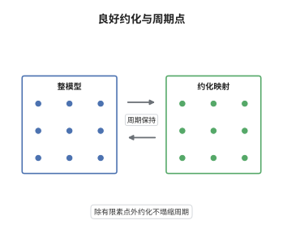

# 良好约化与算术动力系统

> **一句话大白话**：除了有限多个"坏"素点，映射可以整体地模掉素点变成一个有限域上的映射，而且原来周期点的周期在模掉之后一点也不会缩水。
>
> **小例子**：$f(z)=z^2-1$ 在 $\mathbb Q$ 上每个素点都有好约化，$0\mapsto-1\mapsto0$ 是 $2$-周期。模任意素数 $p$ 后 $0$ 与 $-1$ 仍然互不相同（$p=2$ 时 $-1\equiv1$，但 $0\mapsto1\mapsto0$ 仍是 $2$-周期），周期没有塌缩。

## 介绍

算术动力系统研究数域上的态射，而数域的信息分散在各个素点。良好约化（good reduction）说的是：在几乎所有的非阿基米德素点处，映射可以写成整系数的齐次形式，模掉素点后仍是同次数的态射。Silverman 在 1993 年证明，这时周期点的约化保持周期。这条看似技术性的结论，实际是"局部信息控制整体"的入口：它给出周期点个数的局部上界，也是典范高度在好素点处局部为零的来源。

## 几何直观

图意在说明：左边是特征零的整模型，系数都是整数；右边是模掉素点后得到的有限域映射。双向箭头表示两者次数相同、周期点一一对应，约化不丢失动力学信息。

## 分析

**前置依赖**：算术动力系统、整模型；补充：结式、Hensel 引理、局部典范高度。

**数学内涵**：
- 整模型：取 $F_0,F_1\in\mathcal O_v[x_0,x_1]$ 同为次数 $d$ 的齐次形式、无公共零点，$f=[F_0:F_1]$。好约化指 $\mathrm{Res}(F_0,F_1)$ 是 $v$-进单位，等价于约化后的映射 $f_v:\mathbb P^1(k_v)\to\mathbb P^1(k_v)$ 仍是次数 $d$ 的态射。
- 坏素点只有有限多个：坏的条件是 $v(\mathrm{Res})>0$，而结式是非零整数，正赋值的素点有限。
- 周期保持：若 $v$ 是好素点、$P$ 的精确周期为 $n$ 且 $\mathrm{char}\,k_v\nmid n$，则 $\bar P$ 的精确周期也是 $n$。缺少 $p\nmid n$ 时结论会失效。
- 常见误区：把"好约化"当成"$f$ 的系数是整数"。系数整只保证映射可约化，但约化后可能塌成常值映射（例如所有系数都被 $v$ 整除），那不是好约化；判据是结式而非系数。

**结构**：
1. 用结式判别坏素点有限，得到"除有限个 $v$ 外约化保持次数 $d$"。
2. 用不动点方程的分离性与 Hensel 引理，把 $f^n$ 的不动点逐个与 $\bar f^n$ 的不动点对应。
3. 用局部典范高度 $\hat\lambda_v$ 的非负性与函子性，说明好素点对整体高度没有贡献，从而给出周期点个数的局部上界。

## 思考过程

算术几何里"约化"是老工具：椭圆曲线的好约化决定 $j$ 不变量的赋值，Néron 模型把局部信息编码成整模型。Silverman 的问题是：这套语言能不能用在动力系统上？障碍在于映射不是群运算，没有 Néron 模型可用，只能用齐次形式与结式硬造一个整模型。关键观察是结式恰好度量"约化后次数是否下降"：结式为单就说明两个分量模 $v$ 后仍无公共零点，态射不会塌缩。有了这一点，周期点就靠 Hensel 引理逐位提升——只要不动点方程在模 $v$ 后是简单的，提升唯一，周期自然保持。$p\nmid n$ 正是保证"简单"的那个条件。

## 证明过程

**定理**：设 $K$ 为数域，$f:\mathbb P^1\to\mathbb P^1$ 是 $K$ 上次数 $d\ge2$ 的态射。则除有限多个非阿基米德素点外，$f$ 在 $v$ 处有好约化；若 $v$ 是好素点、$P\in\mathbb P^1(\bar K)$ 的精确周期为 $n$ 且 $\mathrm{char}\,k_v\nmid n$，则 $\bar P$ 的精确周期也是 $n$，且约化在周期整除 $n$ 的点集上是单射。

**证明**：

### 1. 坏素点有限

取整系数的齐次表示 $f=[F_0:F_1]$，$F_i$ 次数为 $d$、系数在 $\mathcal O_K$ 中且无公共零点，故结式 $R=\mathrm{Res}(F_0,F_1)\in\mathcal O_K\setminus\{0\}$。对素点 $v$，若 $v(R)=0$ 则 $R$ 是 $v$-进单位，于是 $F_0,F_1$ 模 $v$ 仍无公共零点，约化映射仍是次数 $d$ 的态射，即 $v$ 是好素点。反之 $v(R)>0$ 时约化后两个分量有公共零点、次数下降。由于 $R\ne0$，只有有限多个素点满足 $v(R)>0$。

### 2. 好约化处的距离不增性

设 $v$ 好，$x,y\in\mathbb P^1(\mathcal O_v)$ 落在同一剩余类，即 $\|x-y\|_v<1$。由于 $F_i$ 系数整，$F_i(x)-F_i(y)$ 被 $x-y$ 整除且商仍取整值，故

$$
\|f(x)-f(y)\|_v\le\|x-y\|_v .
$$

又因 $R$ 是单位，$\|F(x)\|_v$ 与 $\|x\|_v^{d}$ 相互控制，约化映射不会把两个不同剩余类合并。于是约化在剩余类层面是"良定义且不放大"的。

### 3. 不动点的提升与周期保持

设 $P$ 的精确周期为 $n$。函数 $g(x)=f^n(x)-x$ 在仿射卡内是系数在 $\mathcal O_v$ 中的有理函数，其零点模 $v$ 后给出 $\bar f^n$ 的不动点。若 $\bar P$ 的周期 $m<n$ 且 $m\mid n$，令 $Q=f^m(P)$，则 $Q\ne P$ 而 $\bar Q=\bar P$，即 $Q$ 与 $P$ 同剩余类。对 $g$ 在 $P$ 处作 $v$-进展开，一次项系数是乘子 $\lambda=(f^n)'(P)-1$；$\mathrm{char}\,k_v\nmid n$ 保证 $f^n$ 与恒等映射在模 $v$ 后不重合，从而 $\lambda$ 不是 $v$-进单位，$g$ 在该剩余类内的零点不唯一——与第 2 步的"约化不合并不同剩余类"矛盾。故 $\bar P$ 的周期恰为 $n$，且同一周期内的不同点约化后互不相同。

### 4. 局部高度的非负性

对好素点定义 $\hat\lambda_v(P)=\lim_k d^{-k}\log^+\|f^k(P)\|_v$。由第 2 步，$\|f^k(P)\|_v$ 在剩余类内不增，故 $\hat\lambda_v\ge0$；又 $\hat\lambda_v(f(P))=d\,\hat\lambda_v(P)$，与整体典范高度满足 $\hat h_f=\sum_v\hat\lambda_v$。于是好素点只贡献非负项，周期点满足 $\hat h_f=0$ 迫使 $\hat\lambda_v=0$。 $\square$

## 课堂问答

**老师**：为什么判据是结式，而不是"系数都是整数"？

**学生**：系数整只说明映射可以模 $v$，不能说明模完之后还是次数 $d$ 的态射。若 $F_0,F_1$ 的所有系数都被 $v$ 整除，约化后是零映射；若它们模 $v$ 后有公共零点，约化后次数下降、成为常值或低次映射。结式恰是"两个分量模 $v$ 后有无公共零点"的判别式，结式为单才等价于约化后次数不变。

**老师（追问）**：$p\nmid n$ 这个条件能不能去掉？

**学生**：不能。它保证 $f^n$ 与恒等映射在模 $v$ 后仍有区别，等价于不动点方程在剩余类内是"简单"的，Hensel 提升才唯一。若 $p\mid n$，$f^n$ 的约化可能整体退化为恒等映射，此时一个剩余类里可以塞进无穷多个周期为 $n$ 的点，周期会塌缩。这也是为什么定理的陈述必须把 $n$ 与剩余特征分开讨论。

**老师（拓展）**：好约化与典范高度怎么配合？

**学生**：典范高度可以按素点拆成局部高度之和，好素点上的局部高度非负且在剩余类的"好约化域"内为零。于是整体高度完全由有限个坏素点贡献，这正是 Morton-Silverman 型计数论证的出发点：固定周期 $n$ 且避开 $p\mid n$ 的好素点时，周期点约化后互不相同，其个数不超过 $\#\mathbb P^1(k_v)$ 加上坏素点上的提升数目，得到只依赖 $d,n,K$ 的上界。
