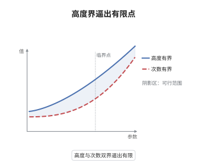

# 高度函数与 Northcott 有限性定理

> **一句话大白话**：把代数点的"大小"和它所需数域的"次数"同时钉死，能挑出来的点就只有有限多个，怎么凑也凑不成无穷序列。
>
> **小例子**：取 $d=2$、$B=\log 2$。高度不超过 $\log 2$、次数不超过 $2$ 的点只有有限多个：$\sqrt2$ 在内（$h(\sqrt2)=\tfrac12\log2$），而 $\sqrt[3]{2}$ 虽高度也不大，却因次数为 $3$ 被排除。

## 介绍

Northcott 定理（Northcott 1950）断言：给定次数上界与高度上界，代数点只有有限多个。它是算术几何最基础的存在性工具，把"是否有无穷多解"这类问题系统地转化为"高度是否一致有界"的问题。Weil 高度度量代数点的算术复杂度，次数记录点所在数域的大小，定理说这两把尺子合用就足以制造有限性。Mordell-Weil 定理、Siegel 定理、预周期点有限性，最后都要回到它。

## 几何直观

图意在说明：横轴是次数、纵轴是高度，两条阈值围出的角形区域才是候选点所在之处。区域越往左下越窄，能容纳的点急剧减少；真正允许的点在每个格子中至多有限个，整个区域也就有限。

## 分析

**前置依赖**：数域、绝对值、射影空间；补充：乘积公式、Mahler 测度与最小多项式的系数界。

**数学内涵**：
- 对数 Weil 高度定义为 $h(P)=\frac{1}{[K:\mathbb Q]}\sum_{v\in M_K}\log^+\|P\|_v$，其中 $\|P\|_v=\max_i|x_i|_v$；由乘积公式，换齐次代表元或换含坐标的数域 $K$ 都不改变它。
- 高度是"算术大小"：$h([x:1])$ 是各共轭上 $\log\max(1,|x|)$ 的平均，因此共轭不变，且 $h(\alpha^n)=|n|\,h(\alpha)$ 对整数 $n$ 成立。
- 次数是"代数复杂度"，即极小多项式的次数。只用高度不够：$h(\alpha)=0$ 只说明 $\alpha$ 是零或单位根；只用次数也不够：固定次数仍有无限多个点。
- 常见误区：以为 $h\le B$ 是紧性条件。高度在非阿基米德处根本没有上界可言，水平集在射影空间中并不紧；有限性完全来自"整系数 + 系数有界"的离散性。

**结构**：
1. 先把射影点化到某个坐标非零的仿射卡，用高度控制各坐标之比。
2. 在 $\mathbb P^1$ 情形，用 Mahler 测度把高度上界翻译成极小多项式系数的上界。
3. 用"整系数、次数与系数双有界的多项式只有有限多个"收尾，再拼回射影空间。

## 思考过程

Weil 在证明 Mordell-Weil 定理时意识到，有理点之所以有限生成，是因为高度有"下水平集有限"的性质。Northcott 把这层直觉提成一条独立公理式的命题：不要具体知道点的位置，只要知道它不太大、所在数域不太大，就能穷举完毕。障碍在于高度是各素点贡献的求和，单看一个素点毫无约束；关键想法是把它整体地转成最小多项式的整系数——Mahler 测度恰好是共轭模长的几何平均，直接给出系数的指数上界。这样"算术大小"就变成了"整数的绝对值"，有限性水到渠成。这也是为什么此后再谈有限性，都先问一句"高度有没有一致上界"。

## 证明过程

**定理**：设 $d\ge1$、$B\in\mathbb R$、$n\ge1$。集合 $\{P\in\mathbb P^n(\bar{\mathbb Q}):[\mathbb Q(P):\mathbb Q]\le d,\ h(P)\le B\}$ 是有限集。

**证明**：

### 1. 高度控制坐标比

设 $P=[x_0:\cdots:x_n]$ 定义在数域 $K$ 上，取 $i$ 使 $x_i\ne0$。对每个 $j$，由 $\log\max(1,|x_j|_v)\le\log^+\|P\|_v$ 逐点求和得

$$
h([x_j:1])=\frac{1}{[K:\mathbb Q]}\sum_{v}\log\max(1,|x_j|_v)\le h(P)\le B .
$$

再用 $h(uv)\le h(u)+h(v)$ 得 $h(x_j/x_i)\le 2B$，且 $x_j/x_i\in\mathbb Q(P)$，其次数不超过 $d$。于是问题归约为 $\mathbb P^1$ 中"次数与高度双有界"的点。

### 2. 一维情形的系数界

设 $\alpha$ 次数 $D\le d$、$h(\alpha)\le B$，极小多项式取整系数本原形式 $P_\alpha(T)=a_0T^D+\cdots+a_D$，$a_0>0$。Mahler 测度满足

$$
M(\alpha)=a_0\prod_{i=1}^{D}\max(1,|\alpha^{(i)}|)=e^{D h(\alpha)}\le e^{dB},
$$

故 $a_0\le e^{dB}$，且每个共轭满足 $|\alpha^{(i)}|\le e^{dB}$。系数是共轭的初等对称函数乘以 $a_0$，于是

$$
|a_k|=a_0\big|e_k(\alpha^{(1)},\dots,\alpha^{(D)})\big|\le e^{dB}\binom{D}{k}e^{kdB}\le 2^{d}e^{d^{2}B+dB}.
$$

右端只依赖 $d$ 与 $B$，与 $\alpha$ 无关。

### 3. 有限性与拼回

次数不超过 $d$、系数绝对值不超过 $C=2^{d}e^{d^{2}B+dB}$ 的整系数本原多项式只有有限多个，每个至多有 $D$ 个根，故这样的 $\alpha$ 有限。回到第 1 步，每个坐标比只取有限多个值，组合起来 $\mathbb P^n$ 中的点也有限。

### 4. 结论

次数与高度双上界蕴含有限。这条判据此后反复使用：只要某类点的高度能被一致界住而次数固定，该类点就有限。 $\square$

## 课堂问答

**老师**：为什么非要同时卡住次数？只卡高度为什么不够？

**学生**：只卡高度一定不够。固定 $B>0$ 时，任意次数 $D$ 都可取 $\alpha=2^{1/D}$，其高度为 $\frac1D\log2\le B$，但次数随 $D$ 增大而无界，点也互不相同。所以必须同时限制次数，否则高度小的点可以来自任意大的数域。

**老师（追问）**：系数界那一步，为什么 Mahler 测度给出的界是"每个共轭都不大"，而不是"平均不大"？

**学生**：因为 $M(\alpha)=a_0\prod_i\max(1,|\alpha^{(i)}|)$ 是乘积，而 $h(\alpha)=\frac1D\log M(\alpha)$ 是平均。$M(\alpha)\le e^{dB}$ 意味着乘积有界，而每个因子 $\ge1$，所以每个因子单独也被 $e^{dB}$ 界住。这一步把"平均意义下的小"升级成"逐个共轭的小"，是整系数系数界能够成立的关键。

**老师（拓展）**：这条定理在算术动力系统里怎么用？

**学生**：用于证明预周期点有限。对次数 $d\ge2$ 的态射 $f$，典范高度满足 $|h-\hat h_f|\le C/(d-1)$，而预周期点恰是 $\hat h_f=0$ 的点，故它们的高度被 $C/(d-1)$ 一致界住；次数又固定为 $[\mathbb Q(P):\mathbb Q]$ 的上界，于是由 Northcott 定理预周期点有限。反过来说，任何想证明"某类点有限"的论证，最终都要交出这样一个一致高度界。
