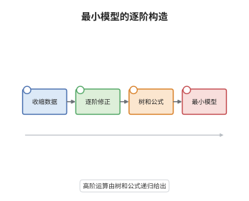

# $A_\infty$ 代数与最小模型定理

> **一句话大白话**：把"结合律"从必须严格成立放松成"只差一个同伦"，再让这个差本身也差一个同伦，如此无穷递推——这就是 $A_\infty$ 代数。最小模型定理说：任何这样的结构都能压成一个微分全为零的等价物。
>
> **小例子**：任何微分分次代数都是 $A_\infty$ 代数，只要令 $m_3=m_4=\cdots=0$，此时 $m_1$ 是微分、$m_2$ 是乘法。而 $H^*(A)$ 上的 $m_3$ 一般不为零，它正是 Massey 三重积 $\langle a,b,c\rangle$。

## 介绍

$A_\infty$ 代数由 Stasheff 在 1963 年研究环路空间的"结合律到同伦"时引入，是微分分次代数（DGA）的强同伦推广。它用一串运算 $m_n:A^{\otimes n}\to A$ 记录"结合律失败到第几阶"，并用 Stasheff 恒等式把这些失败层层绑定。这套结构在同伦代数、形变理论、Fukaya 范畴与镜像对称中都是主角。最小模型定理（Kadeishvili 1980）解决了它的规范形问题：每个 $A_\infty$ 代数都同伦等价于一个 $m_1=0$ 的极小 $A_\infty$ 代数，结构常数可以逐阶算出来。这把"分类 $A_\infty$ 结构"变成了"在 $H^*(A)$ 上解一串线性方程"。

## 几何直观

图意在说明：最左边先选一组收缩数据，即把上同调嵌入原复形并给出同伦 $h$；中间两步用 $h$ 把每一阶的障碍消掉，消掉的方式是把所有"树形"的代入方式加起来；最右边得到的极小模型上 $m_1=0$，只剩下同伦结合的高阶乘法。整条链说明：高阶运算不是凭空出现的，而是由同伦 $h$ 逐阶"搬运"出来的。

## 分析

**前置依赖**：微分分次代数、同伦扰动；补充：Koszul 符号约定、谱序列的收敛直觉。

**数学内涵**：
- 结构：分次向量空间 $A$ 带运算 $m_n:A^{\otimes n}\to A$（$n\ge1$），$\deg m_n=2-n$；$m_1$ 次数为 $1$ 即微分，$m_2$ 次数为 $0$ 即乘法，$m_3$ 次数为 $-1$ 记录结合律的失败。
- Stasheff 恒等式把各阶失败绑在一起：$n=1$ 给出 $m_1^2=0$，$n=2$ 给出 $m_1$ 是 $m_2$ 的导子，$n=3$ 给出结合子的边界公式。
- 常见误区：以为 $m_3=0$ 就是结合。$m_3=0$ 时结合子为零，这正是 DGA 的情形；但一般 $m_3\ne0$，此时"结合"只在链同伦意义下成立。另一误区是把最小模型当成唯一到严格同构的规范形而不加限定——$m_2$ 可典范选取，$m_{\ge3}$ 依赖收缩数据。

恒等式的算子形式为

$$
\sum_{r+s+t=n}(-1)^{r+st}\,m_{r+1+t}\big(\mathrm{id}^{\otimes r}\otimes m_s\otimes \mathrm{id}^{\otimes t}\big)=0 ,
$$

其 $n=3$ 的具体形式是

$$
m_2(\mathrm{id}\otimes m_2)-m_2(m_2\otimes \mathrm{id})=m_1m_3+m_3(m_1\otimes 1\otimes 1)+m_3(1\otimes m_1\otimes 1)+m_3(1\otimes 1\otimes m_1).
$$

右端是 $m_3$ 的边界，故结合律的失败被 $m_3$ 吸收：$m_2$ 在同伦意义下结合、在同调上严格结合。

**结构**：
1. 选收缩数据 $H\rightleftharpoons A$ 与同伦 $h$，把 $H^*(A)$ 嵌成 $A$ 中的代表元。
2. 先定义 $m_2^H$ 并验证它是闭链，从而在同伦层面给出乘法。
3. 归纳定义 $m_n^H$：把第 $n$ 阶的障碍用 $h$ 消掉，等价地写成树和公式；再验证 Stasheff 恒等式与极小性、唯一性。

## 思考过程

Stasheff 面对的是环路空间：在那里"先走再走"与"另一种走法"并不相等，只同伦。他意识到不能简单地把结合律丢掉，否则就什么结构都不剩；正确的做法是让失败本身成为一个新运算，再让这个新运算的失败成为更高阶运算，如此无穷。这个无穷塔的每一层都由 Stasheff 多面体（associahedron）的胞腔粘合方式决定，恒等式的符号正是多面体定向的符号。二十年后 Kadeishvili 问：既然同伦等价不保持严格乘法，那么它保持什么？答案是全部 $m_n$：同伦等价可以把整个 $A_\infty$ 结构沿收缩数据搬运到上同调上，高阶项由同伦 $h$ 消障碍的递归唯一确定。这也解释了为什么 Massey 积在有理同伦论里如此自然——它本来就是 $m_3$。

## 证明过程

**定理**：设 $(A,m_1,m_2,\dots)$ 是域上 $A_\infty$ 代数，$H=H^*(A)$。则 $H$ 上存在 $A_\infty$ 结构 $m_1^H=0,m_2^H,m_3^H,\dots$ 与 $A_\infty$ 拟同构 $f:H\to A$，且两个极小模型之间的拟同构必是同构。

**证明**：

### 1. 收缩数据

取分次向量空间分裂 $H\xrightarrow{i}Z^*(A)\subset A\xrightarrow{p}H$，并取同伦 $h:A\to A[-1]$ 使

$$
\mathrm{id}-ip=m_1h+hm_1,\qquad h^2=0,\quad hi=0,\quad ph=0 .
$$

$h^2=0$ 与 $hi=0$、$ph=0$ 是"侧条件"，总能通过调整 $h$ 得到，它们使后面的树和公式不产生重复项。

### 2. 二阶运算

定义 $m_2^H(a,b)=p\,m_2(ia,ib)$。$ia$、$ib$ 是闭链，故

$$
m_1m_2(ia,ib)=\pm m_2(m_1ia,ib)\pm m_2(ia,m_1ib)=0,
$$

即 $m_2(ia,ib)$ 是闭链，$m_2^H$ 良定义并下降到上同调，它就是 $H$ 上的乘法。此时 $m_1^H=p\,m_1i=0$：极小性在最低阶已成立。

### 3. 归纳构造 $m_n^H$

设 $m_k^H$（$k<n$）已定义且 Stasheff 恒等式在第 $n-1$ 阶成立。把第 $n$ 阶恒等式中所有含 $m_n$ 的项移到一边，其余项之和记为障碍 $o_n(a_1,\dots,a_n)$，它是 $A$ 中的闭链：对 $o_n$ 取 $m_1$ 时各项按第 $k<n$ 阶恒等式成对抵消。令

$$
m_n^H(a_1,\dots,a_n)=p\,h\,o_n(ia_1,\dots,ia_n).
$$

这一式把障碍沿 $h$ 压回上同调代表元，于是新的 $m_n^H$ 恰好吸收 $o_n$，第 $n$ 阶 Stasheff 恒等式成立。展开递归即得树和公式：对每个 $n$ 叶平面树，内部顶点放 $m^A_{\bullet}$、内部边放 $h$、叶放 $i$，最后乘 $p$ 并求和，

$$
m_n^H=\sum_{T}\pm\,p\,m_{|T|}^A\big(h\text{ 在内部边},\ i\text{ 在叶}\big).
$$

Stasheff 恒等式的验证等价于说：把所有树按"某条边收缩"配对求和，边界成对抵消，只剩空树一项。

### 4. 拟同构与唯一性

同样地定义 $f_1=i$、$f_n=p\,h\,(\text{障碍})$ 的树和，得到 $A_\infty$ 态射 $f:H\to A$，其中 $f_1=i$ 在 homology 上是同构，故 $f$ 是拟同构。若 $g:(H',0,\dots)\to(H,0,\dots)$ 是极小代数之间的拟同构，则 $g_1$ 是零微分复形之间的拟同构，从而是分次空间的同构；再用 Stasheff 恒等式逐阶归纳，可从 $g_1^{-1}$ 构造出 $A_\infty$ 逆，故 $g$ 是同构。于是极小模型唯一到同构。 $\square$

## 课堂问答

**老师**：$A_\infty$ 结构看起来只是把 DGA 的乘法放松一点，它到底比 DGA 多了什么信息？

**学生**：多了"乘法结合律失败的方式"。DGA 要求结合律严格成立，$m_3=0$；$A_\infty$ 允许 $m_3\ne0$，并把 $m_3$ 看成结合子的链同伦。更关键的是同伦不变性：同伦等价的 DGA 之间，$H^*$ 上的 $m_3,m_4,\dots$ 可能非零，这些高阶项是同伦不变量，DGA 结构本身却不被同伦等价保持。

**老师（追问）**：为什么 $m_n^H$ 要写成 $p\,h\,o_n$，直接用 $p\,o_n$ 不行吗？

**学生**：不行。$o_n$ 只是闭链，$p\,o_n$ 落在 $H$ 上未必能吸收障碍；障碍的差是一个恰当元 $m_1\xi$，需要用 $h$ 把它拉回成链层面的元素，即 $h\,m_1\xi=\xi-ip\xi$，这样"差一个边界"的部分才被真正消掉。侧条件 $h^2=0$、$hi=0$、$ph=0$ 保证递归不产生重复计数。

**老师（拓展）**：$A_\infty$ 与 $E_\infty$ 有什么本质区别？给出一个能看出差别的例子。

**学生**：$A_\infty$ 只编码结合律，是"单入单出"的运算；$E_\infty$ 编码交换律，运算带对称群的对称性。例子是对 $E_\infty$ 代数取上同调：在特征 $p$ 下 $H^*$ 带有 Dyer–Lashof 运算，仅凭 $A_\infty$ 结构无法恢复；反过来，交换 DGA 的 $H^*$ 上的 $A_\infty$ 结构可以由树和算出，但不会自动带上交换性。
