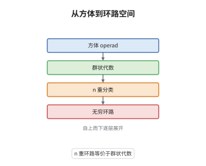

# $E_\infty$ 代数与 May 识别定理

> **一句话大白话**：$n$ 重环路空间上可以"在 $n$ 个独立方向上同时做乘法"，这正是 $E_n$ 代数；反过来，只要一个 $E_n$ 代数的连通成分构成群，它就能被重新"绕回去"变成某个空间的 $n$ 重环路空间。
>
> **小例子**：$X=S^1$ 时 $\Omega S^1\simeq\mathbb Z$ 是离散的 $E_1$ 代数，$\pi_0=\mathbb Z$ 是群；它的分类空间 $B\mathbb Z$ 正是 $S^1$，于是 $\Omega B\mathbb Z\simeq\mathbb Z$。若取 $n=2$，$E_2$ 的乘法由 Eckmann-Hilton 论证自动交换，$\pi_0$ 是交换群。

## 介绍

May 在 1972 年的《The Geometry of Iterated Loop Spaces》中回答了同伦论的一个基本问题：哪些空间同伦等价于 $n$ 重环路空间 $\Omega^nX$？答案是"群状的 $E_n$ 空间"。他的工具是 operad：把"乘法"换成一族参数空间 $\mathcal C_n(k)$，$k$ 个输入如何摆放在 $n$ 维方体里本身就是结构的一部分，于是结合律与交换律的"只到同伦"被精确记录下来。这条定理把"识别环路空间"这个几何问题，变成了"检验一个 operad 作用与 $\pi_0$ 是否为群"的代数问题。当 $n\to\infty$ 时，它进一步给出群状 $E_\infty$ 空间与连接谱的等价，成为稳定同伦论的入口。

## 几何直观

图意在说明：最底层是 $n$ 维方体里摆放若干互不相交小方体的参数空间，它决定乘法的形状；往上一层，这些参数作用在空间上，得到 $E_n$ 代数；再往上用 bar 构造造出分类空间 $B^nA$；最顶层把它绕回来，得到 $\Omega^nB^nA$，与出发点同伦等价。四层合起来就是"代数结构—分类空间—环路空间"的往返。

## 分析

**前置依赖**：operad、环路空间；补充：May 的两边 bar 构造、Eckmann-Hilton 论证。

**数学内涵**：
- 小方体 operad：$\mathcal C_n(k)$ 是 $I^n$ 中 $k$ 个内部互不相交、边平行于坐标轴的小方体构成的空间，$\Sigma_k$ 置换各分量，operad 复合由"把小方体按仿射参数化放入大方体"给出。它与 $\mathbb R^n$ 中 $k$ 点构型空间同伦等价，故 $\mathcal C_\infty(k)$ 可缩。
- 作用：把 $\Omega^nX$ 实现为 $\mathrm{Map}_*((I^n,\partial I^n),(X,*))$。给定 $c=(c_1,\dots,c_k)$ 与 $k$ 个环路 $f_i$，在 $c_i$ 上令 $g=f_i\circ\phi_i^{-1}$（$\phi_i$ 为把 $I^n$ 仿射送到 $c_i$ 的映射），在其余部分令 $g$ 取基点。因为 $f_i$ 把边界送到基点，$g$ 连续且良定义。
- 群状：指 $\pi_0(A)$ 是群。$n\ge1$ 时 $\pi_0(\Omega^nX)=\pi_n(X)$ 自动是群；$n\ge2$ 时由 Eckmann-Hilton 论证 $\pi_0(A)$ 还是交换群。识别定理必须假设群状，否则只能得到群完备化。
- 常见误区：把 $E_\infty$ 当成"严格交换"。严格交换幺半群对应常值 operad，它不是 $\Sigma$-自由的对象，同伦论性质很差；$E_\infty$ 只保证交换律成立到无穷阶同伦，$\Omega^\infty\mathbb S$ 就是 $E_\infty$ 而非严格交换的典型。

**结构**：
1. 构造 $\mathcal C_n$，验证 operad 公理，并说明 $\mathcal C_n(k)$ 与构型空间同伦等价。
2. 用仿射重参数化写出作用 $\theta$，逐条验证单位与复合公理。
3. 用两边 bar 构造给出左伴随 $B^n$，证明求值映射 $B^n\Omega^nX\to X$ 是弱等价，从而得到 $A\simeq\Omega^nB^nA$；最后取 $n\to\infty$。

## 思考过程

在 May 之前，人们知道二重环路空间上的两种乘法自动交换（Eckmann-Hilton），但"$n$ 重"到底意味着什么并不清楚：写下一串等式会立刻发现它们只在同伦意义下成立，而同伦本身又需要更高阶的数据。Boardman 与 Vogt 提出用参数空间记录乘法，May 把它系统化为 operad 并把识别定理证出来。关键的障碍是"如何从代数结构造回空间"：不能只取一个分类空间，因为 $n$ 重环路需要 $n$ 次去环路。May 的解法是两边 bar 构造——它同时记录了 operad 的复合与代数的乘法，实现后恰好是 $n$ 重分类空间。第二个障碍是群状条件：没有它，bar 构造只给出群完备化，这是 Quillen 与 Segal 早已熟悉的现象。

## 证明过程

**定理**：设 $n\ge1$，$X$ 为带非退化基点的空间。则 $\Omega^nX$ 是 $\mathcal C_n$ 代数且 $\pi_0$ 为群；反之若 $A$ 是群状 $\mathcal C_n$ 代数，则伴随单位 $A\to\Omega^nB^nA$ 是弱等价。当 $n=\infty$ 时，群状 $E_\infty$ 空间与连接谱互为等价。

**证明**：

### 1. 小方体 operad 及其同伦型

令 $I=[0,1]$，把 $k$ 个小方体写成 $c_i=a_i+(b_i-a_i)I^n$，要求内部互不相交，则

$$
\mathcal C_n(k)=\big\{(c_1,\dots,c_k):\ c_i\subset I^n\ \text{为轴平行小方体，内部互不相交}\big\}
$$

按 $I^n$ 的乘积拓扑取子空间拓扑。$\Sigma_k$ 以置换分量作用，复合 $\gamma$ 把外层第 $i$ 个小方体按仿射参数化换成内层的一组小方体。把每个小方体映到其中心再缩放，得到同伦等价 $\mathcal C_n(k)\simeq\mathrm{Conf}_k(\mathbb R^n)$，故 $\mathcal C_n(k)$ 是 $(n-2)$-连通的，$n\to\infty$ 时逐点可缩。由这些数据逐条验证 operad 公理，全部是仿射映射的结合律。

### 2. 作用与公理

对 $c\in\mathcal C_n(k)$、$f_1,\dots,f_k\in\Omega^nX$，定义 $\theta(c;f_1,\dots,f_k)$ 为

$$
g(u)=\begin{cases} f_i\big(\phi_i^{-1}(u)\big), & u\in c_i,\\ *, & u\notin c_1\cup\cdots\cup c_k,\end{cases}
$$

其中 $\phi_i:I^n\to c_i$ 是仿射同胚。当 $u\in\partial c_i$ 时 $\phi_i^{-1}(u)\in\partial I^n$，故 $f_i$ 取基点，与"外部取基点"一致，$g$ 连续且 $g(\partial I^n)=*$。单位公理由 $\mathcal C_n(1)$ 含恒等方体给出；复合公理由 $\phi$ 的仿射复合律直接得到 $\theta(c;\theta(d_1;\cdot),\dots)=\theta(\gamma(c;d_1,\dots);\cdot)$。

### 3. bar 构造与求值是弱等价

令 $\mathbb C_n$ 为 $\mathcal C_n$ 生成的单子，$\mathbb C_nA=\coprod_k\mathcal C_n(k)\times_{\Sigma_k}A^k$。取两边 bar 构造的几何实现

$$
B^nA=\big|B_\bullet(\mathbb C_n,\mathbb C_n,A)\big|,\qquad B_q=\mathbb C_n^{q+1}A,
$$

面映射交替使用单子乘法 $\mu$ 与前两个因子的作用，退化映射用单位 $\eta$。它给出伴随 $\mathrm{Hom}_{\mathbb C_n}(\mathbb C_nA,\Omega^nY)\cong\mathrm{Top}_*(A,\Omega^nY)$，因为 $\Omega^nY$ 上的 $\mathcal C_n$ 作用正是第 2 步的 $\theta$。

对 $A=\Omega^nX$ 有求值映射 $e:B^n\Omega^nX\to X$：一个 $q$-单形是 $(q+1)$ 个环路与一串嵌套小方体，逐层代入并沿方体拼接成 $I^n\to X$ 的映射。按方体个数过滤 $B^n\Omega^nX$，其连带分次商是若干悬挂的楔和，故 $e$ 在 $H_*$ 上是同构；又 $\pi_0(B^n\Omega^nX)=\pi_n(X)=\pi_0(\Omega^nX)$，$e$ 在 $\pi_0$ 上也是同构。由 May 的逼近定理（$\mathcal C_n$ 空间之间的映射若在 $\pi_0$ 与 $H_*$ 上同构则为弱等价），$e$ 是弱等价，于是 $A\simeq\Omega^nB^nA$。

### 4. 群状条件与 $n=\infty$

若 $\pi_0(A)$ 不是群，$B^nA$ 只记录"自由幺半"的信息，$A\to\Omega^nB^nA$ 落在群完备化上而非 $A$ 本身；这正是必须假设群状的原因。取 $n\to\infty$：$\mathcal C_\infty=\mathrm{colim}_n\mathcal C_n$ 逐点可缩，$E_\infty$ 代数即其代数；此时 $B^\infty A$ 不再是空间而是谱，因为可以无限次去环路。$\Omega^\infty$ 把连接谱送到群状 $E_\infty$ 空间，$B^\infty$ 反向，二者互为等价。$\square$

## 课堂问答

**老师**：为什么识别定理非要求 $\pi_0$ 是群？$E_n$ 结构本身不够吗？

**学生**：不够。$E_n$ 只给出乘法与高阶结合/交换数据，不保证元素可逆。反例是 $\coprod_{k\ge0}B\Sigma_k$ 这类自由 $E_\infty$ 空间，$\pi_0=\mathbb N$ 只是幺半群；它的 $B^\infty$ 给出的是群完备化，$A\to\Omega^\infty B^\infty A$ 不是等价。加上群状条件后，bar 构造才能充当真正的去环路。

**老师（追问）**：第 3 步里"过滤的连带分次商是悬挂的楔和"具体靠什么成立？

**学生**：靠方体配置空间的胞腔分解。$q$ 层过滤商把一个 $q$-单形中新插入的小方体剥离出来，剩下的部分是同伦到"少一个小方体"的配置，这一剥离恰好对应一次悬挂；而配置空间 $\mathcal C_n(k)$ 的胞腔按小方体个数分层，因此整条谱序列在 $E^1$ 页就是楔和的同调，故求值映射在 $H_*$ 上同构。

**老师（拓展）**：$n=\infty$ 时为什么不能继续说"$\Omega^\infty X$ 与群状 $E_\infty$ 空间等价"就完了？

**学生**：还要说清取值范畴。$n$ 有限时两边都是空间；$n=\infty$ 时 $B^\infty$ 的产物是谱，等价发生在"连接谱"与"群状 $E_\infty$ 空间"之间，且只有连接谱（$\pi_{<0}=0$）才对应空间。另外 $E_\infty$ 必须取 $\Sigma$-自由的模型，$\mathcal C_\infty$ 本身不 $\Sigma$-自由，直接用它会把"严格交换"错误地混进来。
