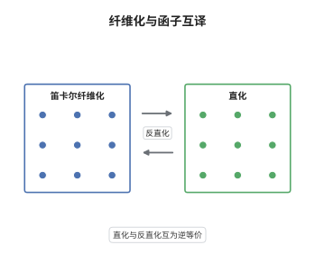

# Grothendieck 构造与 $\infty$-函子

> **一句话大白话**：一族按底范畴变化着的范畴，可以打包成一个总范畴，其投影让每个底对象上的纤维正好是那一族中的成员；反过来说，任何"纤维化"都来自这样一族。
>
> **小例子**：取底范畴为单对象群胚 $B\mathbb Z/2$，函子给集合 $\{a,b\}$ 带上交换 $a\leftrightarrow b$ 的作用。Grothendieck 构造得到作用群胚：两个对象、两条非恒等态射，投影到 $B\mathbb Z/2$ 的纤维恰是 $\{a,b\}$。

## 介绍

Grothendieck 构造把一个"以范畴为值"的函子 $F:\mathcal C^{op}\to\mathrm{Cat}$ 变成一个大范畴 $\int F$，其投影 $\int F\to\mathcal C$ 是纤维化；反过来，任何纤维化都由某个函子如此得到。这条对应是下降理论、模空间与拓扑斯理论的骨架：它把"变化的范畴"与"带纤维结构的单一对象"互相翻译。在 $\infty$-范畴里，Lurie 把它升级为直化与反直化的等价——函子取值为 $\infty$-范畴，纤维化是笛卡尔纤维化，两边构成 $\infty$-范畴的等价。它把"如何存储一族同伦连贯的范畴"的问题，变成了"如何造一个投影"的问题。

## 几何直观

图意在说明：左栏画的是总范畴到基底范畴的投影，箭头竖直向下表示纤维，横向箭头表示笛卡尔提升，即把底范畴的一条边唯一地拉到纤维之间；右栏画的是基底范畴到范畴之范畴的函子，每个对象标记一个纤维。中间的箭头代表直化与反直化，两者互逆，因此"带提升的投影"与"函子"是同一件事的两种写法。

## 分析

**前置依赖**：范畴论、$\infty$-范畴；补充：笛卡尔纤维化、相对 nerve 构造。

**数学内涵**：
- 一范畴版：对协变函子 $F:\mathcal C\to\mathrm{Cat}$，$\int F$ 的对象是二元组 $(c,x)$，$x\in F(c)$；态射 $(c,x)\to(c',x')$ 是 $f:c\to c'$ 加 $\phi:F(f)(x)\to x'$。投影 $p(c,x)=c$ 是余笛卡尔纤维化。
- 余笛卡尔态射：$(f,\phi)$ 使对每个 $h:c'\to c''$ 与每个 $(h,\psi)$，映射 $\phi$ 唯一确定剩余的 $F(h)(x')\to y$。唯一性来自 $F(hf)=F(h)F(f)$ 与复合的结合。
- $\infty$ 版：$p:X\to\mathcal C$ 是余笛卡尔纤维化，指 $p$ 是内纤维化，且对每条边 $f:c\to c'$ 与每个 $x'\in X_{c'}$ 存在 $p$-余笛卡尔提升；余笛卡尔性用映射空间方块是同伦拉回来刻画。直化 $\mathrm{St}$ 把 $X$ 送到 $c\mapsto X_c$，反直化 $Un$ 由相对 nerve 给出。
- 常见误区：以为把一范畴版本的构造照搬即可。当函子取值是 $\infty$-范畴时，必须用相对 nerve，逐维记录"到各阶骨架的相容映射"，否则会丢掉函子值之间的高阶态射。

**结构**：
1. 写出 $\int F$ 与投影，验证 $(f,\mathrm{id})$ 是余笛卡尔态射。
2. 反过来由纤维化造伪函子，说明两个方向互为逆，即 2-范畴层面的等价。
3. 在 $\infty$-情形用相对 nerve 与万有纤维化给出直化与反直化的等价。

## 思考过程

Grothendieck 在 SGA 1 里需要处理"下降"：一族局部对象如何粘成整体对象。他发现粘合数据本身就是一个函子，而总对象就是 Grothendieck 构造。障碍立刻出现：函子的复合严格结合，而"选择提升"只能选到同构，于是必须引入 cleavage 与伪函子，等式变成同构。这个麻烦在一范畴层面可控（因为同构可以当作等式来用），到了 $\infty$-范畴就失控：同构之间还有同伦，同伦之间还有更高同伦。Lurie 的处理是把"选择"完全去掉：不构造分裂，只用相对 nerve 定义一个总对象，让所有相干性由单纯集的高维单形自动携带。这样直化与反直化才能成为真正的等价，而不是仅到同构为止的对应。

## 证明过程

**定理**：设 $\mathcal C$ 为拟范畴，$\mathcal C\mathrm{at}_\infty$ 为 $\infty$-范畴之 $\infty$-范畴。直化给出 $\infty$-范畴的等价

$$
\mathrm{St}:\mathrm{Cocart}(\mathcal C)\rightleftarrows\mathrm{Fun}(\mathcal C,\mathcal C\mathrm{at}_\infty):Un .
$$

**证明**：

### 1. 构造与提升

对 $F:\mathcal C\to\mathrm{Cat}$ 定义 $\int F$ 如上。给定 $(c',x')$ 与 $f:c\to c'$，取 $\tilde f=(f,\mathrm{id}):(c,F(f)(x'))\to(c',x')$。验证余笛卡尔性：设有 $(g,\psi):(c,F(f)(x'))\to(c'',y)$ 与 $h:c'\to c''$ 使 $hf=g$。需要唯一的 $\theta:F(h)(x')\to y$ 使 $(h,\theta)\circ\tilde f=(g,\psi)$。左端为 $(hf,\,F(hf)(x')\xrightarrow{\theta\circ F(h)(\mathrm{id})}y)$，而 $F(hf)=F(h)F(f)$，故 $\theta$ 只能是 $\psi$ 在这一识别下的对应，存在且唯一。

### 2. 反向与 2-等价

设 $p:E\to\mathcal C$ 是余笛卡尔纤维化。令 $F(c)=p^{-1}(c)$；对 $f:c\to c'$ 及每个 $x\in F(c)$ 选余笛卡尔提升 $\tilde f_x$，令 $F(f)(x)$ 为其靶点。不同选择相差典范同构：两条余笛卡尔提升的靶点由唯一同构连接，因为余笛卡尔性给出唯一的比较映射。于是得到伪函子，且 $\int F\to E$ 是全忠实且本质满的函子，两个构造互逆到自然同构，故在 2-范畴层面是等价。这一步暴露了一范畴版本的局限：逆只到同构。

### 3. 相对 nerve 与 $\infty$-等价

给定 $F:\mathcal C\to\mathcal C\mathrm{at}_\infty$，定义相对 nerve $Un(F)$：其 $n$-单形由一条 $\sigma:\Delta^n\to\mathcal C$ 与一族相容映射 $\tau_J:\Delta^J\to F(\sigma|_J)$（$J$ 取遍 $[n]$ 的非空子集）组成，相容性即 $J\subseteq J'$ 时两映射在 $F$ 的函子性下一致。投影 $Un(F)\to\mathcal C$ 取 $\sigma$，它是余笛卡尔纤维化，纤维在 $c$ 上正是 $F(c)$。高维单形恰好存放"复合到高阶同伦"的全部相干数据，这正是第 2 步所缺的。

### 4. 万有纤维化与等价

取 $(\mathcal C\mathrm{at}_\infty)^{*}\to\mathcal C\mathrm{at}_\infty$ 为"带点 $\infty$-范畴"的遗忘函子，其纤维在 $\mathcal D$ 上就是 $\mathcal D$ 本身，且它是余笛卡尔纤维化，称为万有纤维化。对任意 $F$，$Un(F)$ 等于它沿 $F$ 的拉回；反过来，直化 $\mathrm{St}$ 是 $Un$ 沿 $\mathcal C$ 的右 Kan 延拓。两者满足三角恒等，故互为等价。于是"$\mathcal C$ 上取值为 $\infty$-范畴的函子"与"$\mathcal C$ 上的余笛卡尔纤维化"是同一件事。 $\square$

## 课堂问答

**老师**：既然函子和纤维化是一回事，为什么不干脆只用函子，省掉纤维化这一套？

**学生**：因为函子的复合要求严格，而几何里自然出现的族——例如概形上的准凝聚层、拓扑空间上的局部系统——只能给出"到同构为止"的提升。纤维化把这种松弛写进结构：提升不必唯一，只需在同伦意义下唯一，于是复合自动解决。用纤维化还能直接谈"总空间"，这对做下降与上同调是必需的。

**老师（追问）**：第 1 步里余笛卡尔性为什么要求"对每个 $h$ 都唯一"，而不是只要求对某条边唯一？

**学生**：余笛卡尔性是一个万有性质，必须对一切可能的靶与一切可能的分解都成立，否则提升就不能代表函子作用。正是"对所有 $h:c'\to c''$ 唯一"这一条，把 $F(hf)$ 与 $F(h)F(f)$ 强行等同起来，从而把函子性编码进几何。

**老师（拓展）**：这条对应与前一节的同伦余极限有什么关系？

**学生**：有直接关系。Thomason 定理说，一范畴的 Grothendieck 构造在 Thomason 模型结构下计算同伦余极限，即 $N(\int F)\simeq\mathrm{hocolim}\,N(F)$；$\infty$ 版本中，直化把"沿 $\mathcal C$ 的族"等同于"$\mathcal C$ 上的图"，而总空间正是这张图的余极限所在的万有对象。换句话说，Grothendieck 构造是"图"与"余极限"之间的桥。
