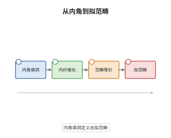

# Joyal 模型结构与拟范畴

> **一句话大白话**：在单纯集上换一套口味：把"能填内角"的态射当作纤维化、把"换过去不丢信息"的态射当作弱等价，于是纤维性对象正好是拟范畴——一种把高阶同伦塞进组合数据的无穷范畴。
>
> **小例子**：$\Delta^2$ 是拟范畴。给定两条可复合的边 $f:0\to1$ 与 $g:1\to2$，内角 $\Lambda^2_1$ 的填充就是 2-单形，它的第三条边 $h:0\to2$ 正是复合 $g\circ f$。而 $\Delta^1$ 里每条边都等价，所以它其实是无穷群胚。

## 介绍

Joyal 在 2002 年引入的这套模型结构，把 Boardman 与 Vogt 的"弱 Kan 复形"提升为完整的同伦论框架。它的纤维对象是**内 Kan 复形**，也就是拟范畴（quasi-category），是现代 $\infty$-范畴论最常用的模型。与 Quillen 模型结构相比，两者余纤维化相同（都是单射），但弱等价更宽：Quillen 的纤维对象是 Kan 复形，即所有态射都可逆的 $\infty$-群胚；Joyal 的纤维对象允许不可逆的态射，于是"范畴的范畴"本身也成为一个拟范畴。它把"如何在组合对象里正确表达'复合只到同伦' "的问题，变成了"哪些角形必须能填"的问题。

## 几何直观

图意在说明：最左边只要求内角能填洞，这一步就给出了复合；沿箭头向右，填洞性质升级为对所有内角包含的提升性质，即内纤维化；纤维的弱等价由"对每个拟范畴取映射空间"来检测，得到范畴等价；最后的纤维性对象就是拟范畴本身。四个方框是一条定义链，而不是四个独立概念。

## 分析

**前置依赖**：单纯集、模型范畴；补充：内角包含、单纯集的内 hom 与 core（极大 Kan 子复形）。

**数学内涵**：
- 拟范畴：单纯集 $X$ 使每个内角包含 $\Lambda^n_k\to\Delta^n$（$0<k<n$，$n\ge2$）都有填充。$n=2$ 给出复合：两条边 $f:x\to y$、$g:y\to z$ 可填成 2-单形，其第三边就是 $g\circ f$，只确定到同伦。
- 内纤维化：对内角包含有右提升性质。它不必是 Kan 纤维化，纤维也只是拟范畴而非 Kan 复形。
- 范畴等价：$f:X\to Y$ 使对每个拟范畴 $C$，$\mathrm{Map}(Y,C)\to\mathrm{Map}(X,C)$ 是 Kan 复形的弱同伦等价，这里 $\mathrm{Map}$ 取内 hom 的 core。当 $X$、$Y$ 本身是拟范畴时，这等价于 $\mathrm{ho}(f)$ 本质满，且 $\mathrm{Map}_X(x,y)\to\mathrm{Map}_Y(fx,fy)$ 对所有 $x,y$ 是弱等价。
- 常见误区：把"每条边都是等价"当成拟范畴的定义。那是 Kan 复形（$\infty$-群胚）的刻画；拟范畴允许不可逆边，等价性只在 1-单纯形层面要求"存在逆与两个 2-单形"。

**结构**：
1. 定义内角与内 anodyne 类，用小对象论证得到两种分解。
2. 证明每个内角包含都是范畴等价：填充空间可缩。
3. 归纳证明"无环内纤维化是平凡纤维化"，再用收缩论证补齐提升公理。

## 思考过程

Boardman 与 Vogt 在研究 iterated loop space 时发现，只要要求内角能填、不要求外角能填，单纯集就能同时容纳"复合"与"高阶同伦"。Joyal 的问题是：能否找到一个模型结构，使纤维对象恰好是这些弱 Kan 复形？难处在弱等价的定义——Kan 情形可以逐点用同伦群，拟范畴情形没有基点可用。Joyal 的办法是拿"探针"：对每个拟范畴 $C$ 取内 hom 的 core，得到 Kan 复形 $\mathrm{Map}(X,C)$，用它把范畴等价翻译成弱同伦等价，从而借用现成的同伦论。整套论证的支点是"内角填充空间可缩"这一句：它既说明填洞在弱意义下唯一，又说明内角包含本身不改变同伦型。

## 证明过程

**定理**：在 $\mathrm{sSet}$ 上以单射为余纤维化、以内纤维化为纤维化、以上述范畴等价为弱等价，则构成模型范畴；其纤维对象恰为拟范畴。

**证明**：

### 1. 内角与分解

记内角包含为

$$
\Lambda^n_k\hookrightarrow\Delta^n,\qquad 0<k<n,\ n\ge2 .
$$

内 anodyne 类由它们经推出、超限复合与收缩生成。$\Delta^n$ 紧，故小对象论证对生成集有效：任一态射 $X\to Y$ 可分解为 $X\to X'$（相对内角的胞腔复形）与 $X'\to Y$（内纤维化）；换生成集为边界包含，则得到"内 anodyne + 平凡纤维化"的分解。这给出 MC5，并说明所有对象余纤维。

### 2. 内角包含是范畴等价

设 $C$ 是拟范畴，要证限制映射 $\mathrm{Map}(\Delta^n,C)\to\mathrm{Map}(\Lambda^n_k,C)$ 是弱同伦等价。把 $\Delta^n$ 沿第 $k$ 个顶点拆成两个子单纯形，它们的交恰是 $\Lambda^n_k$。于是该方块是映射空间的粘合方块

$$
\begin{array}{ccc}
\mathrm{Map}(\Delta^n,C) & \to & \mathrm{Map}(\Delta^{n-1}_{(0)},C)\\
\downarrow & & \downarrow\\
\mathrm{Map}(\Delta^{n-1}_{(1)},C) & \to & \mathrm{Map}(\Lambda^n_k,C)
\end{array}
$$

由于 $C$ 对内角有填充，任意一对相容的 $(n-1)$-单形都有填充，且填充的全体可缩，这个方块是同伦拉回。同伦拉回的两条边在弱等价意义下互相决定，故限制映射的纤维可缩，从而是弱等价。因此每个内角包含都是范畴等价，内 anodyne 类全落在弱等价中。

### 3. 无环内纤维化是平凡纤维化

设 $p:X\to Y$ 是内纤维化且是范畴等价。要对每个 $\partial\Delta^n\to\Delta^n$ 造提升，对 $n$ 归纳。$n=0$ 平凡。设已有相容的 $b:\partial\Delta^n\to X$ 与 $a:\Delta^n\to Y$，全体提升构成 $\mathrm{Map}_{/Y}(\Delta^n,X)$ 的纤维，它是 Kan 复形。由第 2 步及 $p$ 是范畴等价，$\mathrm{Map}(\Delta^n,X)\to\mathrm{Map}(\partial\Delta^n,X)\times_{\mathrm{Map}(\partial\Delta^n,Y)}\mathrm{Map}(\Delta^n,Y)$ 是弱等价，故该提升空间非空且连通，任取一点即为提升。于是 $p$ 对一切单射有右提升性质，是平凡纤维化。

### 4. 公理齐备

MC1 显然；MC2 由 $\mathrm{Map}(-,C)$ 保弱等价与本质满射的复合封闭得到；MC3 由提升性质与弱等价都对收缩封闭得到；MC5 由第 1 步得到。至于 MC4：设 $i$ 是无环余纤维化，把它按第 1 步写成 $i=p\circ j$，$j$ 为内 anodyne、$p$ 为内纤维化；由 2-out-of-3 与第 3 步，$p$ 是平凡纤维化，故 $i$ 是 $j$ 的收缩，从而对一切内纤维化有左提升。另一半由第 3 步直接给出。纤维对象是到终对象的内纤维化，即内 Kan 复形，正是拟范畴。 $\square$

## 课堂问答

**老师**：为什么不干脆用 Quillen 模型结构，非要再搞一套 Joyal？

**学生**：Quillen 结构的纤维对象是 Kan 复形，所有态射可逆，只能描述 $\infty$-群胚。要描述一般的 $\infty$-范畴——例如函子范畴、导出范畴、稳定同伦范畴——必须有不可逆态射。Joyal 结构把生成的无环余纤维化从全部角包含收缩到内角包含，纤维对象随之扩大为拟范畴，代价是弱等价必须重新定义。

**老师（追问）**：范畴等价的定义里为什么要取内 hom 的 core，而不直接要求 $\mathrm{Map}(X,C)$ 是拟范畴之间的等价？

**学生**：因为 $X$、$Y$ 可能不是拟范畴，此时 $\mathrm{Map}(Y,C)\to\mathrm{Map}(X,C)$ 的一方未必有好的范畴语义。取 core 后两端都是 Kan 复形，可以直接用弱同伦等价这个已有概念，不必先假设纤维性。当 $X$、$Y$ 都是拟范畴时，两种说法一致，并可化成"$\mathrm{ho}(f)$ 本质满 + 各 hom 空间弱等价"。

**老师（拓展）**：拟范畴里什么叫做"等价"？它和 Kan 复形的情形差在哪里？

**学生**：1-单纯形 $f:x\to y$ 叫等价，指存在 $g:y\to x$ 以及两个 2-单形分别把 $g\circ f$ 与 $f\circ g$ 填到 $\mathrm{id}_x$、$\mathrm{id}_y$，等价地 $f$ 在 $\mathrm{ho}(X)$ 中是同构。Kan 复形的情形是每条边都自动如此；拟范畴只要求"存在"，这正是"复合只到同伦、可逆也只到同伦"的准确表达。
