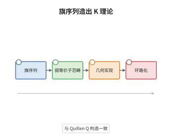

# Waldhausen $S_\bullet$ 构造与代数 K 理论

> **一句话大白话**：把"对象能被层层滤出来"这件事本身做成一个单纯对象，再绕一圈（取环路空间），得到的就是 K 理论；它把"数商对象"变成了一条拓扑空间。
>
> **小例子**：取 $\mathcal A$ 为有限维 $k$-向量空间。旗 $0\rightarrowtail A_1\rightarrowtail\cdots\rightarrowtail A_n$ 的每条商 $A_i/A_{i-1}$ 都是 $k^{d_i}$，于是 $\pi_1(|wS_\bullet\mathcal A|)$ 由关系 $[k^{d+e}]=[k^d]+[k^e]$ 生成，得 $K_0(\mathcal A)\cong\mathbb Z$，由维数给出。

## 介绍

Waldhausen 在 1985 年的《Algebraic K-theory of spaces》中提出 $S_\bullet$ 构造，目的是给拓扑空间做代数 K 理论（即 $A$-理论），而 Quillen 的 $Q$ 构造只适用于正合范畴。他的观察是：K 理论真正需要的不是核与余核，而是"余纤维化序列"，也就是一串可以层层取商的对象。于是只需一个带余纤维化与弱等价的范畴，就能造出单纯对象 $S_\bullet$，其弱等价子范畴的几何实现绕一圈即得 K 理论。对正合范畴，这条构造与 Quillen 的 $Q$ 构造给出同一个 K 理论，这就是一致性定理。它把"如何定义高阶 K 群"的问题，变成了"如何选择旗"的问题。

## 几何直观

图意在说明：最左边只要求范畴带余纤维化与弱等价；第二步把对象层层滤成旗，得到单纯范畴 $S_\bullet$；第三步只保留弱等价，取几何实现；最后绕一圈得到 K 理论。四个方框说明 K 群不是从环的乘法算出来的，而是从"旗如何互相嵌套"这一组合数据里长出来的。

## 分析

**前置依赖**：代数 K 理论、单纯集；补充：正合范畴、Quillen 的 $Q$ 构造。

**数学内涵**：
- Waldhausen 范畴：带余纤维化类 $\mathrm{cof}$（含同构、对复合封闭、沿余纤维化的推出存在且仍是余纤维化）、弱等价类 $w$（含同构、满足 2-out-of-3 与 gluing）、以及零对象。
- 旗：$S_n\mathcal C$ 的对象是 $0=A_0\rightarrowtail A_1\rightarrowtail\cdots\rightarrowtail A_n$；态射是兼容的 $A_i\to B_i$，要求每条商映射 $A_i/A_{i-1}\to B_i/B_{i-1}$ 是弱等价。
- 单纯结构：面映射 $\partial_i$ 删去第 $i$ 个对象（$0<i<n$），$\partial_0$ 只删零对象，$\partial_n$ 删末项；退化映射重复一个对象。所有商都仍可定义，因为余纤维化对推出封闭。
- K 理论：$K(\mathcal C)=\Omega|wS_\bullet\mathcal C|$，即 $K_i(\mathcal C)=\pi_{i+1}(|wS_\bullet\mathcal C|)$。
- 常见误区：以为 $K_0=\pi_0(|wS_\bullet|)$。实际 $\pi_1(|wS_\bullet|)\cong K_0$，必须环路一次；否则只得到"对象的弱等价类"，丢掉了 $[B]=[A]+[B/A]$ 这条关系带来的群结构。

**结构**：
1. 构造 $S_n\mathcal C$ 与面、退化映射，验证单纯恒等式。
2. 说明 $S_n$ 仍是 Waldhausen 范畴，$wS_\bullet$ 才是可作几何实现的部分。
3. 由 2-单形读出 $[B]=[A]+[B/A]$，得 $\pi_1\cong K_0$；再陈述加性定理与一致性定理并给出比较路线。

## 思考过程

Quillen 的 $Q$ 构造极其成功，但它要求正合范畴：必须有核、余核与短正合列。拓扑空间、环谱、甚至某些导出范畴并不满足，于是"给空间做 K 理论"卡住了。Waldhausen 的关键判断是把结构要求降到最低：只需要"哪些映射是余纤维化"与"哪些映射是同伦可逆"，因为 K 理论真正用到的只是商序列 $A\rightarrowtail B\twoheadrightarrow B/A$。另一个障碍是：$Q$ 构造把对象与态射混在一个范畴里，难以迭代；旗序列则天然是单纯对象，可以逐层叠、可以直接做几何实现。加性定理随后说明这个单纯对象确实是一个谱的第零空间，而一致性定理说明它没有偏离 Quillen 的答案。

## 证明过程

**定理**：设 $\mathcal C$ 是 Waldhausen 范畴。则 $S_\bullet\mathcal C$ 是单纯 Waldhausen 范畴，$K(\mathcal C)=\Omega|wS_\bullet\mathcal C|$ 良定义且 $\pi_1(|wS_\bullet\mathcal C|)\cong K_0(\mathcal C)$；若 $\mathcal A$ 是正合范畴，则 $\Omega|wS_\bullet\mathcal A|\simeq\Omega BQ\mathcal A$。

**证明**：

### 1. 旗序列与单纯恒等式

令 $S_n\mathcal C$ 的对象为旗 $A_\bullet=(0=A_0\rightarrowtail A_1\rightarrowtail\cdots\rightarrowtail A_n)$。对 $0\le i\le n$ 定义 $\partial_i$ 删去 $A_i$：$i=0$ 时删去首项 $A_0$（余下 $A_1\rightarrowtail\cdots$），$0<i<n$ 时把 $A_{i-1}\rightarrowtail A_i\rightarrowtail A_{i+1}$ 换成合成 $A_{i-1}\rightarrowtail A_{i+1}$，$i=n$ 时删去 $A_n$。退化 $s_i$ 把 $A_i$ 重复一次，即插入 $A_i=A_i$（这是余纤维化，因为同构属 $\mathrm{cof}$）。

要验证 $\partial_i\partial_j=\partial_{j-1}\partial_i$（$i<j$）：两边都只是在删去 $A_i$ 与 $A_j$，删除顺序不影响结果，因为合成映射满足结合律，且 $A_j/A_{j-1}$ 在两次删除后仍由同一对象给出。退化同理。故 $S_\bullet\mathcal C$ 是单纯范畴。

### 2. $S_n$ 的 Waldhausen 结构

$S_n\mathcal C$ 的余纤维化取逐项余纤维化，弱等价取"每条商 $A_i/A_{i-1}\to B_i/B_{i-1}$ 是弱等价"。余纤维化对推出封闭来自 $\mathcal C$ 的公理：逐项推出后商仍逐项对应。gluing 公理要求立方体图中若三条边是弱等价则第四条也是，这里逐项归结为 $\mathcal C$ 中商对象的 gluing。于是 $S_n\mathcal C$ 是 Waldhausen 范畴，$wS_\bullet\mathcal C$ 是单纯范畴，其几何实现可取。

### 3. $\pi_1$ 与 $K_0$

$S_1\mathcal C$ 的对象是 $0\rightarrowtail A$，与 $\mathcal C$ 的对象一一对应，弱等价也一致，故 $|wS_1|\cong|w\mathcal C|$。$S_2\mathcal C$ 的对象是 $A_1\rightarrowtail A_2$，$2$-单形的三条边分别给出 $A_1$、$A_2$、$A_2/A_1$。在 $\pi_1(|wS_\bullet|)$ 中，一个 $2$-单形对应一条同伦，于是

$$
[A_2]=[A_1]+[A_2/A_1] .
$$

这正是 $K_0$ 的定义关系，故 $\pi_1(|wS_\bullet\mathcal C|)\cong K_0(\mathcal C)$；取环路后 $K_0$ 变成 $\pi_0$。

### 4. 加性定理与一致性

加性定理：若正合函子 $F\to F'\to F''$ 满足 $F''(X)\simeq F'(X)/F(X)$，则 $K(F')\to K(F)\times K(F'')$ 是同伦等价。证明思路是把 $S_n$ 的旗按"落在 $F$ 中的部分"分层，得到长度 $n$ 的过滤，其连带商逐层是 $F$ 的旗；由 Quillen 定理 B 型的长正合列，$|wS_\bullet F'|\to|wS_\bullet F''|$ 是拟纤维化，纤维为 $|wS_\bullet F|$，再环路即得分裂。

一致性定理：对正合 $\mathcal A$，先用分辨率定理论证 $\mathcal A\to\mathrm{Ch}^b(\mathcal A)$ 满足 approximation，故两端 K 理论不变；在 $\mathrm{Ch}^b(\mathcal A)$ 上，$Q$ 构造的 $BQ$ 与 $|wS_\bullet|$ 都把"短正合列"记成单形，两者按链复形长度过滤给出同一条纤维序列；由加性定理，两端的分裂因子逐个相同，故环路后同伦等价，即 $\Omega|wS_\bullet\mathcal A|\simeq\Omega BQ\mathcal A$。 $\square$

## 课堂问答

**老师**：既然 $Q$ 构造已经给出 K 理论，$S_\bullet$ 的额外价值到底在哪？

**学生**：在于适用范围与可迭代性。$Q$ 构造要求正合范畴，而 $S_\bullet$ 只要求余纤维化与弱等价，因此能处理拓扑空间、环谱与带标架的流形，得到 $A$-理论。此外 $S_\bullet$ 是单纯对象，可以直接连乘、取极限、与 operad 作用，这些是 $Q$ 构造做不到的。

**老师（追问）**：为什么 K 理论要定义成环路空间而不是直接用 $|wS_\bullet|$？

**学生**：因为 $|wS_\bullet|$ 只记录到"对象与商"的层面，$\pi_1$ 才是 $K_0$；环路把这一步平移，使 $K_0$ 成为 $\pi_0$，$K_1$ 成为 $\pi_1$，如此才是通常 K 群的编号。若直接用 $|wS_\bullet|$，所有 K 群会整体错位一维。

**老师（拓展）**：加性定理在一致性定理里扮演什么角色，能否绕过它？

**学生**：很难绕过。它把"纤维序列"变成"直和分解"，是 $|wS_\bullet|$ 与 $BQ$ 两端能逐项比较的唯一依据；没有它，两条构造只在 $\pi_0$ 层面显然一致，高阶一致性无从谈起。它同时保证 $K(\mathcal C)$ 是无穷环路空间，从而 K 理论升级为谱。
