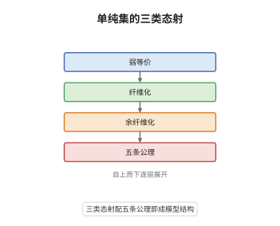

# 单纯集与 Quillen 模型结构

> **一句话大白话**：在单纯集上挑出三类态射——"同伦可逆的"、"能沿角形填洞的"、"逐层单射的"——让它们像拓扑里的弱等价、纤维化、余纤维化那样互相配合，于是不真造拓扑空间也能做同伦论。
>
> **小例子**：$\Lambda^2_1\to\Delta^2$ 逐层单射，因而是余纤维化；但 $|\Lambda^2_1|=S^1$ 与 $|\Delta^2|=*$ 不同伦等价，所以它不是弱等价。相反 $\Delta^1\to*$ 是弱等价，因为 $\Delta^1$ 可缩。

## 介绍

Quillen 在 1967 年把同伦论"代数化"：不直接操作拓扑空间，而在单纯集这一组合对象上指定三类态射，使同伦论的全部机器——同伦群、纤维序列、导出函子——都能运转。这三类态射是弱等价、Kan 纤维化与单射，它们满足五条公理，因而构成模型结构（model structure）。模型结构把"同伦等价"从几何概念变成范畴论概念：同伦范畴就是局部化 $\mathrm{sSet}[W^{-1}]$，而同伦群可以组合地计算。它把"两个空间是否同伦等价"的问题变成了"一个态射能否被分解与提升"的问题。

## 几何直观

图意在说明：最上层是"可逆"的弱等价，中间是"能填洞"的 Kan 纤维化，最下层是"逐层单射"的余纤维化。三类态射不是随意并列，而是被提升公理绑成对偶：左边的余纤维化对右边的纤维化有左提升性质，中间一层则负责把任意态射拆成一块余纤维化加一块纤维化。

## 分析

**前置依赖**：范畴论、单纯集；补充：几何实现与奇异集、小对象论证。

**数学内涵**：
- 弱等价：$f:X\to Y$ 使 $|f|$ 是同伦等价，等价地 $\pi_0(f)$ 是双射，且对每个基点 $x$ 与所有 $n\ge1$，$\pi_n(f):\pi_n(X,x)\to\pi_n(Y,f(x))$ 是同构。
- 纤维化就是 Kan 纤维化：对每个 $0<i<n$ 的角包含 $\Lambda^n_i\to\Delta^n$ 有右提升性质。余纤维化是逐层单射，等价于由边界包含 $\partial\Delta^n\to\Delta^n$ 生成的相对胞腔复形。
- 五条公理：MC1 有限完各与余完各；MC2 弱等价满足 2-out-of-3；MC3 三类态射对收缩封闭；MC4 提升公理；MC5 分解公理。提升公理拆成两半：无环余纤维化对纤维化有左提升，无环纤维化对余纤维化有右提升。
- 常见误区：以为弱等价可以逐层判断。角包含 $\Lambda^2_1\to\Delta^2$ 的低维部分逐层是双射，却因 $S^1$ 与一点不同伦等价而不是弱等价；必须看几何实现后的同伦群。

**结构**：
1. 定义三类态射，验证它们对同构、复合、收缩封闭，并把 2-out-of-3 归到同伦群的长正合列。
2. 用小对象论证把任一态射分解为"相对胞腔复形 + 平凡纤维化"，得到 MC5。
3. 证明关键引理"无环纤维化必是平凡纤维化"，再用收缩论证补齐 MC4 的两半。

## 思考过程

Quillen 想要一个既可代数化、又忠实记录同伦信息的地基：空间太粗，同伦群又太难算。单纯集恰好两端兼顾，但什么样的态射才算"弱等价"并不显见——逐层同构太强，逐层同伦又太弱。Kan 的角形填洞条件给出了可操作的纤维化概念，Quillen 的关键判断是让"填洞"与"几何实现后同伦等价"配对，而不是与逐层条件配对。真正的障碍在提升公理的一侧：要证"既是纤维化又是弱等价"的态射对边界包含有右提升性质。Quillen 用极小纤维化绕开它，后来的证明则直接用单纯集的小对象论证，把组合结构与同伦群的长正合列接上，干净许多。

## 证明过程

**定理**：在单纯集范畴 $\mathrm{sSet}$ 上，取 $W$ 为几何实现后是同伦等价的态射，$\mathrm{Fib}$ 为 Kan 纤维化，$\mathrm{Cof}$ 为逐层单射。则 $(\mathrm{sSet},W,\mathrm{Cof},\mathrm{Fib})$ 是模型范畴。

**证明**：

### 1. 三类态射的封闭性

$\mathrm{Cof}$ 是单射类，显然含同构、对复合与收缩封闭。$\mathrm{Fib}$ 由对内角包含的右提升性质定义，而右提升性质对复合、收缩、拉回都封闭。$W$ 的 2-out-of-3 来自同伦群的长正合列：若 $f$、$g$、$g\circ f$ 中有两个诱导同伦群的同构，第三个由五引理也诱导同构。使组合定义与拓扑定义衔接的是伴随单位：对 Kan 复形 $X$，$X\to\mathrm{Sing}|X|$ 是弱等价，于是

$$
\pi_n(X,x)\cong\pi_n(|X|,|x|),\qquad n\ge0 .
$$

### 2. 小对象论证给出分解

$\Delta^n$ 在 $\mathrm{sSet}$ 中是紧对象：任何态射 $\Delta^n\to\mathrm{colim}_\alpha X_\alpha$ 只经过有限多个 $X_\alpha$。于是对任意 $f:X\to Y$ 可逐步沿边界包含作推出，构造出相对胞腔复形的余极限

$$
X=X_0\hookrightarrow X_1\hookrightarrow\cdots\hookrightarrow X_\infty=X',
$$

每一步 $X_k\to X_{k+1}$ 都是沿某个 $\partial\Delta^n\to\Delta^n$ 的推出。取 $X\to X'$ 为余纤维化，则 $X'\to Y$ 对一切边界包含有右提升性质，即平凡纤维化。把生成集换成角包含，同一论证给出"无环余纤维化 + 纤维化"的分解。

### 3. 无环纤维化是平凡纤维化

设 $p:X\to Y$ 是 Kan 纤维化且是弱等价，要证它对每个 $\partial\Delta^n\to\Delta^n$ 有右提升性质。对 $n$ 归纳：$n=0$ 时 $\partial\Delta^0$ 为空，无需提升。设给定相容的 $a:\Delta^n\to Y$ 与 $b:\partial\Delta^n\to X$。由 $p$ 的纤维化性质，任一纤维 $F=F_{a(v)}$ 是 Kan 复形；由同伦群长正合列与 $p$ 在 $\pi_*$ 上同构得 $\pi_k(F)=0$ 对所有 $k$，故 $F$ 可缩。把 $b$ 与"某个候选提升"在边界上的差看成映射 $\partial\Delta^n\to F$，它零伦且可沿 $\partial\Delta^n\hookrightarrow\Delta^n$ 的同伦延拓性质（$F$ 是 Kan 复形）延拓到整个圆盘，把这个延拓加回候选提升即得方块所需的提升。故 $p$ 是平凡纤维化。

### 4. 收缩论证与结论

设 $i:A\to B$ 既余纤维化又弱等价。由第 2 步把 $i$ 分解为 $i=p\circ j$，其中 $j$ 是沿角包含的胞腔复形（无环余纤维化），$p$ 是纤维化。$i$ 与 $j$ 都是弱等价，由 2-out-of-3 得 $p$ 弱等价；由第 3 步 $p$ 是平凡纤维化，对一切单射有右提升性质。把 $i$ 与 $j$ 放进标准方块并用提升，得到 $i$ 是 $j$ 的收缩；$j$ 对一切纤维化有左提升性质，收缩保持该性质，故 $i$ 也有。结合第 1、2 步，五条公理齐备。 $\square$

## 课堂问答

**老师**：三类态射里，为什么偏偏用"几何实现后同伦等价"定义弱等价，而不用逐层条件？

**学生**：逐层条件不封闭于同伦的意义。用几何实现定义，$W$ 自动满足 2-out-of-3，且与拓扑同伦论对齐，$\pi_n(X,x)\cong\pi_n(|X|,|x|)$ 成立。逐层双射既漏掉真正的同伦等价（如 $\Lambda^2_1\to\Delta^2$ 不是弱等价却逐层单射），又把大量同伦等价排除在外。

**老师（追问）**：第 3 步里"纤维可缩"是怎么来的，为什么这一步不能省？

**学生**：由 $p$ 是弱等价与长正合列 $\pi_k(F)\to\pi_k(X)\to\pi_k(Y)$，两侧同构迫使 $\pi_k(F)=0$，Kan 复形白空间定理（Whitehead 定理的组合版）给出 $F$ 可缩。它不能省，因为 MC4 的一半正是要证无环纤维化是平凡纤维化，而平凡纤维化等价于"对边界包含提升"，其几何含义就是纤维可缩。

**老师（拓展）**：这套结构换成"内角"而不是"全部角"，会得到什么？

**学生**：把生成的无环余纤维化从全部角包含换成内角包含 $\Lambda^n_k\to\Delta^n$（$0<k<n$），纤维对象从 Kan 复形扩大为拟范畴，得到 Joyal 模型结构。此时 Quillen 弱等价仍包含于 Joyal 弱等价，但反过来不成立：$\Lambda^2_1\to\Delta^2$ 在 Joyal 结构中是无环余纤维化，在 Quillen 结构中连弱等价都不是，因为它的实现是圆到点的映射。
