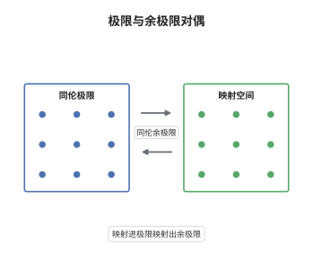

# 同伦极限与同伦余极限

> **一句话大白话**：在 $\infty$-范畴里，(余)极限不再只要求"有一个万有三角"，而要求映射空间层面的万有性质，于是原先被普通 (余)极限压掉的同伦信息被完整保留下来。
>
> **小例子**：把一点沿着 $S^1$ 的两端粘起来，普通推出得到一点；同伦推出却得到 $S^2$，因为双映射柱是 $S^1\times I$ 两端各缩成点，恰是 $S^1$ 的悬挂 $\Sigma S^1$。

## 介绍

同伦 (余)极限是 $\infty$-范畴论的基本运算，把拓扑学中的 homotopy colimit 与 homotopy limit 提升为纯范畴论概念。普通余极限只记录"对象之间有哪些态射"，同伦余极限还记录"这些态射如何被同伦连接"。在拟范畴框架下，它的定义只看映射空间：余极限 $X$ 满足 $\mathrm{Map}(X,Y)\simeq\mathrm{holim}_i\mathrm{Map}(F_i,Y)$，即"从余极限映射出去"等于"沿图作同伦极限"。这把"如何粘合"的问题变成了"映射空间如何取值"的问题，并给出极限与余极限的严格对偶。计算上则回到模型范畴的左导出函子与 Bousfield-Kan 公式。

## 几何直观

图意在说明：左栏是同伦极限，箭头全部指向中央，中央对象到每个 $F_i$ 的映射空间由整张图的同伦极限给出；右栏是同伦余极限，箭头由每个 $F_i$ 射向中央，中央到任意外部对象的映射空间由同伦极限给出。中间的箭头表示两者只是箭头方向反转，公式完全对称。

## 分析

**前置依赖**：$\infty$-范畴、单纯集；补充：单纯模型范畴、Bousfield-Kan 公式。

**数学内涵**：
- 余极限：$F:\mathcal I\to\mathcal C$ 的余极限是对象 $X$ 带余锥，使对每个 $Y$ 有 $\mathrm{Map}_{\mathcal C}(X,Y)\simeq\mathrm{holim}_{i\in\mathcal I}\mathrm{Map}_{\mathcal C}(F_i,Y)$。注意右边是**同伦极限**：这正是"余极限换方向"的来源。
- 极限：对偶地 $\mathrm{Map}_{\mathcal C}(Y,\lim F)\simeq\mathrm{holim}_i\mathrm{Map}_{\mathcal C}(Y,F_i)$。
- 计算：在单纯模型范畴中，同伦余极限是普通余极限的左导出函子，即 $\mathrm{hocolim}F\simeq\mathrm{colim}\,QF$，其中 $QF\to F$ 是图范畴投影模型结构下的余纤维替换。
- 常见误区：以为同伦余极限等于普通余极限再加一个"修正"。反例就是 $\ast\sqcup_{S^1}\ast$：普通推出是一点，同伦推出是 $S^2$，两者连弱同伦型都不同；"修正"不是小扰动而是本质改变。

**结构**：
1. 写出映射空间版本的万有性质，并证明满足它的对象在可缩的选择空间意义下唯一。
2. 在单纯模型范畴中证明 $\mathrm{colim}\,QF$ 满足该性质，从而同伦余极限由左导出函子给出。
3. 用单纯替换导出 Bousfield-Kan 公式，并用 $S^1$ 的推出算一遍。

## 思考过程

拓扑学家早就知道，粘合两个空间时必须用双映射柱而不是直接取商，否则会把同伦信息压掉。问题是这个操作依赖具体的模型（拓扑空间、单纯集、链复形），换一个模型就要重证一遍。Grothendieck 与后来的 $\infty$-范畴论者给出的方案是：不要定义"怎么粘"，只定义"粘出来的东西满足什么"。于是万有性质被搬到映射空间上——因为映射空间本身已经含全部同伦信息，用它写出的万有性质自动是同伦不变的。真正的障碍在于"图"必须被理解为同伦连贯的图，否则态射之间的同伦不被记录；拟范畴的函子天然是同伦连贯的，这一障碍因此消失。留下的是计算问题，由 Bousfield-Kan 公式回答。

## 证明过程

**定理**：设 $\mathcal M$ 是单纯模型范畴，$\mathcal I$ 是小范畴，$F:\mathcal I\to\mathcal M$。则 $\mathrm{hocolim}_{\mathcal I}F:=\mathrm{colim}\,QF$（$QF\to F$ 为投影模型结构下的余纤维替换）表示 $\infty$-范畴意义下的余极限，且

$$
\mathrm{hocolim}_{\mathcal I}F\simeq\mathrm{colim}\Big(\coprod_{i_0\to\cdots\to i_n}F(i_0)\otimes\Delta^n\Big).
$$

**证明**：

### 1. 万有性质与唯一性

设 $X$ 与 $X'$ 都满足 $\mathrm{Map}(X,Y)\simeq\mathrm{holim}_i\mathrm{Map}(F_i,Y)$ 对一切 $Y$ 成立。取 $Y=X'$，由 $X$ 的性质得 $\mathrm{Map}(X,X')\simeq\mathrm{holim}_i\mathrm{Map}(F_i,X')$，而后者由 $X'$ 的性质又同构于 $\mathrm{Map}(X',X')$，其中余锥对应的点给出一个映射 $X\to X'$。交换 $X$ 与 $X'$ 得反向映射，两者的复合在映射空间层面同伦于恒等，因为余锥空间本身可缩：任何两个余锥之间的比较映射唯一到同伦。故满足万有性质的对象构成可缩的选择空间。

### 2. 单纯模型范畴中的实现

在 $[\mathcal I,\mathcal M]$ 上取投影模型结构，其弱等价与纤维化逐对象定义。取余纤维替换 $QF\to F$，则 $QF$ 逐对象余纤维且图整体余纤维，于是 $\mathrm{colim}$ 与同伦余极限一致。对纤维对象 $Y$，单纯映射空间把余极限送到极限：

$$
\mathrm{Map}(\mathrm{colim}\,QF,Y)\simeq\lim_i\mathrm{Map}(QF_i,Y).
$$

再用 $QF\to F$ 是逐对象弱等价、且 $\mathrm{Map}(-,Y)$ 把弱等价送到弱等价（$Y$ 纤维），右端与 $\mathrm{holim}_i\mathrm{Map}(F_i,Y)$ 弱等价。于是 $\mathrm{colim}\,QF$ 满足第 1 步的万有性质，它就是余极限。

### 3. Bousfield-Kan 公式

把单纯替换写成余端

$$
\mathrm{hocolim}_{\mathcal I}F=\int^{[n]\in\Delta}\coprod_{i_0\to\cdots\to i_n}F(i_0)\otimes\Delta^n .
$$

这个余端给出一个从"自由图"到 $F$ 的逐对象弱等价（每层的面与退化映射由 $F$ 的函子性给出），因此它是余纤维替换；由第 2 步它计算同伦余极限。对偶地，同伦极限由余单纯替换的总化给出

$$
\mathrm{holim}_{\mathcal I}F\simeq\mathrm{Tot}\Big(\prod_{i_0\to\cdots\to i_n}F(i_n)\Big).
$$

### 4. 用 $S^1$ 的推出验证

取图 $\ast\leftarrow S^1\to\ast$。公式中 $0$-层是两份 $\ast$ 与一份 $S^1$，$1$-层记录三条边，几何实现后正是双映射柱：$S^1\times I$ 的一端经 $\ast$ 缩点、另一端经另一个 $\ast$ 缩点，即

$$
\mathrm{hocolim}\big(\ast\leftarrow S^1\to\ast\big)\cong \Sigma S^1\cong S^2 .
$$

而普通推出 $\ast\sqcup_{S^1}\ast$ 是一点。对比可见同伦余极限保留了"粘合时经过 $S^1$ 绕了一圈"这一信息。 $\square$

## 课堂问答

**老师**：为什么同伦余极限的定义里右边的指标是 $\mathrm{holim}$ 而不是 $\lim$？

**学生**：因为映射空间本身已经是同伦对象。若用普通极限 $\lim_i\mathrm{Map}(F_i,Y)$，就要求所有相容条件严格成立，等于把图当成严格图；而余极限要记录的是"到同伦为止的相容"，即同伦连贯的锥，所以必须取同伦极限。这也解释了为什么余极限与极限的公式只差箭头方向：一边用 holim 是因为另一边取的是映射空间。

**老师（追问）**：第 2 步里"余纤维图"这个条件在哪用到了？去掉它会怎样？

**学生**：用在两处：一是保证 $\mathrm{colim}\,QF$ 与 $\mathrm{hocolim}$ 一致（普通余极限对非余纤维图不保持弱等价），二是保证 $\mathrm{Map}(\mathrm{colim}\,QF,Y)\simeq\lim_i\mathrm{Map}(QF_i,Y)$ 在模型层面成立。若图不是余纤维的，例如把 $S^1\to\ast$ 换成同伦等价的非纤维映射，普通余极限可能仍是点，就得不到 $S^2$。

**老师（拓展）**：在稳定范畴里，(余)极限会变得简单吗？

**学生**：会。稳定 $\infty$-范畴中有限极限与有限余极限一致（因为是三角范畴式的结构），于是有限推出等于有限拉回，纤维序列与余纤维序列重合；例如上面的 $\ast\sqcup_{S^1}\ast$ 与对应的拉回给出同一个对象。但无限 (余)极限仍不同，$\prod$ 与 $\bigoplus$ 一般不相等。
