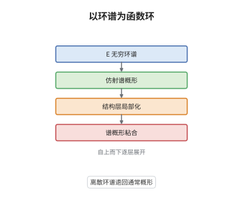

# 谱代数几何的基础

> **一句话大白话**：把"函数环"从交换环升级成 $E_\infty$ 环谱，环里就自带同伦信息，仿射对象叫谱概形；普通概形只是它丢掉高阶同伦后的影子。
>
> **小例子**：取一个零次生成元 $x$ 的自由 $E_\infty$ 环谱 $\mathbb S[x]$，则 $\pi_0\mathbb S[x]=\mathbb Z[x]$，所以它的底空间是 $\mathbb A^1_{\mathbb Z}$。但 $\pi_1\mathbb S[x]\ne0$（来自 $B\Sigma_2$ 的贡献），这部分信息在 $\mathbb Z[x]$ 里完全看不到。

## 介绍

谱代数几何（spectral algebraic geometry）是 Lurie 在《Spectral Algebraic Geometry》中建立的框架，把代数几何的"函数环"由交换环换成 $E_\infty$ 环谱。动机来自导出代数几何：形变理论与上同调论需要把"环的消解"也算进几何，而 $E_\infty$ 环谱恰好提供了一套既有好的同伦论、又能做交换代数的环论。仿射对象 $\mathrm{Spec}R$ 的底空间仍是 $\mathrm{Spec}\pi_0R$，但结构层本身是高阶对象，$\pi_nR$ 成为其上的准凝聚层。它把"环的同伦类型如何几何化"的问题，变成了"能否在 $\pi_0$ 上粘出一层高阶结构"的问题。定向上同调、椭圆上同调、$\mathbb G_m$-梯度等周期现象都能在此框架内获得几何解释。

## 几何直观

图意在说明：最底层是 $E_\infty$ 环谱，它的 $\pi_0$ 给出底空间、$\pi_n$ 给出高阶层；往上一层得到仿射谱概形，结构层取值于环谱而非环；再往上，局部化给出结构层的基本开集；最顶层把这些仿射块粘成一般的谱概形，导出概形则是其中"只允许连接环谱"的特例。

## 分析

**前置依赖**：导出代数几何、稳定同伦论；补充：$\mathbb S$-代数与 $E_\infty$ 结构、准凝聚层。

**数学内涵**：
- 环谱：$E_\infty$ 环谱是 $\mathbb S$-代数带上 $E_\infty$ 结构，其同伦范畴带对称幺半结构（smash 积）。$\pi_*R$ 是分次交换环，$\pi_0R$ 作用在其上，且 $\pi_nR$ 是 $\pi_0R$-模。
- 谱概形：$\mathrm{Spec}R$ 是取值于 $E_\infty$ 环谱的局部环空间，底拓扑空间为 $\mathrm{Spec}\pi_0R$ 上的 Zariski 拓扑，结构层由基本开集 $D(f)$ 上的 $R[f^{-1}]$ 决定，整体截面满足 $\Gamma(\mathrm{Spec}R)\simeq R$。
- 伴随：$\mathrm{Spec}$ 是整体截面函子 $\Gamma$ 的右伴随，单位 $\mathrm{Spec}\,\Gamma X\to X$ 在仿射情形是同构。
- 常见误区：以为 $\pi_*R$ 决定 $R$。$R$ 是离散环 $\mathbb Z[x]$ 时，$\pi_0$ 与 $\mathbb S[x]$ 相同，但高阶同伦完全不同；谱概形的结构层不是 $\pi_*R$ 这个分次环，而是 $R$ 本身。

**结构**：
1. 用望远镜构造局部化 $R[f^{-1}]$，并算出它的同伦群。
2. 验证有限多个 $f_i$ 生成单位理想时的层条件，得到结构层。
3. 证明 $\Gamma(\mathrm{Spec}R)\simeq R$ 与伴随关系，再与导出概形比较。

## 思考过程

Grothendieck 把"环"变成"几何"的办法是取谱，这一步在导出代数几何里被推广为"取环的消解"，但单纯交换环在高阶上有明显局限：它只在特征零附近与 cdga 等价，且无法容纳周期性的上同调论。Lurie 的关键判断是：与其修补单纯交换环，不如直接取"环"为 $E_\infty$ 环谱——它自带稳定同伦范畴作为系数，既有乘法又有同伦极限。难点在于层论：结构层的取值不再是集合层面的环，而是谱，于是"局部化是否正合""层条件是否在高阶层成立"都必须重新验证。幸运的是 $\pi_*$ 与滤过同伦余极限交换，这把问题逐阶压回通常的交换代数，只留下一个一致性检查。

## 证明过程

**定理**：设 $R$ 为 $E_\infty$ 环谱。则对任意 $f\in\pi_0R$，$\pi_*(R[f^{-1}])=\pi_*(R)[f^{-1}]$；由 $D(f)\mapsto R[f^{-1}]$ 定义的预层是 $\mathrm{Spec}\pi_0R$ 上的层，且 $\Gamma(\mathrm{Spec}R)\simeq R$，$\mathrm{Spec}$ 与 $\Gamma$ 互为伴随。

**证明**：

### 1. 局部化的同伦群

定义 $R[f^{-1}]$ 为望远镜

$$
R[f^{-1}]=\mathrm{colim}\big(R\xrightarrow{\cdot f}R\xrightarrow{\cdot f}R\to\cdots\big).
$$

同伦群函子 $\pi_*$ 与滤过同伦余极限交换（同伦群是稳定同伦范畴到分次群的正合函子，滤过余极限在稳定范畴中正合），故

$$
\pi_*(R[f^{-1}])=\mathrm{colim}\big(\pi_*R\xrightarrow{f}\pi_*R\xrightarrow{f}\cdots\big)=\pi_*R[f^{-1}].
$$

同理 $R[1]\simeq R$，$R[0]\simeq0$。这说明局部化在高阶层没有"额外同伦"，这是后面层条件的支点。

### 2. 层条件

设 $f_1,\dots,f_n\in\pi_0R$ 生成单位理想。要证

$$
R\to\prod_{i}R[f_i^{-1}]\rightrightarrows\prod_{i,j}R[(f_if_j)^{-1}]
$$

是同伦等化器。逐阶取 $\pi_*$：由第 1 步，每项都是 $\pi_*R$ 沿相应元素的局部化；由于 $\pi_0R\to\pi_0R[f^{-1}]$ 平坦，$\pi_*R[f^{-1}]=\pi_*R\otimes_{\pi_0R}\pi_0R[f^{-1}]$，于是该序列在每一阶都化为通常仿射概形的层条件（它是 $\pi_*R$ 作为 $\pi_0R$-模的局部化序列）。逐阶正合且等化器的同伦群等于同伦群的等化器，故原序列是同伦等化器。把 $f$ 取遍 $\pi_0R$ 即得结构层 $\mathcal O$，它在 $D(f)$ 上取值 $R[f^{-1}]$。

### 3. 整体截面与伴随

覆盖取 $f=1$ 的平凡覆盖，第 2 步给出 $\Gamma(\mathrm{Spec}R)\simeq R$。由此可验证伴随：对任意谱概形 $X$，$\mathrm{Hom}(\mathrm{Spec}R,X)\simeq\mathrm{Hom}_{E_\infty}(R,\Gamma X)$，一边由 $\mathrm{Spec}$ 的函子性与整体截面给出，另一边把 $R\to\Gamma X$ 沿结构层拉回并粘合，两个方向在第 2 步的层条件保证下互逆。

### 4. 与通常概形、导出概形比较

若 $R$ 离散（$\pi_{>0}R=0$），则 $R[f^{-1}]$ 也离散且等于 $R[f^{-1}]$，结构层就是普通环层，$\mathrm{Spec}R$ 回到通常的仿射概形。此时两个离散环谱之间的映射空间是离散的，$\pi_0$ 恰为环同态集，故通常概形到谱概形的嵌入是全忠实的。连接 $E_\infty$ 环谱在特征零等价于连接 cdga（Shipley 定理），这就是导出概形的情形；而在特征 $p$，自由 $E_\infty$ 环谱的同伦群带 Dyer–Lashof 运算，cdga 的同伦群不带，故两者不等价。 $\square$

## 课堂问答

**老师**：谱概形与导出概形的差别到底在哪？为什么非要把环谱允许到非连接？

**学生**：导出概形用的是单纯交换环或连接 $E_\infty$ 环，几何上"把消解纳入结构层"，但结构层的同伦群只出现在非负次数。谱概形允许 $R$ 有正次数同伦群，于是可以容纳周期性的上同调论：$KU$ 的 $2$-周期性、$tmf$ 的模形式分层、$\mathbb G_m$-梯度，都表现为 $\pi_*R$ 在正次数上的非平凡性。若只取连接情形，这些现象被截断。

**老师（追问）**：为什么底空间只由 $\pi_0$ 决定，$\pi_{>0}$ 完全不影响开集？

**学生**：Zariski 开集由"哪些元素可逆"决定，而可逆性只在 $\pi_0$ 层面判定：$f\in\pi_0R$ 在 $R[f^{-1}]$ 中变成单位，与高阶同伦无关。$\pi_{>0}R$ 的作用是给每个开集附上一个高阶层，它是准凝聚的，拓扑上不可见，正如向量丛不影响底流形的拓扑。

**老师（拓展）**：$\pi_*R$ 与 $R$ 的关系能差多远？举个例子。

**学生**：可以差很远。$\mathbb S[x]$ 与离散的 $\mathbb Z[x]$ 有相同的 $\pi_0$，但前者 $\pi_1\ne0$（由 $B\Sigma_2$ 的稳定同伦贡献），后者的高阶同伦全为零。这说明"环谱—分次环"不是忠实对应，谱概形的结构层确实携带了 $\pi_*$ 之外的一致性数据。
