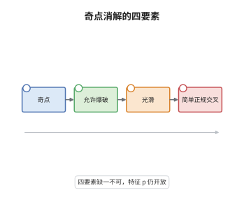

# Hironaka 奇点消解定理

> **一句话大白话**：代数簇上每一处"尖的、粘的"坏点，都能用有限次沿光滑小片把它炸开的方式抹平；而且炸出来的裂缝（例外除子）彼此横着相交，不会叠成一团。
>
> **小例子**：曲线 $y^2=x^3$ 在原点有尖点。沿原点爆破一次后，例外除子 $E$ 是一条射影直线，原曲线的严格变换只与 $E$ 交于一个光滑点并且横截相交，尖点随之消失；此时 $X'$ 光滑，$E$ 的支撑落在简单正规交叉位置。

## 介绍

Hironaka 奇点消解定理（1964）断言：特征零域上的代数簇总能经过一串以光滑闭子簇为中心的爆破变成光滑簇，并且例外除子连同给定除子的全原像一起处于简单正规交叉（simple normal crossing）位置。它属于双有理几何的起点问题：同一双有理等价类里有没有一个"最干净"的成员？答案是有的，而且可以用显式的爆破序列造出来。这条定理把"奇点有多坏"这种定性描述，转化为"我能用多少步、沿什么样的中心炸开"这种可操作的构造问题。整个极小模型纲领、对数对的终端化、以及后面的翻转理论，都把"先消解、再在光滑情形做手术"当作默认前提。

## 几何直观

图意在说明：最左边是带奇点的簇与它的奇异轨迹；中间一步是沿奇异轨迹内部的一个光滑闭中心爆破，把奇点炸开成一个有厚度的例外除子；最右边得到的光滑簇里，例外除子与严格变换像一张被拉直的网格，每个点附近都只是若干光滑分支横截地穿过，局部由坐标乘积为零给出。

## 分析

**前置依赖**：代数几何、概形、blow-up；补充：例外除子与严格变换、简单正规交叉除子、优环（excellent ring）与一般光滑性。

**数学内涵**：
- 消解指的是一个 proper 双有理态射 $\pi:X'\to X$，要求四件事同时成立：基域特征为 $0$；$\pi$ 双有理；$X'$ 光滑；$\pi^{-1}(D)+\mathrm{Exc}(\pi)$ 的支撑是简单正规交叉除子，即局部同构于 $\prod_{i=1}^{k}x_i=0$ 定义的超曲面并。
- 特征零是证明里真正被用到的假设：对"待消解的理想"做归纳时，需要取一般超平面切片，靠特征零的一般光滑性（generic smoothness，可分扩张下 $\Omega$ 的满射性）保证切片仍是"同类型但维数更低"的奇点。
- 特征 $p>0$ 的一般情形至今仍是公开问题。已知的有曲面（Abhyankar、Lipman）、三维（Cossart-Piltant）、局部单点化（Abhyankar 的赋值论方法）、以及 F 有限或强 F 正则等特殊类；四维以上的正特征一般消解尚无定理。
- 常见误区：以为"沿奇点爆破若干次必然变光滑"。爆破的中心必须光滑、且要保持在已有例外除子的交叉图之内；随意沿奇异子簇爆破会让除子叠成非交叉的形状，反而离目标更远。

**结构**：
1. 把问题局部化并"除子化"：把待消解的对象记成理想层与除子的二元组，允许的爆破中心限制在与已有除子横截的光滑闭子簇内。
2. 定义不变量：以 Hilbert-Samuel 型函数（各点局部环的$\mathfrak m$-adic 长度增长率）为主，构造一个在每次允许爆破下严格下降、取值落在良序集里的量。
3. 对不变量做超限归纳：极小值的二元组已经光滑且除子交叉，否则存在"最坏的点"，沿其光滑化后的中心爆破使不变量下降，归纳终止即得结论。

## 思考过程

Zariski 在二十世纪三十年代用赋值与局部单点化的语言处理了曲面情形，Abhyankar 后来把局部单点化系统化为赋值论问题：每个赋值都应该有光滑模型。但"逐点修好"并不能自动拼成整体结论，因为修一处可能弄坏另一处，例外除子越堆越复杂。Hironaka 的关键转折是不再把奇点单独当作归纳对象，而是把"奇点 + 已经生成的例外除子"作为一个整体，并且要求每次爆破的中心与这个整体横截——于是爆破只会让除子图变得更规整，不会更乱。真正困难的是找到会下降的量：他用 Hilbert-Samuel 函数在"最大奇点"处给出上界，证明沿精心挑选的中心爆破后上界严格变小。特征零的一般光滑性保证了"取一般切片"这一步不会把奇点类型换掉，这也是为什么特征 $p$ 的同一论证至今走不通。

## 证明过程

**定理**：设 $k$ 是特征 $0$ 的域，$X$ 是 $k$ 上既约的代数簇（更一般地，优 Noether 概形），$D$ 是 $X$ 上的有效除子。则存在由光滑闭中心组成的爆破序列

$$
\pi:\ X'=X_n\longrightarrow X_{n-1}\longrightarrow\cdots\longrightarrow X_0=X
$$

满足：$\pi$ 是 proper 双有理态射；$X'$ 光滑；$\pi$ 在 $X\setminus\bigl(\mathrm{Sing}(X)\cup\mathrm{Supp}\,D\bigr)$ 上是同构；并且 $\pi^{-1}(D)+\mathrm{Exc}(\pi)$ 的支撑是简单正规交叉除子。特征 $p>0$ 时相应的一般陈述仍为公开问题。

**证明**：

### 1. 允许爆破与除子化

把 $X$ 的奇点用理想层 $\mathcal I\subset\mathcal O_X$ 记录，并令 $E=\sum E_i$ 为已有的例外除子。一次允许爆破是指沿光滑闭子簇 $Z\subset X$ 爆破，且 $Z$ 与 $E$ 的每个 stratum 横截相交，即 $Z$ 局部由 $x_1=\cdots=x_c=0$ 给出而 $E$ 局部由部分坐标之积给出。爆破后把新例外除子并入 $E$，于是 $\mathcal I$ 换成其严格变换的理想。允许性保证 $E$ 的支撑始终保持简单正规交叉。

### 2. Hilbert-Samuel 型不变量

对闭点 $x\in X$ 与整数 $s$，令 $\mathcal I^{(s)}$ 表示 $\mathcal I$ 的 $s$ 次"除子化"乘积（即把 $E_i$ 的系数吸收进指数）。Hironaka 的不变量是

$$
\mathrm{ord}_x^{\,E}(\mathcal I)=\lim_{s\to\infty}\frac{\max\{n:\ \mathcal I^{(s)}\subseteq\mathfrak m_x^{\,n}\}}{s},
$$

以及它在所有点上的最大值 $\mathrm{ord}^{\,E}(\mathcal I)=\sup_x \mathrm{ord}_x^{\,E}(\mathcal I)$。该量取非负实数值，且沿允许爆破不增。关键是选"最大奇点集"作中心时它严格下降：设 $Z$ 为 $\mathrm{ord}^{\,E}(\mathcal I)$ 取最大值的点集的光滑化，则对爆破 $\pi$ 有

$$
\mathrm{ord}^{\,E'}(\pi^{*}\mathcal I)<\mathrm{ord}^{\,E}(\mathcal I).
$$

下降的理由是：爆破把多重数按重数分解，$Z$ 上的重数被"摊"到法向坐标里，而 $\pi$ 的例外除子吸收了这部分重数，$\mathrm{ord}$ 的比值严格变小。

### 3. 良序归纳与终止

把二元组（奇点集维数，$\mathrm{ord}$，各 stratum 的交叉重数）按字典序排列，它是一个良序集。每次沿最大奇点光滑化中心爆破，该元组严格下降；由于不变量不能无限下降，序列有限步后必须停在不下降的情形，而唯一不下降的情形就是 $\mathcal I=\mathcal O_X$，即 $X$ 已光滑。此时 $E$ 的支撑仍是简单正规交叉，因为每一步都用了允许爆破。

### 4. 结论

取 $\mathcal I$ 为 $X$ 的奇异轨迹定义的理想，$D$ 为给定除子，上面的归纳给出有限爆破序列使 $X'$ 光滑、$\pi$ 在光滑部分之外同构、且 $\pi^{-1}(D)+\mathrm{Exc}(\pi)$ 呈简单正规交叉。特征零的一般光滑性在第 1、2 步的切片论证中不可替换，故特征 $p$ 的对应陈述仍未解决。 $\square$

## 课堂问答

**老师**：定理为什么一定要强调"例外除子处于简单正规交叉"？只要求 $X'$ 光滑不够吗？

**学生**：不够，而且这一条才是定理的难点。光滑只保证 $X'$ 本身没有奇点，但双有理几何里真正参与运算的是除子：翻转、消失定理、对数对的系数，都要求除子局部写成坐标乘积为零。若除子有三条分支在一点相切而非横截，$K_{X'}+E$ 的奇点类型就失控，后面的 Kawamata-Viehweg 消失与终端化都无法进行。所以定理的输出必须是"光滑 + 除子网格化"这一对条件。

**老师（追问）**：既然证明靠不变量下降，为什么特征 $p$ 的同一条路走不通？哪一步坏了？

**学生**：坏在"取一般超平面切片"这一步。归纳要对维数下降，需要把高维奇点切成低维奇点而不改变奇点类型，这靠特征零的一般光滑性：$k(X)/k$ 可分时，一般纤维上 $\Omega_{X/k}$ 的秩保持。特征 $p$ 下 $k(X)/k$ 可能不可分，一般成员可能整片落在奇异轨迹里，切片后奇点类型完全变掉，不变量不再对应。正因如此，特征 $p$ 只在曲面、三维、局部单点化和 F 奇异等特殊情形有定理。

**老师（拓展）**：消解定理在极小模型纲领里具体扮演什么角色？

**学生**：它是最基础的"通行证"。第一，任何簇都可以先消解成光滑簇，于是在光滑情形定义典范除子 $K_X$ 并用相交理论；第二，对数对的终端化（terminalization）就是对 $X$ 做消解并取相对典范，把任意 klt 对替换成终端对；第三，翻转的构造中需要把双有理映射延拓成态射，也要用消解来解析不定点。反过来，消解本身不控制 $K$ 的正负性，所以它替代不了 MMP——它只把奇点变干净，不告诉你该往哪个方向收缩。
