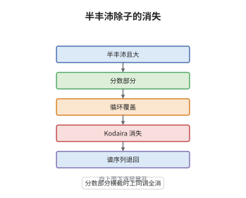

# Kawamata-Viehweg 消失定理

> **一句话大白话**：除子只要足够"肥"，并且它的分数部分又摆得整齐、互不纠缠，那么 $K_X$ 加上它之后所有高阶上同调都会消失，什么也剩不下来。
>
> **小例子**：在 $X=\mathbb P^2$ 上取 $D=\frac32H$（$H$ 为直线类）。$D$ 丰沛，且 $D-\lfloor D\rfloor=\frac12H$ 的支撑是一条光滑直线，自然是简单正规交叉。于是取整后 $K_X+D$ 对应 $\mathcal O_{\mathbb P^2}(-H)$，从而 $H^1=H^2=0$。

## 介绍

Kawamata 与 Viehweg 在 1982 年各自独立证明的消失定理，把 Kodaira 消失从"整系数的丰沛除子"推广到"半丰沛的 $\mathbb Q$-除子"。结论的形状与 Kodaira 完全一样：$H^i(X,K_X+D)=0$ 对所有 $i>0$ 成立；代价是 $D$ 可以带分数系数，但它的小数部分必须由简单正规交叉的光滑除子构成。这条定理是双有理几何的发动机：基点自由定理靠它、翻转的丰沛性判据靠它、对数对的压缩与终端化也都靠它。它把"除子有多正"这一几何问题，转成了"上同调是否为零"这一可计算的问题。

## 几何直观

图意在说明：第一层是光滑射影簇与一个半丰沛且 big 的 $\mathbb Q$-除子；第二层把除子拆成整数部分与简单正规交叉的分数部分，说明系数如何排布；第三层用循环覆盖把分数次数乘成整数，覆盖后的簇仍然光滑；第四层在覆盖上直接用 Kodaira 消失；第五层沿覆盖的纤维用谱序列把零上同调推回原簇。

## 分析

**前置依赖**：Kodaira 消失定理、相交理论；补充：$\mathbb Q$-除子的取整与分数部分、循环覆盖（cyclic cover）、Leray 谱序列。

**数学内涵**：
- 假设有两条。其一是正性：$D$ 是半丰沛（nef）且 big 的 $\mathbb Q$-除子，等价地可写成 $D=A+E$，其中 $A$ 是丰沛 $\mathbb Q$-除子、$E$ 是有效 $\mathbb Q$-除子。其二是形状：分数部分

$$
\{D\}=D-\lfloor D\rfloor=\sum_{i=1}^{r}a_iD_i,\qquad 0\le a_i<1,
$$

的支撑 $\bigcup D_i$ 是简单正规交叉除子，每个 $D_i$ 光滑。
- 结论是 $H^i\bigl(X,\mathcal O_X(K_X+\lceil D\rceil)\bigr)=0$ 对一切 $i>0$ 成立，通常简写为 $H^i(X,K_X+D)=0$。
- 与 Kodaira 的关系：$D$ 整、丰沛时就是 Kodaira 消失；本定理把"丰沛"松成"nef 且 big"，多出来的自由度全靠"分数部分呈简单正规交叉"来偿还。
- 常见误区：以为 nef 就够。$D=0$ 在 K3 曲面上使 $H^1(X,K_X)=H^1(X,\mathcal O_X)\ne0$，可见 big 不能去掉；也以为 SNC 只是技术性小条件，实际上它保证循环覆盖光滑，一旦破坏，覆盖会出现奇点，Kodaira 消失就无法直接搬过去。

**结构**：
1. 先把系数整理成 $a_i=1-\frac{1}{m_i}$ 的形状并取 $m$ 使 $mD$ 为整除子，为构造覆盖做准备。
2. 沿分数部分的各分支构造 $m$ 次循环覆盖 $\rho:Y\to X$，SNC 条件保证 $Y$ 光滑；把 $\rho^*(K_X+D)$ 与 $K_Y$ 的差写成一个 nef 且 big 的整除子。
3. 在 $Y$ 上用 Kodaira 消失，再用 Leray 谱序列沿有限平坦的 $\rho$ 把消失性推回 $X$。

## 思考过程

Kodaira 消失是 Hodge 理论的支柱，但极小模型纲领要处理的除子常常不是整系数的：对数对的边界 $\Delta=\sum a_iD_i$ 的系数是任意有理数，$K_X+\Delta$ 也未必丰沛，往往只知道 nef 和 big。直接把 Kodaira 搬过来是行不通的，因为"丰沛"这个假设在证明里被用来做非常丰沛的高次嵌入。Kawamata 与 Viehweg 的关键想法是：分数系数可以用覆盖"乘掉"。取 $m$ 使 $mD$ 成为整除子，再沿 $\sum D_i$ 做 $m$ 次循环覆盖，拉回后分数次数变成整数次数，而 nef 与 big 在拉回下保持。剩下的障碍是覆盖的光滑性——这正是 SNC 假设的用处：分支除子横截相交时，覆盖局部同构于 $t^m=\prod x_i^{m_i}$ 的标准形，光滑性可以直接读出。于是问题被彻底还原成 Kodaira 消失。

## 证明过程

**定理**：设 $X$ 是复数域上的光滑射影簇，$D$ 是 $X$ 上的 $\mathbb Q$-除子。若 $D$ 半丰沛（nef）且 big，并且分数部分 $D-\lfloor D\rfloor$ 的支撑是简单正规交叉除子，则

$$
H^i(X,K_X+D)=0\qquad(i>0).
$$

**证明**：

### 1. 化到标准系数

设 $\{D\}=\sum a_iD_i$，$a_i\in\mathbb Q\cap[0,1)$。取足够大的整数 $m$，使每个 $m a_i$ 为整数且 $mD$ 为整除子，并把 $a_i$ 改写成 $1-\frac{b_i}{m}$ 的形式（$1\le b_i\le m$）。这一步只用到系数的有理性与有限性，不改变支撑的 SNC 性质。

### 2. 构造循环覆盖

沿 $\sum D_i$ 构造 $m$ 次循环覆盖 $\rho:Y\to X$：局部在 $D_i$ 由 $x_i=0$ 给出处，$Y$ 由

$$
t^{m}=\prod_{i}x_i^{\,b_i}
$$

定义。由于 $\bigcup D_i$ 是简单正规交叉，$\rho$ 在每一点都局部同构于上述标准形，故 $Y$ 光滑；$\rho$ 是有限平坦态射，且 $\rho^{-1}(D_i)$ 的重数为 $m$。

### 3. 拉回后化为 Kodaira 情形

由覆盖的构造，$\rho^{*}\bigl(K_X+D\bigr)$ 与 $K_Y$ 只差一个整除子，而这个整除子等于 $\rho^{*}A$ 加上分支除子的整系数组合。因为 $A$ 丰沛、$\rho$ 有限，$\rho^{*}A$ 仍是 nef 且 big；于是 $K_Y$ 加上该整除子是 nef 且 big 的整除子。Kodaira 消失给出

$$
H^i\bigl(Y,K_Y+\rho^{*}D\bigr)=0\qquad(i>0).
$$

### 4. 用谱序列退回

$\rho$ 有限平坦，故 $\rho_*\mathcal O_Y$ 局部自由，Leray 谱序列

$$
E_2^{p,q}=H^p\bigl(X,K_X+D\otimes R^q\rho_*\mathcal O_Y\bigr)\Rightarrow H^{p+q}\bigl(Y,K_Y+\rho^{*}D\bigr)
$$

的右端为零。对 $p+q$ 作归纳：$q=0$ 层就是 $H^p(X,K_X+D)$，而更高 $q$ 的项由归纳假设已为零，于是 $H^i(X,K_X+D)=0$ 对一切 $i>0$ 成立，定理得证。 $\square$

## 课堂问答

**老师**：为什么"big"这个条件不能省？只要求 nef 会坏在哪里？

**学生**：$D=0$ 且 $X$ 为 K3 曲面就是反例：$K_X+D=0$，而 $H^1(X,\mathcal O_X)\cong\mathbb C^2\ne0$，消失直接失败。原因在证明里很清楚：big 性被用来保证 $\rho^{*}A$ 在覆盖上仍是 big，而 Kodaira 消失需要 nef 与 big 同时具备。nef 只说明除子在每个曲线上非负，big 才说明它的自交足够大、能撑起丰沛性，两者缺一不可。

**老师（追问）**：SNC 假设在证明中到底用在哪一步？如果除子只有普通交叉会怎样？

**学生**：用在第 2 步的局部计算。覆盖由 $t^m=\prod x_i^{b_i}$ 定义，只有当各 $D_i$ 在每点由互不相同的坐标函数给出（即 SNC）时，右端才是单项式，$Y$ 才光滑、$\rho$ 才有限平坦。若只是普通交叉，比如三条分支在一点相切，右端出现非单项式，$Y$ 带奇点，$K_Y$ 不再良定义，Kodaira 消失无从谈起。要救回来必须先做消解并调整系数，而那会改变 $D$，所以定理的陈述才把这个条件写死。

**老师（拓展）**：这条定理与后来 Nadel 的消失定理是什么关系？

**学生**：Nadel 消失是它的推广：对 klt 对 $(X,\Delta)$ 与 nef 且 big 的整除子 $L$，有 $H^i(X,\mathcal J(X,\Delta)\otimes L)=0$，其中 $\mathcal J$ 是乘子理想层。当 $\Delta$ 的系数都小于 $1$ 且支撑 SNC 时乘子理想层就是 $\mathcal O_X$，Nadel 消失立刻退化成 Kawamata-Viehweg。反过来，KV 的证明思路（覆盖 + Kodaira）也是 Nadel 论证的原型，只是后者把覆盖换成了奇点理论语言。
