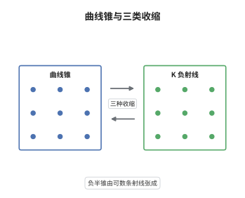

# Mori 锥定理与收缩定理

> **一句话大白话**：把所有曲线类张成的那个锥拿出来看，除了 $K_X$ 不为负的半个空间，剩下的部分总能拆成一条条笔直的射线，而每一条这样的射线都能被一个收缩态射整条压掉。
>
> **小例子**：取 $X=\mathrm{Bl}_p\mathbb P^2$，它同时是射影直线丛 $\mathbb P^1\to\mathbb P^1$ 的全空间。曲线锥由两条极值射线张成：例外曲线 $E$ 满足 $-K_X\cdot E=1$，纤维 $\ell'$ 满足 $-K_X\cdot\ell'=2$。前者给出除子型收缩 $X\to\mathbb P^2$，后者给出纤维型收缩 $X\to\mathbb P^1$。

## 介绍

Mori 锥定理（1982）刻画了射影簇上曲线锥 $\overline{NE}(X)$ 的形状：$K_X$ 非负的那部分之外，锥由可数多条 $K_X$-负的极值射线拼成，每条射线由一条有理曲线生成，且这条曲线的 $K_X$-次数有统一上界 $2\dim X$。配合收缩定理，每条这样的射线都对应一个收缩态射，把该射线方向的曲线全部压成点。这两条结果合起来回答了极小模型纲领最核心的问题：下一步该往哪个方向收缩。它们把一个关于"所有曲线"的无穷维问题，压缩成"逐条射线做手术"的有限步流程，此后 MMP 的每一步都只是选一条射线而已。

## 几何直观

图意在说明：左栏画出曲线锥，斜线阴影是 $K_X\ge0$ 的那半个锥，边界上伸出几条笔直射线，每条射线上站着一族有理曲线；右栏把同一条射线翻译成几何操作，纤维型把簇压到更低的底空间，除子型把一个除子压成低维集合，小收缩只压掉一条曲线却留下同维的像。

## 分析

**前置依赖**：相交理论、典范除子、锥定理；补充：极值射线与长度 $l(R)=\min\{-K_X\cdot C:[C]\in R\}$、klt 奇点、bend-and-break。

**数学内涵**：
- 锥定理：设 $X$ 正规射影、$(X,\Delta)$ klt（$\Delta=0$ 且 $X$ 终端时是经典情形），则

$$
\overline{NE}(X)=\overline{NE}(X)_{K_X+\Delta\ge0}+\sum_{j\ge1}R_j,
$$

其中每个 $R_j$ 是 $K_X+\Delta$-负的极值射线，$R_j=\mathbb R_{\ge0}[C_j]$，$C_j$ 是有理曲线且 $0<-(K_X+\Delta)\cdot C_j\le 2\dim X$。
- 收缩定理：对每条 $K_X+\Delta$-负极值射线 $R$，存在态射 $\mathrm{cont}_R:X\to Y$ 到正规射影簇，使得曲线 $C$ 被压成点当且仅当 $[C]\in R$；此时 $\rho(X/Y)=1$，且 $-(K_X+\Delta)$ 相对丰沛。
- 三种类型由例外集的形状区分：纤维型满足 $\dim Y<\dim X$，一般纤维 $F$ 是 Fano 且 $-(K_X+\Delta)|_F$ 丰沛；除子型满足 $\dim Y=\dim X$ 且例外集是素除子，$\rho$ 恰好下降 $1$；小收缩型满足 $\dim Y=\dim X$ 但例外集余维 $\ge2$，此时 $Y$ 上的 $K_Y$ 甚至不是 $\mathbb Q$-Cartier，必须做翻转。
- 常见误区：以为极值射线只有有限条。一般情形有无穷多条，锥定理只保证可数且"在 $K_X\ge0$ 部分之外局部有限"；另外 $2\dim X$ 的界只对 $K_X$-负射线成立，不能推广到任意曲线。

**结构**：
1. 用 bend-and-break 制造有理曲线：对长度有上界的曲线族，证明其形变空间维数足够大，于是曲线可以"折断"成两条，从而射线的生成元必为有理曲线，且长度被 $2\dim X$ 界住。
2. 用相对丰沛判据把射线变成态射：证明在射线外的方向上 $-(K_X+\Delta)$ 非负，再用相对 nef 值的基点自由型判据得到 $Y$ 与收缩态射。
3. 按 $\dim Y$ 与例外集的余维分类出三种类型，并把小收缩型交给翻转处理。

## 思考过程

Kleiman 在 1966 年已经知道曲线锥是闭凸锥、且 $K_X$-负方向才是"可收缩"的方向，但那只是抽象的凸几何断言，没有给出生成元。真正的障碍是：曲线有无穷多条，凭什么只用可数多条射线就能张成整个负半锥？Mori 的想法来自形变理论——如果一族曲线的 $K_X$-次数有界，那么它的形变参数空间维数就足够大，曲线会被"压断"成两条，而断点处的两条曲线各自更小。反复折断就得到有理曲线，因为只有有理曲线能在保持次数有界的前提下无限细分。有意思的是，Mori 最初在特征 $p$ 里做这个论证，正是为了利用 Frobenius 拉回带来的额外形变；特征零的情形随后通过化归到特征 $p$ 得到。有了生成元，收缩定理就顺势靠相对丰沛判据落地。

## 证明过程

**定理**：设 $(X,\Delta)$ 是 klt 对数对，$X$ 正规射影，$K_X+\Delta$ 为 $\mathbb Q$-Cartier。则

$$
\overline{NE}(X)=\overline{NE}(X)_{K_X+\Delta\ge0}+\sum_{j\ge1}R_j,
$$

其中 $R_j$ 是 $K_X+\Delta$-负的极值射线，由有理曲线 $C_j$ 生成并满足 $0<-(K_X+\Delta)\cdot C_j\le2\dim X$。进一步，每条这样的 $R_j$ 都对应唯一的收缩态射 $\mathrm{cont}_{R_j}:X\to Y$。

**证明**：

### 1. 折断引理给出有界长度的有理曲线

设 $\{C_t\}$ 是一族曲线，且 $-(K_X+\Delta)\cdot C_t\le\lambda$。对形变空间作维数估计，可找到通过同一点的形变使 $C_t$ 在某个点分裂为 $C_1+C_2$，且

$$
-(K_X+\Delta)\cdot C_1>0,\qquad -(K_X+\Delta)\cdot C_2>0 .
$$

不断分裂，次数保持有界，最终每段都是有理曲线；而 $-(K_X+\Delta)\cdot C\le2\dim X$ 来自分裂过程对次数的最小化。

### 2. 负半锥由这些射线张成

设 $[C]\in\overline{NE}(X)$ 且 $(K_X+\Delta)\cdot C<0$。由第 1 步的折断过程，$[C]$ 可写成有限个"极小段"的非负组合，每个极小段张成一条极值射线；反之每条极值射线都含有一条有理曲线。两方面合起来就得到锥分解，且求和只涉及可数条射线，因为在 $K_X+\Delta\ge0$ 之外长度有正下界。

### 3. 收缩态射的构造

固定负极值射线 $R$。先证 $-(K_X+\Delta)$ 在 $R$ 上正、在 $\overline{NE}(X)$ 的其余部分非负，故它相对某个丰沛除子是 nef 的。于是相对 nef 值的基点自由型判据适用，得到态射

$$
f=\mathrm{cont}_R:\ X\longrightarrow Y=\mathrm{Proj}\bigoplus_{m\ge0}H^0\bigl(X,\mathcal O_X(\lfloor m(K_X+\Delta)\rfloor)\bigr),
$$

且 $f$ 的纤维恰好是使曲线落在 $R$ 中的那些连通分支，故 $\rho(X/Y)=1$。

### 4. 三种类型的分类

考察例外集 $E=\mathrm{Exc}(f)$。若 $\dim Y<\dim X$，则一般纤维被 $f$ 压扁，$f$ 是纤维型，一般纤维是 Fano 簇。若 $\dim Y=\dim X$ 且 $E$ 含素除子，则 $E$ 是 $f$-反丰沛除子，$f$ 是除子型，$\rho(X)=\rho(Y)+1$。若 $\dim Y=\dim X$ 而 $\operatorname{codim}E\ge2$，则 $f$ 是小收缩型，$K_Y$ 不是 $\mathbb Q$-Cartier，$f$ 本身无法让 MMP 继续，这正是翻转要解决的缺口。 $\square$

## 课堂问答

**老师**：锥定理为什么只描述 $K_X$-负的那一半，正的那一半有什么不值得说的？

**学生**：因为收缩只对负有意义。Kleiman 的判据说，锥的"可收缩方向"恰好是 $K_X$-负的部分，$K_X$ 非负方向上没有极值射线可收缩，强行收缩会得到一个 $K$ 不正的像，MMP 立刻停在那里。所以锥定理把研究资源全押在负半锥上，说它由可数条射线 + 有界长度生成，于是算法每步只需处理一条射线。

**老师（追问）**：三条射线对应三种收缩，凭什么小收缩被单独挑出来说麻烦？

**学生**：因为剩下两种都能立刻推进 MMP。纤维型降低维数，问题转为在更低的底空间上做；除子型让 Picard 数降 $1$，而 $\rho$ 是正整数，不可能无限下降，所以这两类每步都有明确进展。小收缩两者都不占：维数不变、$\rho$ 在 $X$ 上也不降，而且像空间 $Y$ 的 $K_Y$ 根本不是 $\mathbb Q$-Cartier，$K$ 无法继续计算。于是必须在 $Y$ 的另一侧造一个新簇 $X^+$，这就是翻转，也正是它把 MMP 从"总能走"卡成"需要定理"。

**老师（拓展）**：长度界 $2\dim X$ 是怎么来的，能不能更小？

**学生**：它来自折断过程对次数的记账：每次折断都要求两段的 $-(K_X+\Delta)$-次数都为正整数级的量，而 $K_X$ 在有理曲线上的次数由维数控制，最优情形是射影空间中直线的次数 $\dim X+1$，一般 klt 情形放宽到 $2\dim X$。这个界不能对任意曲线成立，因为 $K$ 正的方向上次数无上界。它的真正用途不是数值精确，而是给出"长度有正下界"，从而保证负半锥之外的射线离散、求和局部有限。
