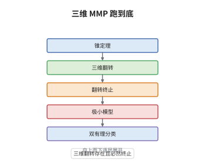

# 三维极小模型纲领

> **一句话大白话**：在三维情形里，翻转不但真的存在，翻转序列还真的会停，于是"不断挑 $K$ 负方向做手术"这套流程能一路跑到底，三维簇的双有理分类也就此完成。
>
> **小例子**：取 $X=\mathrm{Bl}_L\mathbb P^3$，沿一条直线 $L$ 爆破，例外除子 $E\cong\mathbb P^1\times\mathbb P^1$，其纤维 $\ell$ 满足 $K_X\cdot\ell=-1$。除子型收缩把 $E$ 压回 $L$，得 $X_1=\mathbb P^3$；此时 $K_{\mathbb P^3}=-4H$ 仍不 nef，再沿直线方向的射线做纤维型收缩，把 $\mathbb P^3$ 压成一点，MMP 结束。

## 介绍

Mori 在 1988 年证明：$\mathbb Q$-factorial 终端三维射影簇的翻转存在且翻转序列终止，因而三维极小模型纲领可以完整运行，任一这样的簇要么有极小模型，要么有 Mori 纤维空间。这是三维双有理几何的收官之作：锥定理与收缩定理给出候选方向，翻转补上小收缩这个缺口，终止性保证流程有限。它把三维簇的双有理分类化为"极小模型 + 终端奇点 + Fano 纤维化"三件可列举的对象，直接支撑了三维 Fano 簇的分类与三维极小模型理论的全部后续工作。它也是高维纲领的原型：后来 BCHM 做的事情，本质上就是把 Mori 在三维逐个构造的翻转，换成任意维的抽象存在性。

## 几何直观

图意在说明：第一层是锥定理与收缩定理，负责挑出射线并给出三种收缩；第二层是三维翻转的存在性，这是 Mori 亲自补上的缺口；第三层是终止性，说明翻转不会无限循环；第四层给出两种终局，极小模型或 Mori 纤维空间；第五层是把两种终局拼起来得到的三维双有理分类。

## 分析

**前置依赖**：三维几何、翻转、锥定理；补充：终端奇点与 cDV 分类、极值邻域（extremal neighborhood）、翻转图。

**数学内涵**：
- 定理（Mori 1988）：设 $X$ 是 $\mathbb Q$-factorial 终端三维射影簇，则 $X$ 有极小模型，或有 Mori 纤维空间 $X'\to S$（$\dim S<3$、$-(K)$ 相对丰沛、$\rho=1$）。等价的说法是：三维翻转存在，且任何翻转序列终止。
- 三维的简化来自奇点结构：终端三维奇点是孤立复合 Du Val 奇点（cDV），局部可嵌入 $\mathbb C^4$，故翻转收缩的例外集可以归结为有限种"极值邻域"，逐类显式构造。
- 终止性的依据是数值离散性：翻转中例外曲线的 $K$-次数落在有限集内，翻转图的"邻接关系"无环，于是不可能出现无限翻转序列；这与高维依赖 ACC 或标度论证形成对照。
- 常见误区：以为该定理对任意三维簇直接可用。必须先做终端化（消解后取相对典范），否则 $K$ 不是 $\mathbb Q$-Cartier；也以为三维只处理光滑簇，实际上终端奇点无法回避，正因如此才需要 cDV 分类。

**结构**：
1. 用锥定理取出 $K$-负极值射线，用收缩定理把射线变成收缩；除子型与纤维型都立即推进。
2. 对小收缩，把例外集化为极值邻域，按终端奇点的 cDV 类型与曲线的长度分类，逐类构造翻转。
3. 证明翻转序列终止：由例外曲线次数的有界性与翻转图的离散性排除无限循环。
4. 归纳得到两种终局，并合成三维双有理分类。

## 思考过程

Mori 在 1979 年用正特征的有理曲线论证证明了 Hartshorne 猜想，1982 年得到锥定理，三维 MMP 于是只剩一个缺口：小收缩之后怎么办。这个缺口比想象中硬，因为翻转不是爆破、不是收缩，而是一次"换曲线"的双有理手术，必须把新簇实际造出来。Mori 的办法是把问题局部化：小收缩的例外集在三维里是一族曲线，而终端奇点是 cDV，局部方程可以写下来，于是翻转收缩被压缩成有限种"极值邻域"，长度只能取 $1$ 或 $2$。逐类构造虽繁琐但可行，用的是加权爆破与 Reid 的"宝塔"技巧。剩下的是终止性：翻转每次都换簇而 $\rho$ 不变，不能靠 $\rho$ 计数，Mori 改用数值离散性——例外曲线的次数只能取有限多个值，翻转图也不可能成环，这才把无限循环的可能性排除。1992 年 Kawamata 把终止性推广到四维，而一般维数至今没有对应定理。

## 证明过程

**定理**：设 $X$ 是 $\mathbb Q$-factorial 终端三维射影簇。则存在双有理态射 $X\dashrightarrow X'$ 使 $K_{X'}$ nef（极小模型），或存在 Mori 纤维空间 $X'\to S$。特别地，三维翻转存在，且任一翻转序列终止。

**证明**：

### 1. 收缩与两类顺利情形

若 $K_X$ 不 nef，由锥定理存在 $K_X$-负极值射线 $R$，收缩定理给出 $f:X\to Z$。若 $\dim Z<3$，$f$ 是纤维型，$(Z,\Delta_Z)$ 上 $-K$ 相对丰沛且 $\rho=1$，即 Mori 纤维空间。若例外集是素除子，$f$ 是除子型，$\rho$ 降 $1$，以 $Z$ 替换 $X$ 继续。两种情形都不需要新工具。

### 2. 小收缩化为极值邻域

剩下 $\dim Z=3$ 而例外集 $E$ 是一维的情形。因 $X$ 终端，$X$ 的奇点是 cDV，$E$ 的每个连通分支是一条曲线 $C\cong\mathbb P^1$，其法向丛为

$$
N_{C/X}\cong\mathcal O(-1)\oplus\mathcal O(-1)\quad\text{或}\quad \mathcal O(-1)\oplus\mathcal O(-2),
$$

按 $K_X\cdot C=0$ 或 $K_X\cdot C=-1$ 分成两类；含奇点时还允许 $\frac12(1,1,1)$ 型终端奇点。把 $C$ 的一个邻域连同收缩 $f$ 一起取出，称为极值邻域，它只有有限种局部模型。

### 3. 逐类构造翻转

对每一种极值邻域，用加权爆破显式造出 $X^+\to Z$：先沿 $C$ 的某个加权理想爆破，再收缩掉多余除子，得到新的曲线 $C^+$ 与

$$
K_{X^+}\cdot C^+=-K_X\cdot C>0 .
$$

逐类验证 $X^+$ 仍终端、$\mathbb Q$-factorial，$K_{X^+}$ 在 $Z$ 上丰沛，且 $X\dashrightarrow X^+$ 在 $E$ 之外同构。有限种模型全部处理完，三维翻转的存在性得证。

### 4. 终止性

考察翻转序列 $X_0\dashrightarrow X_1\dashrightarrow\cdots$。每一步的例外曲线 $C_i$ 满足 $K_{X_i}\cdot C_i\in\{-1,-2\}$（按长度分类只有有限种取值），而 $C_i$ 在 $X_{i+1}$ 中的像与 $C_{i+1}$ 的相交行为受终端性约束；把这些数据连成"翻转图"，可证它不含环。图中每个顶点的出度有限、且沿序列数值单调，故序列长度有限。于是 MMP 的循环有限步停止。

### 5. 结论

停在 $K$ nef 处得极小模型，停在纤维型处得 Mori 纤维空间；二者合起来把任意 $\mathbb Q$-factorial 终端三维射影簇送入"极小模型 + 终端奇点 + Fano 纤维化"的标准形，三维双有理分类由此完成。 $\square$

## 课堂问答

**老师**：三维翻转能逐类构造，四维以上为什么就不行？差在哪里？

**学生**：差在例外集的结构。三维的小收缩只压掉曲线，终端奇点是 cDV、局部可嵌入 $\mathbb C^4$，法向丛只有两种，于是翻转收缩能被切成有限张"表格"逐格填。四维起例外集可以是一族曲线甚至一个曲面，法向丛没有分类，局部方程也写不出来，逐类构造这条路就断了。BCHM 换了个思路：不再造簇，改成证明截面环有限生成，用抽象存在性替代显式表格。

**老师（追问）**：终止性在三维靠"翻转图无环"，这个论证为什么不能直接搬到高维？

**学生**：因为它依赖两个三维特有的离散性。其一是例外曲线的 $K$-次数只能取 $\{-1,-2\}$ 这样有限多个值，其二是曲线之间的相交数被终端性压成有限种模式，图才可能无环。高维里例外纤维的维数更高、数值不变量连续变化，既没有有限取值也没有有限模式，只能改用 ACC（对数典范阈值的升链条件）或带标度的单调性来间接控制，而这些工具目前还不足以给出一般的终止定理。

**老师（拓展）**：三维 MMP 完成后，双有理分类得到了什么具体结论？

**学生**：任何 $\mathbb Q$-factorial 终端三维射影簇都可以沿 MMP 走到极小模型 $X'$ 或 Mori 纤维空间 $X'\to S$；极小模型上 $K$ nef，若还 big 就是一般型，$K$ 不 big 时可用"极小模型 + 收缩"继续分解成 Fano 纤维化。于是三维簇的双有理分类归结为分类终端三维奇点与三维 Fano 簇（Iskovskikh 等人的工作）。这与曲面情形（极小模型 + $(-1)$-曲线收缩）完全平行，只是三维多了翻转与终端奇点两个新现象。
