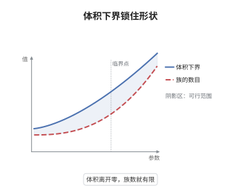

# 双有理几何中的有界性

> **一句话大白话**：维数钉死、体积不许缩到零，那么 klt 簇的"形状"就只有有限多种——所有这类簇都挤在有限多个形变族里，再多也只是在族内换参数。
>
> **小例子**：曲面上 $K_X$ 丰沛、$K_X^2\ge1$ 时，$K_X^2$ 只能取 $1,\dots,9$ 这些值，每个值只对应少数几个形变族（例如次数 $8$ 恰有 $\mathbb P^1\times\mathbb P^1$ 与 $\mathrm{Bl}_p\mathbb P^2$ 两族）。但若允许 $K_X^2\to0$，如 $\mathbb P^1$-丛上的 $K^2=0$，族数立刻变得无穷多。

## 介绍

有界性问题问的是：给定维数与体积下界，满足条件的簇到底有多少"本质不同"的形状？Birkar 证明：固定维数 $d$ 与体积下界 $v>0$，klt 的一般型簇构成有界族；对应的 Fano 版本（固定 $d$ 与 $\epsilon$，$\epsilon$-lc Fano 簇有界）正是著名的 Borisov-Alexeev-Borisov 猜想。这条定理把"体积"从一个连续不变量变成了离散化的闸门：一旦它离开零，双有理几何的模空间就只剩有限多个分支。它与极小模型纲领互为表里——MMP 负责把簇送到典范模型，有界性负责说明送到的目的地只有有限多种。

## 几何直观

图意在说明：横轴是体积 $K_X^d$ 的下界，纵轴是描述这些簇所需的族的数目；曲线在靠近零的一段急剧攀升，说明体积越小、能塞进去的形状越多；越过阈值 $v$ 之后曲线被压成一段平直的平台，表示族数被统一界住，只剩有限多个形变族。

## 分析

**前置依赖**：MMP、有界性、奇点；补充：klt 与 $\epsilon$-lc 奇点、DCC 系数集、Hilbert 概形与形变族。

**数学内涵**：
- 定理（Birkar）：固定整数 $d\ge1$、实数 $v>0$ 与满足 DCC 的系数集 $\Lambda\subset[0,1)\cap\mathbb Q$。则全体满足下述条件的 $d$ 维 klt 对数对 $(X,\Delta)$ 构成有界族：$X$ 射影、$\mathbb Q$-factorial，$K_X+\Delta$ 丰沛，$(K_X+\Delta)^d\ge v$，且 $\Delta$ 的系数取自 $\Lambda$。等价地，存在只依赖 $d,v,\Lambda$ 的 $N$ 与 $r$，使每个这样的 $X$ 都可嵌入 $\mathbb P^N$ 并由次数不超过 $r$ 的方程定义。
- 条件不可省。$\mathbb Q$-factorial 保证体积可用 $K_X^d$ 直接计算；去掉它则须改用 $\mathbb Q$-factorial 终端化的体积，因为小 $\mathbb Q$-factorial 化会改变自交数。$\Lambda$ 取 DCC 集则保证系数不会无限逼近 $1$，否则边界可以连续漂移，族数失控。
- Fano 侧的对偶陈述是：固定 $d$ 与 $\epsilon>0$，全体 $\epsilon$-lc 的 $d$ 维 Fano 簇有界，即 Borisov-Alexeev-Borisov 猜想，由 Birkar 在 2016 年证明；klt 但非 $\epsilon$-lc 的 Fano 簇在固定体积下界下也有界，但去掉体积下界即失效。
- 常见误区：把"有界族"误解成"有限个同构类"。有界只给出统一嵌入维数与统一方程次数，因此只有有限多个形变族，族内仍有连续模参数，同构类可以是无穷多；反过来，仅有"有限个形变族"也不够，必须统一嵌入才能控制族的紧性。

**结构**：
1. 用 MMP 把 $(X,\Delta)$ 换成对数典范模型 $X'$，使 $K_{X'}+\Delta'$ 丰沛；有界性是双有理不变的，故只需在丰沛情形证明。
2. 证明存在只依赖 $d,v$ 的整数 $m$，使 $m(K_{X'}+\Delta')$ very ample 且 $h^0$ 一致有界，于是所有成员嵌入同一个 $\mathbb P^N$。
3. 用 Hilbert 概形收尾：维数与次数一致有界，只有有限多个 Hilbert 多项式，每个给出有限多个平坦族。

## 思考过程

在低维，有界性可以靠分类硬算：曲面有 Enriques-Kodaira 分类，三维有 Mori 的极小模型理论，逐个列举。高维没有分类表，只能问"模空间有几个分支"。障碍很具体：体积是一个连续量，$K_X^d\ge v$ 只给了下界，上界完全没有，理论上次数可以任意大；而次数一大，Hilbert 概形就散成无穷多片。Birkar 的关键想法是把"体积有下界"翻译成"丰沛性一致"：如果体积不趋于零，那么 $mK_X$ 的 very ample 性所需的 $m$ 就不需要随 $X$ 变大，而可以由 $d$ 与 $v$ 统一控制。这一步用的是有界性 of complements 与有效基定理，也是整篇论证最吃力的地方。一旦 $m$ 统一，次数就有上界，Hilbert 概形的有限性立刻接管，剩下的都是形式工作。同一个机制在 Fano 侧表现为"反典范次数有下界 ⇒ 反典范系统的生成次数一致"，从而攻下 BAB 猜想。

## 证明过程

**定理**：固定 $d\ge1$、$v>0$ 与 DCC 系数集 $\Lambda\subset[0,1)\cap\mathbb Q$。则存在常数 $N=N(d,v,\Lambda)$ 与 $r=r(d,v,\Lambda)$，使得对每个满足下列条件的 $d$ 维 klt 对数对 $(X,\Delta)$：$X$ 射影 $\mathbb Q$-factorial、$K_X+\Delta$ 丰沛、$(K_X+\Delta)^d\ge v$、$\Delta$ 的系数属于 $\Lambda$，都存在闭嵌入 $X\hookrightarrow\mathbb P^N$，其像由次数不超过 $r$ 的方程定义。特别地这类对只落在有限多个形变族中。

**证明**：

### 1. 归约到丰沛情形

若 $K_X+\Delta$ 不丰沛，先运行 $(K_X+\Delta)$-MMP。由于 $K_X+\Delta$ big，MMP 终止于对数典范模型 $X'$，满足 $K_{X'}+\Delta'$ 丰沛且 $(K_{X'}+\Delta')^d=(K_X+\Delta)^d\ge v$；$X'$ 仍是 klt、$\mathbb Q$-factorial，系数集不变。双有理映射不改变"是否有界"，故只需对丰沛情形证明。以下仍记作 $(X,\Delta)$。

### 2. 统一的高次嵌入

由有界性 of complements 与有效基定理，存在只依赖 $d,v,\Lambda$ 的整数 $m$，使得 $m(K_X+\Delta)$ 是 Cartier 且 very ample，并且

$$
h^0\bigl(X,\mathcal O_X(m(K_X+\Delta))\bigr)\le N_0=N_0(d,v,\Lambda).
$$

原因是：体积有正下界时，任何" $m$ 不够大"的情形都会迫使某个极端收缩出现，而极端收缩会把体积压到 $v$ 以下，矛盾。于是可取 $N=N_0-1$，使每个 $X$ 通过 $|m(K_X+\Delta)|$ 嵌入同一个 $\mathbb P^N$。

### 3. 次数的一致上界

在上述嵌入下，$X$ 的次数为

$$
\deg X=\bigl(m(K_X+\Delta)\bigr)^d=m^{d}\,(K_X+\Delta)^d .
$$

这里需要 $(K_X+\Delta)^d$ 的上界。由第 2 步末尾的同一机制，若 $(K_X+\Delta)^d$ 无上界，相应的极端收缩又会把体积压破下界；于是存在 $V=V(d,v,\Lambda)$ 使 $(K_X+\Delta)^d\le V$。取

$$
r=m^{d}V
$$

即得所有成员在 $\mathbb P^N$ 中的次数不超过 $r$。

### 4. Hilbert 概形与有限族

维数固定为 $d$、所在射影空间固定为 $\mathbb P^N$、次数不超过 $r$ 的闭子概形，其 Hilbert 多项式只有有限多个，因为 Hilbert 多项式的次数为 $d$、首项系数由次数决定、其余系数被次数界住。于是所有成员落在有限多个 Hilbert 概形的分支上，每个分支给出一个平坦形变族。合并这些族即得"有界族"，定理成立。 $\square$

## 课堂问答

**老师**：定理里为什么非要 $\mathbb Q$-factorial？这个条件看着像是技术性的。

**学生**：它不是技术性的，因为体积 $(K_X+\Delta)^d$ 只有在 $K_X+\Delta$ 是 $\mathbb Q$-Cartier 时才是良定义的整数型不变量。对非 $\mathbb Q$-factorial 的 klt 簇，可以做小 $\mathbb Q$-factorial 化，而这一步会改变自交数，于是"体积有下界"这句话本身就失去意义。实践中的处理方式是：要么在假设里写 $\mathbb Q$-factorial，要么把体积换成 $\mathbb Q$-factorial 终端化上的体积，两者是等价的写法。省掉它，定理的陈述会含糊到无法证明。

**老师（追问）**：第 2、3 步都说"若不然就会出现极端收缩把体积压破下界"，这个论证凭什么成立？

**学生**：因为 klt 簇的体积不是自由的连续量，它被奇点与收缩结构锁住。若统一嵌入所需的 $m$ 或体积上界无界，则存在一列成员使某个反典范或典范系统的生成次数趋于无穷；对这种退化取极限会得到一个非 klt 的极限对象或一个把体积压到零的纤维型收缩，两者都与"klt + 体积有下界"矛盾。严格的版本要把这句话落实为有界性 of complements 与 ACC 型定理，Birkar 的贡献正是把这些"极限论证"做成了定理，而不是靠直观。

**老师（拓展）**：有界性与 Fano 的 BAB 猜想是什么关系？

**学生**：是同一机制的两面。BAB 猜想说固定 $d$ 与 $\epsilon$，$\epsilon$-lc 的 $d$ 维 Fano 簇有界，Birkar 2016 用反典范系统的有界生成性证明之；一般型版本则把 $K_X+\Delta$ 换成丰沛的典范类，用同样的"体积下界 ⇒ 生成次数一致"逻辑。两者的差别只在正性来源：Fano 侧靠 $-K_X$ 丰沛，一般型侧靠 $K_X+\Delta$ 丰沛。也正因如此，有界性常被当作 MMP 的"离散化伴侣"：MMP 把簇送到标准形，有界性说明标准形只有有限多种，两者合起来才使高维双有理分类具有可数的骨架。
