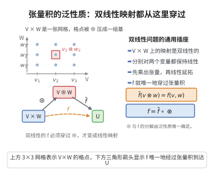

# 张量积的泛性质

> **一句话大白话**：张量积 $V\otimes W$ 是所有"双线性映射"最通用的接收器——任何双线性 $f$ 都能唯一地"拆成"一个线性 $\tilde{f}$ 穿过它，像万能适配插座。
>
> **小例子**：点积 $f(v,w)=\langle v,w\rangle$ 是双线性的，可唯一分解为 $V\otimes W$ 上的线性映射 $\tilde{f}$，满足 $\tilde{f}(v\otimes w)=\langle v,w\rangle$。

## 介绍

张量积的泛性质（Universal Property of Tensor Product）是多重线性代数中的核心概念，给出了张量积的范畴论刻画。该性质表明，张量积 $V\otimes W$ 是双线性映射的"最一般"的目标空间，任何双线性映射都可以通过张量积唯一分解。该性质是张量积在物理、几何、代数等领域广泛应用的理论基础。

## 几何直观

图意在说明：任何双线性映射都唯一地分解为张量映射与一个线性映射的复合，这就是张量积的泛性质。

## 分析

**前置依赖**：自由向量空间、双线性映射、商空间、线性映射的泛性质

**定理内容**：设 $V,W$ 是数域 $\mathbb{F}$ 上的向量空间，则存在向量空间 $V\otimes W$ 和双线性映射 $\otimes:V\times W\to V\otimes W$，满足以下泛性质：

对任意向量空间 $U$ 和任意双线性映射 $f:V\times W\to U$，存在唯一的线性映射 $\tilde{f}:V\otimes W\to U$，使得下图交换：
$$
\begin{CD}
V\times W @>{\otimes}>> V\otimes W \\
@| @V{\tilde{f}}VV \\
V\times W @>{f}>> U
\end{CD}
$$
即 $f = \tilde{f}\circ\otimes$，或等价地 $\tilde{f}(v\otimes w)=f(v,w)$。

**前置知识**：
- 张量积的构造：$V\otimes W$ 由形式张量 $v\otimes w$ 生成的自由向量空间模去双线性关系

**数学内涵**：
泛性质是范畴论中"普遍构造"的典型例子。张量积的泛性质表明，张量积是"解双线性映射问题"的通用对象。该性质唯一确定了张量积（在同构意义下），因此所有关于张量积的结论都可以从泛性质推导出来。

## 思考过程

**存在性**：通过显式构造证明。取以 $V\times W$ 为基的自由向量空间 $F(V\times W)$，商去由双线性关系生成的子空间 $R$，定义 $V\otimes W=F(V\times W)/R$，$v\otimes w$ 为 $(v,w)$ 的像。

**泛性质**：对任意双线性映射 $f:V\times W\to U$，定义 $\tilde{f}:V\otimes W\to U$ 为 $\tilde{f}(v\otimes w)=f(v,w)$，线性延拓。需要验证 $\tilde{f}$ 在商空间上良定义。

## 证明过程

**证明**：

**第一步：构造 $V\otimes W$。**

令 $F(V\times W)$ 是以集合 $V\times W$ 为基的自由向量空间，其元素为形式有限和 $\sum a_i(v_i,w_i)$。

考虑 $F(V\times W)$ 的子空间 $R$，由以下形式的元素生成：
1. $(v_1+v_2,w)-(v_1,w)-(v_2,w)$
2. $(v,w_1+w_2)-(v,w_1)-(v,w_2)$
3. $c(v,w)-(cv,w)$
4. $c(v,w)-(v,cw)$

定义 $V\otimes W = F(V\times W)/R$，商映射记为 $\pi$。定义 $\otimes(v,w)=\pi(v,w)=v\otimes w$。由 $R$ 的定义，$\otimes$ 是双线性的。

**第二步：验证泛性质。**

设 $U$ 是任意向量空间，$f:V\times W\to U$ 是任意双线性映射。

由自由向量空间的泛性质，存在唯一的线性映射 $\bar{f}:F(V\times W)\to U$，使得 $\bar{f}(v,w)=f(v,w)$。

由于 $f$ 是双线性的，$\bar{f}$ 在生成元 $R$ 上为零。例如：
$$\bar{f}((v_1+v_2,w)-(v_1,w)-(v_2,w))=f(v_1+v_2,w)-f(v_1,w)-f(v_2,w)=0$$
因此 $R\subseteq\ker\bar{f}$，由商空间的泛性质，存在唯一的线性映射 $\tilde{f}:V\otimes W\to U$，使得 $\tilde{f}\circ\pi=\bar{f}$。

从而对任意 $v\in V,w\in W$，$\tilde{f}(v\otimes w)=\tilde{f}(\pi(v,w))=\bar{f}(v,w)=f(v,w)$。

**第三步：唯一性。**

若存在另一个线性映射 $\tilde{f}':V\otimes W\to U$ 满足 $\tilde{f}'(v\otimes w)=f(v,w)$，则 $\tilde{f}'$ 与 $\tilde{f}$ 在生成元 $v\otimes w$ 上相等，由线性性，两者在 $V\otimes W$ 上处处相等。

$\square$

## 课堂问答

**老师**：张量积 $V\otimes W$ 凭什么能"接住"所有双线性映射？

**学生**：结论：它满足泛性质——对任意双线性 $f:V\times W\to U$，存在唯一线性映射 $\tilde f:V\otimes W\to U$ 使 $\tilde f(v\otimes w)=f(v,w)$，即 $f=\tilde f\circ\otimes$。

**老师（追问）**：这个 $V\otimes W$ 是怎么造出来的？$\tilde f$ 又为什么良定义？

**学生**：取以 $V\times W$ 为基的自由向量空间 $F$，商掉由 $(v_1+v_2,w)-(v_1,w)-(v_2,w)$、$c(v,w)-(cv,w)$ 等双线性关系生成的子空间 $R$，令 $V\otimes W=F/R$。由自由空间泛性质得 $\bar f:F\to U$ 且在 $R$ 上为零，故 $R\subseteq\ker\bar f$，商空间泛性质便给出唯一的 $\tilde f$。

**老师（拓展）**：泛性质为什么唯一确定张量积？常见误区是什么？

**学生**：若另一空间也满足同一泛性质，则由两边互设的分解得到互逆同构，故张量积在同构意义下唯一。常见误区是把 $v\otimes w$ 当成"逐坐标相乘"——一般张量是形式和的像，不能随意拆成单个 $v\otimes w$；一切性质都应从泛性质推，而非依赖某个具体坐标公式。
