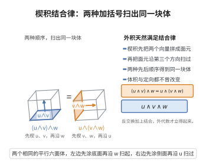

# 楔积的结合律

> **一句话大白话**：楔积带上先后括号的结果一样：$(u\wedge v)\wedge w = u\wedge(v\wedge w)$——不管怎么先组合，楔出来的相同，外代数才谈得上"乘法体系"。
>
> **小例子**：对向量 $e_1,e_2,e_3$，$(e_1\wedge e_2)\wedge e_3=e_1\wedge(e_2\wedge e_3)$，都等于同一个单位体积元。

## 介绍

楔积的结合律（Associativity of Wedge Product）是外代数（Grassmann 代数）中的基本性质，断言楔积运算满足结合律。该性质保证了外代数在楔积下构成一个结合代数，是微分形式理论、多变量微积分（斯托克斯定理）和代数拓扑的基础。

## 几何直观

图意在说明：先楔哪两个向量只影响作图的顺序，扫出的有向体积元完全相同，故楔积满足结合律。

## 分析

**前置依赖**：外代数定义、张量积、交替化映射、置换与对称群

**定理内容**：设 $V$ 是数域 $\mathbb{F}$ 上的向量空间，$\bigwedge(V)$ 是 $V$ 上的外代数。对任意 $u,v,w\in\bigwedge(V)$，有
$$(u\wedge v)\wedge w = u\wedge(v\wedge w)$$

**特别地**，对 $1$-形式（即 $V$ 中的向量）：
$$(u\wedge v)\wedge w = u\wedge(v\wedge w)$$

**前置知识**：
- 外代数定义：$\bigwedge(V)=\bigoplus_{k=0}^{\infty}\bigwedge^k(V)$，其中 $\bigwedge^k(V)$ 是 $k$ 次外幂
- 楔积 $\wedge:\bigwedge^k(V)\times\bigwedge^{\ell}(V)\to\bigwedge^{k+\ell}(V)$ 定义为交替化映射

**数学内涵**：
结合律是外代数成为代数的基础。结合律加上反交换律 $u\wedge v=(-1)^{k\ell}v\wedge u$（其中 $u\in\bigwedge^k,v\in\bigwedge^{\ell}$）构成了外代数的基本运算规则。在微分几何中，微分形式的楔积满足结合律，这使得外微分运算 $d$ 自然地满足 $d^2=0$。

## 思考过程

楔积的定义通常通过交替化映射给出：
$$u\wedge v = \operatorname{Alt}(u\otimes v) = \frac{1}{k!\ell!}\sum_{\sigma\in S_{k+\ell}}\operatorname{sgn}(\sigma)\sigma\cdot(u\otimes v)$$

证明结合律的关键在于利用张量积的结合律和交替化映射的性质：
$$\operatorname{Alt}\circ(\operatorname{Alt}\otimes\operatorname{id}) = \operatorname{Alt}\circ(\operatorname{id}\otimes\operatorname{Alt}) = \operatorname{Alt}$$

## 证明过程

**证明**：

**第一步：回忆楔积的定义。**

对 $u\in\bigwedge^k(V)$，$v\in\bigwedge^{\ell}(V)$，楔积定义为
$$u\wedge v = \operatorname{Alt}(u\otimes v) = \frac{1}{k!\ell!}\sum_{\sigma\in S_{k+\ell}}\operatorname{sgn}(\sigma)\sigma\cdot(u\otimes v)$$
其中 $\sigma\cdot(u\otimes v)$ 表示 $\sigma$ 作用在张量积的因子上的置换。

**第二步：展开 $(u\wedge v)\wedge w$。**

设 $u\in\bigwedge^k$，$v\in\bigwedge^{\ell}$，$w\in\bigwedge^m$。则
$$(u\wedge v)\wedge w = \operatorname{Alt}((u\wedge v)\otimes w) = \operatorname{Alt}(\operatorname{Alt}(u\otimes v)\otimes w)$$

**关键性质**：交替化映射 $\operatorname{Alt}$ 满足：
$$\operatorname{Alt}\circ(\operatorname{Alt}\otimes\operatorname{id}) = \operatorname{Alt}\circ(\operatorname{id}\otimes\operatorname{Alt}) = \operatorname{Alt}$$

这是因为 $\operatorname{Alt}$ 是投影到全交错张量子空间上的线性映射，且 $\operatorname{Alt}\otimes\operatorname{id}$ 后再 $\operatorname{Alt}$ 等价于直接 $\operatorname{Alt}$。

因此
$$(u\wedge v)\wedge w = \operatorname{Alt}(u\otimes v\otimes w)$$

**第三步：展开 $u\wedge(v\wedge w)$。**

类似地，
$$u\wedge(v\wedge w) = \operatorname{Alt}(u\otimes(v\wedge w)) = \operatorname{Alt}(u\otimes\operatorname{Alt}(v\otimes w)) = \operatorname{Alt}(u\otimes v\otimes w)$$

**第四步：比较。**

$$(u\wedge v)\wedge w = \operatorname{Alt}(u\otimes v\otimes w) = u\wedge(v\wedge w)$$

因此楔积满足结合律。

$\square$

## 课堂问答

**老师**：楔积 $(u\wedge v)\wedge w$ 与 $u\wedge(v\wedge w)$ 一样吗？为什么值得关心？

**学生**：结论：相等，楔积满足结合律。因为楔积就是交替化 $u\wedge v=\operatorname{Alt}(u\otimes v)$，而交替化有性质 $\operatorname{Alt}\circ(\operatorname{Alt}\otimes\operatorname{id})=\operatorname{Alt}\circ(\operatorname{id}\otimes\operatorname{Alt})=\operatorname{Alt}$。

**老师（追问）**：这个 $\operatorname{Alt}$ 的性质怎么让两种结合顺序归于一致？

**学生**：$(u\wedge v)\wedge w=\operatorname{Alt}(\operatorname{Alt}(u\otimes v)\otimes w)=\operatorname{Alt}(u\otimes v\otimes w)$；同理 $u\wedge(v\wedge w)=\operatorname{Alt}(u\otimes\operatorname{Alt}(v\otimes w))=\operatorname{Alt}(u\otimes v\otimes w)$。两边同归到一个三重交替化，故相等。

**老师（拓展）**：结合律在外代数里扮演什么角色？还有什么并列规则？

**学生**：它让 $\bigwedge(V)$ 成为真正的结合代数，才谈得上"乘法体系"与多重复合，也才使外微分满足 $d^2=0$。与之并列的是反交换律 $u\wedge v=(-1)^{k\ell}v\wedge u$（$u\in\bigwedge^k,v\in\bigwedge^\ell$）。常见误区是以为楔积像普通乘法一样可交换——对奇次形式它恰恰是反交换的。
