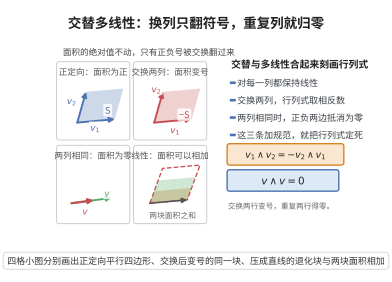

# 行列式的交替多重线性性

> **一句话大白话**：行列式这个"多路输入函数"对每一列都是线性的（可加成、可提倍数），而且只要有任意两列摆成一样，输出立刻变0（交换两列会翻号）——"多线性 + 交替"两条铁律就把行列式完全定死了。
>
> **小例子**：$\det(v_1,\dots,v_i+v_i',\dots)=\det(\dots,v_i,\dots)+\det(\dots,v_i',\dots)$（线性）；$\det(\dots,v,\dots,v,\dots)=0$ 且交换两列变号（交替）——两条性质共同决定 $\det$ 唯一，是"唯一刻画行列式"的骨架。

## 介绍

行列式的交替多重线性性（Alternating Multilinearity of Determinant）是行列式理论的核心性质，表明行列式是 $n$ 重交替多重线性形式。该性质为行列式提供了公理化定义，并蕴含了行列式的所有其他性质（如乘积定理、克莱姆法则等）。从多重线性代数的角度看，行列式是 $n$ 次外积在标准基下的坐标表示。

## 几何直观

图意在说明：行列式对每一列线性、交换两列变号，两列相同时面积塌成零，这三条把行列式完全钉死。

## 分析

**前置依赖**：多重线性代数基本概念、行列式的 Leibniz 公式、置换与奇偶性

**定理内容**：行列式 $\det:(\mathbb{F}^n)^n\to\mathbb{F}$ 满足以下性质：
1. **多重线性性**：$\det$ 对每个变量是线性的，即
   $$\det(\mathbf{v}_1,\ldots,\mathbf{v}_{i-1},\alpha\mathbf{v}_i+\beta\mathbf{v}_i',\mathbf{v}_{i+1},\ldots,\mathbf{v}_n)=\alpha\det(\mathbf{v}_1,\ldots,\mathbf{v}_i,\ldots,\mathbf{v}_n)+\beta\det(\mathbf{v}_1,\ldots,\mathbf{v}_i',\ldots,\mathbf{v}_n)$$
2. **交错性（交替性）**：交换任意两列，行列式变号，即
   $$\det(\ldots,\mathbf{v}_i,\ldots,\mathbf{v}_j,\ldots)=-\det(\ldots,\mathbf{v}_j,\ldots,\mathbf{v}_i,\ldots)$$
   等价地，若有两列相同，则 $\det=0$。

**前置知识**：
- 多重线性代数基本概念

**数学内涵**：
从外代数的角度看，$\det(\mathbf{v}_1,\ldots,\mathbf{v}_n)$ 是 $\mathbf{v}_1\wedge\cdots\wedge\mathbf{v}_n$ 在标准基 $\mathbf{e}_1\wedge\cdots\wedge\mathbf{e}_n$ 下的系数。这意味着 $\det$ 是 $n$ 次外幂 $\bigwedge^n(\mathbb{F}^n)$ 上的线性泛函。该观点将行列式自然地嵌入到外代数理论中。

## 思考过程

行列式的交替多重线性性可以直接从行列式的定义（如 Leibniz 公式）验证。

**多重线性性**：由 Leibniz 公式 $\det(A)=\sum_{\sigma\in S_n}\operatorname{sgn}(\sigma)\prod_{i=1}^n a_{i,\sigma(i)}$，行列式对每列是线性的，因为每列中的元素在各乘积项中恰好出现一次。

**交错性**：交换两列相当于在排列中交换两个元素，置换的奇偶性改变，故行列式变号。由此立即可得若有两列相同，则交换这两列行列式不变又变号，故为零。

## 证明过程

**证明**：

**第一部分：多重线性性。**

设 $A=[\mathbf{a}_1,\ldots,\mathbf{a}_n]$，其中 $\mathbf{a}_j=(a_{1j},\ldots,a_{nj})^T$。由 Leibniz 公式：
$$\det(A)=\sum_{\sigma\in S_n}\operatorname{sgn}(\sigma)\prod_{i=1}^n a_{i,\sigma(i)}$$

固定第 $k$ 列，考虑 $\mathbf{a}_k=\alpha\mathbf{v}+\beta\mathbf{w}$，其中 $\mathbf{v}=(v_1,\ldots,v_n)^T$，$\mathbf{w}=(w_1,\ldots,w_n)^T$。则 $a_{i,k}=\alpha v_i+\beta w_i$。

代入 Leibniz 公式：
$$\det(\mathbf{a}_1,\ldots,\alpha\mathbf{v}+\beta\mathbf{w},\ldots,\mathbf{a}_n)=\sum_{\sigma\in S_n}\operatorname{sgn}(\sigma)\left(\prod_{i\neq k}a_{i,\sigma(i)}\right)(\alpha v_{\sigma^{-1}(k)}+\beta w_{\sigma^{-1}(k)})$$
$$=\alpha\sum_{\sigma\in S_n}\operatorname{sgn}(\sigma)\left(\prod_{i\neq k}a_{i,\sigma(i)}\right)v_{\sigma^{-1}(k)}+\beta\sum_{\sigma\in S_n}\operatorname{sgn}(\sigma)\left(\prod_{i\neq k}a_{i,\sigma(i)}\right)w_{\sigma^{-1}(k)}$$
$$=\alpha\det(\mathbf{a}_1,\ldots,\mathbf{v},\ldots,\mathbf{a}_n)+\beta\det(\mathbf{a}_1,\ldots,\mathbf{w},\ldots,\mathbf{a}_n)$$

**第二部分：交错性。**

设 $A'$ 是将 $A$ 的第 $i$ 列和第 $j$ 列交换得到的矩阵。则 $A'$ 的列向量为 $\mathbf{a}_1,\ldots,\mathbf{a}_j,\ldots,\mathbf{a}_i,\ldots,\mathbf{a}_n$。

考虑置换 $\tau=(ij)$（交换 $i$ 和 $j$）。则 $\sigma$ 在 $\det(A')$ 中的项对应于 $\sigma\circ\tau$ 在 $\det(A)$ 中的项，且 $\operatorname{sgn}(\sigma\circ\tau)=-\operatorname{sgn}(\sigma)$。因此：
$$\det(A')=\sum_{\sigma\in S_n}\operatorname{sgn}(\sigma)\prod_{k=1}^n a_{k,\sigma\circ\tau(k)}=-\sum_{\sigma\in S_n}\operatorname{sgn}(\sigma\circ\tau)\prod_{k=1}^n a_{k,\sigma\circ\tau(k)}=-\det(A)$$

**推论**：若 $\mathbf{a}_i=\mathbf{a}_j$（$i\neq j$），则交换这两列后矩阵不变，但行列式变号，故 $\det(A)=-\det(A)$，从而 $\det(A)=0$。

$\square$

## 课堂问答

**老师**：到底是什么把行列式"钉死"成了一个唯一的函数？

**学生**：结论：两条铁律——对每一列线性（多重线性）、交换两列变号（交错性），再加上规范 $\det(I)=1$，三者合起来唯一确定 $\det$。

**老师（追问）**：交错性为什么蕴含"两列相同则行列式为零"？

**学生**：因为若两列相同，交换它们矩阵不变，但交错性使行列式变号，故 $\det=-\det$，即 $2\det=0$，于是 $\det=0$。从 Leibniz 公式看也一致：相交的置换项符号成对相消。

**老师（拓展）**：这两条性质如何刻画行列式的所有推论？常见误区是什么？

**学生**：由它们可导出乘积定理、展开定理、克莱姆法则等一切基本性质；从多重线性代数看，$\det(\mathbf v_1,\dots,\mathbf v_n)$ 正是 $\mathbf v_1\wedge\cdots\wedge\mathbf v_n$ 在标准基 $\mathbf e_1\wedge\cdots\wedge\mathbf e_n$ 下的系数。常见误区是只会用 Leibniz 公式硬算，却忽略了"公理化刻画"才是这些性质统一的源头。
