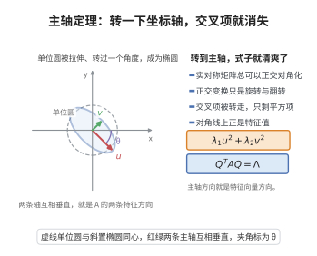

# 二次型主轴定理

> **一句话大白话**：任意一个由二次项拼成的式子，总能通过旋转坐标轴把它转成"纯平方和"的标准样，把交叉项扫光，还顺带找出空间里最"伸展"的几个主轴方向。
>
> **小例子**：$Q(x,y)=3x^2+12xy+2y^2$ 经正交变换可化为标准的 $\lambda_1 u^2+\lambda_2 v^2$。

## 介绍

二次型主轴定理（Principal Axis Theorem）是解析几何和线性代数中的重要定理，断言实二次型可通过正交变换化为标准形（平方和）。该定理是二次曲面分类、主成分分析（PCA）、多元统计分析等领域的理论基础，在物理中对应于刚体转动惯量主轴的计算。

## 几何直观

图意在说明：正交变换把二次型的两条特征方向转成新坐标轴，交叉项随之消失，只剩两个平方项。

## 分析

**前置依赖**：谱定理（实对称矩阵可正交对角化）、二次型与对称矩阵、特征值、正交变换

**定理内容**：设 $Q(\mathbf{x})=\mathbf{x}^T A\mathbf{x}$ 是 $\mathbb{R}^n$ 上的实二次型，其中 $A$ 是 $n\times n$ 实对称矩阵，则存在正交矩阵 $Q$（$Q^TQ=I$），使得通过正交变换 $\mathbf{x}=Q\mathbf{y}$，二次型化为标准形
$$Q(\mathbf{x})=\lambda_1 y_1^2+\lambda_2 y_2^2+\cdots+\lambda_n y_n^2$$
其中 $\lambda_1,\ldots,\lambda_n$ 是 $A$ 的特征值。

**前置知识**：
- 谱定理：实对称矩阵可正交对角化

**数学内涵**：
二次型主轴定理的几何意义是：对于二次型 $Q(\mathbf{x})=\mathbf{x}^T A\mathbf{x}$，其等值面 $Q(\mathbf{x})=c$ 是一个二次曲面。通过正交变换（旋转和反射），可以将坐标轴旋转到与曲面的"主轴"方向一致，此时曲面方程中不再有交叉项（$y_i y_j$ 项），只剩下平方项。

## 思考过程

由谱定理，实对称矩阵 $A$ 可正交对角化：存在正交矩阵 $Q$ 和对角矩阵 $\Lambda=\operatorname{diag}(\lambda_1,\ldots,\lambda_n)$，使得 $A=Q\Lambda Q^T$。

令 $\mathbf{x}=Q\mathbf{y}$，则
$$Q(\mathbf{x})=\mathbf{x}^T A\mathbf{x}=(Q\mathbf{y})^T A(Q\mathbf{y})=\mathbf{y}^T(Q^T A Q)\mathbf{y}=\mathbf{y}^T\Lambda\mathbf{y}=\sum_{i=1}^n\lambda_i y_i^2$$

## 证明过程

**证明**：

**第一步：正交对角化二次型矩阵。**

$A$ 是实对称矩阵。由谱定理，存在正交矩阵 $Q$（$Q^TQ=I$）和对角矩阵 $\Lambda=\operatorname{diag}(\lambda_1,\ldots,\lambda_n)$，使得
$$A=Q\Lambda Q^T$$
其中 $\lambda_i$ 是 $A$ 的特征值，$Q$ 的列是对应的标准正交特征向量。

**第二步：正交变换。**

令 $\mathbf{x}=Q\mathbf{y}$，则 $\mathbf{y}=Q^T\mathbf{x}$。代入二次型：
$$Q(\mathbf{x})=\mathbf{x}^T A\mathbf{x}=(Q\mathbf{y})^T A(Q\mathbf{y})=\mathbf{y}^T(Q^T A Q)\mathbf{y}$$

由于 $Q^T A Q = Q^T(Q\Lambda Q^T)Q = (Q^T Q)\Lambda(Q^T Q)=\Lambda$，
$$Q(\mathbf{x})=\mathbf{y}^T\Lambda\mathbf{y}=\sum_{i=1}^n\lambda_i y_i^2$$

**第三步：讨论标准形的性质。**

特征值 $\lambda_i$ 的符号决定了二次型的类型：
- 若所有 $\lambda_i>0$，正定；
- 若所有 $\lambda_i<0$，负定；
- 若既有正又有负，不定；
- 若 $\lambda_i=0$，退化。

**例**：对于二维二次型 $ax^2+2bxy+cy^2$，矩阵为 $\begin{pmatrix}a&b\\b&c\end{pmatrix}$，特征值 $\lambda_1,\lambda_2$ 是方程 $\lambda^2-(a+c)\lambda+(ac-b^2)=0$ 的根。正交变换将二次型化为 $\lambda_1 y_1^2+\lambda_2 y_2^2$。

$\square$

## 课堂问答

**老师**：二次项拼成的式子总能用"纯平方和"表示，这一步凭什么成立？

**学生**：结论是先立得住的：设 $Q(\mathbf{x})=\mathbf{x}^TA\mathbf{x}$，$A$ 为实对称矩阵，则存在正交矩阵 $Q$ 使 $\mathbf{x}=Q\mathbf{y}$ 时 $Q=\lambda_1y_1^2+\cdots+\lambda_ny_n^2$，$\lambda_i$ 正是 $A$ 的特征值。依据是谱定理 $A=Q\Lambda Q^T$，代入得 $\mathbf{y}^T(Q^TAQ)\mathbf{y}=\mathbf{y}^T\Lambda\mathbf{y}$。注意 $\mathbf{x}=Q\mathbf{y}$ 只做旋转与反射，不改变椭球的形状，只是把坐标轴转到主轴方向。

**老师（追问）**：为什么非得用正交变换？普通可逆变换不也能化成对角形吗？

**学生**：普通可逆变换（配方法）确实能对角化，但它会拉伸坐标轴，改变长度与角度，对角元也不再是特征值。正交变换是等距的，$Q^TQ=I$，所以对角元恰好是特征值——这才是"把椭球摆正"而不变形。

**老师（拓展）**：特征值的符号与二次型类型、几何形状有什么关系？

**学生**：全为正即正定（椭球），全为负即负定，正负都有即不定；有零则退化。由 $Q=\text{const}$ 得半轴长与 $1/\sqrt{\lambda_i}$ 成正比，所以特征值同时给出"最伸展方向"与伸展幅度，这正是刚体转动惯量主轴与主成分分析 PCA 的同一个数学。
