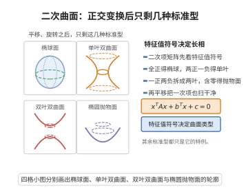

# 二次曲面分类定理

> **一句话大白话**：三维空间里所有"二次曲面"看似五花八门，但只要平移、旋转一下坐标，翻来覆去其实只有椭球、双曲面、抛物面等17种长相。
>
> **小例子**：$x^2+2y^2-z^2=1$ 经过变换可归入单叶双曲面这一类标准型。

## 介绍

二次曲面分类定理（Classification of Quadric Surfaces）是解析几何中的重要结论，断言在三维空间中，一般的二次曲面方程可以通过正交变换和平移化为17种标准型之一。该定理是二次型主轴定理在三维空间中的直接应用，为理解二次曲面的几何形状提供了完整的分类。

## 几何直观

图意在说明：三维二次曲面按特征值的符号分成椭球、单叶、双叶与抛物四类，其余差别只是平移与比例。

## 分析

**前置依赖**：二次型主轴定理、正交变换与平移、二次曲面方程、特征值

**定理内容**：三维空间中的一般二次曲面方程为
$$a_{11}x^2+a_{22}y^2+a_{33}z^2+2a_{12}xy+2a_{13}xz+2a_{23}yz+b_1x+b_2y+b_3z+c=0$$

通过正交变换和平移，可化为以下标准型之一：
1. **椭球面**：$\frac{x^2}{a^2}+\frac{y^2}{b^2}+\frac{z^2}{c^2}=1$
2. **单叶双曲面**：$\frac{x^2}{a^2}+\frac{y^2}{b^2}-\frac{z^2}{c^2}=1$
3. **双叶双曲面**：$\frac{x^2}{a^2}-\frac{y^2}{b^2}-\frac{z^2}{c^2}=1$
4. **椭圆抛物面**：$\frac{x^2}{a^2}+\frac{y^2}{b^2}=z$
5. **双曲抛物面**：$\frac{x^2}{a^2}-\frac{y^2}{b^2}=z$（马鞍面）
6. **二次锥面**：$\frac{x^2}{a^2}+\frac{y^2}{b^2}-\frac{z^2}{c^2}=0$
7. 等等（共17种）

**前置知识**：
- 二次型主轴定理：实二次型可通过正交变换化为标准形

**数学内涵**：
二次曲面分类的实质是利用二次型主轴定理消去交叉项，再通过平移消去一次项（或将其合并到平方项中）。二次曲面的类型由二次型矩阵的特征值符号和一次项的存在情况决定。

## 思考过程

**第一步**：将二次曲面方程写为矩阵形式。
$$\mathbf{x}^T A\mathbf{x} + \mathbf{b}^T\mathbf{x} + c = 0$$
其中 $A$ 是 $3\times 3$ 实对称矩阵，$\mathbf{b}$ 是 $3\times 1$ 向量。

**第二步**：由二次型主轴定理，存在正交矩阵 $Q$，使得 $Q^T A Q = \operatorname{diag}(\lambda_1,\lambda_2,\lambda_3)$。令 $\mathbf{x}=Q\mathbf{y}$，消去交叉项。

**第三步**：通过平移消去一次项（或处理退化情况）。根据特征值的符号和是否为零，分类得到17种标准型。

## 证明过程

**证明**：

**第一步：化为矩阵形式。**

将二次曲面方程写为
$$\mathbf{x}^T A\mathbf{x} + 2\mathbf{b}^T\mathbf{x} + c = 0$$
其中 $\mathbf{x}=(x,y,z)^T$，$A$ 是 $3\times 3$ 实对称矩阵，$\mathbf{b}$ 是 $3\times 1$ 向量。

**第二步：正交变换消去交叉项。**

由二次型主轴定理，存在正交矩阵 $Q$ 使得 $Q^T A Q = \Lambda = \operatorname{diag}(\lambda_1,\lambda_2,\lambda_3)$。

令 $\mathbf{x}=Q\mathbf{y}$，$\mathbf{y}=(x',y',z')^T$，则
$$\mathbf{y}^T\Lambda\mathbf{y} + 2\mathbf{b}'^T\mathbf{y} + c = 0$$
其中 $\mathbf{b}'=Q^T\mathbf{b}=(b_1',b_2',b_3')^T$。

展开得：
$$\lambda_1 x'^2 + \lambda_2 y'^2 + \lambda_3 z'^2 + 2b_1'x' + 2b_2'y' + 2b_3'z' + c = 0$$

**第三步：平移消去一次项。**

对每个非零特征值 $\lambda_i\neq 0$，通过平移 $x''=x'+b_i'/\lambda_i$ 消去一次项。若 $\lambda_i=0$，则一次项无法消去。

**第四步：根据特征值分类。**

根据 $\lambda_1,\lambda_2,\lambda_3$ 的符号和是否为零，以及一次项的存在情况，可得以下标准型：

1. $\lambda_1,\lambda_2,\lambda_3$ 同号且非零：
   - 椭球面（常数项与特征值异号）
   - 虚椭球面（常数项与特征值同号）
   - 点（常数项为零）

2. $\lambda_1,\lambda_2,\lambda_3$ 两正一负：
   - 单叶双曲面（常数项非零）
   - 二次锥面（常数项为零）

3. $\lambda_1,\lambda_2,\lambda_3$ 一正两负：
   - 双叶双曲面

4. 一个特征值为零：
   - 椭圆抛物面（两特征值同号）
   - 双曲抛物面（两特征值异号）
   - 抛物柱面等

5. 两个特征值为零（柱面等情况）

共计17种标准型。

$\square$

## 课堂问答

**老师**：三维里五花八门的二次曲面，为什么本质上只有有限多种？

**学生**：结论：类型完全由二次型矩阵 $A$ 的特征值符号组合以及常数项摆法决定。写成 $\mathbf{x}^TA\mathbf{x}+2\mathbf{b}^T\mathbf{x}+c=0$，先由主轴定理正交变换消交叉项得 $\sum\lambda_ix_i'^2+2b_i'x_i'+c=0$，再对每个 $\lambda_i\ne0$ 平移 $x_i''=x_i'+b_i'/\lambda_i$ 消一次项，即归入标准形。

**老师（追问）**：若某个特征值 $\lambda_i=0$，平移消不掉那一方向的一次项，怎么办？

**学生**：消不掉的一次项恰恰制造了"退化类"：两个非零特征值时分别得到椭圆抛物面（同号）与双曲抛物面（异号），一个非零时得到抛物柱面等，加上椭球、单叶/双叶双曲面、二次锥面，合计 17 种。可见分类的丰富性全藏在零特征值上。

**老师（拓展）**：为什么正交变换和平移都保证"类型不变"？

**学生**：正交变换保持 $A$ 的特征值（相似不变量），平移不改变二次部分、只挪动中心或顶点位置。两者都是刚体操作，因此类型是几何不变量，这才使"有限分类"成为可能。
