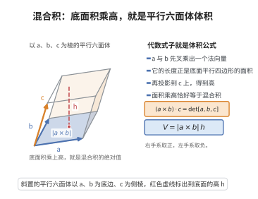

# 向量混合积的几何意义

> **一句话大白话**：三个向量做特定运算 $(a\times b)\cdot c$，算出的数恰好等于用这三条棱搭成的"斜方块"（平行六面体）的体积，带正负号表示方向。
>
> **小例子**：$a=(1,0,0), b=(0,1,0), c=(0,0,2)$ 时，$(a\times b)\cdot c=1\cdot 2=2$，正是该六面体的体积。

## 介绍

向量混合积的几何意义是三维解析几何中的基本结论，指出三个向量的混合积 $(a\times b)\cdot c$ 等于以这三个向量为棱的平行六面体的有向体积。该结论将代数运算与几何直观联系起来，是向量分析中最重要的几何解释之一，在物理、工程、计算机图形学中有广泛应用。

## 几何直观

图意在说明：a×b 的模是底面积，再乘上 c 在法向上的投影即高，混合积正好等于有向体积。

## 分析

**前置依赖**：向量积与数量积、行列式定义、平行六面体体积、投影与维度

**定理内容**：设 $\mathbf{a},\mathbf{b},\mathbf{c}\in\mathbb{R}^3$，则
$$(\mathbf{a}\times\mathbf{b})\cdot\mathbf{c} = \det[\mathbf{a},\mathbf{b},\mathbf{c}]$$
其绝对值等于以 $\mathbf{a},\mathbf{b},\mathbf{c}$ 为棱的平行六面体的体积，符号由 $\mathbf{a},\mathbf{b},\mathbf{c}$ 的定向决定（右手系为正，左手系为负）。

**前置知识**：
- 向量积定义：$\mathbf{a}\times\mathbf{b}$ 是垂直于 $\mathbf{a},\mathbf{b}$ 的向量，长度为 $|\mathbf{a}||\mathbf{b}|\sin\theta$，方向由右手定则确定
- 行列式定义

**数学内涵**：
混合积的几何意义是三维空间中"体积"概念的代数表示。$\det[\mathbf{a},\mathbf{b},\mathbf{c}]$ 的绝对值等于平行六面体的体积，其符号表示定向。这一性质将"体积"与"定向"统一为行列式，是外微分形式理论的雏形。

## 思考过程

**代数推导**：直接计算混合积与行列式的关系。

设 $\mathbf{a}=(a_1,a_2,a_3)$，$\mathbf{b}=(b_1,b_2,b_3)$，$\mathbf{c}=(c_1,c_2,c_3)$。

则 $\mathbf{a}\times\mathbf{b}=(a_2b_3-a_3b_2,\ a_3b_1-a_1b_3,\ a_1b_2-a_2b_1)$。

计算 $(\mathbf{a}\times\mathbf{b})\cdot\mathbf{c}$：
$$(a_2b_3-a_3b_2)c_1+(a_3b_1-a_1b_3)c_2+(a_1b_2-a_2b_1)c_3$$
$$=a_1b_2c_3+a_2b_3c_1+a_3b_1c_2-a_1b_3c_2-a_2b_1c_3-a_3b_2c_1$$
$$=\det\begin{pmatrix}a_1&a_2&a_3\\b_1&b_2&b_3\\c_1&c_2&c_3\end{pmatrix}$$

**几何解释**：$|\mathbf{a}\times\mathbf{b}|$ 是以 $\mathbf{a},\mathbf{b}$ 为边的平行四边形面积，方向垂直于该平面。$(\mathbf{a}\times\mathbf{b})\cdot\mathbf{c}$ 等于该面积乘以 $\mathbf{c}$ 在 $\mathbf{a}\times\mathbf{b}$ 方向上的投影，即底面积乘以高，得到平行六面体的体积。

## 证明过程

**证明**：

**第一部分：代数恒等式。**

设 $\mathbf{a}=(a_1,a_2,a_3)$，$\mathbf{b}=(b_1,b_2,b_3)$，$\mathbf{c}=(c_1,c_2,c_3)$。

由向量积的定义：
$$\mathbf{a}\times\mathbf{b}=(a_2b_3-a_3b_2,\ a_3b_1-a_1b_3,\ a_1b_2-a_2b_1)$$

计算混合积：
$$(\mathbf{a}\times\mathbf{b})\cdot\mathbf{c}=(a_2b_3-a_3b_2)c_1+(a_3b_1-a_1b_3)c_2+(a_1b_2-a_2b_1)c_3$$
$$=a_2b_3c_1-a_3b_2c_1+a_3b_1c_2-a_1b_3c_2+a_1b_2c_3-a_2b_1c_3$$
$$=a_1b_2c_3+a_2b_3c_1+a_3b_1c_2-a_1b_3c_2-a_2b_1c_3-a_3b_2c_1$$

这正是行列式 $\det[\mathbf{a},\mathbf{b},\mathbf{c}]$ 的展开式：
$$\det[\mathbf{a},\mathbf{b},\mathbf{c}]=\det\begin{pmatrix}a_1&a_2&a_3\\b_1&b_2&b_3\\c_1&c_2&c_3\end{pmatrix}$$

因此 $(\mathbf{a}\times\mathbf{b})\cdot\mathbf{c}=\det[\mathbf{a},\mathbf{b},\mathbf{c}]$。

**第二部分：几何解释。**

以 $\mathbf{a},\mathbf{b}$ 为边的平行四边形的面积为：
$$|\mathbf{a}\times\mathbf{b}| = |\mathbf{a}||\mathbf{b}|\sin\theta$$其中 $\theta$ 是 $\mathbf{a},\mathbf{b}$ 的夹角。

$\mathbf{c}$ 在 $\mathbf{a}\times\mathbf{b}$ 方向上的投影为：
$$\operatorname{proj}_{\mathbf{a}\times\mathbf{b}}(\mathbf{c}) = \frac{(\mathbf{a}\times\mathbf{b})\cdot\mathbf{c}}{|\mathbf{a}\times\mathbf{b}|}$$

该投影的绝对值等于 $\mathbf{c}$ 到 $\mathbf{a},\mathbf{b}$ 所在平面的距离 $h$（即平行六面体的高）。

因此平行六面体的体积为：
$$V = \text{底面积}\times\text{高} = |\mathbf{a}\times\mathbf{b}|\cdot h = |\mathbf{a}\times\mathbf{b}|\cdot\left|\frac{(\mathbf{a}\times\mathbf{b})\cdot\mathbf{c}}{|\mathbf{a}\times\mathbf{b}|}\right| = |(\mathbf{a}\times\mathbf{b})\cdot\mathbf{c}|$$

符号由 $\mathbf{a},\mathbf{b},\mathbf{c}$ 的定向决定：若 $\mathbf{a},\mathbf{b},\mathbf{c}$ 构成右手系，则 $(\mathbf{a}\times\mathbf{b})\cdot\mathbf{c}>0$；若构成左手系，则 $<0$。

$\square$

## 课堂问答

**老师**：$(\mathbf{a}\times\mathbf{b})\cdot\mathbf{c}$ 为什么会等于平行六面体的体积？

**学生**：结论：它等于以三向量为行的行列式，绝对值是体积、符号是定向。代数上直接展开 $(\mathbf{a}\times\mathbf{b})\cdot\mathbf{c}$，六项恰好拼成 $\det[\mathbf{a},\mathbf{b},\mathbf{c}]$。几何上 $|\mathbf{a}\times\mathbf{b}|$ 是底面积，$\mathbf{c}$ 在 $\mathbf{a}\times\mathbf{b}$ 方向的投影是高的绝对值，底乘高即体积。

**老师（追问）**：既然投影本身带符号，为什么体积要取绝对值？

**学生**：投影的符号记录 $\mathbf{c}$ 落在 $\mathbf{a}\times\mathbf{b}$ 的哪一侧，即定向：$\mathbf{a},\mathbf{b},\mathbf{c}$ 成右手系时为正、左手系时为负。体积必须非负，故取绝对值。顺带得到判据：三向量共面当且仅当混合积 $=0$。

**老师（拓展）**：混合积有哪些代数对称性？

**学生**：它关于轮换不变，$(\mathbf{a}\times\mathbf{b})\cdot\mathbf{c}=(\mathbf{b}\times\mathbf{c})\cdot\mathbf{a}=(\mathbf{c}\times\mathbf{a})\cdot\mathbf{b}$，但交换任意两个向量变号。这正说明它是交错多重线性函数，即体积形式的雏形，也是外微分理论的起点。
