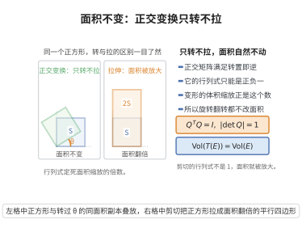

# 坐标变换下的面积不变性

> **一句话大白话**：旋转、翻转这种"只转不拉"的正交变换不会改变图形的面积和体积，就像你把一张纸转个方向，纸片的面积丝毫不变。
>
> **小例子**：正方形 $[0,1]^2$ 绕原点转 $90°$ 后仍是面积 $1$，因为正交变换的 Jacobi 行列式为 $\pm1$。

## 介绍

坐标变换下的面积不变性定理是解析几何和线性代数中的重要结论，断言正交变换保持面积（和体积）。该定理的数学表述是：正交变换的 Jacobi 行列式的绝对值为 1，因此坐标变换不改变图形的面积或体积。该性质是刚体运动（旋转、反射）的数学基础。

## 几何直观

图意在说明：正交矩阵的行列式为 ±1，所以旋转与翻转不改变面积，而剪切的行列式不为 1，面积随之缩放。

## 分析

**前置依赖**：行列式的几何意义（体积缩放）、正交矩阵、多重积分的变量替换公式

**定理内容**：设 $T:\mathbb{R}^n\to\mathbb{R}^n$ 是正交变换，即 $T(\mathbf{x})=Q\mathbf{x}$，其中 $Q$ 是正交矩阵（$Q^TQ=I$）。则 $T$ 保持面积（$n=2$）和体积（$n=3$），即对任意可测集 $E$，
$$\operatorname{Vol}(T(E)) = |\det(Q)|\cdot\operatorname{Vol}(E) = \operatorname{Vol}(E)$$
因为 $|\det(Q)|=1$。

**前置知识**：
- 行列式的几何意义：$\det(A)$ 的绝对值等于以 $A$ 的列向量为边的平行六面体的体积

**数学内涵**：
该定理的几何解释是：正交变换对应于旋转和反射，这些变换保持图形的形状和大小不变。$|\det(Q)|=1$ 保证了变换不改变体积缩放因子。更一般地，对于任意线性变换 $T(\mathbf{x})=A\mathbf{x}$，变换后的体积为 $|\det(A)|$ 乘以原体积。

## 思考过程

由行列式的几何意义，以 $Q$ 的列向量 $\mathbf{q}_1,\ldots,\mathbf{q}_n$ 为边的平行六面体的体积为 $|\det(Q)|$。

由于 $Q$ 是正交矩阵，$Q^TQ=I$，这意味着 $\mathbf{q}_i$ 是标准正交的。因此以 $\mathbf{q}_i$ 为边的平行六面体是单位立方体，体积为 1。故 $|\det(Q)|=1$。

对于一般区域，由多重积分的变量替换公式，变换后的体积等于原体积乘以 $|\det(Q)|$，因此体积不变。

## 证明过程

**证明**：

**第一步：证明 $|\det(Q)|=1$。**

设 $Q$ 是正交矩阵，即 $Q^TQ=I$。取行列式：
$$\det(Q^TQ)=\det(Q^T)\det(Q)=(\det(Q))^2=\det(I)=1$$
故 $|\det(Q)|=1$。

**第二步：证明正交变换保持单位立方体的体积。**

以 $Q$ 的列向量 $\mathbf{q}_1,\ldots,\mathbf{q}_n$ 为边的平行六面体的体积为 $|\det(Q)|=1$。由于 $\mathbf{q}_i$ 是标准正交的，该平行六面体是单位立方体，体积为 1。

**第三步：一般区域的体积不变性。**

由多重积分的变量替换公式，对任意可测集 $E$，
$$\operatorname{Vol}(T(E)) = \int_{T(E)} d\mathbf{y} = \int_E |\det(J_T(\mathbf{x}))| d\mathbf{x}$$
其中 $J_T(\mathbf{x})$ 是 $T$ 在 $\mathbf{x}$ 处的 Jacobi 矩阵。由于 $T(\mathbf{x})=Q\mathbf{x}$，$J_T(\mathbf{x})=Q$，是常数矩阵。

因此
$$\operatorname{Vol}(T(E)) = \int_E |\det(Q)| d\mathbf{x} = \int_E 1 d\mathbf{x} = \operatorname{Vol}(E)$$

**推论**：正交变换保持面积（$n=2$）和体积（$n=3$），也保持长度（因为 $\|Q\mathbf{x}\|=\|\mathbf{x}\|$）和角度。

$\square$

## 课堂问答

**老师**：为什么旋转、翻转折纸不会改变面积和体积？

**学生**：结论：因为正交变换 $|\det Q|=1$。由 $Q^TQ=I$ 取行列式得 $(\det Q)^2=1$。再由变量替换公式，$\operatorname{Vol}(T(E))=\int_E|\det J_T|\,d\mathbf{x}$，而 $T(\mathbf{x})=Q\mathbf{x}$ 的 Jacobi 矩阵恒为 $Q$，故 $\operatorname{Vol}(T(E))=|\det Q|\operatorname{Vol}(E)=\operatorname{Vol}(E)$。

**老师（追问）**：如果换成一般的线性变换 $T(\mathbf{x})=A\mathbf{x}$ 呢？

**学生**：体积缩放为 $|\det A|$ 倍，即 $\operatorname{Vol}(A(E))=|\det A|\operatorname{Vol}(E)$。正交变换只是 $|\det A|=1$ 的特例。这也说明行列式的几何意义就是体积的缩放因子。

**老师（拓展）**：正交变换除了保面积，还保什么？为什么？

**学生**：保长度、内积、角度，因为 $\|Q\mathbf{x}\|^2=\mathbf{x}^TQ^TQ\mathbf{x}=\|\mathbf{x}\|^2$。它是欧氏空间的等距同构，由旋转与反射生成，恰是刚体运动的数学描述，因此面积、体积不变只是它保度量的一个推论。
