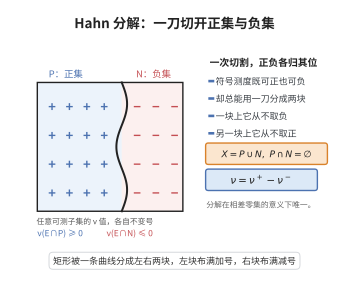

# Hahn 分解定理

> **一句话大白话**：一个可以取正、也可以取负的"符号测度"，总能被一刀切成两块地盘：在一块上它从不取负值（正集），在另一块上它从不取正值（负集）。

> **小例子**：在 $\mathbb{R}$ 上取 $\nu=\delta_1-2\delta_{-1}$。则 $P=\{1\}$ 是正集，$N=\mathbb{R}\setminus\{1\}$ 是负集：$\nu(E\cap P)\ge0$ 恒成立，而 $\nu(E\cap N)\le0$ 恒成立。

## 介绍

Hahn 分解定理（Hahn Decomposition Theorem）由奥地利数学家 Hans Hahn 于 1921 年证明，是符号测度理论的奠基性结果。它断言：对可测空间 $(X,\Sigma)$ 上的任意符号测度 $\nu$，都存在一个可测分割 $X=P\cup N$（$P\cap N=\varnothing$），使得 $P$ 关于 $\nu$ 是正集（任意可测子集的 $\nu$ 值非负），$N$ 是负集（任意可测子集的 $\nu$ 值非正）。它要解决的问题是：如何把"可正可负的测度"化归为"两个普通正测度"来处理？有了这个分界，就可以定义正部 $\nu^+$、负部 $\nu^-$ 与全变差 $|\nu|$，从而把对 $\nu$ 的积分拆成正、负两块分别计算。它是 Jordan 分解定理的直接前提，也是 Radon-Nikodym 定理证明中的标准第一步。

## 几何直观

图意在说明：任何符号测度都能把空间分成正集与负集，使各部分的可测子集不再变号。

## 分析

**前置依赖**：符号测度的定义与可数可加性、正集与负集、测度的上确界与连续性（单调收敛思想）、实数的完备性。

**定理内容**：设 $\nu$ 是可测空间 $(X,\Sigma)$ 上的实值（有限）符号测度。则存在可测集 $P,N\in\Sigma$ 满足

$$P\cup N=X,\qquad P\cap N=\varnothing,$$

使得对任意 $E\in\Sigma$ 有

$$\nu(E\cap P)\ge0,\qquad \nu(E\cap N)\le0 .$$

称 $P$ 为 $\nu$ 的正集、$N$ 为 $\nu$ 的负集。此外分解在"相差 $\nu$-零集"的意义下唯一：若 $(P',N')$ 是另一对这样的分割，则

$$\nu(P\triangle P')=0,$$

即 $P$ 与 $P'$ 只差一个 $\nu$-零集。

**推论**：令 $\nu^+(E)=\nu(E\cap P)$、$\nu^-(E)=-\nu(E\cap N)$，则 $\nu^+,\nu^-$ 是相互奇异的有限正测度，且 $\nu=\nu^+-\nu^-$，$|\nu|=\nu^++\nu^-$（Jordan 分解）。

## 思考过程

最直觉的想法是：在所有可测集上取 $\nu$ 的上确界 $M=\sup_E\nu(E)$，再找出一个"达到"这个上确界的集合 $P$。如果这样的 $P$ 存在，它必然只能是正集：因为若 $E\subseteq P$ 而 $\nu(E)<0$，那么 $\nu(P\setminus E)=\nu(P)-\nu(E)>M$，与 $M$ 是上确界矛盾；同理补集必然是负集。所以整个定理的难点只有一件事：上确界能否被某一个集合达到。

直接取逼近序列 $E_n$（$\nu(E_n)\to M$）并令 $P=\cup E_n$ 是不对的——并集可能把负质量也吞进来，使 $\nu(P)$ 反而变小。正确路线分两步：先证明一个"关键引理"——任何具有正质量的集合内部都含有一个具有正质量的正集（用不断挖去负质量的递归法，并用级数收敛性证明递归必然停止）；再把逼近序列 $E_n$ 中每个集合都换成其内部的正集 $P_n$，正集的可数并仍是正集，从而得到一个既是正集、又逼近 $M$ 的 $P$。最后用 $M$ 的极大性把 $\nu(P)=M$ 与补集的负性一并拿下。

## 证明过程

**步骤 1：上确界有限。** 令 $M=\sup\{\nu(E):E\in\Sigma\}$。先证 $M<\infty$。若不然，取 $E_n$ 使 $\nu(E_n)>n$。令 $G_n=E_n\setminus\bigcup_{k<n}E_k$，则 $\{G_n\}$ 互不相交且 $\bigcup_{k\le n}G_k=\bigcup_{k\le n}E_k\supseteq E_n$，故由有限可加性

$$\sum_{k\le n}\nu(G_k)=\nu\Big(\bigcup_{k\le n}G_k\Big)\ge\nu(E_n)>n .$$

但 $G_k$ 互不相交、$\bigcup_kG_k\subseteq X$，由连续性从下，部分和收敛于 $\nu(\bigcup_kG_k)\in\mathbb{R}$，故部分和必有界，矛盾。故 $M$ 是有限实数（同理 $\inf_E\nu(E)>-\infty$）。

**步骤 2：关键引理（正集的存在性）。** 设 $E\in\Sigma$ 且 $\nu(E)>0$。用递归法构造一个具有正质量的正集。取 $E_0=E$。若 $E_{n-1}$ 已不是正集，则存在 $A\subseteq E_{n-1}$ 可测使 $\nu(A)<0$；由步骤 1，$\inf_{F\subseteq E_{n-1}}\nu(F)$ 是有限负数，故可取 $A_n\subseteq E_{n-1}$ 满足

$$\nu(A_n)\le\frac12\inf_{F\subseteq E_{n-1},F\in\Sigma}\nu(F)<0,$$

并置 $E_n=E_{n-1}\setminus A_n$，于是 $\nu(E_n)=\nu(E_{n-1})-\nu(A_n)>\nu(E_{n-1})$。诸 $\{A_n\}$ 互不相交且 $\nu(A_n)<0$。

递归必在某步停止：若它永不停止，设 $E_\infty=\bigcap_nE_n$。对任意 $B\subseteq E_\infty$ 可测，$B\subseteq E_{n-1}$ 对所有 $n$ 成立，故 $\inf_{F\subseteq E_{n-1}}\nu(F)\le\nu(B)$，从而 $\nu(A_n)\le\frac12\nu(B)$。若存在 $B\subseteq E_\infty$ 使 $\nu(B)=-\delta<0$，则所有 $n$ 都满足 $\nu(A_n)\le-\delta/2$，于是 $\sum_{k\le n}\nu(A_k)\le-\frac{\delta}{2}n$；但诸 $A_k$ 互不相交且 $\bigcup_kA_k\subseteq X$，由连续性从下 $\sum_{k\le n}\nu(A_k)\to\nu(\bigcup_kA_k)\in\mathbb{R}$，部分和不可能趋于 $-\infty$，矛盾。故 $E_\infty$ 是正集。又 $\nu(E_n)>\nu(E)$ 且 $E_n\downarrow E_\infty$，由连续性从上 $\nu(E_\infty)=\lim_n\nu(E_n)\ge\nu(E)>0$。引理得证。

**步骤 3：关键引理的第二部分（正集并的封闭性）。** 若 $\{P_n\}$ 都是正集，则 $P=\bigcup_nP_n$ 是正集：对任意 $E\in\Sigma$，有限并 $P_1\cup\cdots\cup P_n$ 是正集（对 $n$ 作简单归纳，逐块把 $E$ 的贡献相加），故 $\nu(E\cap(P_1\cup\cdots\cup P_n))\ge0$；由连续性从下，$\nu(E\cap P)=\lim_n\nu(E\cap(P_1\cup\cdots\cup P_n))\ge0$。

**步骤 4：达到上确界的正集。** 对每个 $n$ 取 $E_n\in\Sigma$ 使 $\nu(E_n)>M-2^{-n}$。若 $\nu(E_n)>0$，由步骤 2 存在正集 $P_n\subseteq E_n$ 满足 $\nu(P_n)\ge\nu(E_n)>M-2^{-n}$；若 $\nu(E_n)\le0$，则 $M\le2^{-n}$，此时取 $P_n=\varnothing$ 同样有 $\nu(P_n)\ge M-2^{-n}$。令 $P=\bigcup_nP_n$。由步骤 3，$P$ 是正集；由 $P\supseteq P_n$ 得 $\nu(P)\ge\nu(P_n)>M-2^{-n}$ 对一切 $n$ 成立，故 $\nu(P)\ge M$。另一方面 $M$ 是上确界，$\nu(P)\le M$。因此 $\nu(P)=M$。

**步骤 5：补集是负集。** 令 $N=X\setminus P$。若存在 $E\subseteq N$ 可测使 $\nu(E)>0$，则由步骤 2 存在正集 $P'\subseteq E$ 使 $\nu(P')>0$。由步骤 3，$P\cup P'$ 是正集，且由 $P\cap P'=\varnothing$ 与有限可加性

$$\nu(P\cup P')=\nu(P)+\nu(P')=M+\nu(P')>M,$$

与 $M=\sup_E\nu(E)$ 矛盾。故对任意 $E\subseteq N$ 有 $\nu(E)\le0$，即 $N$ 是负集。

**步骤 6：唯一性。** 设 $(P',N')$ 是另一对正、负分割。对任意 $E\in\Sigma$，集合 $E\cap P\cap N'$ 同时满足 $\subseteq P$（故 $\nu\ge0$）与 $\subseteq N'$（故 $\nu\le0$），于是

$$\nu(E\cap P\cap N')=0 .$$

同理 $\nu(E\cap P'\cap N)=0$。取 $E=X$，注意到 $P\triangle P'=(P\cap N')\cup(P'\cap N)$，由可加性得

$$\nu(P\triangle P')=\nu(P\cap N')+\nu(P'\cap N)=0,$$

即两个分割至多相差一个 $\nu$-零集。

证毕。

## 课堂问答

**老师**：一个可正可负的符号测度，能不能"一刀切"成正负两块？

**学生**：结论：存在可测分割 $X=P\cup N$，$P\cap N=\varnothing$，使 $P$ 是正集（$\nu(E\cap P)\ge0$）、$N$ 是负集（$\nu(E\cap N)\le0$）。思路是取 $M=\sup_E\nu(E)$，关键引理保证任何含正质量的集合内部有正质量的正集，正集的可数并仍为正集，于是造出达到 $M$ 的正集 $P$，其补集只能是负集。分解在相差 $\nu$-零集的意义下唯一。

**老师（追问）**：为什么不直接取逼近序列 $E_n$（$\nu(E_n)\to M$）的并作为 $P$？

**学生**：并集可能把负质量也吞进来，反而使 $\nu(P)$ 变小。必须先用关键引理把每个 $E_n$ 换成它内部的正集 $P_n$，再由"正集之并可数并仍正"保住逼近性，最终 $\nu(P)=M$。这个引理的另一半——正集并的封闭性——是不可省的。

**老师（拓展）**：这个分解与 Jordan 分解、全变差是什么关系？

**学生**：令 $\nu^+(E)=\nu(E\cap P)$、$\nu^-(E)=-\nu(E\cap N)$，则 $\nu=\nu^+-\nu^-$、$\nu^+\perp\nu^-$，且全变差 $|\nu|=\nu^++\nu^-$，正是 Jordan 分解。故 Hahn 分解是 Jordan 分解的构造前提，也是 Radon–Nikodym 定理证明的标准第一步。

## 相关条目

- [Jordan分解定理](./Jordan分解定理.md)：由 Hahn 分解得到的 $P,N$ 直接给出 $\nu=\nu^+-\nu^-$，是 Jordan 分解的唯一性来源。
- [有界变差函数](./有界变差函数.md)：有界变差函数的 Lebesgue-Stieltjes 测度可分解为正、负变差，正是 Hahn 分解的特殊情形。
- [绝对连续函数](./绝对连续函数.md)：绝对连续性与奇异性讨论都建立在符号测度的 $\nu^\pm$ 与全变差语言上。
