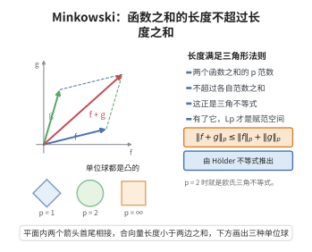

# Minkowski 不等式

> **一句话大白话**：$L^p$ 意义下的"长度"满足三角形不等式——两个函数之和的长度，不超过它们各自长度之和。
>
> **小例子**：取 $p=2$、向量 $a=(3,0)$、$b=(0,4)$，则 $\|a+b\|_2=5=\|a\|_2+\|b\|_2$；若 $a=(1,0)$、$b=(1,0)$，则 $\|a+b\|_2=2=\|a\|_2+\|b\|_2$，仍是等号。

## 介绍

Minkowski 不等式（Minkowski's inequality）是 $L^p$ 空间理论中的基本不等式，由德国数学家赫尔曼·闵可夫斯基（Hermann Minkowski）在 19 世纪末研究数的几何与凸体时提出。它断言：对 $1\le p<\infty$，

$$\|f+g\|_p\le \|f\|_p+\|g\|_p$$

这正是把 $\|\cdot\|_p$ 称为"范数"的关键一步——三角不等式成立，$L^p$ 才成为一个赋范线性空间。

Minkowski 不等式可以看成欧氏空间中三角形不等式的连续推广。当 $p=2$ 时它就是 $\sqrt{\sum(a_i+b_i)^2}\le\sqrt{\sum a_i^2}+\sqrt{\sum b_i^2}$，即勾股定理背后的三角不等式；当 $p=1$ 时它是绝对值的可加性；当 $p\to\infty$ 时它退化为一致范数的三角不等式。

该不等式是 Hölder 不等式的推论，也是证明 $L^p$ 空间完备性（Riesz–Fischer 定理）、研究傅里叶分析中的卷积估计、以及建立各种插值定理的基础工具。

## 几何直观

图意在说明：Lp 范数满足三角不等式，这正是它能被称为范数的关键一步。

## 分析

**前置依赖**：Hölder 不等式、$L^p$ 范数的定义、积分的基本性质、三角不等式。

**定理内容**：设 $1\le p<+\infty$，$f,g$ 为测度空间 $(X,\mu)$ 上的可测函数，则

$$\left(\int_X |f+g|^p\,d\mu\right)^{1/p}\le \left(\int_X |f|^p\,d\mu\right)^{1/p}+\left(\int_X |g|^p\,d\mu\right)^{1/p}$$

特别地，当 $1\le p<+\infty$ 且两侧右端有限时，$f+g\in L^p$，且 $\|f+g\|_p\le\|f\|_p+\|g\|_p$。

## 思考过程

先处理 $p=1$，此时由 $|f+g|\le|f|+|g|$ 逐点积分即得。对 $p>1$，关键是给 $|f+g|^p$ 找一个可被 Hölder 处理的分解：

$$|f+g|^p=|f+g|\cdot|f+g|^{p-1}\le |f|\cdot|f+g|^{p-1}+|g|\cdot|f+g|^{p-1}$$

对右端两项分别用 Hölder 不等式。注意 $|f+g|^{p-1}$ 要放在 $L^{q}$ 中，其中共轭指数 $q$ 满足 $\frac1p+\frac1q=1$，即 $q=\frac{p}{p-1}$；此时 $\big(|f+g|^{p-1}\big)^q=|f+g|^p$，于是这一项的 $L^q$ 范数正好是 $(\int|f+g|^p)^{1/q}$。两边提取公因子后即可得到结论。

## 证明过程

**步骤 1：$p=1$ 的情形。**

由三角不等式逐点有 $|f(x)+g(x)|\le|f(x)|+|g(x)|$，积分得 $\int|f+g|\le\int|f|+\int|g|$，即 $\|f+g\|_1\le\|f\|_1+\|g\|_1$。

**步骤 2：约定记号并排除平凡情形。**

设 $p>1$，共轭指数 $q=\frac{p}{p-1}$，满足 $\frac1p+\frac1q=1$ 与 $p-1=\frac{p}{q}$。若 $\|f+g\|_p=0$，结论显然成立；若 $\|f+g\|_p=+\infty$，则因 $|f+g|\le|f|+|g|$ 知右端有一项为 $+\infty$，结论同样成立。以下设 $0<\|f+g\|_p<\infty$。

**步骤 3：基本分解。**

由三角不等式与积的单调性，几乎处处有

$$|f+g|^p\le |f|\cdot|f+g|^{p-1}+|g|\cdot|f+g|^{p-1}$$

两边积分：

$$\int|f+g|^p\le \int |f||f+g|^{p-1}+\int |g||f+g|^{p-1}$$

**步骤 4：对两项分别用 Hölder 不等式。**

注意到 $|f+g|^{p-1}\in L^q$，因为 $\int\big(|f+g|^{p-1}\big)^q=\int|f+g|^p<\infty$。对 $f$ 与 $|f+g|^{p-1}$ 用 Hölder 不等式（指数 $p,q$）：

$$\int |f|\cdot|f+g|^{p-1}\le \|f\|_p\left(\int|f+g|^{(p-1)q}\right)^{1/q}=\|f\|_p\left(\int|f+g|^{p}\right)^{1/q}$$

同理

$$\int |g|\cdot|f+g|^{p-1}\le \|g\|_p\left(\int|f+g|^{p}\right)^{1/q}$$

**步骤 5：提取公因子并化简。**

把两式相加代回步骤 3：

$$\int|f+g|^p\le\Big(\|f\|_p+\|g\|_p\Big)\left(\int|f+g|^p\right)^{1/q}$$

因 $0<\int|f+g|^p<\infty$，两边除以 $\left(\int|f+g|^p\right)^{1/q}$：

$$\left(\int|f+g|^p\right)^{1-\frac1q}\le \|f\|_p+\|g\|_p$$

由 $1-\frac1q=\frac1p$ 得

$$\left(\int|f+g|^p\right)^{1/p}\le \|f\|_p+\|g\|_p$$

即 $\|f+g\|_p\le\|f\|_p+\|g\|_p$。证毕。

**步骤 6：取等条件（说明）。** 当 $p=1$ 时，取等当且仅当 $f$ 与 $g$ 几乎处处同号；当 $p>1$ 时，取等当且仅当 $f$ 与 $g$ 几乎处处成非负比例（即 Hölder 两步同时取等且 $f,g$ 同向）。

## 课堂问答

**老师**：$L^p$ 意义下的"长度"为什么满足三角形不等式？

**学生**：结论：对 $1\le p<\infty$，$\|f+g\|_p\le\|f\|_p+\|g\|_p$。$p=1$ 由 $|f+g|\le|f|+|g|$ 逐点积分。$p>1$ 时先分解 $|f+g|^p\le|f||f+g|^{p-1}+|g||f+g|^{p-1}$，对两项分别用 Hölder 不等式，把 $|f+g|^{p-1}$ 放进 $L^q$（$q=\frac{p}{p-1}$），提取公因子 $\left(\int|f+g|^p\right)^{1/q}$ 即得。

**老师（追问）**：$p=1$ 与 $p\to\infty$ 分别退回成什么？

**学生**：$p=1$ 就是绝对值可加性的积分形式；$p\to\infty$ 退化为一致范数的三角不等式。$p=2$ 时是欧氏空间三角形不等式的连续版本 $\|a+b\|_2\le\|a\|_2+\|b\|_2$。

**老师（拓展）**：取等条件是什么？它被用在哪些证明中？

**学生**：$p=1$ 取等当且仅当 $f$ 与 $g$ 几乎处处同号；$p>1$ 取等当且仅当两者几乎处处成非负比例。它是 $L^p$ 成为赋范线性空间的关键，并直接用于证明 Riesz–Fischer 定理（$L^p$ 的完备性）。

## 相关条目

- [Hölder不等式](./Hölder不等式.md)：Minkowski 不等式的直接来源，两者互为对偶。
- [里斯-费舍尔定理](./里斯-费舍尔定理.md)：用 Minkowski 不等式证明 $L^p$ 空间的完备性。
- [单调收敛定理](./单调收敛定理.md)：积分与极限交换的基本工具，贯穿 $L^p$ 理论的证明。
