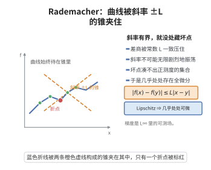

# Rademacher 定理

> **一句话大白话**：Lipschitz 函数纵使"起皱打折"，褶皱也只能落在没有体积的极小集合上——它在几乎每一点都可微。

> **小例子**：$f(x)=|x|$ 是 $\mathbb R$ 上的 Lipschitz 函数（$L=1$），它只在 $x=0$ 处不可导，而单点集的 Lebesgue 测度为 $0$，正合"几乎处处可微"。

## 介绍

经典的 Weierstrass 构造说明：连续并不蕴涵可导，甚至可以构造处处连续却处处不可导的函数。但若把条件从"连续"加强为"Lipschitz"，情形便截然不同。Hans Rademacher 于 1919 年证明：$\mathbb R^n$ 上任何 Lipschitz 函数都几乎处处可微。原因很直观——Lipschitz 条件把一切差商一致地控制在常数 $L$ 以内，函数不可能像 Weierstrass 函数那样在每一点作无限剧烈的振荡；斜率处处有界，就没有"藏不可导点"的自由度去占据正测度。

这条定理把"可微"的门槛从 $C^1$ 降到"斜率有界"，是几何测度论与非光滑分析的基石。它使 Lipschitz 函数的梯度几乎处处有定义，从而能写下面积公式、共面积公式与换元公式；在偏微分方程中，它断言空间 $W^{1,\infty}$（Lipschitz 函数的 Sobolev 等价刻画）的弱梯度几乎处处就是经典梯度；在最优传输、半凸函数与凸分析、度量测度空间理论中，它同样是梯度存在性的标准入口。

## 几何直观

图意在说明：Lipschitz 条件把差商一致压住，函数无法剧烈振荡，因而几乎处处可微。

## 分析

**前置依赖**：绝对连续函数、有界变差函数、Lebesgue单调函数可微定理、勒贝格控制收敛定理、Lebesgue 测度与零测集、可积函数的局部平均收敛性。

**定理内容**：设 $U\subseteq\mathbb R^n$ 为开集，$f:U\to\mathbb R$ 满足：存在常数 $L\ge0$，使对一切 $x,y\in U$ 有
$$
|f(x)-f(y)|\le L\,|x-y| .
$$
则 $f$ 在 $U$ 上几乎处处可微，即存在 Lebesgue 零测集 $Z\subseteq U$，使对每个 $x\in U\setminus Z$ 存在向量 $\nabla f(x)\in\mathbb R^n$，满足
$$
\lim_{h\to0}\frac{f(x+h)-f(x)-\nabla f(x)\cdot h}{|h|}=0 .
$$

证明分两层。第一层是"降维"：沿每条平行于坐标轴的直线，$f$ 自动是一维 Lipschitz 函数，从而局部绝对连续、几乎处处可导；这些一维导数拼成一个有界可测的"名义梯度" $(\partial_1f,\dots,\partial_nf)$。第二层是"回填"：把 $f(x+h)-f(x)$ 拆成 $n$ 段沿坐标方向的一维积分之和，再用可积函数的局部平均收敛性说明每段的平均值都趋于 $\partial_if(x)$，于是余项是 $|h|$ 的高阶小量。

## 思考过程

第一，为什么可以"先沿方向求导"？因为 Lipschitz 性沿直线限制后仍成立，一维 Lipschitz 函数在每个紧区间上绝对连续；由一维单调函数几乎处处可微定理（对 $g+Lt$ 用单调情形）知每条截线几乎处处可导。用 Fubini 型截面结论把这些逐点导数在 $\mathbb R^n$ 上拼成可测函数 $\partial_if$，并注意差商被 $L$ 一致控制，故 $|\partial_if|\le L$，即名义梯度属于 $L^\infty_{\mathrm{loc}}$。

第二，一维导数怎样拼成"全微分"？这是难点。多变量没有直接的牛顿—莱布尼茨公式，但可把位移 $h$ 分解为 $n$ 个坐标方向的分段，每段用一维定积分写成相应偏导数的积分。难点于是转为：这些积分的被积函数随 $h\to0$ 是否收敛到 $\partial_if(x)$。这不能逐点要求连续（$f$ 未必 $C^1$），只能要求"平均收敛"，而这正是可积函数的局部平均收敛性所保证的。

第三，为什么要强调界 $L$ 而不只是可积？因为界 $L$ 给出统一控制，使余项估计中出现的因子不依赖于具体的 $h$ 方向，从而 $O(|h|)$ 是一致成立的。这也解释了"几乎处处可微的梯度"为何是有界可测场，这一点正是 Lipschitz 情形优于一般 Sobolev 函数之处。

## 证明过程

**步骤 1：沿坐标方向的一维可微性。** 固定 $i$。记 $\hat x=(x_1,\dots,x_{i-1},x_{i+1},\dots,x_n)$，令 $g(t)=f(x_1,\dots,x_{i-1},t,x_{i+1},\dots,x_n)$。由 Lipschitz 性 $|g(s)-g(t)|\le L|s-t|$，故 $g$ 在 $I=\{t:(x_1,\dots,t,\dots,x_n)\in U\}$ 上 Lipschitz，在每个紧子区间上绝对连续。对单调不减的 $g(t)+Lt$ 应用 Lebesgue 单调函数可微定理，知 $g$ 在 $I$ 上几乎处处可导，且由差商有界知导数的绝对值不超过 $L$。由 Fubini 型截面结论，对几乎处处的 $(x,t)$ 该导数存在；令 $\partial_if$ 在可导点取值、其余点取 $0$，则 $\partial_if$ 可测且 $\|\partial_if\|_{L^\infty}\le L$，特别地 $\partial_if\in L^1_{\mathrm{loc}}(U)$。

**步骤 2：把函数差写成沿坐标方向的积分之和。** 取 $x$ 同时属于上述所有截线导数的"好集合"（有限次并集，仍几乎处处），并取 $h$ 充分小使全部线段落在 $U$ 内。沿 $e_1$ 到 $e_n$ 逐段用牛顿—莱布尼茨公式，得
$$
f(x+h)-f(x)=\sum_{k=1}^{n}\int_0^1 \partial_kf\big(x_1+h_1,\dots,x_{k-1}+h_{k-1},x_k+th_k,x_{k+1},\dots,x_n\big)\,h_k\,dt .
$$
其中第 $k$ 项正是在点 $x+h_1e_1+\cdots+h_{k-1}e_{k-1}$ 处沿 $e_k$ 方向的一维积分，逐段可加给出全差。

**步骤 3：扣除线性主部。** 令 $\nabla f(x)=(\partial_1f(x),\dots,\partial_nf(x))$。把步骤 2 的和减去 $\nabla f(x)\cdot h=\sum_k\partial_kf(x)h_k$，并记 $y_k(t)$ 为步骤 2 中第 $k$ 项的积分点，则
$$
\Big|f(x+h)-f(x)-\nabla f(x)\cdot h\Big|\le |h|\sum_{k=1}^{n}\int_0^1\big|\partial_kf(y_k(t))-\partial_kf(x)\big|\,dt .
$$
理由是每一项都含因子 $h_k$，而 $|h_k|\le|h|$。

**步骤 4：局部平均收敛推出可微。** 由可积函数的局部平均收敛性，对几乎处处的 $x$ 有
$$
\lim_{r\to0}\frac{1}{|B(x,r)|}\int_{B(x,r)}\big|\partial_kf(y)-\partial_kf(x)\big|\,dy=0,\qquad k=1,\dots,n .
$$
由于步骤 3 中所有 $y_k(t)$ 都落在球 $B(x,|h|)$ 内，把上式用于半径 $r=|h|$，即得
$$
\sum_{k=1}^{n}\int_0^1\big|\partial_kf(y_k(t))-\partial_kf(x)\big|\,dt\le C\sum_{k=1}^{n}\frac{1}{|B(x,|h|)|}\int_{B(x,|h|)}\big|\partial_kf(y)-\partial_kf(x)\big|\,dy\longrightarrow 0 .
$$
代回步骤 3 得 $\big|f(x+h)-f(x)-\nabla f(x)\cdot h\big|/|h|\to0$，即 $f$ 在 $x$ 处可微。使上述各步失效的点（截线例外点与平均收敛例外点）是至多可数个零测集之并，仍为零测集，故 $f$ 在 $U$ 上几乎处处可微。证毕。

## 课堂问答

**老师**：Weierstrass 能造出处处连续处处不可导的函数，那 Lipschitz 函数呢？

**学生**：结论：$\mathbb{R}^n$ 上任何 Lipschitz 函数都几乎处处可微。理由是差商被常数 $L$ 一致控制，斜率处处有界，就没有让不可导点占据正测度的自由度。证明分两层：先沿坐标轴降维得到一维的 a.e. 导数，拼成有界的"名义梯度" $(\partial_1f,\dots,\partial_nf)$；再用局部平均收敛把它回填成真正的全微分。

**老师（追问）**：一维导数怎样拼成多变量的全微分？难点在哪里？

**学生**：多变量没有直接可用的牛顿–莱布尼茨公式，但可把位移 $h$ 拆成 $n$ 段沿坐标方向的积分：$f(x+h)-f(x)=\sum_k\int_0^1\partial_kf(y_k(t))h_k\,dt$。减去线性主部 $\nabla f(x)\cdot h$ 后，余项被 $|h|\sum_k\int_0^1|\partial_kf(y_k(t))-\partial_kf(x)|\,dt$ 控制。难点在于被积函数未必逐点连续，只能靠可积函数的局部平均收敛性得出它是 $o(|h|)$。

**老师（拓展）**：为什么强调"界 $L$"而不是仅仅可积？

**学生**：界 $L$ 给出与点、与方向都无关的统一控制，使余项 $O(|h|)$ 一致成立，梯度是有界可测场，对应 Sobolev 空间 $W^{1,\infty}$。这正是 Lipschitz 情形优于一般 Sobolev 函数之处，也是几何测度论、最优传输、凸分析中梯度存在性的标准入口。

## 相关条目

- [Lebesgue单调函数可微定理](./Lebesgue单调函数可微定理.md)：本定理在一维截线上的核心输入，保证每条直线几乎处处可导。
- [绝对连续函数](./绝对连续函数.md)：Lipschitz 函数沿直线限制后正是绝对连续函数，牛顿—莱布尼茨公式在此适用。
- [有界变差函数](./有界变差函数.md)：Lipschitz 函数是有界变差函数的原型，二者的几乎处处可微性同源。
- [Lebesgue微分定理](../第32级-高等实分析/Lebesgue微分定理.md)：步骤 4 所依赖的局部平均收敛性的一般形式。
