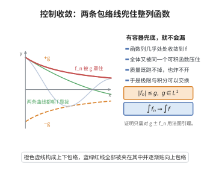

# 勒贝格控制收敛定理

> **一句话大白话**：一列函数只要处处逼近同一个极限，并且全体都被一个"总积分有限"的骨架函数罩着，那么求极限和算积分可以放心调换顺序。
>
> **小例子**：$f_n(x)=\frac{n}{1+n^2x^2}$ 被 $g(x)=\frac{1}{1+x}$ 之类的可积函数控制，于是 $\lim_n\int f_n=\int\lim_n f_n$。

## 介绍

勒贝格控制收敛定理（Lebesgue Dominated Convergence Theorem）是实分析中最重要的定理之一，也是 Lebesgue 积分理论的核心工具。它给出了积分号下取极限的充分条件：若一列可测函数 $\{f_n\}$ 几乎处处收敛于 $f$，且被一个可积函数 $g$ 控制（即 $|f_n| \le g$ 几乎处处成立），则 $f$ 可积且 $\int f_n \to \int f$。这个定理极大地推广了 Riemann 积分中的控制收敛定理，为分析学中交换极限和积分次序提供了强有力的理论依据。

## 几何直观

图意在说明：只要存在一个可积的控制函数把整列函数罩住，极限与积分就可以交换次序。

## 分析

**前置依赖**：法图引理、可测函数、勒贝格积分、可积控制函数。

**定理的精确表述**：设 $\{f_n\}$ 是可测集 $E$ 上的一列可测函数，满足：

1. $\lim_{n\to\infty} f_n(x) = f(x)$ 几乎处处在 $E$ 上成立；
2. 存在非负可积函数 $g \in L^1(E)$ 使得 $|f_n(x)| \le g(x)$ 几乎处处在 $E$ 上成立（对每个 $n$）。

则 $f$ 可积，且 $\lim_{n\to\infty} \int_E f_n(x) dx = \int_E f(x) dx$。

**关键要点**：

- 控制函数 $g$ 的存在性保证了 $\{f_n\}$ 和 $f$ 不会"爆炸"。
- 几乎处处收敛可以弱化为依测度收敛。
- 结论不仅包含极限与积分的交换，还断言 $f$ 可积。

**与 Riemann 积分的对比**：在 Riemann 积分框架下，一致收敛是保证极限与积分交换的常用充分条件。控制收敛定理用更弱的条件（逐点收敛 + 可积控制）达到了同样的效果，这充分体现了 Lebesgue 积分在处理极限问题上的优势。

## 思考过程

控制收敛定理的证明基于法图引理（Fatou's Lemma）。法图引理给出了积分与下极限的不等式关系：

$$
\int \liminf_{n\to\infty} f_n \le \liminf_{n\to\infty} \int f_n.
$$

要证明 $\int f_n \to \int f$，我们需要同时证明 $\limsup \int f_n \le \int f$ 和 $\int f \le \liminf \int f_n$。利用控制函数 $g$ 构造非负函数 $g \pm f_n \ge 0$，然后应用法图引理即可得到这两个不等式。

直观理解：控制函数 $g$ 就像一个有界的"容器"，将所有 $f_n$ 关在里面。由于 $g$ 的可积性，$f_n$ 的"质量"不会逃逸到无穷远处，因此极限函数 $f$ 的积分就是 $f_n$ 积分的极限。

## 证明过程

**证明**：由 $|f_n| \le g$ 几乎处处成立，且 $f_n \to f$ 几乎处处成立，得 $|f| \le g$ 几乎处处成立。故 $f \in L^1(E)$。

考虑函数列 $\{g - f_n\}$，它们非负几乎处处成立。由法图引理：

$$
\int_E \liminf_{n\to\infty} (g - f_n) \le \liminf_{n\to\infty} \int_E (g - f_n).
$$

由于 $f_n \to f$ 几乎处处成立，$\liminf_{n\to\infty} (g - f_n) = g - f$ 几乎处处成立。因此

$$
\int_E (g - f) \le \liminf_{n\to\infty} \int_E (g - f_n) = \int_E g + \liminf_{n\to\infty} \left(-\int_E f_n\right) = \int_E g - \limsup_{n\to\infty} \int_E f_n.
$$

消去 $\int_E g$ 得

$$
\limsup_{n\to\infty} \int_E f_n \le \int_E f. \tag{1}
$$

类似地，考虑函数列 $\{g + f_n\}$，它们也非负几乎处处成立。再次应用法图引理：

$$
\int_E \liminf_{n\to\infty} (g + f_n) \le \liminf_{n\to\infty} \int_E (g + f_n).
$$

由于 $f_n \to f$ 几乎处处成立，$\liminf_{n\to\infty} (g + f_n) = g + f$ 几乎处处成立。因此

$$
\int_E (g + f) \le \liminf_{n\to\infty} \int_E (g + f_n) = \int_E g + \liminf_{n\to\infty} \int_E f_n.
$$

消去 $\int_E g$ 得

$$
\int_E f \le \liminf_{n\to\infty} \int_E f_n. \tag{2}
$$

由 (1) 和 (2) 得

$$
\limsup_{n\to\infty} \int_E f_n \le \int_E f \le \liminf_{n\to\infty} \int_E f_n,
$$

这意味着 $\lim_{n\to\infty} \int_E f_n = \int_E f$。$\square$

**推论（有界收敛定理）**：若 $E$ 是有限测度集，$\{f_n\}$ 在 $E$ 上几乎处处收敛于 $f$，且存在常数 $M$ 使得 $|f_n| \le M$ 几乎处处成立，则 $\int_E f_n \to \int_E f$。

**证明**：取 $g(x) \equiv M$，由于 $m(E) < \infty$，$g \in L^1(E)$，直接应用控制收敛定理即可。$\square$

## 课堂问答

**老师**：什么条件下可以把求极限与算积分放心交换？

**学生**：结论：若 $f_n\to f$ 几乎处处且存在可积函数 $g$ 使 $|f_n|\le g$ 几乎处处，则 $f$ 可积且 $\int f_n\to\int f$。证明把法图引理分别用在 $g-f_n\ge0$ 与 $g+f_n\ge0$ 上，得 $\limsup\int f_n\le\int f$ 与 $\int f\le\liminf\int f_n$，两边夹逼即等号。

**老师（追问）**：控制函数 $g$ 为什么不可缺少？去掉会怎样？

**学生**：没有 $g$，质量会"逃逸"：如 $f_n=n\chi_{(0,1/n)}$ 或 $\frac1n\chi_{(0,n)}$ 都满足 $f_n\to0$，但积分不趋于 $0$。$g$ 的可积性保证质量不能跑到无穷远处，这是结论成立的关键假设。

**老师（拓展）**：它与有界收敛、Riemann 积分的情形有什么联系？

**学生**：若 $E$ 有限测度且 $|f_n|\le M$，取 $g\equiv M$ 即得"有界收敛定理"。它比 Riemann 积分理论中要求一致收敛的条件弱得多，体现了 Lebesgue 积分在极限问题上的优势；此外 a.e. 收敛还可弱化为依测度收敛而结论不变。
