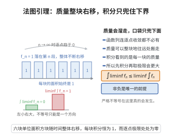

# 法图引理

> **一句话大白话**：对非负函数列，"先取极限再积分"的结果不会比"先积分再取极限"更大——积分这只口袋从下面兜住，只能把极限漏小、不会漏大。
>
> **小例子**：对 $f_n\ge 0$ 恒有 $\int \liminf f_n \le \liminf \int f_n$；例如 $f_n=1_{\text{浓集}}$ 时不等号可为严格小于。

## 介绍

法图引理（Fatou's Lemma）是 Lebesgue 积分理论中的一个基本不等式，它给出了非负可测函数列的下极限的积分与积分下极限之间的关系：$\int \liminf_{n\to\infty} f_n \le \liminf_{n\to\infty} \int f_n$。这个引理是证明勒贝格控制收敛定理的关键工具，也是分析学中处理极限与积分交换次序问题的基础。法图引理适用于非负可测函数，不需要任何收敛性假设，因此具有广泛的应用。

## 几何直观

图意在说明：质量可以整块逃向远处，逐点极限看不到它，于是积分下极限严格大于极限的积分。

## 分析

**前置依赖**：单调收敛定理、非负可测函数、下极限、积分的单调性。

**定理的精确表述**：设 $\{f_n\}$ 是可测集 $E$ 上的一列非负可测函数，则

$$
\int_E \liminf_{n\to\infty} f_n(x) dx \le \liminf_{n\to\infty} \int_E f_n(x) dx.
$$

**关键要点**：

- 函数列 $\{f_n\}$ 可以逐点发散，甚至可以在某些点趋于无穷大。
- 不等号可能是严格的，例如 $f_n(x) = \chi_{(n,n+1)}$ 在 $\mathbb{R}$ 上，$\liminf f_n = 0$，$\int \liminf f_n = 0$，但 $\liminf \int f_n = 1$。
- 法图引理给出了一个下界，而不是等式。

**与单调收敛定理的关系**：法图引理可以看作是单调收敛定理的推论，反过来也可以用来证明单调收敛定理。它们与勒贝格控制收敛定理一起构成了 Lebesgue 积分理论中交换极限与积分的三大基本定理。

## 思考过程

法图引理的证明利用了单调收敛定理。核心思想是将 $\liminf_{n\to\infty} f_n$ 表示为单调递增函数列的极限。具体地，定义 $g_n(x) = \inf_{k \ge n} f_k(x)$，则 $\{g_n\}$ 是单调递增的非负可测函数列，且 $\lim_{n\to\infty} g_n = \liminf_{n\to\infty} f_n$。由单调收敛定理，$\int \liminf f_n = \lim \int g_n$。而 $g_n \le f_n$（因为 $g_n$ 是下确界），故 $\int g_n \le \int f_n$，从而 $\lim \int g_n \le \liminf \int f_n$。

这个技巧——将 $\liminf$ 转化为单调递增函数列的极限——是分析学中处理下极限问题的标准方法。

## 证明过程

**证明**：对每个 $n \in \mathbb{N}$，定义

$$
g_n(x) = \inf_{k \ge n} f_k(x), \quad x \in E.
$$

则 $\{g_n\}$ 是一列非负可测函数，且 $g_1 \le g_2 \le \cdots$（单调递增）。由 $\liminf$ 的定义，

$$
\lim_{n\to\infty} g_n(x) = \sup_{n \ge 1} \inf_{k \ge n} f_k(x) = \liminf_{n\to\infty} f_n(x).
$$

由单调收敛定理，

$$
\int_E \liminf_{n\to\infty} f_n = \int_E \lim_{n\to\infty} g_n = \lim_{n\to\infty} \int_E g_n. \tag{1}
$$

由于 $g_n(x) = \inf_{k \ge n} f_k(x) \le f_n(x)$ 对每个 $x \in E$ 成立，由积分的单调性，

$$
\int_E g_n \le \int_E f_n.
$$

因此

$$
\lim_{n\to\infty} \int_E g_n \le \liminf_{n\to\infty} \int_E f_n. \tag{2}
$$

结合 (1) 和 (2) 即得

$$
\int_E \liminf_{n\to\infty} f_n \le \liminf_{n\to\infty} \int_E f_n. \square
$$

**反向法图引理**：若 $\{f_n\}$ 是可测集 $E$ 上的一列可测函数，且存在可积函数 $g$ 使得 $f_n \le g$ 几乎处处成立，则

$$
\int_E \limsup_{n\to\infty} f_n \ge \limsup_{n\to\infty} \int_E f_n.
$$

**证明**：考虑函数列 $\{g - f_n\}$，它们非负。由法图引理，

$$
\int_E \liminf_{n\to\infty} (g - f_n) \le \liminf_{n\to\infty} \int_E (g - f_n).
$$

由于 $\liminf (g - f_n) = g - \limsup f_n$，且 $\liminf \int (g - f_n) = \int g - \limsup \int f_n$，代入即得

$$
\int_E (g - \limsup f_n) \le \int_E g - \limsup \int_E f_n,
$$

整理得 $\int_E \limsup f_n \ge \limsup \int_E f_n$。$\square$

## 课堂问答

**老师**：对非负函数列，$\int\liminf f_n$ 与 $\liminf\int f_n$ 哪个大？

**学生**：结论：$\int_E\liminf_{n}f_n\le\liminf_{n}\int_E f_n$，方向不能反过来。证法是令 $g_n=\inf_{k\ge n}f_k$，它非负、递增且趋于 $\liminf f_n$；由单调收敛定理 $\int\liminf f_n=\lim\int g_n$，又 $g_n\le f_n$ 得 $\lim\int g_n\le\liminf\int f_n$。

**老师（追问）**：不等号能严格吗？举个数例。

**学生**：能。取 $f_n=\chi_{(n,n+1)}$ 在 $\mathbb{R}$ 上，则 $\liminf f_n=0$，故 $\int\liminf f_n=0$；但每个 $\int f_n=1$，故 $\liminf\int f_n=1$。质量"跑到无穷远"就制造出严格不等，这说明法图引理只给下界、不给等式。

**老师（拓展）**：反向法图引理是什么条件？它和控制收敛定理有何关系？

**学生**：若存在可积函数 $g$ 使 $f_n\le g$ 几乎处处，则由 $g-f_n\ge0$ 得 $\int\limsup f_n\ge\limsup\int f_n$。把法图引理分别用在 $g-f_n$ 与 $g+f_n$ 上，正反两条合起来恰好构成控制收敛定理的证明骨架。
